# Spring & Spring Boot — Interview Questions and Answers (Zero Duplicates)

This document is a comprehensive interview preparation guide for Java Backend Developers.
All questions have been audited and organized by interview priority with zero duplicate entries.

Questions are arranged into 4 priority tiers:
- **Priority 1 — Must Know (18 Questions):** Fundamental core concepts expected in every backend interview.
- **Priority 2 — High Priority (16 Questions):** Practical, architecture, and production engineering questions.
- **Priority 3 — Important (10 Questions):** Deeper framework internals, bean mechanics, and language integrations.
- **Priority 4 — Advanced (7 Questions):** Reactive programming (WebFlux), performance testing, and candidate coding logs.

---

# Priority 1 — Must Know

## Topic: Inversion of Control & Dependency Injection

### Q540 — What is IOC in Spring

**Interview Answer (Short):**
Inversion of Control (IoC) is an architectural design principle where the control of object creation, configuration, and lifecycle management is transferred from the application code to a framework or container. Instead of a class instantiating its own dependencies using `new OrderRepository()`, the Spring IoC container creates the dependencies and injects them when needed.

**Detailed Explanation:**
In traditional programming, when class `A` depends on class `B`, `A` directly instantiates `B` (`private B b = new B()`). This creates tight coupling, makes unit testing difficult (you cannot easily mock `B`), and makes changing implementations hard. 

With Inversion of Control, the "control" is inverted. The Spring container acts as an assembler:
1. It scans your application for components (`@Component`, `@Service`, `@Repository`).
2. It instantiates these classes.
3. It resolves the dependencies required by each class and provides ("injects") them.
4. It manages their full lifecycle from creation to destruction.

**How It Works:**
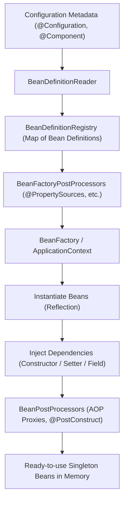

**Java / Spring Boot Example:**
```java
// Traditional tight coupling (Without IoC):
public class OrderService {
    private final PaymentProcessor paymentProcessor;
    
    public OrderService() {
        // OrderService tightly controls which implementation is used
        this.paymentProcessor = new StripePaymentProcessor();
    }
}

// Inverted control with Spring IoC (Decoupled):
@Service
public class OrderService {
    private final PaymentProcessor paymentProcessor;

    // Spring IoC container creates and injects PaymentProcessor here
    public OrderService(PaymentProcessor paymentProcessor) {
        this.paymentProcessor = paymentProcessor;
    }
}
```

**Real-World Usage:**
In production microservices, IoC allows replacing a real payment gateway (`StripePaymentProcessor`) with a mock implementation (`MockPaymentProcessor`) in test environments without modifying a single line of `OrderService`.

**Common Follow-up Questions:**
- What is the difference between IoC and Dependency Injection (DI)?
- Which core interfaces represent the Spring IoC container? (`BeanFactory` vs `ApplicationContext`)

**Interview Tip:**
Always clarify that IoC is the *general principle* (the concept of giving up control of dependencies to a framework), while Dependency Injection (DI) is the *specific design pattern* Spring uses to achieve IoC.


---

### Q479 — Explain Dependency injection in springboot ? which is best ?

**Interview Answer (Short):**
In Spring Boot, Dependency Injection is implemented primarily via **Constructor Injection**, **Setter Injection**, or **Field Injection**. 

**Constructor Injection is unequivocally the best** because:
1. It allows fields to be declared `final`, ensuring **immutability**.
2. It prevents `NullPointerException` by ensuring an object cannot be created in an incomplete state.
3. It makes unit testing straightforward without needing Spring test runners or Mockito reflection hacks.
4. It avoids hidden dependencies.

**Detailed Explanation:**
Many developers start with Field Injection (`@Autowired private MyService myService;`) because it requires fewer lines of code. However, this is an anti-pattern:
- **Coupling to Container:** You cannot instantiate the class in a plain unit test (`new MyController()`) without Mockito's `@InjectMocks` or Spring's `ReflectionTestUtils`.
- **Violation of Single Responsibility:** It is easy to add 15 `@Autowired` fields without realizing the class is doing too much. With constructor injection, a 15-parameter constructor immediately signals code smell.
- **Circular Dependencies Masking:** Field injection masks circular dependencies until runtime methods are called, whereas constructor injection fails fast at startup.

**How It Works:**
Since Spring 4.3, if a class has a single constructor, Spring automatically treats it as the injection point—the `@Autowired` annotation is completely optional.

In modern Spring Boot with Lombok, you typically write:
```java
@Service
@RequiredArgsConstructor // Generates constructor for all final fields
public class OrderProcessingService {
    private final OrderRepository orderRepository;
    private final PaymentClient paymentClient;
    private final NotificationService notificationService;
}
```

**Java / Spring Boot Example:**
```java
@Service
public class CustomerService {
    private final CustomerRepository customerRepository;
    private final EmailService emailService;

    // Best Practice: Explicit constructor injection with final fields
    public CustomerService(CustomerRepository customerRepository, EmailService emailService) {
        this.customerRepository = Objects.requireNonNull(customerRepository, "customerRepository must not be null");
        this.emailService = Objects.requireNonNull(emailService, "emailService must not be null");
    }

    public void registerCustomer(String email, String name) {
        Customer customer = customerRepository.save(new Customer(email, name));
        emailService.sendWelcomeEmail(customer.getEmail());
    }
}
```

**Real-World Usage:**
All enterprise production applications mandate constructor injection via static analysis rules (such as SonarQube or ArchUnit) to prohibit field injection across the codebase.

**Common Follow-up Questions:**
- How do you handle optional dependencies with constructor injection? (Pass `Optional<MyService>` as constructor argument, or use `@Autowired(required = false)` on a setter).

**Interview Tip:**
Mention that starting with Spring Boot 2.6+, circular dependencies in constructor injection are rejected by default at startup (`BeanCurrentlyInCreationException`), which forces developers to design clean, acyclic architectures.


---

### Q518 — what is @Autowired?

**Interview Answer (Short):**
`@Autowired` is a Spring annotation used to mark a dependency to be resolved and injected automatically by the Spring container by type. It can be applied on constructors, setter methods, config methods, and fields.

**Detailed Explanation:**
The `@Autowired` annotation is processed by Spring's `AutowiredAnnotationBeanPostProcessor`. 

Key attributes and rules of `@Autowired`:
- **`required` attribute (default `true`):** If Spring cannot find a matching bean, the application fails to start. Setting `@Autowired(required = false)` allows the field to remain `null` or empty.
- **Can inject collections:** You can autowire `List<MyPlugin>` or `Map<String, MyPlugin>`. Spring will collect all beans of type `MyPlugin` and inject them as a list, or as a map where keys are bean names.
- **Can inject `Optional<T>`:** In Java 8+, you can inject `Optional<MyService>` to handle optional beans cleanly.

**Java / Spring Boot Example:**
```java
@Service
public class ReportGenerator {

    // 1. Optional dependency via required = false
    @Autowired(required = false)
    private WatermarkService watermarkService;

    // 2. Injecting a collection of strategy implementations
    private final List<ExportFormatter> formatters;

    @Autowired
    public ReportGenerator(List<ExportFormatter> formatters) {
        this.formatters = formatters;
    }

    public void generateReport(ReportData data, String format) {
        ExportFormatter formatter = formatters.stream()
                .filter(f -> f.supports(format))
                .findFirst()
                .orElseThrow(() -> new IllegalArgumentException("Unsupported format: " + format));
        
        formatter.format(data);
    }
}
```

**Common Follow-up Questions:**
- What is the difference between `@Autowired` (Spring) and `@Inject` (JSR-330)? (`@Autowired` has the `required` flag; `@Inject` is standard Jakarta/Java specification).
- What is the difference between `@Autowired` and `@Resource`? (`@Autowired` binds by type; `@Resource` binds by name first, then by type).

**Interview Tip:**
Always note that while `@Autowired` on fields is very common in tutorials, constructor injection without `@Autowired` is the modern standard for production code.


---

## Topic: Spring Beans, Scopes & Lifecycle

### Q489 — What is bean?

**Interview Answer (Short):**
A Spring Bean is simply a Java object that is instantiated, configured, assembled, and fully managed by the Spring IoC container. Unlike normal Java objects created using `new`, a bean lives within the container's lifecycle, benefits from dependency injection, and can have cross-cutting features like transactions and security applied to it automatically.

**Detailed Explanation:**
In a standard Java application, developers control object lifecycle using `new MyService()`. In a Spring application, control is surrendered to the Spring IoC container (`BeanFactory` or `ApplicationContext`). 

A Java class becomes a Spring Bean when:
1. It is declared with a stereotype annotation (`@Component`, `@Service`, `@Repository`, `@Controller`).
2. It is returned from a `@Bean` method inside a `@Configuration` class.
3. It is explicitly registered via XML or runtime programmatic registration (`GenericApplicationContext.registerBean()`).

The Spring container maintains metadata for every bean in a `BeanDefinition` object, recording its class name, scope, constructor arguments, autowiring rules, and lifecycle callbacks.

**How It Works:**
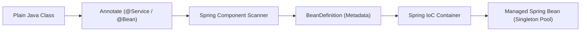

**Java / Spring Boot Example:**
```java
// Not a Spring bean (Manual instantiation, no DI, no AOP)
public class UnmanagedClient {
    public void execute() { ... }
}

// Managed Spring Bean (Container controls lifecycle and dependencies)
@Component
public class ManagedOrderProcessor {
    private final PaymentClient paymentClient;

    public ManagedOrderProcessor(PaymentClient paymentClient) {
        this.paymentClient = paymentClient;
    }

    public void process(Order order) {
        paymentClient.charge(order);
    }
}
```

**Real-World Usage:**
In real backend systems, almost all long-lived service objects—repositories, controllers, caching clients, database connection managers, and security filters—are Spring Beans. Short-lived domain models and DTOs (e.g., `UserDto`, `OrderRequest`) are plain objects and are *not* Spring beans.

**Interview Tip:**
Interviewers often ask: *"Is a JPA Entity (like `@Entity class User`) a Spring Bean?"* Always answer: **No.** JPA entities are domain objects managed by Hibernate/JPA EntityManager, not by the Spring IoC container.


---

### Q482 — What is bean and its scope?

**Interview Answer (Short):**
A Spring Bean is a container-managed object. Its **scope** defines the lifecycle and visibility of that bean instance within the application context. 

Spring supports six scopes:
1. **singleton (Default):** Exactly one instance per Spring IoC container.
2. **prototype:** A new instance is created every time the bean is requested.
3. **request (Web):** One instance per HTTP request lifecycle.
4. **session (Web):** One instance per HTTP Session.
5. **application (Web):** One instance per `ServletContext`.
6. **websocket (Web):** One instance per WebSocket lifecycle.

**Detailed Explanation:**

### Comparison of Spring Bean Scopes:

| Scope | Number of Instances | Thread Safety Consideration | Use Case |
| :--- | :--- | :--- | :--- |
| **singleton** (default) | 1 per `ApplicationContext` | **Must be stateless** (shared across all threads) | Services, Repositories, Controllers |
| **prototype** | 1 per injection / `getBean()` call | Caller is responsible for state/destruction | Stateful builders, parsers, temporary workers |
| **request** | 1 per HTTP request | Thread-safe per request thread | Request headers, audit logging context, user IP tracking |
| **session** | 1 per HTTP session | Bound to single user session | User cart, authenticated user session profile |
| **application**| 1 per `ServletContext` | Shared across web apps in same container | Global web application metadata |
| **websocket**  | 1 per WebSocket session | Bound to active socket connection | Live chat session state |

**How It Works:**
When you declare `@Scope("prototype")`, Spring executes the full initialization phase (instantiation, injection, `@PostConstruct`), but it does **not** store the instance in its singleton cache. Furthermore, Spring does **not** manage the destruction lifecycle of prototype beans—the caller must clean them up.

**Java / Spring Boot Example:**
```java
// Singleton (Default, stateless, shared)
@Service
public class OrderService { ... }

// Prototype (New instance on every injection or getBean() call)
@Component
@Scope(ConfigurableBeanFactory.SCOPE_PROTOTYPE)
public class TokenGenerator {
    private final String seed = UUID.randomUUID().toString();
    public String generate() { return seed + "-" + System.currentTimeMillis(); }
}

// Request Scope (Web context only)
@Component
@RequestScope // Equivalent to @Scope(value = WebApplicationContext.SCOPE_REQUEST, proxyMode = ScopedProxyMode.TARGET_CLASS)
public class RequestContext {
    private String correlationId;
    public String getCorrelationId() { return correlationId; }
    public void setCorrelationId(String id) { this.correlationId = id; }
}
```

**Interview Tip:**
Be ready for the classic trap: *"What happens if you inject a prototype bean into a singleton bean?"* 
Because the singleton bean is only instantiated once, the prototype bean is also injected **only once at startup**! To get a new prototype instance every time, use `@Lookup` or inject an `ObjectProvider<PrototypeBean>`.


---

### Q469 — Explain Spring Bean life cycle?

**Interview Answer (Short):**
The Spring Bean lifecycle represents the complete journey of a bean managed by the Spring container:
1. **Instantiation:** Spring creates the instance via reflection using its constructor.
2. **Populating Properties:** Injects dependencies (Constructor, Setter, or Field).
3. **Aware Interfaces:** Injects infrastructure hooks like `BeanNameAware` and `ApplicationContextAware`.
4. **Pre-Initialization:** `BeanPostProcessor.postProcessBeforeInitialization` (triggers `@PostConstruct`).
5. **Initialization:** `InitializingBean.afterPropertiesSet()` and custom `init-method`.
6. **Post-Initialization:** `BeanPostProcessor.postProcessAfterInitialization` (generates AOP dynamic proxies).
7. **Ready for Use:** Serves application requests.
8. **Destruction:** On container shutdown, triggers `@PreDestroy`, `DisposableBean.destroy()`, and custom `destroy-method`.

**Detailed Explanation:**
Spring allows developers to plug custom behavior into several lifecycle checkpoints:
- **`@PostConstruct` / `@PreDestroy`:** Standard JSR-250 annotations (recommended approach).
- **`InitializingBean` / `DisposableBean`:** Spring interface contracts (couples your code to Spring interfaces).
- **`@Bean(initMethod = "...", destroyMethod = "...")`:** Programmatic declaration, especially useful when configuring third-party libraries where you cannot modify the source code to add annotations.

**Order of Initialization Callbacks:**
1. Method annotated with `@PostConstruct`.
2. `InitializingBean.afterPropertiesSet()`.
3. Custom `initMethod` declared in `@Bean(initMethod = "init")`.

**Order of Destruction Callbacks:**
1. Method annotated with `@PreDestroy`.
2. `DisposableBean.destroy()`.
3. Custom `destroyMethod` declared in `@Bean(destroyMethod = "cleanup")`.

**Java / Spring Boot Example:**
```java
@Component
public class CacheWarmupService implements InitializingBean, DisposableBean {

    private final ConnectionPool connectionPool;

    public CacheWarmupService(ConnectionPool connectionPool) {
        this.connectionPool = connectionPool;
        System.out.println("Phase 1: Instantiation & Dependency Injection");
    }

    @PostConstruct
    public void initAnnotation() {
        System.out.println("Phase 2a: @PostConstruct executed");
    }

    @Override
    public void afterPropertiesSet() {
        System.out.println("Phase 2b: InitializingBean.afterPropertiesSet executed");
    }

    @PreDestroy
    public void preDestroyAnnotation() {
        System.out.println("Phase 3a: @PreDestroy executed");
    }

    @Override
    public void destroy() {
        System.out.println("Phase 3b: DisposableBean.destroy executed");
    }
}
```

**Common Follow-up Questions:**
- Can we perform database queries inside a constructor? (No, dependencies might not be fully wired and AOP proxies are not yet created; use `@PostConstruct` instead).

**Interview Tip:**
Emphasize that `@PostConstruct` is the correct place for warm-up logic (e.g. loading static caches, validating configs), **not the constructor**.


---

## Topic: Core Stereotypes & Component Scanning

### Q473 — Difference between @Bean and @Component

**Interview Answer (Short):**
`@Component` is a **class-level** annotation used for auto-detecting and registering beans using classpath scanning. 

`@Bean` is a **method-level** annotation used inside `@Configuration` classes to explicitly instantiate, configure, and return a bean. `@Bean` is primarily used when configuring third-party library classes whose source code you do not own.

**Detailed Explanation:**

### Comparison Table: @Component vs @Bean

| Feature | `@Component` | `@Bean` |
| :--- | :--- | :--- |
| **Target Level** | Class level | Method level |
| **Where Declared** | On your custom classes | Inside `@Configuration` classes |
| **Discovery Mechanism** | Automatic via Component Scanning | Explicit invocation of the method |
| **Source Code Access** | Requires modifying the class source code | Works with external / third-party classes |
| **Custom Initialization** | Via `@PostConstruct` / `@PreDestroy` | Supports `initMethod` and `destroyMethod` attributes |
| **Typical Usage** | Services, Repositories, Controllers | `ObjectMapper`, `RestTemplate`, `DataSource` |

**Java / Spring Boot Example:**
```java
// 1. Using @Component (You own the class source code)
@Component
public class EmailNotificationSender {
    public void sendEmail(String to, String msg) { ... }
}

// 2. Using @Bean (Third-party class: com.fasterxml.jackson.databind.ObjectMapper)
@Configuration
public class JacksonConfig {

    @Bean
    public ObjectMapper customObjectMapper() {
        ObjectMapper mapper = new ObjectMapper();
        mapper.configure(DeserializationFeature.FAIL_ON_UNKNOWN_PROPERTIES, false);
        return mapper;
    }
}
```

**Real-World Usage:**
In real-world projects, 90% of business classes use `@Component` (or its stereotypes like `@Service`, `@Repository`). `@Bean` is used exclusively for infrastructure configuration: registering AWS SDK clients, database connection pools (`HikariDataSource`), Redis templates, and external HTTP clients.

**Interview Tip:**
If an interviewer asks: *"Can you place `@Component` on a class inside an external JAR library?"* 
Answer: *"No, because external JAR classes are compiled bytecode and cannot be edited. You must use `@Bean` inside a `@Configuration` class to instantiate and expose it."*


---

### Q556 — Difference between @Component, @Service, and @Repository.

**Interview Answer (Short):**
While `@Component`, `@Service`, and `@Repository` all register a Spring bean via component scanning:
- **`@Component`:** Generic stereotype for any container-managed component.
- **`@Service`:** Indicates business logic and domain processing; typically the target for transaction boundaries (`@Transactional`).
- **`@Repository`:** Indicates data access and persistence; **specifically enables automatic database exception translation** (`PersistenceExceptionTranslationPostProcessor`).

**Detailed Explanation:**

### Comparison Table:

| Annotation | Architectural Layer | Primary Responsibility | Special Framework Behavior |
| :--- | :--- | :--- | :--- |
| **`@Component`** | Any | Generic utility, scheduler, listener | Standard bean management only |
| **`@Service`** | Business Layer | Executes domain logic, coordinates workflows | Semantic indicator; common AOP pointcut target |
| **`@Repository`** | Data Access Layer | CRUD operations, queries on database | **Catches vendor-specific exceptions (SQLException, HibernateException) and rethrows them as unchecked Spring `DataAccessException`** |

**How Persistence Exception Translation Works:**
If your DAO throws a vendor-specific `org.hibernate.exception.ConstraintViolationException` or `java.sql.SQLException`, Spring intercepts it and translates it to `org.springframework.dao.DataIntegrityViolationException`. This prevents your service and web layers from leaking vendor-specific persistence details.

**Java / Spring Boot Example:**
```java
// 1. Data Access Layer
@Repository
public class JpaAccountRepository implements AccountRepository {
    @PersistenceContext
    private EntityManager entityManager;

    public Account findById(Long id) {
        return entityManager.find(Account.class, id); // SQL exceptions automatically translated!
    }
}

// 2. Business Logic Layer
@Service
public class AccountTransferService {
    private final AccountRepository accountRepository;

    public AccountTransferService(AccountRepository accountRepository) {
        this.accountRepository = accountRepository;
    }

    @Transactional
    public void transfer(Long fromId, Long toId, BigDecimal amount) { ... }
}

// 3. Generic Component
@Component
public class SystemHeartbeatScheduler {
    @Scheduled(fixedRate = 60000)
    public void ping() { ... }
}
```

**Interview Tip:**
Interviewers specifically look for the keyword: **"PersistenceExceptionTranslationPostProcessor"**. If you mention that `@Repository` translates JDBC/Hibernate exceptions into Spring's `DataAccessException` hierarchy, you demonstrate deep framework knowledge.


---

### Q566 — Can use @service and @component interchangeably?

**Interview Answer (Short):**
Technically, **yes**, `@Service` and `@Component` can be used interchangeably without causing runtime errors because `@Service` is meta-annotated with `@Component`. 

However, architecturally, **no**, they should not be used interchangeably because it violates the principle of separation of concerns and impairs readability, maintainability, and AOP pointcut definitions.

**Detailed Explanation:**
If you replace `@Service` with `@Component` on `OrderService`:
- The application will compile and start without error.
- Dependency injection will function as expected.
- All transactional annotations (`@Transactional`) will still work if configured.

**Why you should NEVER interchange them in practice:**
1. **Loss of Architecture Clarity:** A developer looking at `@Component class OrderServiceImpl` cannot tell whether it is a business service, a technical helper, an event subscriber, or a background worker.
2. **AOP Aspect Failures:** Many enterprise applications apply aspects (like execution time monitoring, performance logging, or authorization checks) specifically to `@Service` classes:
   ```java
   @Around("@within(org.springframework.stereotype.Service)")
   public Object monitorServicePerformance(ProceedingJoinPoint joinPoint) throws Throwable { ... }
   ```
   If a developer marks a service with `@Component`, that service silently escapes monitoring.

**Interview Tip:**
Give a two-part answer: First address technical functionality (*"Yes, the Spring IoC container handles both identically"*), then address enterprise engineering standards (*"However, in production code, it is an architectural anti-pattern to interchange them"*).


---

### Q557 — @Primary vs @Qualifier in spring

**Interview Answer (Short):**
`@Primary` sets a default bean among multiple candidates at the **declaration level**, while `@Qualifier` selects a specific bean by name at the **injection point**. If both are present, `@Qualifier` takes precedence.

**Detailed Explanation:**

### Comparison Summary:
- **`@Primary`:** *"If nobody asks for a specific implementation, use me by default."*
- **`@Qualifier`:** *"Regardless of any defaults, inject the bean named exactly 'xyz' here."*

**Code Demonstration:**
```java
public interface AlertService { void alert(String msg); }

@Component
@Primary
public class SlackAlertService implements AlertService { ... }

@Component("pagerDuty")
public class PagerDutyAlertService implements AlertService { ... }

@Service
public class MonitoringService {
    // 1. Receives SlackAlertService (resolved via @Primary)
    @Autowired
    private AlertService standardAlert;

    // 2. Receives PagerDutyAlertService (resolved via @Qualifier overriding @Primary)
    @Autowired
    @Qualifier("pagerDuty")
    private AlertService criticalAlert;
}
```

**Interview Tip:**
Point out that using `@Primary` is ideal when introducing a new default implementation (like a Redis cache over an In-Memory cache) without having to touch every injection site in existing code.


---

## Topic: Spring Boot Core & Auto-Configuration

### Q475 — What is Spring Boot, and why choose Spring Boot over Spring Core?

**Interview Answer (Short):**
Spring Boot is an opinionated, production-ready extension of the Spring Framework designed to eliminate boilerplate configuration. 

We choose Spring Boot over Spring Core because:
1. **Auto-Configuration:** Automatically configures beans based on JAR dependencies present on the classpath.
2. **Starter Dependencies:** Curated dependency bundles that eliminate version mismatches.
3. **Embedded Web Servers:** Embeds Tomcat, Jetty, or Undertow, creating a standalone runnable JAR (`java -jar app.jar`) without requiring an external servlet container.
4. **Production Readiness:** Out-of-the-box monitoring, metrics, and health checks via Spring Boot Actuator.

**Detailed Explanation:**

### Comparison Table: Spring Core vs Spring Boot

| Feature | Spring Core / Spring Framework | Spring Boot |
| :--- | :--- | :--- |
| **Philosophy** | Unopinionated, maximum flexibility | Opinionated, convention-over-configuration |
| **Configuration** | Heavy manual XML or `@Configuration` boilerplate | Automatic via `@EnableAutoConfiguration` |
| **Deployment** | Requires deploying WAR to standalone Tomcat/WildFly | Standalone executable JAR with embedded Tomcat |
| **Dependency Management**| Manual dependency declarations with version conflicts | Curated Starter POMs (`spring-boot-starter-web`) |
| **Monitoring** | Requires manual JMX/logging setup | Built-in Actuator endpoints (`/actuator/health`, `/metrics`) |
| **Time to Market** | Days to set up and wire properly | Minutes from initial generation |

**Java / Spring Boot Example:**
In Spring Core, setting up a web app required writing `web.xml`, configuring `DispatcherServlet`, setting up `InternalResourceViewResolver`, and wiring `JacksonHttpMessageConverter`.

In Spring Boot, a single dependency and class is all you need:
```xml
<!-- In pom.xml: Spring Boot Starter web pulls in Tomcat, Spring MVC, Jackson, and Validation -->
<dependency>
    <groupId>org.springframework.boot</groupId>
    <artifactId>spring-boot-starter-web</artifactId>
</dependency>
```

```java
// Complete Spring Boot application:
@SpringBootApplication
@RestController
public class Application {
    @GetMapping("/hello")
    public String hello() { return "Hello, World!"; }

    public static void main(String[] args) {
        SpringApplication.run(Application.class, args);
    }
}
```

**Real-World Usage:**
Virtually all modern Java microservices and enterprise backends are built on Spring Boot because it allows developers to focus purely on business logic rather than infrastructure wiring.

**Interview Tip:**
Do not say *"Spring Boot replaces Spring Framework."* Spring Boot **is built on top of** Spring Framework. It uses the same Spring IoC container, Spring MVC, and Spring Data under the hood.


---

### Q526 — @springbootapplication annotation explain the working.

**Interview Answer (Short):**
`@SpringBootApplication` works by triggering a three-phase bootstrap when `SpringApplication.run()` is called:
1. It registers the annotated class as a Spring `@Configuration` source.
2. It activates `@ComponentScan` from the base package downwards, discovering all application components.
3. It triggers `@EnableAutoConfiguration`, which reads configuration factories from `META-INF/spring/org.springframework.boot.autoconfigure.AutoConfiguration.imports`, evaluates conditional annotations (`@ConditionalOnClass`, `@ConditionalOnMissingBean`), and registers pre-configured framework beans.

**Detailed Explanation:**
Here is what happens step by step when you run `@SpringBootApplication`:

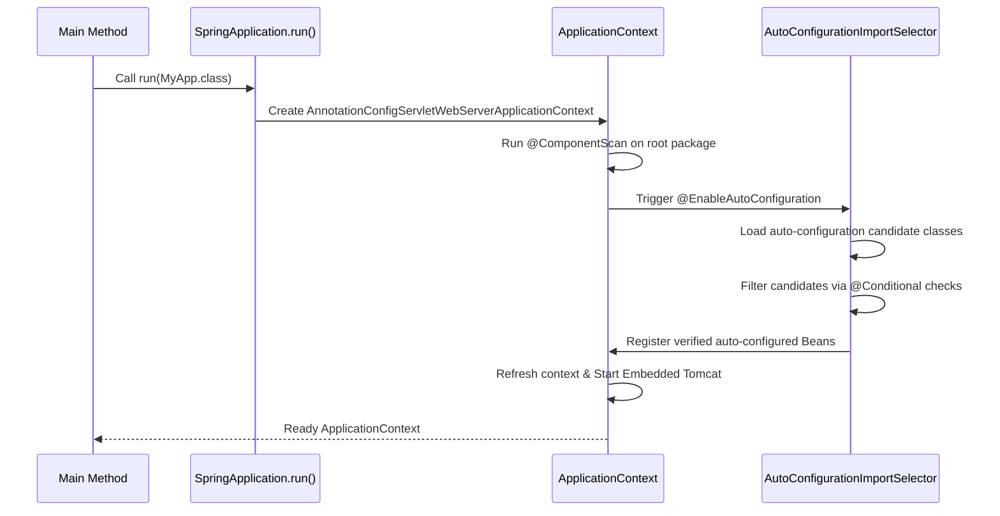

### The Auto-configuration Import Phase:
`@EnableAutoConfiguration` imports the `AutoConfigurationImportSelector`. 
In Spring Boot 3+, it reads candidate auto-configuration classes from:
`META-INF/spring/org.springframework.boot.autoconfigure.AutoConfiguration.imports`

Each candidate class is inspected:
- Does it meet `@ConditionalOnClass`? (Are required classes present on the classpath?)
- Does it meet `@ConditionalOnMissingBean`? (Has the developer NOT already defined their own bean?)
- Does it meet `@ConditionalOnProperty`? (Is the feature enabled in properties?)

If all conditions pass, Spring Boot instantiates and registers the auto-configured beans.

**Java / Spring Boot Example:**
```java
// Excluding unwanted auto-configuration:
@SpringBootApplication(exclude = {
    DataSourceAutoConfiguration.class,
    SecurityAutoConfiguration.class
})
public class LightweightApp {
    public static void main(String[] args) {
        SpringApplication.run(LightweightApp.class, args);
    }
}
```

**Interview Tip:**
Knowing the exact location of auto-configuration definitions (`META-INF/spring/org.springframework.boot.autoconfigure.AutoConfiguration.imports` in Spring Boot 3 vs `spring.factories` in Spring Boot 2) demonstrates current, up-to-date knowledge.


---

### Q559 — Explain spring boot auto configuration.

**Interview Answer (Short):**
Spring Boot Auto-Configuration is an intelligent mechanism that automatically configures beans in the `ApplicationContext` based on the JAR libraries detected on the classpath and defined properties. 

It works using the `@EnableAutoConfiguration` annotation, which loads candidate auto-configuration classes and evaluates **Conditional Annotations** (`@ConditionalOnClass`, `@ConditionalOnMissingBean`, `@ConditionalOnProperty`). If conditions evaluate to true, Spring Boot automatically instantiates and registers those beans.

**Detailed Explanation:**

### The Engine Behind Auto-Configuration:
1. **Trigger:** `@EnableAutoConfiguration` (part of `@SpringBootApplication`).
2. **Selector:** `AutoConfigurationImportSelector` reads candidate classes listed in:
   - Spring Boot 3+: `META-INF/spring/org.springframework.boot.autoconfigure.AutoConfiguration.imports`
   - Spring Boot 2.x: `META-INF/spring.factories`
3. **Condition Evaluation:** Over 100 auto-configuration classes are evaluated at startup, but only those matching specific conditions are applied.

### Common Conditional Annotations:

| Annotation | Explanation | Real-World Example |
| :--- | :--- | :--- |
| **`@ConditionalOnClass`** | Applies only if specified classes are present on the classpath | `DataSourceAutoConfiguration` checks if `javax.sql.DataSource` is on classpath |
| **`@ConditionalOnMissingBean`**| Applies only if the developer has NOT already created a custom bean of that type | Spring creates default `ObjectMapper` only if you haven't declared your own |
| **`@ConditionalOnProperty`** | Applies only if an application property has a specific value | Enables caching only if `spring.cache.type=redis` |
| **`@ConditionalOnWebApplication`**| Applies only if running in a web application context | Configures `DispatcherServlet` only in web apps |

**How It Works:**
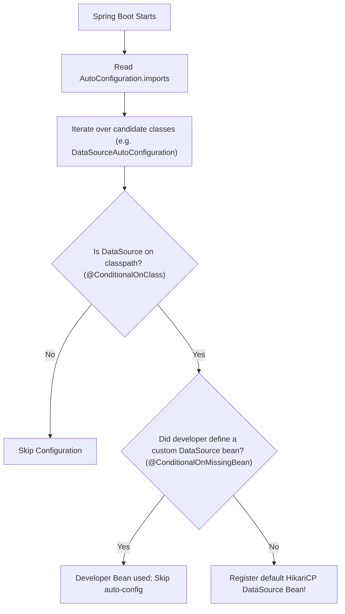

**Java / Spring Boot Example (Simulating Auto-Configuration):**
```java
@Configuration
@ConditionalOnClass(DataSource.class)
@AutoConfigureAfter(JmxAutoConfiguration.class)
public class CustomDatabaseAutoConfiguration {

    // Creates default connection pool only if developer hasn't created one
    @Bean
    @ConditionalOnMissingBean(DataSource.class)
    public DataSource defaultDataSource() {
        return new HikariDataSource();
    }
}
```

**Real-World Usage:**
Auto-configuration is why adding `spring-boot-starter-web` instantly boots an embedded Tomcat server with Jackson JSON serialization ready to go without configuring a single servlet or converter.

**Interview Tip:**
Always emphasize: **"Developer configuration always overrides auto-configuration."** Because auto-configured beans use `@ConditionalOnMissingBean`, as soon as you define your own `@Bean`, Spring Boot gracefully backs off and lets your bean take precedence.


---

## Topic: Web MVC & REST Fundamentals

### Q498 — Explain different annotations used in spring application

**Interview Answer (Short):**
In a typical Spring application, annotations drive the entire architecture:
- **Component Discovery:** `@Component`, `@Service`, `@Repository`, `@Controller`.
- **Bean Creation & Config:** `@Configuration`, `@Bean`, `@Scope`, `@Lazy`.
- **Dependency Wiring:** `@Autowired`, `@Qualifier`, `@Primary`.
- **Web Layer:** `@RestController`, `@RequestMapping`, `@PathVariable`, `@RequestBody`, `@ExceptionHandler`.
- **AOP & Cross-Cutting:** `@Transactional`, `@Async`, `@Aspect`, `@Cacheable`.

**Detailed Explanation:**
Spring annotations act as declarative metadata. Rather than writing procedural code to manage transactions or security, you annotate methods:

### Cross-Cutting Annotations:
- **`@Transactional`:** Manages database transaction boundaries automatically via an AOP proxy.
- **`@Async`:** Offloads method execution to a background thread pool managed by `TaskExecutor`.
- **`@Cacheable`:** Intercepts method calls and returns cached results if available, skipping method execution.
- **`@Scheduled`:** Executes methods periodically based on cron expressions or fixed delays.

**Java / Spring Boot Example:**
```java
@Service
public class OrderFulfillmentService {

    @Transactional // AOP wraps with begin, commit, rollback
    public void completeOrder(Long orderId) {
        // Database update logic
    }

    @Async // Runs on background worker thread
    public CompletableFuture<Void> sendFulfillmentNotification(String email) {
        // Non-blocking email dispatch
        return CompletableFuture.completedFuture(null);
    }

    @Cacheable(value = "orderCatalog", key = "#catalogId")
    public CatalogDetails getCatalog(String catalogId) {
        // Expensive query cached in Redis/Caffeine
        return fetchFromDatabase(catalogId);
    }
}
```

**Interview Tip:**
Mention that cross-cutting annotations like `@Transactional`, `@Async`, and `@Cacheable` rely on **Spring AOP Proxies**, meaning self-invocation (calling an annotated method from within the same class) will bypass the proxy!


---

### Q533 — some annotations in springboot (Eg. controller, RestController etc.)

**Interview Answer (Short):**
The most important web annotations in Spring Boot are `@Controller` and `@RestController`:
- **`@Controller`:** Traditional Spring MVC controller used for returning **views (HTML/JSP)**. Methods return a String representing the view name resolved by a `ViewResolver`.
- **`@RestController`:** Specialized controller for **RESTful Web Services**. It is meta-annotated with `@Controller` and `@ResponseBody`. Every method automatically serializes its return value directly into HTTP response body (JSON/XML) via `HttpMessageConverter`.

**Detailed Explanation:**

### Comparison Table: @Controller vs @RestController

| Feature | `@Controller` | `@RestController` |
| :--- | :--- | :--- |
| **Meta-Annotations** | `@Component` | `@Controller` + `@ResponseBody` |
| **Primary Purpose** | Traditional MVC web applications (HTML views) | REST APIs (JSON / XML payloads) |
| **Return Value Meaning** | View template name (e.g., `"index"` -> `index.html`) | Response data payload (serialized to JSON) |
| **Requires `@ResponseBody`?** | Yes, if you want to return raw data/JSON | No, automatically applied to all methods |
| **View Resolver** | Invoked to render HTML | Bypassed completely |

**Java / Spring Boot Example:**
```java
// Traditional MVC: Returns view template name
@Controller
public class WebPageController {
    @GetMapping("/home")
    public String homePage(Model model) {
        model.addAttribute("username", "Abhijeet");
        return "home"; // Resolves to /templates/home.html (e.g. Thymeleaf)
    }
}

// REST API: Returns JSON data
@RestController
@RequestMapping("/api")
public class UserApiController {
    @GetMapping("/user")
    public UserDto getUser() {
        return new UserDto(1L, "Abhijeet"); // Jackson serializes to {"id":1,"name":"Abhijeet"}
    }
}
```

**Interview Tip:**
Always mention that `@RestController` is simply a convenience shortcut for `@Controller` + `@ResponseBody`. If you put `@ResponseBody` on a method in a `@Controller`, it behaves exactly like a method in a `@RestController`.


---

### Q476 — How do you take input from a client in a Spring Boot application and send a response

**Interview Answer (Short):**
In a Spring Boot application:
- **Taking Input:** We use annotations inside a `@RestController`:
  1. `@RequestBody`: Reads JSON/XML payload from HTTP request body.
  2. `@PathVariable`: Extracts dynamic values from URI path segments.
  3. `@RequestParam`: Extracts query parameters (`?page=1&size=10`).
  4. `@RequestHeader`: Reads HTTP headers (e.g., `Authorization`, `X-Correlation-Id`).
- **Sending Response:** Methods return DTO objects wrapped in `ResponseEntity<T>`, allowing explicit control over HTTP status codes, headers, and the response body. Jackson automatically serializes the object to JSON.

**Detailed Explanation:**

### Input Mechanisms:
- **`@PathVariable`:** Used for identifying specific resources (e.g. `/api/orders/{id}`).
- **`@RequestParam`:** Used for filtering, sorting, and pagination (e.g. `/api/orders?status=PENDING&page=0`).
- **`@RequestBody`:** Used for create and update payloads in `POST`, `PUT`, and `PATCH` requests.
- **`@RequestHeader`:** Used for passing metadata like authentication tokens, tenant IDs, and tracing IDs.

**Java / Spring Boot Example:**
```java
@RestController
@RequestMapping("/api/v1/orders")
public class OrderController {

    private final OrderService orderService;

    public OrderController(OrderService orderService) {
        this.orderService = orderService;
    }

    @PostMapping("/{customerId}")
    public ResponseEntity<OrderResponse> createOrder(
            @PathVariable Long customerId,
            @RequestParam(defaultValue = "STANDARD") String deliveryType,
            @RequestHeader("X-Trace-Id") String traceId,
            @Valid @RequestBody OrderRequest request) {

        OrderResponse response = orderService.processOrder(customerId, deliveryType, request, traceId);
        
        return ResponseEntity
                .status(HttpStatus.CREATED)
                .header("X-Response-Trace-Id", traceId)
                .body(response);
    }
}
```

**Interview Tip:**
Always mention returning `ResponseEntity<T>` rather than raw POJOs. `ResponseEntity` lets you explicitly set status codes (e.g. `201 CREATED`, `204 NO_CONTENT`, `404 NOT_FOUND`) and custom HTTP headers.


---

### Q555 — How to configure global exception handling in Spring Boot.

**Interview Answer (Short):**
Global exception handling in Spring Boot is configured using **`@RestControllerAdvice`** and **`@ExceptionHandler`**:
1. Create a centralized class annotated with `@RestControllerAdvice`.
2. Define methods annotated with `@ExceptionHandler(CustomException.class)`.
3. Return a consistent error structure (such as RFC 7807 `ProblemDetail` in Spring Boot 3 or a custom `ApiError` record) with the appropriate HTTP status code (`404 NOT_FOUND`, `400 BAD_REQUEST`, `500 INTERNAL_SERVER_ERROR`).

**Detailed Explanation:**
Without centralized exception handling, uncaught exceptions result in default HTML error pages or expose internal stack traces to clients (a security vulnerability).

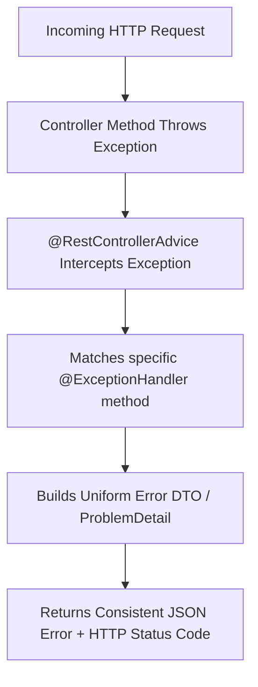

**Java / Spring Boot Example (Using Spring Boot 3 RFC 7807 ProblemDetail):**
```java
// Standard business exception
public class ResourceNotFoundException extends RuntimeException {
    public ResourceNotFoundException(String message) { super(message); }
}

// Global Exception Handler
@RestControllerAdvice
public class GlobalExceptionHandler {

    @ExceptionHandler(ResourceNotFoundException.class)
    public ProblemDetail handleNotFound(ResourceNotFoundException ex) {
        ProblemDetail problemDetail = ProblemDetail.forStatusAndDetail(HttpStatus.NOT_FOUND, ex.getMessage());
        problemDetail.setTitle("Resource Not Found");
        problemDetail.setProperty("timestamp", Instant.now());
        return problemDetail;
    }

    @ExceptionHandler(MethodArgumentNotValidException.class)
    public ProblemDetail handleValidationErrors(MethodArgumentNotValidException ex) {
        ProblemDetail problemDetail = ProblemDetail.forStatusAndDetail(HttpStatus.BAD_REQUEST, "Validation failed");
        Map<String, String> errors = new HashMap<>();
        ex.getBindingResult().getFieldErrors().forEach(error -> 
            errors.put(error.getField(), error.getDefaultMessage()));
        problemDetail.setProperty("invalidFields", errors);
        return problemDetail;
    }

    @ExceptionHandler(Exception.class)
    public ProblemDetail handleGenericError(Exception ex) {
        // Log stack trace for internal monitoring, return generic message to client
        return ProblemDetail.forStatusAndDetail(HttpStatus.INTERNAL_SERVER_ERROR, "An unexpected error occurred.");
    }
}
```

**Interview Tip:**
Mentioning RFC 7807 (`ProblemDetail`), introduced natively in Spring 6 / Spring Boot 3, demonstrates you are current with the latest Spring standards.


---

## Topic: Transaction Management

### Q562 — How to handle transactions in spring boot in case of any issue ?

**Interview Answer (Short):**
To handle transactions in Spring Boot:
1. Annotate business service methods with **`@Transactional`**.
2. By default, Spring rolls back transactions only on **unchecked exceptions** (`RuntimeException` and `Error`). To roll back on checked exceptions, specify `@Transactional(rollbackFor = Exception.class)`.
3. In case of issues, Spring initiates an automatic `ROLLBACK` on the database transaction.
4. For complex compensation or multi-service workflows, programmatic rollback can be invoked via `TransactionAspectSupport.currentTransactionStatus().setRollbackOnly()` or the Saga Pattern.

**Detailed Explanation:**
Spring manages transactions using Spring AOP dynamic proxies:

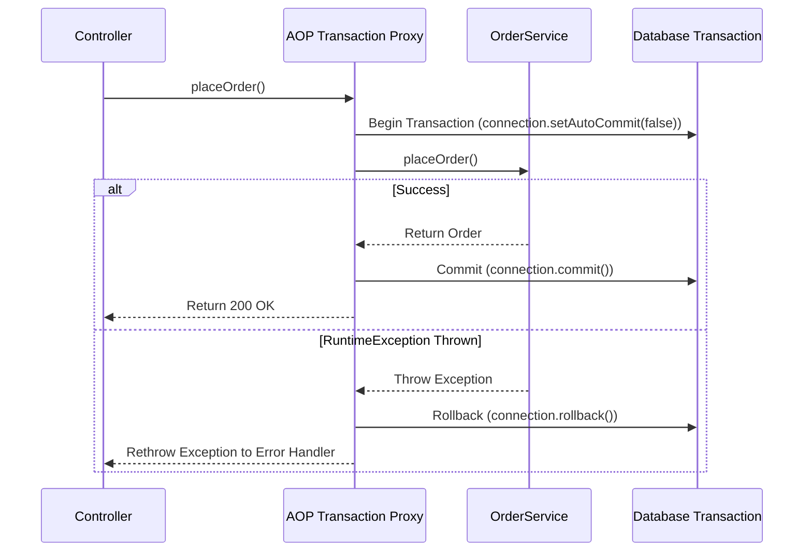

### Key `@Transactional` Attributes:
- **`propagation`:** Controls how transactions relate to existing ones (`REQUIRED` [default], `REQUIRES_NEW`, `MANDATORY`, `SUPPORTS`, `NOT_SUPPORTED`, `NEVER`).
- **`isolation`:** Database isolation level (`READ_COMMITTED`, `REPEATABLE_READ`, `SERIALIZABLE`).
- **`timeout`:** Maximum execution time before automatic rollback.
- **`rollbackFor`:** Explicitly lists checked exceptions that should trigger rollback.

**Java / Spring Boot Example:**
```java
@Service
public class BankTransferService {

    private final AccountRepository accountRepo;

    public BankTransferService(AccountRepository accountRepo) { this.accountRepo = accountRepo; }

    @Transactional(rollbackFor = Exception.class, timeout = 5)
    public void transfer(Long fromId, Long toId, BigDecimal amount) throws InsufficientFundsException {
        Account from = accountRepo.findById(fromId).orElseThrow();
        Account to = accountRepo.findById(toId).orElseThrow();

        if (from.getBalance().compareTo(amount) < 0) {
            throw new InsufficientFundsException("Not enough balance"); // Triggers rollback!
        }

        from.debit(amount);
        to.credit(amount);
        accountRepo.save(from);
        accountRepo.save(to);
    }
}
```

**Interview Tip:**
Be ready for the famous **Self-Invocation Trap**: If method `a()` calls method `b()` within the same class, and `b()` is annotated with `@Transactional`, the transaction will **NOT** start! This happens because the call bypasses the Spring AOP proxy. To fix it, move `b()` to a separate service class or inject the service into itself via self-injection.


---

# Priority 2 — High Priority

## Topic: Data, Repositories & Concurrency

### Q517 — Step by Step Process to create a spring boot application for a entity employee?

**Interview Answer (Short):**
To build a Spring Boot CRUD application for an Employee entity:
1. **Initialize Project:** Include `spring-boot-starter-web`, `spring-boot-starter-data-jpa`, `validation`, and database driver (e.g. PostgreSQL).
2. **Create Entity (`@Entity`):** Define `Employee` with primary key `@Id @GeneratedValue`.
3. **Create Repository:** Extend `JpaRepository<Employee, Long>`.
4. **Create DTOs & Validation:** Define Request/Response records with validation (`@NotBlank`, `@Email`).
5. **Create Service Layer (`@Service`):** Implement business logic and mark transactions with `@Transactional`.
6. **Create Controller (`@RestController`):** Expose REST endpoints with proper HTTP verbs.
7. **Add Global Exception Handler (`@RestControllerAdvice`):** Handle `ResourceNotFoundException`.

**Detailed Explanation:**

### Step-by-Step Architecture:
```text
HTTP Request ──> Controller ──> Service ──> JpaRepository ──> Database (PostgreSQL)
                   │              │              │
                DTO/Record    Business Logic  Hibernate Entity
```

**Java / Spring Boot Example:**
```java
// 1. Entity
@Entity
@Table(name = "employees")
public class Employee {
    @Id
    @GeneratedValue(strategy = GenerationType.IDENTITY)
    private Long id;
    private String name;
    private String department;
    private BigDecimal salary;
    // Getters and setters
}

// 2. Repository
@Repository
public interface EmployeeRepository extends JpaRepository<Employee, Long> {
    List<Employee> findByDepartment(String department);
}

// 3. DTO
public record EmployeeDto(@NotBlank String name, @NotBlank String department, @Positive BigDecimal salary) {}

// 4. Service
@Service
public class EmployeeService {
    private final EmployeeRepository repository;

    public EmployeeService(EmployeeRepository repository) { this.repository = repository; }

    @Transactional
    public Employee create(EmployeeDto dto) {
        Employee emp = new Employee();
        emp.setName(dto.name());
        emp.setDepartment(dto.department());
        emp.setSalary(dto.salary());
        return repository.save(emp);
    }
}

// 5. Controller
@RestController
@RequestMapping("/api/employees")
public class EmployeeController {
    private final EmployeeService service;

    public EmployeeController(EmployeeService service) { this.service = service; }

    @PostMapping
    public ResponseEntity<Employee> create(@Valid @RequestBody EmployeeDto dto) {
        return ResponseEntity.status(HttpStatus.CREATED).body(service.create(dto));
    }
}
```

**Interview Tip:**
Always use DTOs (Java records) rather than exposing JPA `@Entity` classes directly in `@RequestBody` or `@ResponseBody`. Exposing entities directly leads to security vulnerabilities (mass assignment) and Jackson serialization issues with lazy-loaded relationships.


---

### Q554 — They asked the same catalog details, with results sorted by price, and asked me to

**Interview Answer (Short):**
To implement a catalog listing endpoint sorted by price and paginated:
1. Accept Spring Data's `Pageable` in the controller method (or extract `page`, `size`, and `sort` query parameters).
2. Pass `Pageable` to the Spring Data JPA repository method (`findAll(Pageable pageable)`).
3. The repository automatically executes a `SELECT` with `LIMIT`, `OFFSET`, and `ORDER BY price ASC/DESC`, plus an accompanying `COUNT` query.
4. Return `Page<ProductDto>` (or a custom pagination response DTO) to provide content along with total pages and elements.

**Detailed Explanation:**
In high-volume e-commerce catalogs, fetching all products without pagination causes Out-Of-Memory (OOM) errors and slow response times. Spring Data JPA provides native pagination support:

**Java / Spring Boot Example:**
```java
// Controller
@RestController
@RequestMapping("/api/catalog")
public class CatalogController {

    private final ProductRepository productRepository;

    public CatalogController(ProductRepository productRepository) {
        this.productRepository = productRepository;
    }

    // Example call: GET /api/catalog?page=0&size=10&sort=price,asc
    @GetMapping
    public ResponseEntity<Page<ProductSummaryDto>> getCatalog(
            @PageableDefault(page = 0, size = 20, sort = "price", direction = Sort.Direction.ASC) Pageable pageable) {

        Page<ProductSummaryDto> page = productRepository.findAll(pageable)
                .map(p -> new ProductSummaryDto(p.getId(), p.getName(), p.getPrice()));

        return ResponseEntity.ok(page);
    }
}
```

**Generated SQL Query:**
```sql
SELECT id, name, price FROM products ORDER BY price ASC LIMIT 20 OFFSET 0;
SELECT COUNT(id) FROM products;
```

**Interview Tip:**
Mention performance optimization: The count query generated by `Page<T>` can be expensive on massive tables. If total pages are not required by the UI, use `Slice<T>` instead of `Page<T>` because `Slice` executes `LIMIT N+1` to check if a next page exists without running an expensive `COUNT(*)` query!


---

### Q553 — Fetching and inserting data at the same time by different users spring boot real-time

**Interview Answer (Short):**
To handle simultaneous fetching and inserting of data by different users in real time:
1. **Concurrency Control:** Use **Optimistic Locking** (`@Version`) for low-contention reads/writes, or **Pessimistic Locking** (`@Lock(LockModeType.PESSIMISTIC_WRITE)`) for critical financial records.
2. **Transaction Isolation:** Set appropriate isolation levels (e.g. `Isolation.READ_COMMITTED` or `REPEATABLE_READ`) to avoid dirty reads or non-repeatable reads.
3. **Database Indexing:** Ensure query filters use indexes to minimize row-level and table-level locks.
4. **Connection Pooling:** Size HikariCP connection pools appropriately to prevent thread starvation under concurrent load.

**Detailed Explanation:**

### Optimistic vs Pessimistic Locking:
- **Optimistic Locking (`@Version`):**
  - Assumes conflicts are rare.
  - Adds a `version` column. When updating: `UPDATE table SET val = ?, version = version + 1 WHERE id = ? AND version = ?`.
  - If another user updated the record in the meantime, Spring throws `OptimisticLockingFailureException`.
- **Pessimistic Locking (`SELECT FOR UPDATE`):**
  - Locks the database row at the SQL level, forcing concurrent users to wait until the current transaction commits or rolls back.

**Java / Spring Boot Example (Optimistic Locking):**
```java
@Entity
public class ProductStock {
    @Id
    private Long id;
    private int availableQuantity;

    @Version // Spring Data JPA automatically handles optimistic lock checks
    private Long version;
}

@Service
public class InventoryService {

    private final ProductStockRepository repository;

    public InventoryService(ProductStockRepository repository) { this.repository = repository; }

    @Transactional
    public void deductStock(Long productId, int quantity) {
        ProductStock stock = repository.findById(productId).orElseThrow();
        stock.deduct(quantity);
        repository.save(stock); // Throws OptimisticLockingFailureException on conflict
    }
}
```

**Interview Tip:**
Explain that for high-throughput read-heavy systems, optimistic locking is far superior because it holds zero database locks, avoiding database connection pool exhaustion.


---

## Topic: Configuration & Profiles

### Q512 — Question related  application.properties file and application.yml file

**Interview Answer (Short):**
Both `application.properties` and `application.yml` serve the exact same purpose in Spring Boot. 
- **`application.properties`** uses flat key-value pairs (`server.port=8080`).
- **`application.yml`** uses hierarchical, indentation-based syntax (`server:
  port: 8080`), supports multi-profile documents separated by `---`, and eliminates redundant prefixes. 
- Note: `@PropertySource` does **not** natively support YAML files.

**Detailed Explanation:**

### Comparison Table: application.properties vs application.yml

| Feature | `application.properties` | `application.yml` |
| :--- | :--- | :--- |
| **Format** | Flat Key-Value pairs (`a.b.c=value`) | Hierarchical tree with indentation |
| **Readability** | Verbose with repeated prefixes | Clean, compact, visually structured |
| **Multi-document support** | No (requires separate files) | Yes (separated by `---`) |
| **List / Map Support** | Clunky (`list[0]=a, list[1]=b`) | Natural YAML lists (`- item1`) |
| **`@PropertySource` support**| Native support | Requires custom `PropertySourceFactory` |

**Java / Spring Boot Example:**
```yaml
# application.yml
server:
  port: 8080
spring:
  datasource:
    url: jdbc:postgresql://localhost:5432/app
    hikari:
      maximum-pool-size: 20
```

**Interview Tip:**
If both files exist in the same location, Spring Boot loads `application.properties` with higher priority than `application.yml`. However, having both in the same project is considered bad practice.


---

### Q505 — How do we load the application.properties file in Spring Boot?

**Interview Answer (Short):**
Spring Boot automatically loads `application.properties` during application bootstrap via the `ConfigDataEnvironmentPostProcessor` (in Spring Boot 2.4+) or `ConfigFileApplicationListener`. It searches predefined classpath and filesystem locations in a specific order of precedence, loading keys into Spring's `Environment`.

**Detailed Explanation:**

### Loading Order (Highest Precedence to Lowest):
1. Command line arguments (`--spring.config.location=...` or `--server.port=9090`).
2. Directory `./config/` in the application execution directory.
3. Current working directory `./`.
4. Classpath `/config/` directory.
5. Classpath root (`/src/main/resources/application.properties`).

### Custom Property Files:
If you have a custom properties file named `payment.properties`, you can load it using:
```java
@Configuration
@PropertySource("classpath:payment.properties")
public class PaymentFileConfig { ... }
```

**Interview Tip:**
Remember: Properties in `./config/` outside your JAR will **override** properties bundled inside the JAR's classpath! This allows operations teams to configure production settings without recompiling code.


---

### Q520 — How to externalize configuration in SpringBoot Application?

**Interview Answer (Short):**
Spring Boot externalizes configuration using a sophisticated **17-level hierarchy** of property sources. The most critical externalization channels are:
1. **Command-Line Arguments** (`--server.port=9090`)
2. **Java System Properties** (`-Dserver.port=9090`)
3. **OS Environment Variables** (`SERVER_PORT=9090`)
4. **Profile-specific Property Files** (`application-prod.yml`)
5. **Standard Property Files** (`application.yml`)

**Detailed Explanation:**
Externalized configuration is essential for cloud-native applications (12-Factor App methodology), allowing the exact same application binary (JAR) to run in Dev, QA, Staging, and Production environments without recompilation.

### Relaxed Binding Rules:
Spring Boot supports "relaxed binding", meaning environment variables match property keys regardless of casing:
- Property: `spring.datasource.password`
- Env Variable: `SPRING_DATASOURCE_PASSWORD` (all uppercase, dots replaced by underscores).

**Real-World Usage:**
In Kubernetes deployments, secrets (database passwords, API keys) are mounted as OS Environment Variables from Kubernetes `Secret` objects. Spring Boot reads them automatically without changing application code.

**Interview Tip:**
State the golden rule of precedence: **Command-line arguments override Environment variables, which override profile files, which override base application.properties.**


---

### Q542 — Questions about @Profile annotation and categories

**Interview Answer (Short):**
`@Profile` categories include:
1. **Environment-based profiles:** `local`, `dev`, `qa`, `staging`, `prod`.
2. **Infrastructure-based profiles:** `cloud`, `on-prem`, `docker`, `k8s`.
3. **Feature-based profiles:** `mock-payments`, `async-disabled`, `metrics-enabled`.

Profiles can be activated via `application.yml`, JVM arguments (`-Dspring.profiles.active=prod`), or OS environment variables (`SPRING_PROFILES_ACTIVE=prod`).

**Detailed Explanation:**
Profiles are not limited to whole environments; they can be combined modularly:
```bash
java -jar app.jar -Dspring.profiles.active=prod,aws,datadog
```

### Profile Expressions:
- `@Profile("!prod")`: Active in all environments *except* production.
- `@Profile("dev | qa")`: Active in development *or* QA.
- `@Profile("prod & aws")`: Active only when *both* `prod` and `aws` are active.

**Interview Tip:**
Always warn against putting sensitive credentials (like production database passwords) directly in `application-prod.properties` stored in Git. Instead, use profile properties to point to environment variables.


---

## Topic: Production Operations & Security

### Q543 — What is actuator in SpringBoot and Where it is defined in the application

**Interview Answer (Short):**
Actuator is defined by adding the `spring-boot-starter-actuator` dependency to `pom.xml` or `build.gradle`. Its behavior, security, and exposed endpoints are configured inside `application.properties` or `application.yml` under the `management.*` configuration namespace.

**Detailed Explanation:**
By default, only `/actuator/health` is exposed over the web for security reasons.

### Configuring Actuator:
```properties
# Expose health, info, and prometheus endpoints
management.endpoints.web.exposure.include=health,info,prometheus

# Change the base management path or port (for security)
management.server.port=9001
management.endpoints.web.base-path=/internal-actuator

# Show full health details
management.endpoint.health.show-details=when_authorized
```

### Custom Health Indicator Example:
```java
@Component
public class ExternalApiHealthIndicator implements HealthIndicator {

    @Override
    public Health health() {
        boolean serviceUp = checkExternalApi();
        if (serviceUp) {
            return Health.up().withDetail("ExternalAPI", "Available and responsive").build();
        }
        return Health.down().withDetail("ExternalAPI", "Timeout or connection refused").build();
    }

    private boolean checkExternalApi() { return true; }
}
```

**Interview Tip:**
Running Actuator on a **separate management port** (`management.server.port=9001`) is an enterprise security best practice. It allows internal firewalls to block external public access to monitoring endpoints while keeping port 8080 open for customer traffic.


---

### Q499 — There were some questions related to Spring Security and JWT authentication.

**Interview Answer (Short):**
In a stateless Spring Boot microservice, Spring Security and JWT (JSON Web Token) authentication work together by:
1. Validating user credentials during login (`/api/auth/login`) and issuing a signed JWT containing user claims and expiration.
2. Intercepting subsequent requests via a custom `OncePerRequestFilter`.
3. Validating the JWT cryptographic signature and expiration.
4. Extracting user details and authorities and setting an `Authentication` token inside `SecurityContextHolder.getContext().setAuthentication(...)`.

**Detailed Explanation:**

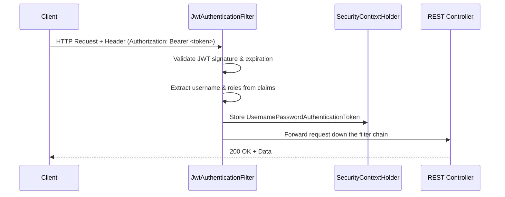

**Key Components in Modern Spring Security 6+:**
- **`SecurityFilterChain` `@Bean`:** Configures endpoint authorization rules, disables CSRF (stateless), and sets session policy to `SessionCreationPolicy.STATELESS`.
- **`JwtAuthenticationFilter`:** Custom filter positioned before `UsernamePasswordAuthenticationFilter`.

**Interview Tip:**
In Spring Security 6 (Spring Boot 3), `SecurityConfigurerAdapter` and `authorizeRequests()` are deprecated. Always reference the modern lambda DSL: `http.authorizeHttpRequests(auth -> auth.requestMatchers("/public/**").permitAll().anyRequest().authenticated())`.


---

## Topic: Dependency & Bean Mechanics

### Q477 — How do you register a third-party library class as a Spring bean ?

**Interview Answer (Short):**
To register a third-party library class as a Spring bean:
1. Create a class annotated with `@Configuration`.
2. Inside it, define a public method that instantiates, configures, and returns an instance of the third-party class.
3. Annotate this method with `@Bean`.
Spring will execute this method during context startup and register the returned object as a managed bean.

**Detailed Explanation:**
Because you cannot edit the source code of an external JAR library to add `@Component`, you must use a Java-based `@Configuration` class.

**Java / Spring Boot Example:**
```java
// Registering third-party AmazonS3 client from AWS SDK:
@Configuration
public class ExternalAwsConfig {

    @Value("${aws.region}")
    private String region;

    @Bean
    public S3Client s3Client() {
        return S3Client.builder()
                .region(Region.of(region))
                .credentialsProvider(DefaultCredentialsProvider.create())
                .build();
    }
}
```

**Interview Tip:**
Mention that you can also configure `initMethod` and `destroyMethod` on the `@Bean` annotation to invoke lifecycle methods on third-party classes that don't have Spring annotations.


---

### Q471 — Difference between @requiredargconstructor and @autowired -----------------------------------------------------------------------------------------------

**Interview Answer (Short):**
- **`@RequiredArgsConstructor`** is a **Lombok** annotation that generates a constructor for all `final` fields and `@NonNull` fields at compile time.
- **`@Autowired`** is a **Spring** annotation that instructs the container to inject a dependency at runtime.
- **Difference:** Combining `@RequiredArgsConstructor` with `final` fields enables clean constructor injection **without writing `@Autowired` or manual constructor boilerplate**.

**Detailed Explanation:**

### Comparison Table:

| Feature | `@RequiredArgsConstructor` | `@Autowired` |
| :--- | :--- | :--- |
| **Origin** | Project Lombok (Compile-time) | Spring Framework (Runtime) |
| **Mechanism** | Generates Java constructor bytecode | Tells Spring where to inject dependencies |
| **Immutability** | Enforces `final` fields | Does not require or enforce `final` fields |
| **Spring Dependency** | Zero coupling to Spring annotations | Coupled to Spring framework |

### Second Part: Constructor vs Method in Java:
- **Constructor:** Special member with no return type; name matches class name; invoked once when creating an object (`new`); initializes instance state.
- **Method:** Standard member with a return type; invoked multiple times on existing objects; performs behavior and logic.

**Java / Spring Boot Example:**
```java
// Clean modern pattern using Lombok:
@Service
@RequiredArgsConstructor
public class CustomerService {
    // Lombok generates: public CustomerService(CustomerRepository customerRepo) { this.customerRepo = customerRepo; }
    // Spring Boot automatically injects it!
    private final CustomerRepository customerRepo;
}
```

**Interview Tip:**
Explain that `@RequiredArgsConstructor` with `final` fields is the most popular idiom in modern Spring Boot codebases because it gives all the benefits of constructor injection with zero boilerplate.


---

### Q468 — You have a rest controller, where a final field and constructor is declared as below.

**Interview Answer (Short):**
The application fails at startup with:
`Parameter 0 of constructor in TestController required a bean of type 'org.springframework.web.client.RestTemplate' that could not be found.`

**Cause:** Spring Boot does **not** auto-configure a `RestTemplate` bean by default because it encourages developers to customize its timeouts, interceptors, and message converters.
**Fix:** Define a `@Bean` method returning `RestTemplate` inside a `@Configuration` class using `RestTemplateBuilder`:
```java
@Bean
public RestTemplate restTemplate(RestTemplateBuilder builder) {
    return builder.build();
}
```

**Detailed Explanation:**
This is a very common practical interview scenario testing your understanding of Spring Boot's opinionated auto-configuration rules.

### Why doesn't Spring Boot auto-configure RestTemplate?
Because `RestTemplate` is stateful regarding its underlying HTTP connection pool and client factories. Spring Boot provides `RestTemplateBuilder` as a pre-configured bean instead, forcing you to explicitly build your own `RestTemplate` instance with application-specific timeouts.

**Java / Spring Boot Example:**
```java
// The failing controller:
@RestController
public class TestController {
    private final RestTemplate restTemplate;

    public TestController(RestTemplate restTemplate) {
        this.restTemplate = restTemplate;
    }
}

// The Fix (Add this Configuration class):
@Configuration
public class RestClientConfig {

    @Bean
    public RestTemplate restTemplate(RestTemplateBuilder builder) {
        return builder
                .setConnectTimeout(Duration.ofSeconds(3))
                .setReadTimeout(Duration.ofSeconds(5))
                .build();
    }
}
```

**Interview Tip:**
Mention modern Spring Boot 3: While `RestTemplate` is still supported, Spring 6 / Spring Boot 3 introduced **`RestClient`** as the modern, synchronous fluent HTTP client replacing `RestTemplate`.


---

### Q573 — How do you detect and resolve circular dependencies in Spring applications?

**Interview Answer (Short):**
A circular dependency occurs when Bean A requires Bean B, and Bean B requires Bean A (A -> B -> A). 
- **Detection:** Spring detects this during dependency resolution and throws a **`BeanCurrentlyInCreationException`** at startup.
- **Resolution:**
  1. **Architectural Redesign (Best):** Extract the shared collaborator into a third bean (C), breaking the cycle (A -> C <- B).
  2. **`@Lazy`:** Break the startup deadlock by proxying one bean with `@Lazy`.
  3. **Event-driven:** Decouple using Spring `ApplicationEventPublisher`.
  4. Note: Since Spring Boot 2.6+, circular dependencies are **forbidden by default**.

**Detailed Explanation:**

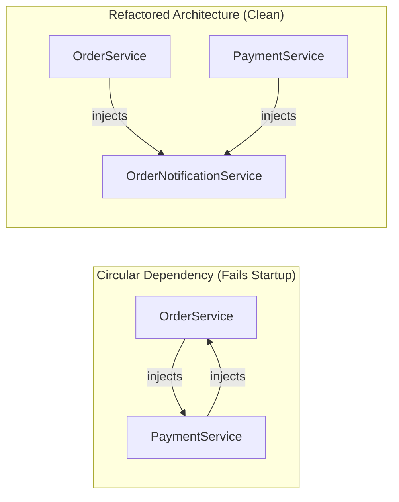

### Resolution Options in Code:

**Option 1: Break the Cycle with a 3rd Bean (Recommended):**
Extract the mutual dependency into a shared service.

**Option 2: Using `@Lazy` (Quick workaround):**
```java
@Service
public class OrderService {
    private final PaymentService paymentService;

    public OrderService(@Lazy PaymentService paymentService) {
        this.paymentService = paymentService;
    }
}
```
`@Lazy` tells Spring to inject a dynamic CGLIB proxy instead of the real bean at startup. The real bean is only instantiated upon the first method call.

**Interview Tip:**
Emphasize that starting in Spring Boot 2.6, `spring.main.allow-circular-references` defaults to `false`. Fixing the design is always preferred over setting `allow-circular-references=true`.


---

## Topic: Caching & Ecosystem

### Q549 — What is caching and how it is implemented in Spring Boot

**Interview Answer (Short):**
Caching in Spring Boot temporarily stores the results of expensive operations (e.g. slow database queries or remote API calls) in fast memory. 
- **Implementation:**
  1. Add `@EnableCaching` on a `@Configuration` class.
  2. Annotate methods with **`@Cacheable(value = "users", key = "#id")`**.
  3. Update caches with **`@CachePut`**.
  4. Invalidate caches with **`@CacheEvict`**.
  5. Back by an in-memory provider (Caffeine) or distributed cache (Redis).

**Detailed Explanation:**
Spring provides an abstraction layer (`CacheManager`) so your code doesn't depend directly on Redis or Ehcache APIs.

### The 4 Core Caching Annotations:
- **`@Cacheable`:** Checks cache first. If found, returns cached value; if not found, executes method and stores result.
- **`@CachePut`:** Always executes the method and updates the cache with the returned result.
- **`@CacheEvict`:** Removes entries from the cache (e.g. `@CacheEvict(value = "users", key = "#id")` or `allEntries = true`).
- **`@Caching`:** Groups multiple caching operations together.

**Java / Spring Boot Example:**
```java
@Service
public class ProductService {

    @Cacheable(value = "products", key = "#productId", unless = "#result == null")
    public ProductDto getProductById(Long productId) {
        // Only executes on cache miss!
        return fetchFromDatabase(productId);
    }

    @CacheEvict(value = "products", key = "#productId")
    public void deleteProduct(Long productId) {
        databaseDelete(productId);
    }
}
```

**Interview Tip:**
Remember: Spring Caching uses **Spring AOP proxies**. Calling a `@Cacheable` method from within the same class (self-invocation) will bypass the cache!


---

### Q538 — Spring starter methods

**Interview Answer (Short):**
Spring Boot Starters are dependency descriptors that aggregate all required libraries, transitive dependencies, and default configurations for a specific capability into a single import. Examples include `spring-boot-starter-web`, `spring-boot-starter-data-jpa`, and `spring-boot-starter-security`.

**Detailed Explanation:**
Before Starters, setting up Spring MVC required manually declaring 10+ dependencies in `pom.xml` and resolving version conflicts between them.

### What is Inside a Starter?
A Starter is essentially an empty JAR whose `pom.xml` contains:
1. Dependencies on core libraries (e.g., Tomcat, Jackson, Hibernate).
2. Dependency on the matching auto-configuration module (`spring-boot-autoconfigure`).

### Custom Starters:
Enterprise companies build custom starters (e.g. `company-audit-starter`) containing standard security filters, logging formatters, and telemetry configurations that all internal microservices import.

**Interview Tip:**
Naming convention rule: Official Spring Boot starters are named `spring-boot-starter-*`. Third-party or custom starters must be named `*-spring-boot-starter` (e.g. `mybatis-spring-boot-starter`).


---

### Q497 — Why @orderd , @Qualifier annotations are used

**Interview Answer (Short):**
- **`@Qualifier`** is used for **disambiguation**: it identifies *which specific bean* to inject when multiple beans share the same type.
- **`@Order`** is used for **sequencing**: it controls the *execution order or sort priority* when multiple beans are injected into a collection (`List<T>`, array) or when ordered components (like filters, interceptors, or runners) execute.

**Detailed Explanation:**

### Comparison:

| Annotation | Purpose | Scope of Effect | Example Use Case |
| :--- | :--- | :--- | :--- |
| **`@Qualifier`** | Disambiguation (Picks 1 bean out of many) | Single injection point | Ingesting `PayPalService` instead of `StripeService` |
| **`@Order`** | Ordering / Priority (Sequences a collection of beans) | Ordered collections / AOP execution | Ordering web `Filter` chains, `CommandLineRunner`s |

**How `@Order` Works:**
`@Order(1)` runs **before** `@Order(2)`. The lowest integer has the highest priority (`Ordered.HIGHEST_PRECEDENCE = Integer.MIN_VALUE`).
Important: `@Order` does **not** change which bean is injected into a single-reference dependency; it only controls ordering in collections!

**Java / Spring Boot Example:**
```java
public interface SecurityRule {
    boolean validate(Request request);
}

// Higher precedence: runs first
@Component
@Order(1)
public class RateLimitRule implements SecurityRule { ... }

// Lower precedence: runs second
@Component
@Order(2)
public class RoleCheckRule implements SecurityRule { ... }

@Service
public class SecurityPipeline {
    // Spring populates the list in the exact order specified by @Order: [RateLimitRule, RoleCheckRule]
    private final List<SecurityRule> rules;

    public SecurityPipeline(List<SecurityRule> rules) {
        this.rules = rules;
    }

    public boolean validateAll(Request request) {
        return rules.stream().allMatch(rule -> rule.validate(request));
    }
}
```

**Interview Tip:**
Common trap: *"Does `@Order` determine the initialization order of singleton beans during startup?"*
Answer: **No.** Bean creation order is determined by the dependency graph (dependencies are instantiated first). `@Order` only applies to collections of beans and advice/aspect execution order.


---

# Priority 3 — Important

## Topic: Framework Internals & Bean Mechanics

### Q511 — Internal flow of Dependency Injection and IOC

**Interview Answer (Short):**
The internal flow of IoC and DI in Spring involves:
1. Scanning and loading Bean Definitions (`BeanDefinition`).
2. Constructing a Dependency Graph.
3. Instantiating beans in dependency order via reflection or CGLIB.
4. Populating properties and resolving dependencies.
5. Invoking `BeanPostProcessors` (for AOP proxies, `@PostConstruct`).
6. Storing ready singletons in the `DefaultSingletonBeanRegistry` cache.

**Detailed Explanation:**
When a Spring Boot application starts (`SpringApplication.run(Application.class, args)`), the internal container flow executes as follows:

1. **Context Initialization:** Creates an `ApplicationContext` (usually `AnnotationConfigServletWebServerApplicationContext` in web applications).
2. **Classpath Scanning (`ClassPathBeanDefinitionScanner`):** Finds classes annotated with `@Component`, `@Service`, `@Repository`, `@Controller`, `@Configuration`.
3. **BeanDefinition Creation:** For each candidate class, Spring creates a `BeanDefinition` metadata object storing its class name, scope (singleton/prototype), constructor arguments, autowiring mode, and lifecycle callbacks.
4. **BeanFactoryPostProcessors Execution:** Classes like `PropertySourcesPlaceholderConfigurer` resolve `${property}` placeholders before any beans are created.
5. **Bean Instantiation & Dependency Resolution:**
   - Spring iterates through the non-lazy singleton bean definitions.
   - For a bean (e.g. `OrderService`), it inspects its constructor.
   - It recursively looks up or instantiates required parameter beans (e.g. `OrderRepository`).
6. **Property Injection:** Injects setter and field dependencies.
7. **BeanPostProcessor - Before Initialization:** Runs `postProcessBeforeInitialization` (e.g. `@PostConstruct`, `ApplicationContextAware`).
8. **Initialization Callback:** Calls `InitializingBean.afterPropertiesSet()` or custom `initMethod`.
9. **BeanPostProcessor - After Initialization:** Runs `postProcessAfterInitialization`. **This is where Spring creates dynamic proxies (JDK dynamic proxies or CGLIB) for `@Transactional`, `@Async`, and `@Aspect`.**
10. **Storage:** The initialized bean is cached in `DefaultSingletonBeanRegistry.singletonObjects` (a concurrent hash map).

**How It Works:**
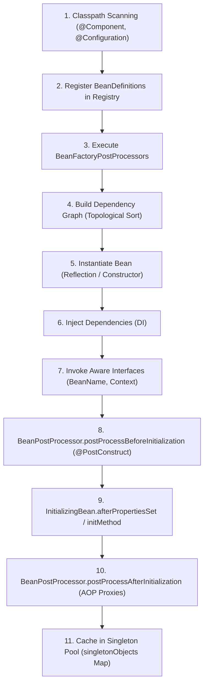

**Real-World Usage:**
Understanding this internal flow is critical when debugging startup errors like `NoSuchBeanDefinitionException`, `BeanCurrentlyInCreationException` (circular reference), or when writing custom `BeanPostProcessors`.

**Interview Tip:**
Always highlight that AOP proxies (such as transactions and security) are created in step 10 (`postProcessAfterInitialization`). If you call an annotated method from within the constructor or `@PostConstruct`, the proxy might not be active yet.


---

### Q485 — What is a dependency injection framework?

**Interview Answer (Short):**
A Dependency Injection framework is an infrastructure library or container that automates the lifecycle, configuration, and injection of dependencies between objects. Instead of developers writing manual factories or wiring boilerplate, the framework uses metadata (like annotations) to automatically build the dependency graph.

**Detailed Explanation:**
In complex systems with hundreds of classes, manually writing dependency wiring code is tedious and error-prone. A DI framework provides:
1. **Container / Context:** A runtime registry where object definitions and instances live.
2. **Automated Discovery:** Scanning the classpath for classes marked with annotations (`@Component`, `@Inject`, `@Named`).
3. **Dependency Resolution:** Determining the exact sequence in which objects must be constructed based on their dependencies (Directed Acyclic Graph).
4. **Lifecycle Management:** Handling initialization callbacks (`@PostConstruct`), destruction callbacks (`@PreDestroy`), and scopes (singleton, prototype, request, session).

Popular DI frameworks in the Java ecosystem include:
- **Spring Framework:** The industry standard, providing full-featured enterprise capabilities, AOP, transaction management, and ecosystem integration.
- **Google Guice:** A lightweight, pure DI framework popular in modular Java applications.
- **Dagger (Dagger 2):** A compile-time DI framework widely used in Android and performance-critical systems because it avoids runtime reflection.
- **Jakarta CDI (Contexts and Dependency Injection):** The standard Java EE / Jakarta EE specification.

**How It Works:**
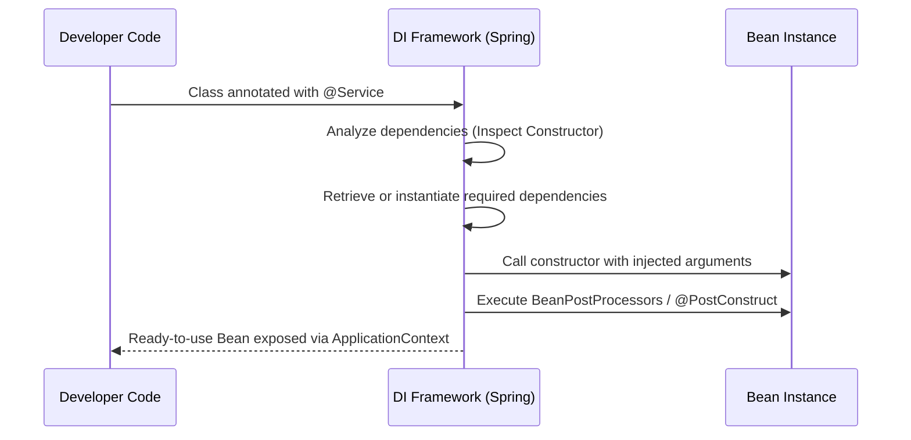

**Java / Spring Boot Example:**
```java
// Spring manages dependencies automatically based on metadata:
@Configuration
public class AppConfig {
    @Bean
    public ObjectMapper objectMapper() {
        return new ObjectMapper()
                .registerModule(new JavaTimeModule())
                .disable(SerializationFeature.WRITE_DATES_AS_TIMESTAMPS);
    }
}

@Service
public class AuditLogService {
    private final ObjectMapper mapper;

    // Framework locates the ObjectMapper bean and supplies it
    public AuditLogService(ObjectMapper mapper) {
        this.mapper = mapper;
    }
}
```

**Real-World Usage:**
DI frameworks form the backbone of modern enterprise architectures. Without a framework like Spring, managing database transactions, security contexts, caching, and client connections would require thousands of lines of fragile boilerplate code.

**Interview Tip:**
Interviewers may ask: *"Does Spring do compile-time or runtime dependency injection?"* Clarify that standard Spring Boot performs runtime DI using reflection and bytecode generation, whereas compile-time DI frameworks like Dagger 2 or Micronuat generate code at build time.


---

### Q569 — Ways of Creating a Spring bean

**Interview Answer (Short):**
The primary ways of creating a Spring bean are:
1. Declarative automatic scanning using stereotypes (`@Component`, `@Service`, `@Repository`).
2. Declarative manual definition using `@Configuration` and `@Bean`.
3. Specialized factory encapsulation using `FactoryBean<T>`.
4. Dynamic programmatic registration via `GenericApplicationContext`.

**Detailed Explanation:**
The choice of creation mechanism depends on ownership and complexity:
- **Own code with standard constructor:** `@Component`.
- **Third-party code or custom parameters:** `@Bean`.
- **Complex lifecycle or proxy encapsulation:** `FactoryBean`.
- **High-performance ahead-of-time (AOT) or dynamic plugins:** Programmatic registration.

**Interview Tip:**
Always note that declarative annotations (`@Component` and `@Bean`) are the industry standard for 99% of business applications.


---

### Q570 — How Spring beans are instantiated?

**Interview Answer (Short):**
Spring beans are instantiated using **Java Reflection**. 
The Spring container reads the bean's `BeanDefinition`, determines the constructor to use (based on `@Autowired` or single-constructor convention), resolves all parameter dependencies recursively, and invokes `Constructor.newInstance(args)`. If CGLIB proxying is required, Spring generates a dynamic subclass bytecode instance.

**Detailed Explanation:**
Internally, Spring uses `ConstructorResolver` inside `AbstractAutowireCapableBeanFactory`:
1. It inspects all constructors of the target class.
2. It chooses the single candidate constructor, or the one annotated with `@Autowired`.
3. It queries the `ApplicationContext` to resolve the arguments.
4. It calls `BeanUtils.instantiateClass(constructor, args)`.
5. If the bean requires class-based proxying (e.g. `@Configuration` or `@Transactional` without an interface), it uses **CGLIB / ByteBuddy** to generate an enhanced subclass in memory.

**Interview Tip:**
If an interviewer asks: *"Does Spring require a default no-arg constructor?"* 
Answer: *"No! As long as all parameters in a parameterized constructor can be resolved from the container, Spring does not require a no-arg constructor."*


---

### Q551 — How to use multiple classes in spring boot.

**Interview Answer (Short):**
To use multiple classes in Spring Boot:
1. Place classes in the same base package (or sub-packages) as your `@SpringBootApplication` class so they are automatically discovered by `@ComponentScan`.
2. If classes reside in external packages, use `@ComponentScan(basePackages = {"com.pkg1", "com.pkg2"})`.
3. If importing configuration classes from other modules, use `@Import({SecurityConfig.class, DatabaseConfig.class})`.
4. Inject collaborating classes via constructor injection.

**Detailed Explanation:**
In multi-module enterprise systems (e.g. `core`, `billing`, `notification`), package management is critical:

**Java / Spring Boot Example:**
```java
// Main application class importing configurations from separate shared libraries
@SpringBootApplication
@Import({AwsInfrastructureConfig.class, SharedSecurityConfig.class})
public class ECommerceApplication {
    public static void main(String[] args) {
        SpringApplication.run(ECommerceApplication.class, args);
    }
}
```

**Interview Tip:**
Mention `@Import`: It is the cleanest way to include explicit configuration classes from external libraries or shared common JARs without scanning unnecessary packages.


---

### Q500 — Difference between java and springboot

**Interview Answer (Short):**
- **Java** is a high-level, class-based, object-oriented programming language designed for platform independence via the JVM (Java Virtual Machine).
- **Spring Boot** is an open-source, opinionated framework built *in* Java that simplifies the creation of enterprise-grade, production-ready web applications, microservices, and APIs.

**Detailed Explanation:**
Interviewers sometimes ask this basic question to evaluate whether a candidate understands the relationship between programming languages and frameworks:

### Core Distinctions:
1. **Language vs Framework:** Java provides language syntax, types, concurrency primitives, and the standard JDK library (`java.util`, `java.io`). Spring Boot is a software library ecosystem written using Java that provides architectural scaffolding (web servers, database connectors, security, dependency injection).
2. **Execution:** Java source code is compiled by `javac` into `.class` bytecode executed by the JVM. Spring Boot applications run on the JVM as standard Java programs with a `public static void main` method.
3. **Analogy:** Java is like raw building materials (steel, bricks, mortar); Spring Boot is a pre-fabricated house frame with plumbing and electrical systems already pre-installed.

**Comparison Table:**

| Aspect | Java | Spring Boot |
| :--- | :--- | :--- |
| **Nature** | Programming Language | Application Framework / Ecosystem |
| **Maintained By** | Oracle & OpenJDK Community | VMware Tanzu / Broadcom |
| **Core Components** | JDK, JVM, JRE, Language Syntax | IoC Container, Starters, Auto-config, Actuator |
| **Execution Entry** | JVM loads bytecode | `SpringApplication.run(App.class, args)` |

**Interview Tip:**
Keep the answer crisp and structured. State clearly: *"Java is the underlying programming language and runtime platform, while Spring Boot is an enterprise framework designed on top of Java to accelerate application development."*


---

## Topic: Language Integration & Foundations

### Q528 — Java 8 features, spring boot

**Interview Answer (Short):**
Spring Boot deeply integrates Java 8+ features:
1. **Lambda Expressions & Functional Interfaces:** Power functional web routing (`RouterFunctions`), Spring Cloud Stream, and configuration callbacks.
2. **Streams API:** Used heavily in service layers for collection transformation and filtering.
3. **`Optional<T>`:** Spring Data JPA returns `Optional<Entity>` for clean null handling; Spring DI supports injecting `Optional<Bean>` for optional dependencies.
4. **Default Methods in Interfaces:** Used across Spring interfaces (e.g. `WebMvcConfigurer`) to provide no-op defaults.
5. **`java.time` API:** Jackson in Spring Boot natively serializes `LocalDate` and `Instant`.

**Detailed Explanation:**
Java 8 was a transformative release for the Java ecosystem, and Spring Framework 5 / Spring Boot 2+ re-engineered core abstractions around Java 8 idioms:
- **Null Safety with `Optional`:** Instead of returning `null` when a database entity is missing, Spring Data JPA repositories return `Optional<T>`. This eliminates `NullPointerException` bugs and forces developers to declare explicit fallback handling using `.orElseThrow()`.
- **Interface Evolution with Default Methods:** Interfaces like `WebMvcConfigurer` previously required a companion abstract adapter class (`WebMvcConfigurerAdapter`). With default methods in Java 8, `WebMvcConfigurer` provides empty default implementations, allowing developers to override only the specific callbacks they need.
- **Modern Date/Time Handling:** Legacy `java.util.Date` and `Calendar` had severe design flaws (mutable, not thread-safe, confusing month indices). Spring Boot integrates the `java.time` (`JSR-310`) API (`Instant`, `LocalDate`, `ZonedDateTime`) with Jackson for ISO-8601 JSON serialization.

**Java / Spring Boot Example:**
```java
// Spring Data JPA returning Optional:
Optional<User> user = userRepository.findById(id);
return user.map(UserResponse::from).orElseThrow(() -> new UserNotFoundException(id));
```

**Interview Tip:**
Mention `Optional` in Spring Data repositories: it eliminates `NullPointerException` and forces developers to explicitly handle missing database entities.


---

### Q525 — Class and Interface,functional interface,string pool, spring & spring boot

**Interview Answer (Short):**
This multi-topic question tests fundamental Java concepts and how Spring leverages them:
- **Class vs Interface:** A class provides implementation and state; an interface defines a contract. Spring uses interfaces extensively to decouple service layers and enable JDK dynamic proxies.
- **Functional Interface:** An interface with exactly one abstract method (e.g. `Function<T,R>`, `Predicate<T>`). Spring uses them in functional routing (`RouterFunction`) and stream APIs.
- **String Pool:** Special memory region in JVM Heap where String literals are cached for immutability and memory optimization.
- **Spring & Spring Boot:** Spring Boot builds on Spring and Java to automate enterprise configurations.

**Detailed Explanation:**
In interviews with broad prompts, concisely demonstrate your Java fundamentals and connect them to Spring design patterns:
1. **Interfaces in Spring:** Enable loose coupling for Dependency Injection and allow Spring to create JDK Dynamic Proxies for transaction management.
2. **Immutability:** Strings in the String Pool and Java Records are immutable, perfectly matching Spring's preference for thread-safe singleton beans.

**Interview Tip:**
When asked a bundled question, organize your response into distinct bullet points so the interviewer knows you answered every sub-topic.


---

### Q547 — Explain oops principles

**Interview Answer (Short):**
The four core Object-Oriented Programming (OOP) principles are:
1. **Encapsulation:** Bundling data and methods while hiding internal state via access modifiers. In Spring: `@Component` classes hide internal logic behind clean public API methods.
2. **Abstraction:** Exposing only essential features through interfaces. In Spring: Services depend on `Repository` interfaces, not concrete database classes.
3. **Inheritance:** Reusing code via class hierarchies. In Spring: Custom controllers or repositories extend base frameworks classes (`JpaRepository`).
4. **Polymorphism:** Performing actions in multiple ways. In Spring: Dependency Injection injects different implementations (e.g. `PayPalGateway` vs `StripeGateway`) at runtime using the same interface.

**Detailed Explanation:**
Spring Framework is one of the world's most prominent examples of OOP and SOLID principles applied at enterprise scale:
- **Dependency Inversion Principle (DIP):** Spring IoC container inverts the dependency graph so high-level business services depend on abstractions.
- **Single Responsibility Principle (SRP):** Layered architecture separates Controllers, Services, and Repositories into dedicated classes.
- **Open/Closed Principle (OCP):** You can extend functionality by creating new beans or `@EventListener` classes without modifying existing code.

**Interview Tip:**
Always ground abstract OOP principles in concrete Spring architectural patterns. It shows you understand how theory translates into real-world code.


---

### Q490 — how will you handle multiple spring profiles using JVM args

**Interview Answer (Short):**
To activate multiple Spring profiles using JVM arguments:
Pass `-Dspring.profiles.active=profile1,profile2` as a comma-separated list when launching the application:
```bash
java -Dspring.profiles.active=dev,k8s,mock-payment -jar myapp.jar
```
Spring Boot will merge configurations from `application.yml`, `application-dev.yml`, and `application-k8s.yml`, with later profiles overriding matching properties from earlier ones.

**Detailed Explanation:**
In containerized Kubernetes environments, activating multiple profiles allows modular environment layering:
- `prod`: Standard production database connections and logging.
- `k8s`: Kubernetes service discovery and internal DNS.
- `datadog`: Enables APM tracing and metrics exporters.

### Precedence in Multiple Profiles:
If `application-dev.yml` sets `server.port=8081` and `application-k8s.yml` sets `server.port=8082`:
Because `k8s` was specified second (`dev,k8s`), **`8082` wins**.

**Interview Tip:**
Mention alternative ways to pass active profiles:
1. Environment Variable: `export SPRING_PROFILES_ACTIVE=dev,k8s`
2. Command-line program argument: `java -jar myapp.jar --spring.profiles.active=dev,k8s`


---

# Priority 4 — Advanced

## Topic: Reactive Programming & Spring WebFlux

### Q491 — How will you implement Reactive Programming in Springboot

**Interview Answer (Short):**
To implement Reactive Programming in Spring Boot:
1. Add `spring-boot-starter-webflux` instead of `spring-boot-starter-web`.
2. Build on **Project Reactor** using non-blocking reactive publishers: **`Mono<T>`** (0 or 1 item) and **`Flux<T>`** (0 to N items).
3. The underlying runtime runs on **Netty** (non-blocking event-loop architecture) rather than Tomcat's thread-per-request model.
4. For database interactions, use reactive database drivers like **Spring Data R2DBC** (Reactive Relational Database Connectivity) or Reactive MongoDB.

**Detailed Explanation:**

### Servlet (MVC) vs Reactive (WebFlux):
- **Spring MVC (Tomcat):** Synchronous, blocking I/O. Each incoming HTTP request holds a dedicated thread from a thread pool (`max-threads=200`). If a thread blocks waiting for a slow database query, it wastes memory and limits concurrency.
- **Spring WebFlux (Netty):** Asynchronous, non-blocking I/O. Uses an event loop with a very small number of worker threads (typically equal to the number of CPU cores). When an I/O operation begins, the thread is released immediately to serve other requests; a callback resumes processing when data arrives.

**How It Works:**
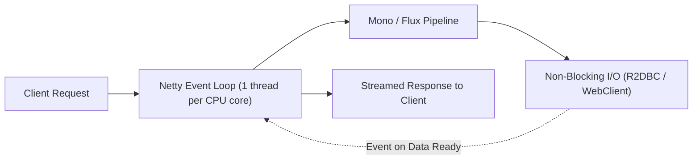

**Java / Spring Boot Example:**
```java
@RestController
@RequestMapping("/api/reactive/stocks")
public class StockPriceController {

    private final StockPriceService stockService;

    public StockPriceController(StockPriceService stockService) {
        this.stockService = stockService;
    }

    // Server-Sent Events (SSE) streaming real-time prices every second
    @GetMapping(value = "/stream", produces = MediaType.TEXT_EVENT_STREAM_VALUE)
    public Flux<StockPrice> streamStockPrices() {
        return stockService.getLivePriceStream();
    }
}
```

**Real-World Usage:**
WebFlux is ideal for high-concurrency gateway proxies (e.g. Spring Cloud Gateway), real-time streaming dashboards, and microservices that call multiple downstream HTTP APIs concurrently.

**Interview Tip:**
Interview trap: *"Can you use standard Spring Data JPA / Hibernate inside Spring WebFlux?"*
Answer: **No!** Standard JPA/JDBC is inherently blocking. Running blocking JDBC calls on Netty's event loop will block the event loop and freeze your application. You must use R2DBC or offload blocking calls to a dedicated `Schedulers.boundedElastic()` thread pool.


---

### Q492 — Difference between flux and mono

**Interview Answer (Short):**
Both `Mono` and `Flux` are reactive publishers implementing the Reactive Streams `Publisher<T>` specification from Project Reactor:
- **`Mono<T>`:** Emits **at most one item** (0 or 1 item), followed by an `onComplete` or `onError` signal. Conceptually similar to a non-blocking `Optional<T>` or `CompletableFuture<T>`.
- **`Flux<T>`:** Emits **0 to N items** (or an infinite stream), followed by an `onComplete` or `onError` signal. Conceptually similar to a non-blocking `List<T>` or reactive `Stream<T>`.

**Detailed Explanation:**

### Comparison Table: Mono vs Flux

| Feature | `Mono<T>` | `Flux<T>` |
| :--- | :--- | :--- |
| **Emitted Elements** | 0 or 1 | 0 to N (finite or infinite) |
| **Traditional Analog** | `Optional<T>` / `CompletableFuture<T>` | `List<T>` / `Stream<T>` / RxJava `Observable` |
| **Standard Use Cases** | `findById()`, `save()`, `delete()` | `findAll()`, real-time event streaming |
| **Conversion** | `mono.flux()` converts to `Flux` | `flux.collectList()` converts to `Mono<List<T>>` |

**Java / Spring Boot Example:**
```java
@Service
public class ReactiveUserService {

    // Returns a single user (0 or 1 item)
    public Mono<User> getUserById(String id) {
        return Mono.just(new User(id, "Abhijeet"));
    }

    // Returns a stream of users (0 to N items)
    public Flux<User> getAllUsers() {
        return Flux.just(
            new User("1", "Alice"),
            new User("2", "Bob"),
            new User("3", "Charlie")
        );
    }
}
```

**Interview Tip:**
Always remember: **"Nothing happens until you subscribe!"** If you create a `Mono` or `Flux` pipeline but do not subscribe (or return it from a Spring WebFlux controller where Spring subscribes for you), no code will actually execute!


---

### Q574 — Can you explain the architecture of Spring WebFlux?

**Interview Answer (Short):**
The architecture of Spring WebFlux is built on a non-blocking reactive pipeline:
1. **Server Layer:** Default server is embedded **Netty** running an Event Loop.
2. **HTTP Abstraction:** Uses `ServerHttpRequest` and `ServerHttpResponse` (reactive streams) instead of blocking `HttpServletRequest`.
3. **Core Processing:** `HttpHandler` and `WebHandler` process requests through a chain of `WebFilter` instances.
4. **Dispatcher:** `DispatcherHandler` routes requests to either `@Controller` handler methods or `HandlerFunction` lambdas.
5. **Data Engine:** Powered by Project Reactor (`Flux` and `Mono`) with end-to-end backpressure from the client socket to the database.

**Detailed Explanation:**

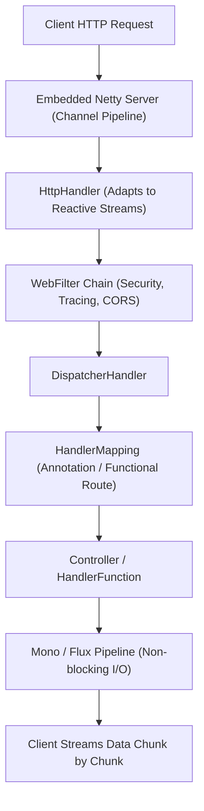

**Interview Tip:**
Highlight that in WebFlux, the execution thread is never blocked waiting for network I/O. When an external I/O call is made, Netty registers a channel future and frees the thread immediately.


---

## Topic: Performance & Volume Testing

### Q493 — How did you do the volume testing in the TLR

**Interview Answer (Short):**
Volume testing in enterprise systems (such as TLR - Transaction Logging and Reconciliation systems) verifies how the application performs when processing massive data volumes over sustained periods. 

In Spring Boot, volume testing is conducted by:
1. **Test Tooling:** Generating realistic mock transaction streams using **Apache JMeter** or **Gatling**.
2. **Batch & Ingestion Performance:** Benchmarking Spring Batch processing chunks (`chunk(1000)`), JDBC batch updates (`rewriteBatchedStatements=true`), and asynchronous Kafka ingestion.
3. **Resource Profiling:** Monitoring heap allocations, garbage collection pauses (using VisualVM / JProfiler), and HikariCP connection pool metrics.
4. **Database Tuning:** Identifying missing indexes, deadlocks, and table partition bottlenecks under high load.

**Detailed Explanation:**
In financial and transaction-heavy applications:
- **Objective:** Ensure the system does not crash with `OutOfMemoryError: Java heap space` or suffer from performance degradation as database tables grow from 100K to 50M rows.
- **Key Bottlenecks to Watch in Spring Boot:**
  - **Hibernate First-Level Cache:** Accumulating millions of entity objects in the `EntityManager` causes memory exhaustion. Fix by calling `entityManager.clear()` periodically in batch jobs.
  - **Connection Pool Exhaustion:** Threads waiting for database connections timeout if connection pool size is too small or queries take too long.

**Interview Tip:**
When asked about volume testing from your project experience, structure your answer around: **Preparation (realistic data) -> Execution (load generation) -> Monitoring (JVM & DB) -> Tuning (indexes, batching, caching).**


---

## Topic: Domain, Coding & Project Walkthroughs

### Q481 — What is AR system? how do you prioritise features.

**Interview Answer (Short):**
This transcript question covers two main dimensions:
1. **AR (Accounts Receivable) System & Feature Prioritization:** An AR system manages invoicing, customer credit, payment reconciliation, and aging reports. Features are prioritized using frameworks like **MoSCoW** (Must have, Should have, Could have, Won't have) or **RICE** (Reach, Impact, Confidence, Effort) based on business value, compliance deadlines, and technical dependencies.
2. **Spring Core Sub-questions:**
   - **Abstract Class vs Interface:** An abstract class defines identity and code reuse (`is-a`); an interface defines a behavioral contract (`can-do`).
   - **`map` vs `flatMap`:** `map` transforms values 1-to-1 (`T -> R`); `flatMap` transforms values 1-to-many and flattens nested structures (`T -> Stream<R>`).
   - **Spring Bean & IoC:** Managed objects assembled by the `ApplicationContext` via Dependency Injection.

**Detailed Explanation:**
In full-stack and domain-focused backend rounds, interviewers often evaluate domain understanding alongside technical acumen:
- **Accounts Receivable Domain:** Core flows include generating invoices upon order completion, processing incoming payments (credit card, bank transfer), matching payments to outstanding invoices (reconciliation), and tracking overdue accounts.
- **Feature Prioritization Framework (RICE):**
  $$\text{RICE Score} = \frac{\text{Reach} \times \text{Impact} \times \text{Confidence}}{\text{Effort}}$$
  High RICE scores (e.g. automated payment retry logic) get prioritized first.

**Interview Tip:**
Always demonstrate that you think like a product-minded engineer: technical decisions (Spring architecture) serve business goals (reducing payment failure rates and improving reconciliation accuracy).


---

### Q522 — Write the jave code to find the duplicate element in an array using streams

**Original Context:**
```text
Write the jave code to find the duplicate element in an array using streams 
what are streams ? 
why we use springboot alternate to other traditional  frameworks 
what is different between spring and springboot 
what is restFull api 
what is inversion of control in spring? 
what is dependency injection ?  
what is dependency inversion?  
what is the features of java8; - 
what is bean? what is @configuartion?  
what is different between interface and abstract class? 
what is functional interface?  
what are the  custom functional interface?- 
what is difference between interface and functional interface; 
what is @Autowaired? stereotype of @compounts; 
some questions on the collection famework; 
some basic questions on java; 
  
At last of the interview he asked to select any data structure comfortable , i told arrays 
,spring and recursion, he told to print the premutation of the spring abcd using the 
recursion.
```

**Interview Answer (Short):**
This transcript excerpt contains a comprehensive technical interview block:
1. **Finding Duplicates in an Array using Streams:**
   ```java
   List<Integer> numbers = List.of(1, 2, 3, 2, 4, 5, 1);
   Set<Integer> duplicates = numbers.stream()
           .filter(n -> !seen.add(n)) // HashSet.add() returns false if already present
           .collect(Collectors.toSet());
   ```
2. **Why Spring Boot over traditional frameworks:** Built-in auto-configuration, embedded servers, starter dependencies, and production-ready monitoring.
3. **IoC, DI & Dependency Inversion:** Inversion of Control is the design principle, Dependency Injection is the pattern, and Dependency Inversion is the SOLID principle stating high-level modules should depend on abstractions.
4. **Recursion (String Permutation):** Permutations generated by swapping characters recursively.

**Detailed Explanation:**

### Finding Duplicates Using Collectors.groupingBy:
```java
public class StreamDuplicatesFinder {
    public static void main(String[] args) {
        int[] arr = {10, 20, 30, 20, 40, 10, 50};

        // Method 1: Using frequency counting via groupingBy
        List<Integer> duplicates = Arrays.stream(arr)
                .boxed()
                .collect(Collectors.groupingBy(Function.identity(), Collectors.counting()))
                .entrySet().stream()
                .filter(entry -> entry.getValue() > 1)
                .map(Map.Entry::getKey)
                .toList();

        System.out.println("Duplicate elements: " + duplicates); // [10, 20]
    }
}
```

### String Permutations Using Recursion:
```java
public class StringPermutations {
    public static void permute(String str, String result) {
        if (str.isEmpty()) {
            System.out.println(result);
            return;
        }
        for (int i = 0; i < str.length(); i++) {
            char ch = str.charAt(i);
            String remaining = str.substring(0, i) + str.substring(i + 1);
            permute(remaining, result + ch);
        }
    }
}
```

**Interview Tip:**
In coding rounds where interviewers ask for duplicates using streams, mentioning both approaches—`seen.add(n)` for $O(N)$ single-pass filtering and `groupingBy(Function.identity(), counting())` for full frequency counting—shows complete mastery of the Java Streams API.


---

### Q552 — Introduction & previous projects

**Interview Answer (Short):**
A professional self-introduction framework for a Spring Boot Backend Engineer:
1. **Present (Who you are):** *"I am a Senior Java Backend Developer with X years of experience designing and building scalable microservices and RESTful APIs using Java 21, Spring Boot, and PostgreSQL."*
2. **Past (Key projects & achievements):** *"In my previous project, I designed a distributed order-processing pipeline using Spring Boot and Kafka, implementing optimistic locking and Redis caching to handle 5,000 requests per second with sub-50ms latency."*
3. **Future (Why you are here):** *"I am excited about this role because of your focus on building resilient, cloud-native distributed systems."*

**Detailed Explanation:**
When an interviewer asks *"Tell me about yourself and your previous projects"*, do not recite your resume line by line. Structure your response into a compelling 90-second technical narrative:
- **Scale:** Mention concrete metrics (throughput, database size, latency improvements).
- **Architecture:** Mention how you applied Spring patterns (IoC, AOP for audit logging, `@Transactional` boundaries, resilience patterns like Circuit Breaker).
- **Ownership:** Emphasize what **you** designed, implemented, and optimized rather than what the team did passively.

**Interview Tip:**
Anchor your self-introduction around **problem -> architecture -> Spring Boot implementation -> measurable result**. Interviewers will naturally base their technical follow-up questions on the technologies you highlight in this intro.


---
