# Spring & Spring Boot — Interview Questions and Answers

This document is a comprehensive, priority-wise preparation guide for Java Backend Developer interviews, covering all 110 questions extracted from the interview transcripts. Questions are arranged into four priority tiers:

- **Priority 1 — Must Know:** Core fundamentals asked in almost every Java backend interview (IoC, DI, Bean Lifecycle, Scopes, Stereotypes, Spring Boot vs Spring Core, Auto-configuration).
- **Priority 2 — High Priority:** Practical daily backend concepts (Spring MVC, REST endpoints, Global Exception Handling, Externalized Configuration, @Profile, Transactions, Actuator, Spring Security).
- **Priority 3 — Important:** Architectural mechanics, dependency injection edge cases, third-party bean configuration, caching, and common interview sets.
- **Priority 4 — Advanced:** Complex internals, WebFlux/reactive streams, custom starters, volume testing, and specialized candidate interview logs.

---

# Priority 1 — Must Know

## Topic: Spring Core, IoC and Dependency Injection

## Q540 — 10. What is IOC in Spring

**Interview Answer (Short):**
Inversion of Control (IoC) is an architectural design principle where the control of object creation, configuration, and lifecycle management is transferred from the application code to a framework or container. Instead of a class instantiating its own dependencies using `new OrderRepository()`, the Spring IoC container creates the dependencies and injects them when needed.

**Detailed Explanation:**
In traditional programming, when class `A` depends on class `B`, `A` directly instantiates `B` (`private B b = new B()`). This creates tight coupling, makes unit testing difficult (you cannot easily mock `B`), and makes changing implementations hard. 

With Inversion of Control, the "control" is inverted. The Spring container acts as an assembler:
1. It scans your application for components (`@Component`, `@Service`, `@Repository`).
2. It instantiates these classes.
3. It resolves the dependencies required by each class and provides ("injects") them.
4. It manages their full lifecycle from creation to destruction.

**How It Works:**
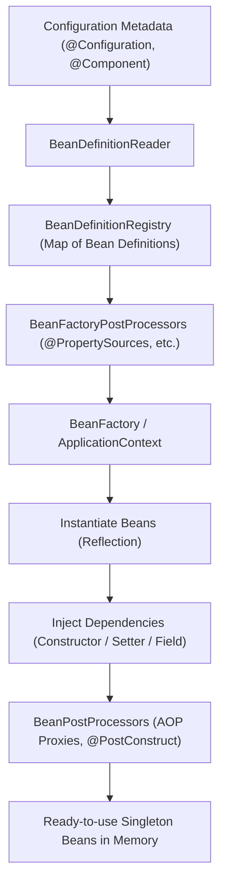

**Java / Spring Boot Example:**
```java
// Traditional tight coupling (Without IoC):
public class OrderService {
    private final PaymentProcessor paymentProcessor;
    
    public OrderService() {
        // OrderService tightly controls which implementation is used
        this.paymentProcessor = new StripePaymentProcessor();
    }
}

// Inverted control with Spring IoC (Decoupled):
@Service
public class OrderService {
    private final PaymentProcessor paymentProcessor;

    // Spring IoC container creates and injects PaymentProcessor here
    public OrderService(PaymentProcessor paymentProcessor) {
        this.paymentProcessor = paymentProcessor;
    }
}
```

**Real-World Usage:**
In production microservices, IoC allows replacing a real payment gateway (`StripePaymentProcessor`) with a mock implementation (`MockPaymentProcessor`) in test environments without modifying a single line of `OrderService`.

**Common Follow-up Questions:**
- What is the difference between IoC and Dependency Injection (DI)?
- Which core interfaces represent the Spring IoC container? (`BeanFactory` vs `ApplicationContext`)

**Interview Tip:**
Always clarify that IoC is the *general principle* (the concept of giving up control of dependencies to a framework), while Dependency Injection (DI) is the *specific design pattern* Spring uses to achieve IoC.

---

## Q544 — 2. ioc

**Interview Answer (Short):**
IoC stands for Inversion of Control. In Spring, it refers to the Spring container managing the instantiation, wiring, configuration, and destruction of objects (beans) instead of developers manually writing `new` statements in business logic.

**Detailed Explanation:**
When an interviewer simply asks "IoC", they want to see if you can explain the core value proposition of Spring. IoC addresses two major software engineering problems:
1. **Coupling:** Without IoC, classes depend directly on concrete implementations rather than interfaces.
2. **Lifecycle Overhead:** Managing database connection pools, thread pools, and service instances manually across dozens of classes leads to resource leaks and duplicate objects.

In Spring, the IoC Container (`ApplicationContext`) acts as a centralized registry. You declare what dependencies a class needs (preferably in its constructor), and the container supplies them at runtime.

**How It Works:**
Spring uses reflection and metadata (annotations or Java configuration) to discover classes annotated with stereotypes (`@Component`, `@Service`), creates metadata representations called `BeanDefinition` objects, and resolves dependencies hierarchically before instantiating singletons.

**Java / Spring Boot Example:**
```java
public interface NotificationService {
    void send(String recipient, String message);
}

@Service
public class EmailNotificationService implements NotificationService {
    @Override
    public void send(String recipient, String message) {
        System.out.println("Email sent to " + recipient + ": " + message);
    }
}

@RestController
@RequestMapping("/api/orders")
public class OrderController {
    private final NotificationService notificationService;

    // Container inverts control and injects the active NotificationService
    public OrderController(NotificationService notificationService) {
        this.notificationService = notificationService;
    }
}
```

**Real-World Usage:**
Used everywhere in enterprise Java. Database repositories, HTTP web clients, message producers, and security filters are all registered in the Spring IoC container and injected across business layers.

**Common Follow-up Questions:**
- Can you have Inversion of Control without Spring? (Yes, through Factory patterns, Service Locator, or template method patterns).
- How does Spring achieve IoC under the hood? (Via Reflection API and dynamic CGLIB / JDK dynamic proxies).

**Interview Tip:**
Mention the Hollywood Principle: *"Don't call us, we'll call you."* Instead of your code calling `new`, Spring calls your constructors and setters.

---

## Q484 — 11. What is dependency injection?

**Interview Answer (Short):**
Dependency Injection (DI) is a design pattern used to implement Inversion of Control. It allows an object to receive its dependencies from an external source (the Spring IoC container) rather than creating them itself.

**Detailed Explanation:**
A "dependency" is any collaborator object that another object needs to function (for example, `UserService` needs `UserRepository`). 

Without DI, `UserService` creates `UserRepository` directly inside its body:
```java
this.userRepository = new UserRepository();
```
This causes major issues:
- `UserService` is tied to a specific database implementation.
- You cannot pass a mock `UserRepository` during unit tests without complex reflection hacks.
- If `UserRepository` itself requires a `DataSource`, `UserService` now has to know how to construct a `DataSource` as well.

With DI, the dependencies are "injected" from the outside through:
1. **Constructor Injection** (recommended)
2. **Setter Injection**
3. **Field Injection**

**How It Works:**
When Spring initializes `UserService`:
1. It inspects `UserService`'s constructor.
2. It detects that `UserRepository` is required.
3. It searches the `ApplicationContext` for an existing bean of type `UserRepository`.
4. If found, it passes the reference into the `UserService` constructor.
5. If not found, it throws a `NoSuchBeanDefinitionException`.

**Java / Spring Boot Example:**
```java
@Repository
public class UserRepository {
    public Optional<User> findById(Long id) {
        return Optional.of(new User(id, "Abhijeet"));
    }
}

@Service
public class UserService {
    private final UserRepository userRepository;

    // Dependency Injection via constructor
    public UserService(UserRepository userRepository) {
        this.userRepository = userRepository;
    }

    public User getUser(Long id) {
        return userRepository.findById(id)
                .orElseThrow(() -> new RuntimeException("User not found"));
    }
}
```

**Real-World Usage:**
In a production Spring Boot application, every controller, service, repository, and messaging client is wired using Dependency Injection, creating a clean separation of concerns and testable code.

**Common Follow-up Questions:**
- Why is Constructor Injection preferred over Field Injection?
- What happens if two beans depend on each other? (Circular dependency).

**Interview Tip:**
Emphasize that DI enables true unit testing. In a JUnit 5 test, you can write `new UserService(mockRepository)` without starting the Spring container at all.

---

## Q485 — 1. What is a dependency injection framework?

**Interview Answer (Short):**
A Dependency Injection framework is an infrastructure library or container that automates the lifecycle, configuration, and injection of dependencies between objects. Instead of developers writing manual factories or wiring boilerplate, the framework uses metadata (like annotations) to automatically build the dependency graph.

**Detailed Explanation:**
In complex systems with hundreds of classes, manually writing dependency wiring code is tedious and error-prone. A DI framework provides:
1. **Container / Context:** A runtime registry where object definitions and instances live.
2. **Automated Discovery:** Scanning the classpath for classes marked with annotations (`@Component`, `@Inject`, `@Named`).
3. **Dependency Resolution:** Determining the exact sequence in which objects must be constructed based on their dependencies (Directed Acyclic Graph).
4. **Lifecycle Management:** Handling initialization callbacks (`@PostConstruct`), destruction callbacks (`@PreDestroy`), and scopes (singleton, prototype, request, session).

Popular DI frameworks in the Java ecosystem include:
- **Spring Framework:** The industry standard, providing full-featured enterprise capabilities, AOP, transaction management, and ecosystem integration.
- **Google Guice:** A lightweight, pure DI framework popular in modular Java applications.
- **Dagger (Dagger 2):** A compile-time DI framework widely used in Android and performance-critical systems because it avoids runtime reflection.
- **Jakarta CDI (Contexts and Dependency Injection):** The standard Java EE / Jakarta EE specification.

**How It Works:**
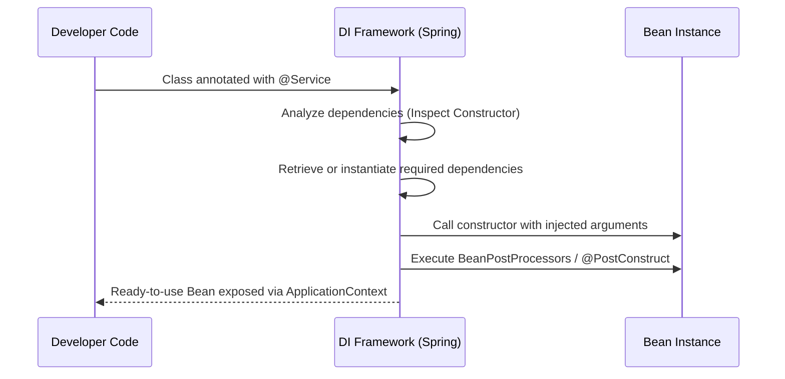

**Java / Spring Boot Example:**
```java
// Spring manages dependencies automatically based on metadata:
@Configuration
public class AppConfig {
    @Bean
    public ObjectMapper objectMapper() {
        return new ObjectMapper()
                .registerModule(new JavaTimeModule())
                .disable(SerializationFeature.WRITE_DATES_AS_TIMESTAMPS);
    }
}

@Service
public class AuditLogService {
    private final ObjectMapper mapper;

    // Framework locates the ObjectMapper bean and supplies it
    public AuditLogService(ObjectMapper mapper) {
        this.mapper = mapper;
    }
}
```

**Real-World Usage:**
DI frameworks form the backbone of modern enterprise architectures. Without a framework like Spring, managing database transactions, security contexts, caching, and client connections would require thousands of lines of fragile boilerplate code.

**Interview Tip:**
Interviewers may ask: *"Does Spring do compile-time or runtime dependency injection?"* Clarify that standard Spring Boot performs runtime DI using reflection and bytecode generation, whereas compile-time DI frameworks like Dagger 2 or Micronuat generate code at build time.

---

## Q472 — 1.What is dependency injection and type of DI?

**Interview Answer (Short):**
Dependency Injection is a design pattern where an object's dependencies are provided by an external container. In Spring, there are three main types of Dependency Injection:
1. **Constructor Injection:** Dependencies are provided via the class constructor (best practice).
2. **Setter Injection:** Dependencies are provided via public setter methods.
3. **Field Injection:** Dependencies are injected directly into private fields using `@Autowired` via reflection.

**Detailed Explanation:**

### Comparison of the 3 Types of DI:

| Injection Type | Description | Mutability | Null Safety | Testability | Recommended? |
| :--- | :--- | :--- | :--- | :--- | :--- |
| **Constructor** | Passed via constructor parameters | Can be `final` (immutable) | High (Cannot instantiate without deps) | Excellent (Plain `new` in tests) | **Yes (Standard)** |
| **Setter** | Injected via `setXxx()` methods | Mutable | Medium (May be null until setter called) | Good | Only for optional dependencies |
| **Field** | Injected directly on private fields | Can be bypassed | Low (Hidden dependencies) | Poor (Requires Spring or Reflection) | **No (Anti-pattern)** |

**How It Works:**
- **Constructor Injection:** The container inspects the available constructors. If there is one constructor (starting in Spring 4.3+), Spring automatically uses it without needing `@Autowired`. It resolves all parameter types and invokes the constructor.
- **Setter Injection:** The container first instantiates the object using the default no-arg constructor, then calls each matching setter method.
- **Field Injection:** The container instantiates the bean with its no-arg constructor, then uses Java Reflection (`Field.setAccessible(true)`) to modify private fields directly.

**Java / Spring Boot Example:**
```java
@Service
public class PaymentService {

    // 1. CONSTRUCTOR INJECTION (Recommended):
    // Immutable, testable, and guaranteed to be non-null.
    private final AccountRepository accountRepository;
    
    // 2. SETTER INJECTION (For optional dependencies):
    private AuditService auditService;

    // 3. FIELD INJECTION (Discouraged):
    // @Autowired private FraudDetector fraudDetector;

    public PaymentService(AccountRepository accountRepository) {
        this.accountRepository = accountRepository;
    }

    @Autowired(required = false)
    public void setAuditService(AuditService auditService) {
        this.auditService = auditService;
    }
}
```

**Real-World Usage:**
In production applications, all core mandatory business services use constructor injection with `final` fields. Setter injection is rarely used, reserved only for truly optional configuration objects with sensible defaults.

**Common Follow-up Questions:**
- Why does the Spring team advise against Field Injection?
- Can you make fields `final` when using Field Injection? (No, `final` fields must be initialized at construction time).

**Interview Tip:**
Always state clearly in interviews: *"Constructor injection is the industry standard and recommended by the Spring team because it enforces immutability, fails fast if dependencies are missing, and makes unit testing trivial."*

---

## Q479 — 16)Explain Dependency injection in springboot ? which is best ?

**Interview Answer (Short):**
In Spring Boot, Dependency Injection is implemented primarily via **Constructor Injection**, **Setter Injection**, or **Field Injection**. 

**Constructor Injection is unequivocally the best** because:
1. It allows fields to be declared `final`, ensuring **immutability**.
2. It prevents `NullPointerException` by ensuring an object cannot be created in an incomplete state.
3. It makes unit testing straightforward without needing Spring test runners or Mockito reflection hacks.
4. It avoids hidden dependencies.

**Detailed Explanation:**
Many developers start with Field Injection (`@Autowired private MyService myService;`) because it requires fewer lines of code. However, this is an anti-pattern:
- **Coupling to Container:** You cannot instantiate the class in a plain unit test (`new MyController()`) without Mockito's `@InjectMocks` or Spring's `ReflectionTestUtils`.
- **Violation of Single Responsibility:** It is easy to add 15 `@Autowired` fields without realizing the class is doing too much. With constructor injection, a 15-parameter constructor immediately signals code smell.
- **Circular Dependencies Masking:** Field injection masks circular dependencies until runtime methods are called, whereas constructor injection fails fast at startup.

**How It Works:**
Since Spring 4.3, if a class has a single constructor, Spring automatically treats it as the injection point—the `@Autowired` annotation is completely optional.

In modern Spring Boot with Lombok, you typically write:
```java
@Service
@RequiredArgsConstructor // Generates constructor for all final fields
public class OrderProcessingService {
    private final OrderRepository orderRepository;
    private final PaymentClient paymentClient;
    private final NotificationService notificationService;
}
```

**Java / Spring Boot Example:**
```java
@Service
public class CustomerService {
    private final CustomerRepository customerRepository;
    private final EmailService emailService;

    // Best Practice: Explicit constructor injection with final fields
    public CustomerService(CustomerRepository customerRepository, EmailService emailService) {
        this.customerRepository = Objects.requireNonNull(customerRepository, "customerRepository must not be null");
        this.emailService = Objects.requireNonNull(emailService, "emailService must not be null");
    }

    public void registerCustomer(String email, String name) {
        Customer customer = customerRepository.save(new Customer(email, name));
        emailService.sendWelcomeEmail(customer.getEmail());
    }
}
```

**Real-World Usage:**
All enterprise production applications mandate constructor injection via static analysis rules (such as SonarQube or ArchUnit) to prohibit field injection across the codebase.

**Common Follow-up Questions:**
- How do you handle optional dependencies with constructor injection? (Pass `Optional<MyService>` as constructor argument, or use `@Autowired(required = false)` on a setter).

**Interview Tip:**
Mention that starting with Spring Boot 2.6+, circular dependencies in constructor injection are rejected by default at startup (`BeanCurrentlyInCreationException`), which forces developers to design clean, acyclic architectures.

---

## Q488 — 4. How will you implement dependency injection?

**Interview Answer (Short):**
To implement Dependency Injection in Spring Boot:
1. Annotate the dependency class with a stereotype annotation like `@Component`, `@Service`, or `@Repository` so Spring discovers and registers it as a bean.
2. In the dependent class, declare a `private final` field for the dependency interface or class.
3. Create a constructor that accepts the dependency as a parameter. Spring automatically resolves and injects it at application startup.

**Detailed Explanation:**
Implementing DI in Spring involves two sides:
- **The Provider (The Dependency):** Must be recognized by Spring's component scanner or declared in a `@Configuration` class via a `@Bean` method.
- **The Consumer (The Client):** Expresses what it needs through its constructor.

### Step-by-Step Implementation:
1. **Define the abstraction:** Create an interface to decouple the contract from implementation.
2. **Implement the contract:** Mark the class with `@Service`.
3. **Inject into the consumer:** Pass the interface into the consumer's constructor.

**Java / Spring Boot Example:**
```java
// Step 1: Define interface contract
public interface PaymentGateway {
    boolean processPayment(BigDecimal amount, String currency);
}

// Step 2: Implement and register bean
@Component
public class RazorpayGateway implements PaymentGateway {
    @Override
    public boolean processPayment(BigDecimal amount, String currency) {
        // Integration logic with Razorpay API
        return true;
    }
}

// Step 3: Inject via constructor
@Service
public class CheckoutService {
    private final PaymentGateway paymentGateway;

    // Spring Boot automatically injects RazorpayGateway
    public CheckoutService(PaymentGateway paymentGateway) {
        this.paymentGateway = paymentGateway;
    }

    public void checkout(Cart cart) {
        paymentGateway.processPayment(cart.getTotalAmount(), "INR");
    }
}
```

**Real-World Usage:**
This pattern is used across every layer of a 3-tier architecture:
- `Controller` injects `Service`
- `Service` injects `Repository` and external clients (`RestClient`, `KafkaTemplate`)
- `Repository` communicates with the database

**Interview Tip:**
If the interviewer asks: *"Do we need `@Autowired` on the constructor?"* Always answer: *"No, as of Spring 4.3, if a Spring component has only one constructor, the `@Autowired` annotation is optional."*

---

## Q495 — Dependency Injection

**Interview Answer (Short):**
Dependency Injection (DI) is a core technique in Spring where the responsibility of creating and providing dependent objects is delegated to the Spring IoC container. This decouples classes from concrete implementations, adheres to the Dependency Inversion Principle of SOLID, and simplifies automated testing.

**Detailed Explanation:**
When an interviewer simply says "Dependency Injection", they expect you to demonstrate depth across three dimensions:
1. **Design Philosophy:** It satisfies SOLID's *Dependency Inversion Principle* (High-level modules should not depend on low-level modules; both should depend on abstractions).
2. **Mechanics:** How Spring identifies, creates, and wires beans at runtime.
3. **Benefits:** High cohesion, low coupling, testability, and configuration flexibility.

**How It Works:**
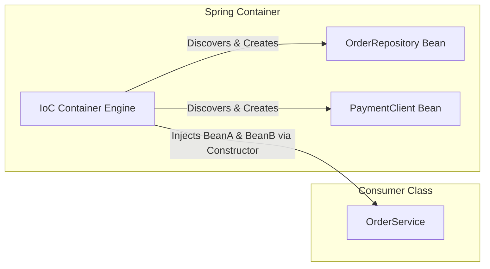

**Java / Spring Boot Example:**
```java
public interface MessageSender {
    void sendMessage(String to, String body);
}

@Component
public class SqsMessageSender implements MessageSender {
    @Override
    public void sendMessage(String to, String body) {
        // Send message to AWS SQS
    }
}

@Service
public class AlertDispatcher {
    private final MessageSender messageSender;

    public AlertDispatcher(MessageSender messageSender) {
        this.messageSender = messageSender;
    }

    public void dispatch(String alert) {
        messageSender.sendMessage("admin-alerts", alert);
    }
}
```

**Real-World Usage:**
Allows seamless switching between AWS SQS, Apache Kafka, or in-memory messaging implementations by merely changing the active bean or profile without altering the calling code.

**Interview Tip:**
Remember: **IoC is the concept, DI is the pattern, and Spring IoC container is the implementation.**

---

## Q531 — 4.2)IoC and DI and types of injection

**Interview Answer (Short):**
- **IoC (Inversion of Control):** The broad architectural principle where object creation, configuration, and lifecycle are handled by an external container (Spring) rather than individual classes.
- **DI (Dependency Injection):** The specific design pattern used to implement IoC by providing dependent objects to a class.
- **Types of Injection:**
  1. **Constructor Injection:** Injected via constructor arguments (best, immutable).
  2. **Setter Injection:** Injected via setter methods (for optional dependencies).
  3. **Field Injection:** Injected directly into fields via `@Autowired` (discouraged).

**Detailed Explanation:**

### IoC vs DI Difference:
- **IoC is the Goal:** Shift control from the application developer's code to the framework.
- **DI is the Mechanism:** Inject collaborators through constructors, setters, or fields.
- **Other IoC Mechanisms:** Template Method pattern, Service Locator, Event Listeners.

### Detailed Injection Types:
1. **Constructor Injection:**
   - Guaranteed initialization.
   - Prevents `NullPointerException`.
   - Supports `final` fields for thread safety.
2. **Setter Injection:**
   - Useful when dependencies need to be reconfigured or changed at runtime.
   - Requires dependencies to be non-final.
3. **Field Injection:**
   - Uses reflection to bypass encapsulation.
   - Impossible to instantiate outside of a Spring context without reflection.

**Java / Spring Boot Example:**
```java
@Service
public class UserRegistrationService {

    // 1. Mandatory dependency: Constructor Injection
    private final UserRepository userRepository;
    
    // 2. Optional dependency: Setter Injection
    private MetricsService metricsService;

    public UserRegistrationService(UserRepository userRepository) {
        this.userRepository = userRepository;
    }

    @Autowired(required = false)
    public void setMetricsService(MetricsService metricsService) {
        this.metricsService = metricsService;
    }
}
```

**Common Follow-up Questions:**
- Can you use both Constructor and Setter injection in the same class? (Yes, constructor for mandatory fields, setter for optional ones).
- What is `@Autowired(required = false)`? (Tells Spring not to fail if the bean is missing; sets the field/parameter to `null`).

**Interview Tip:**
Always mention that Spring Boot defaults to constructor injection without needing explicit annotations when only one constructor is present.

---

## Q561 — 5. Asked to write different types of dependency injection

**Interview Answer (Short):**
When asked to write the different types of dependency injection, demonstrate all three types clearly in Java code:
1. Constructor Injection (preferred)
2. Setter Injection
3. Field Injection (discouraged)

Explain the syntax, annotations, and when each is applied.

**Detailed Explanation:**
In coding rounds or whiteboard interviews, interviewers frequently ask you to write out all three types from scratch to check your understanding of object initialization, `@Autowired`, and immutability.

**Java / Spring Boot Example:**
```java
// Common dependency interface and implementation
public interface LoggerService {
    void log(String message);
}

@Component
public class ConsoleLoggerService implements LoggerService {
    public void log(String message) { System.out.println(message); }
}

// -------------------------------------------------------------
// TYPE 1: CONSTRUCTOR INJECTION (Recommended)
// -------------------------------------------------------------
@Service
public class OrderServiceConstructorDI {
    private final LoggerService loggerService; // Can be declared final

    // @Autowired is optional in single-constructor classes
    public OrderServiceConstructorDI(LoggerService loggerService) {
        this.loggerService = loggerService;
    }

    public void process() {
        loggerService.log("Processing order via Constructor DI");
    }
}

// -------------------------------------------------------------
// TYPE 2: SETTER INJECTION (For optional dependencies)
// -------------------------------------------------------------
@Service
public class OrderServiceSetterDI {
    private LoggerService loggerService; // Cannot be final

    @Autowired
    public void setLoggerService(LoggerService loggerService) {
        this.loggerService = loggerService;
    }

    public void process() {
        if (loggerService != null) {
            loggerService.log("Processing order via Setter DI");
        }
    }
}

// -------------------------------------------------------------
// TYPE 3: FIELD INJECTION (Anti-pattern / Discouraged)
// -------------------------------------------------------------
@Service
public class OrderServiceFieldDI {
    // Injected directly via reflection behind the scenes
    @Autowired
    private LoggerService loggerService;

    public void process() {
        loggerService.log("Processing order via Field DI");
    }
}
```

**Interview Tip:**
Highlight on the whiteboard that in Type 1 (Constructor DI), the `final` keyword guarantees immutability and thread safety, which is impossible with Types 2 and 3.

---

## Q511 — 7. Internal flow of Dependency Injection and IOC

**Interview Answer (Short):**
The internal flow of IoC and DI in Spring involves:
1. Scanning and loading Bean Definitions (`BeanDefinition`).
2. Constructing a Dependency Graph.
3. Instantiating beans in dependency order via reflection or CGLIB.
4. Populating properties and resolving dependencies.
5. Invoking `BeanPostProcessors` (for AOP proxies, `@PostConstruct`).
6. Storing ready singletons in the `DefaultSingletonBeanRegistry` cache.

**Detailed Explanation:**
When a Spring Boot application starts (`SpringApplication.run(Application.class, args)`), the internal container flow executes as follows:

1. **Context Initialization:** Creates an `ApplicationContext` (usually `AnnotationConfigServletWebServerApplicationContext` in web applications).
2. **Classpath Scanning (`ClassPathBeanDefinitionScanner`):** Finds classes annotated with `@Component`, `@Service`, `@Repository`, `@Controller`, `@Configuration`.
3. **BeanDefinition Creation:** For each candidate class, Spring creates a `BeanDefinition` metadata object storing its class name, scope (singleton/prototype), constructor arguments, autowiring mode, and lifecycle callbacks.
4. **BeanFactoryPostProcessors Execution:** Classes like `PropertySourcesPlaceholderConfigurer` resolve `${property}` placeholders before any beans are created.
5. **Bean Instantiation & Dependency Resolution:**
   - Spring iterates through the non-lazy singleton bean definitions.
   - For a bean (e.g. `OrderService`), it inspects its constructor.
   - It recursively looks up or instantiates required parameter beans (e.g. `OrderRepository`).
6. **Property Injection:** Injects setter and field dependencies.
7. **BeanPostProcessor - Before Initialization:** Runs `postProcessBeforeInitialization` (e.g. `@PostConstruct`, `ApplicationContextAware`).
8. **Initialization Callback:** Calls `InitializingBean.afterPropertiesSet()` or custom `initMethod`.
9. **BeanPostProcessor - After Initialization:** Runs `postProcessAfterInitialization`. **This is where Spring creates dynamic proxies (JDK dynamic proxies or CGLIB) for `@Transactional`, `@Async`, and `@Aspect`.**
10. **Storage:** The initialized bean is cached in `DefaultSingletonBeanRegistry.singletonObjects` (a concurrent hash map).

**How It Works:**
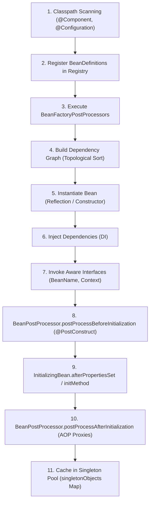

**Real-World Usage:**
Understanding this internal flow is critical when debugging startup errors like `NoSuchBeanDefinitionException`, `BeanCurrentlyInCreationException` (circular reference), or when writing custom `BeanPostProcessors`.

**Interview Tip:**
Always highlight that AOP proxies (such as transactions and security) are created in step 10 (`postProcessAfterInitialization`). If you call an annotated method from within the constructor or `@PostConstruct`, the proxy might not be active yet.

---

## Q486 — 2. What is Autowiring?

**Interview Answer (Short):**
Autowiring is Spring's automatic dependency resolution mechanism. When autowiring is enabled, the Spring container inspects the type (or name) of a required dependency and automatically matches, retrieves, and injects the corresponding bean from the `ApplicationContext` without requiring manual XML configuration or manual object wiring.

**Detailed Explanation:**
In the early days of Spring (XML era), developers had to manually wire every property using `<property name="repo" ref="userRepo"/>`.

Autowiring introduced automatic discovery. Spring provides multiple autowiring modes:
1. **byType (Default in annotation-driven Spring):** Spring looks for exactly one bean matching the target type. If more than one exists, it throws `NoUniqueBeanDefinitionException`.
2. **byName:** Spring looks for a bean whose ID/name matches the variable name or setter property name.
3. **constructor:** Similar to `byType`, but applied to constructor arguments.

In modern Spring Boot, autowiring is predominantly handled via the `@Autowired` annotation or implicit constructor injection.

**Java / Spring Boot Example:**
```java
@Component
public class InventoryClient {
    public boolean checkStock(String sku, int quantity) {
        return true;
    }
}

@Service
public class WarehouseService {
    // Spring inspects the parameter type InventoryClient,
    // finds the registered InventoryClient bean, and autowires it.
    private final InventoryClient inventoryClient;

    public WarehouseService(InventoryClient inventoryClient) {
        this.inventoryClient = inventoryClient;
    }
}
```

**Real-World Usage:**
Every Spring Boot application relies on autowiring to wire data sources, HTTP clients, template engines, and services automatically.

**Common Follow-up Questions:**
- What happens if no bean of the target type is found? (Spring throws `NoSuchBeanDefinitionException` unless `required = false` is configured).
- What happens if multiple beans of the same type exist? (Spring throws `NoUniqueBeanDefinitionException` unless disambiguated with `@Primary` or `@Qualifier`).

**Interview Tip:**
Distinguish between the concept of *Autowiring* and the `@Autowired` annotation. Autowiring is the mechanism; `@Autowired` is one of the annotations that signals it.

---

## Q518 — 9  what is @Autowired?

**Interview Answer (Short):**
`@Autowired` is a Spring annotation used to mark a dependency to be resolved and injected automatically by the Spring container by type. It can be applied on constructors, setter methods, config methods, and fields.

**Detailed Explanation:**
The `@Autowired` annotation is processed by Spring's `AutowiredAnnotationBeanPostProcessor`. 

Key attributes and rules of `@Autowired`:
- **`required` attribute (default `true`):** If Spring cannot find a matching bean, the application fails to start. Setting `@Autowired(required = false)` allows the field to remain `null` or empty.
- **Can inject collections:** You can autowire `List<MyPlugin>` or `Map<String, MyPlugin>`. Spring will collect all beans of type `MyPlugin` and inject them as a list, or as a map where keys are bean names.
- **Can inject `Optional<T>`:** In Java 8+, you can inject `Optional<MyService>` to handle optional beans cleanly.

**Java / Spring Boot Example:**
```java
@Service
public class ReportGenerator {

    // 1. Optional dependency via required = false
    @Autowired(required = false)
    private WatermarkService watermarkService;

    // 2. Injecting a collection of strategy implementations
    private final List<ExportFormatter> formatters;

    @Autowired
    public ReportGenerator(List<ExportFormatter> formatters) {
        this.formatters = formatters;
    }

    public void generateReport(ReportData data, String format) {
        ExportFormatter formatter = formatters.stream()
                .filter(f -> f.supports(format))
                .findFirst()
                .orElseThrow(() -> new IllegalArgumentException("Unsupported format: " + format));
        
        formatter.format(data);
    }
}
```

**Common Follow-up Questions:**
- What is the difference between `@Autowired` (Spring) and `@Inject` (JSR-330)? (`@Autowired` has the `required` flag; `@Inject` is standard Jakarta/Java specification).
- What is the difference between `@Autowired` and `@Resource`? (`@Autowired` binds by type; `@Resource` binds by name first, then by type).

**Interview Tip:**
Always note that while `@Autowired` on fields is very common in tutorials, constructor injection without `@Autowired` is the modern standard for production code.

---

## Q545 — 3. autowiring

**Interview Answer (Short):**
Autowiring is the automated process by which the Spring container detects, resolves, and injects collaborators into a bean. It eliminates manual object binding, relying on type matching (`byType`), bean naming (`byName`), or constructor parameters to link components together.

**Detailed Explanation:**
When an interviewer asks just "autowiring", provide a concise 360-degree overview:
1. **Definition:** Automatic dependency resolution.
2. **Resolution Strategy:**
   - Evaluates required type.
   - If 1 candidate -> Injects it.
   - If 0 candidates -> Fails with `NoSuchBeanDefinitionException` (unless optional).
   - If >1 candidates -> Checks for `@Primary`, then matches bean name against property name or `@Qualifier`. If still ambiguous -> Fails with `NoUniqueBeanDefinitionException`.
3. **Internal Engine:** Driven by `AutowiredAnnotationBeanPostProcessor`.

**Comparison Table: @Autowired vs @Resource vs @Inject:**

| Feature | `@Autowired` | `@Resource` | `@Inject` |
| :--- | :--- | :--- | :--- |
| **Origin** | Spring Framework | Java EE / Jakarta EE (JSR-250) | Java EE / Jakarta EE (JSR-330) |
| **Default Binding** | By **Type** | By **Name** | By **Type** |
| **Optional Flag** | Yes (`required = false`) | No | No |
| **Disambiguation** | `@Qualifier`, `@Primary` | `name` attribute | `@Named`, `@Qualifier` |

**Java / Spring Boot Example:**
```java
// Spring resolves by type, then disambiguates by name
@Component("smsNotifier")
public class SmsNotifier implements Notifier { ... }

@Component("emailNotifier")
public class EmailNotifier implements Notifier { ... }

@Service
public class AlertService {
    // Variable name 'smsNotifier' matches bean name 'smsNotifier'
    private final Notifier smsNotifier;

    public AlertService(Notifier smsNotifier) {
        this.smsNotifier = smsNotifier;
    }
}
```

**Interview Tip:**
Mentioning the fallback from type-matching to name-matching demonstrates that you understand Spring's internal resolution mechanics.

---

## Q503 — How to inject one dependency of one Bean into another.

**Interview Answer (Short):**
To inject one dependency of one bean into another:
1. Ensure both classes are managed as Spring beans (annotated with `@Component`, `@Service`, or declared as `@Bean`).
2. Declare the target bean as a `private final` collaborator inside the dependent bean.
3. Supply that dependency through the dependent bean's constructor. Spring will automatically wire the instance.

**Detailed Explanation:**
Suppose `PaymentService` needs `FraudDetectionService`:
- `FraudDetectionService` is a managed bean (marked with `@Service`).
- `PaymentService` is a managed bean (marked with `@Service`).
- When Spring creates `PaymentService`, it looks up the `FraudDetectionService` instance from the `ApplicationContext` and passes it into `PaymentService`'s constructor.

If multiple implementations of the dependency exist, use `@Qualifier` or `@Primary` to specify which bean instance should be injected.

**Java / Spring Boot Example:**
```java
// Dependency Bean
@Service
public class FraudDetectionService {
    public boolean isFraudulent(String accountId, BigDecimal amount) {
        return false; // Evaluation logic
    }
}

// Dependent Bean injecting FraudDetectionService
@Service
public class PaymentService {
    private final FraudDetectionService fraudDetectionService;

    // Spring injects FraudDetectionService into PaymentService
    public PaymentService(FraudDetectionService fraudDetectionService) {
        this.fraudDetectionService = fraudDetectionService;
    }

    public void processTransaction(String accountId, BigDecimal amount) {
        if (fraudDetectionService.isFraudulent(accountId, amount)) {
            throw new SecurityException("Transaction flagged as fraudulent");
        }
        // Proceed with payment
    }
}
```

**Real-World Usage:**
Standard in every multi-layered Spring application: Controllers inject Services, Services inject Repositories and external clients, and Aspect classes inject Services.

**Common Follow-up Questions:**
- What if Bean A depends on Bean B, and Bean B depends on Bean A? (Circular Dependency — resolved via redesign, `@Lazy`, or setter injection).

**Interview Tip:**
Emphasize that both classes must be managed by the Spring container. If someone instantiates `PaymentService` with `new PaymentService()`, Spring will not inject anything and dependencies will be `null`.

---

## Topic: Spring Beans, Lifecycle & Scopes

## Q489 — 5. What is bean?

**Interview Answer (Short):**
A Spring Bean is simply a Java object that is instantiated, configured, assembled, and fully managed by the Spring IoC container. Unlike normal Java objects created using `new`, a bean lives within the container's lifecycle, benefits from dependency injection, and can have cross-cutting features like transactions and security applied to it automatically.

**Detailed Explanation:**
In a standard Java application, developers control object lifecycle using `new MyService()`. In a Spring application, control is surrendered to the Spring IoC container (`BeanFactory` or `ApplicationContext`). 

A Java class becomes a Spring Bean when:
1. It is declared with a stereotype annotation (`@Component`, `@Service`, `@Repository`, `@Controller`).
2. It is returned from a `@Bean` method inside a `@Configuration` class.
3. It is explicitly registered via XML or runtime programmatic registration (`GenericApplicationContext.registerBean()`).

The Spring container maintains metadata for every bean in a `BeanDefinition` object, recording its class name, scope, constructor arguments, autowiring rules, and lifecycle callbacks.

**How It Works:**
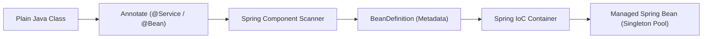

**Java / Spring Boot Example:**
```java
// Not a Spring bean (Manual instantiation, no DI, no AOP)
public class UnmanagedClient {
    public void execute() { ... }
}

// Managed Spring Bean (Container controls lifecycle and dependencies)
@Component
public class ManagedOrderProcessor {
    private final PaymentClient paymentClient;

    public ManagedOrderProcessor(PaymentClient paymentClient) {
        this.paymentClient = paymentClient;
    }

    public void process(Order order) {
        paymentClient.charge(order);
    }
}
```

**Real-World Usage:**
In real backend systems, almost all long-lived service objects—repositories, controllers, caching clients, database connection managers, and security filters—are Spring Beans. Short-lived domain models and DTOs (e.g., `UserDto`, `OrderRequest`) are plain objects and are *not* Spring beans.

**Interview Tip:**
Interviewers often ask: *"Is a JPA Entity (like `@Entity class User`) a Spring Bean?"* Always answer: **No.** JPA entities are domain objects managed by Hibernate/JPA EntityManager, not by the Spring IoC container.

---

## Q575 — 10.brief expln of what are spring beans?

**Interview Answer (Short):**
Spring beans are the foundational building blocks of a Spring application. They are POJOs (Plain Old Java Objects) that the Spring IoC container creates, wires together through dependency injection, manages according to specified scopes (like singleton or prototype), and destroys when the application shuts down.

**Detailed Explanation:**
To provide a structured explanation in an interview:
1. **Definition:** Objects managed by the `ApplicationContext`.
2. **Metadata-driven:** Built using `BeanDefinition` created from `@Component` scanning or `@Bean` declarations.
3. **Container Services:** Once an object is a Spring Bean, it automatically gains access to:
   - Dependency Injection.
   - Lifecycle hooks (`@PostConstruct`, `@PreDestroy`).
   - Aspect-Oriented Programming (AOP) capabilities, such as `@Transactional`, `@Async`, and `@Secured`.
   - Environment and property injection (`@Value`, `@ConfigurationProperties`).

**Java / Spring Boot Example:**
```java
@Configuration
public class ThirdPartyBeanConfig {

    // Registering an external library class as a Spring Bean
    @Bean
    public RestTemplate restTemplate(RestTemplateBuilder builder) {
        return builder
                .setConnectTimeout(Duration.ofSeconds(3))
                .setReadTimeout(Duration.ofSeconds(5))
                .build();
    }
}
```

**Common Follow-up Questions:**
- Can we create a Spring bean manually at runtime? (Yes, via `GenericApplicationContext.registerBean()`).
- Where does Spring store singleton beans? (In the `DefaultSingletonBeanRegistry` internal hash map).

**Interview Tip:**
Differentiate between "POJO" and "Bean": Every Spring Bean starts as a POJO, but once the IoC container instantiates, injects, and wraps it with proxies, it becomes a managed Spring Bean.

---

## Q482 — 9. What is bean and its scope?

**Interview Answer (Short):**
A Spring Bean is a container-managed object. Its **scope** defines the lifecycle and visibility of that bean instance within the application context. 

Spring supports six scopes:
1. **singleton (Default):** Exactly one instance per Spring IoC container.
2. **prototype:** A new instance is created every time the bean is requested.
3. **request (Web):** One instance per HTTP request lifecycle.
4. **session (Web):** One instance per HTTP Session.
5. **application (Web):** One instance per `ServletContext`.
6. **websocket (Web):** One instance per WebSocket lifecycle.

**Detailed Explanation:**

### Comparison of Spring Bean Scopes:

| Scope | Number of Instances | Thread Safety Consideration | Use Case |
| :--- | :--- | :--- | :--- |
| **singleton** (default) | 1 per `ApplicationContext` | **Must be stateless** (shared across all threads) | Services, Repositories, Controllers |
| **prototype** | 1 per injection / `getBean()` call | Caller is responsible for state/destruction | Stateful builders, parsers, temporary workers |
| **request** | 1 per HTTP request | Thread-safe per request thread | Request headers, audit logging context, user IP tracking |
| **session** | 1 per HTTP session | Bound to single user session | User cart, authenticated user session profile |
| **application**| 1 per `ServletContext` | Shared across web apps in same container | Global web application metadata |
| **websocket**  | 1 per WebSocket session | Bound to active socket connection | Live chat session state |

**How It Works:**
When you declare `@Scope("prototype")`, Spring executes the full initialization phase (instantiation, injection, `@PostConstruct`), but it does **not** store the instance in its singleton cache. Furthermore, Spring does **not** manage the destruction lifecycle of prototype beans—the caller must clean them up.

**Java / Spring Boot Example:**
```java
// Singleton (Default, stateless, shared)
@Service
public class OrderService { ... }

// Prototype (New instance on every injection or getBean() call)
@Component
@Scope(ConfigurableBeanFactory.SCOPE_PROTOTYPE)
public class TokenGenerator {
    private final String seed = UUID.randomUUID().toString();
    public String generate() { return seed + "-" + System.currentTimeMillis(); }
}

// Request Scope (Web context only)
@Component
@RequestScope // Equivalent to @Scope(value = WebApplicationContext.SCOPE_REQUEST, proxyMode = ScopedProxyMode.TARGET_CLASS)
public class RequestContext {
    private String correlationId;
    public String getCorrelationId() { return correlationId; }
    public void setCorrelationId(String id) { this.correlationId = id; }
}
```

**Interview Tip:**
Be ready for the classic trap: *"What happens if you inject a prototype bean into a singleton bean?"* 
Because the singleton bean is only instantiated once, the prototype bean is also injected **only once at startup**! To get a new prototype instance every time, use `@Lookup` or inject an `ObjectProvider<PrototypeBean>`.

---

## Q534 — 9. Bean Scope

**Interview Answer (Short):**
Bean scope determines how Spring creates, shares, and discards bean instances. Spring provides **singleton** (one instance per container, default) and **prototype** (new instance on every request) in standard standalone applications, plus four web-aware scopes: **request**, **session**, **application**, and **websocket**.

**Detailed Explanation:**
In technical interviews, interviewers expect you to explain:
1. Why `singleton` is the default: Memory efficiency and high performance. Since services and repositories are typically stateless, one instance can serve thousands of concurrent requests across multiple threads.
2. The concurrency implication: Because singletons are shared across threads, you must **never store mutable user-specific state in singleton instance variables**.
3. Scoped Proxies (`proxyMode`): When a shorter-lived scope (like `request` or `session`) is injected into a longer-lived scope (like a `singleton` controller), Spring injects a CGLIB proxy that dynamically resolves the active request/session bean on each method invocation.

**Java / Spring Boot Example:**
```java
// Injecting Request Scope into Singleton Controller requires ScopedProxy
@Component
@Scope(value = WebApplicationContext.SCOPE_REQUEST, proxyMode = ScopedProxyMode.TARGET_CLASS)
public class UserSessionContext {
    private String userId;
    private String clientIp;
    // Getters and setters
}

@RestController
@RequestMapping("/api")
public class UserProfileController {
    // Singleton Controller holding a Scoped Proxy to the active RequestContext
    private final UserSessionContext userSessionContext;

    public UserProfileController(UserSessionContext userSessionContext) {
        this.userSessionContext = userSessionContext;
    }

    @GetMapping("/me")
    public String getProfile() {
        // Transparently resolves the specific user's request context for this thread
        return "Active user: " + userSessionContext.getUserId();
    }
}
```

**Common Follow-up Questions:**
- Does Spring destroy prototype beans? (No! Spring creates and configures prototype beans, but does not call `@PreDestroy` on them).
- How do you configure bean scope in Java config? (`@Scope("prototype")` or `@Scope(ConfigurableBeanFactory.SCOPE_PROTOTYPE)`).

**Interview Tip:**
Highlight that a Spring Singleton is **not the same** as a Gang of Four (GoF) Singleton. A GoF singleton enforces one instance per *ClassLoader* via a private constructor. A Spring singleton enforces one instance per *Spring ApplicationContext*.

---

## Q527 — • What is bean and bean lifecycle and bean scopes.

**Interview Answer (Short):**
- **Spring Bean:** A POJO managed by the Spring IoC container with lifecycle management and dependency injection.
- **Bean Scopes:** Defines the creation and sharing lifecycle (`singleton` [default], `prototype`, `request`, `session`, `application`, `websocket`).
- **Bean Lifecycle:** The sequence of phases from instantiation, dependency injection, and initialization callbacks (`@PostConstruct`, `afterPropertiesSet`), through active usage, to destruction callbacks (`@PreDestroy`, `destroy`).

**Detailed Explanation:**
This question tests your ability to connect the core architecture of Spring into a cohesive picture:
1. **Definition & Discovery:** The container reads `@Component` or `@Configuration` metadata.
2. **Scoping Strategy:** If `singleton`, Spring checks its internal cache; if already created, it returns it; otherwise, it proceeds with instantiation. If `prototype`, it always instantiates a new object.
3. **Lifecycle Execution:**
   - Instantiation (`new` via reflection).
   - Populate properties (inject dependencies).
   - Aware interfaces (`BeanNameAware`, `BeanFactoryAware`, `ApplicationContextAware`).
   - `BeanPostProcessor.postProcessBeforeInitialization()`.
   - Initialization (`@PostConstruct`, `InitializingBean.afterPropertiesSet()`, custom `initMethod`).
   - `BeanPostProcessor.postProcessAfterInitialization()` -> AOP dynamic proxies created here.
   - Bean is ready for use.
   - On shutdown: `@PreDestroy`, `DisposableBean.destroy()`, custom `destroyMethod`.

**How It Works:**
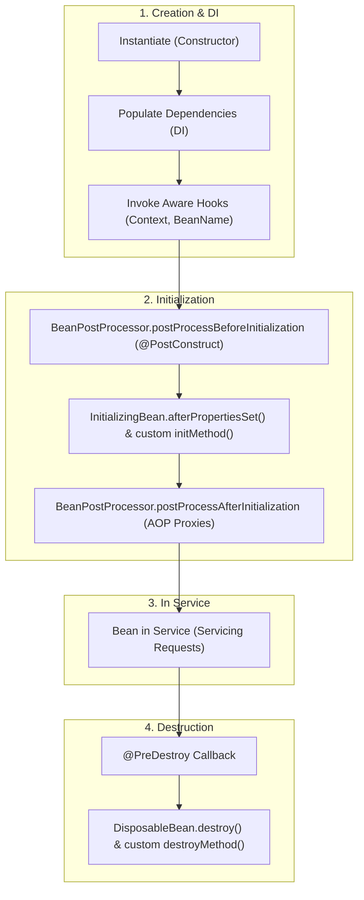

**Java / Spring Boot Example:**
```java
@Component
@Scope(ConfigurableBeanFactory.SCOPE_SINGLETON)
public class DatabaseHealthChecker implements InitializingBean, DisposableBean {

    public DatabaseHealthChecker() {
        System.out.println("1. Constructor: Bean Instantiated");
    }

    @PostConstruct
    public void postConstruct() {
        System.out.println("2. @PostConstruct: Custom init annotation executed");
    }

    @Override
    public void afterPropertiesSet() {
        System.out.println("3. InitializingBean: Properties populated");
    }

    @PreDestroy
    public void preDestroy() {
        System.out.println("4. @PreDestroy: Cleaning up resources before shutdown");
    }

    @Override
    public void destroy() {
        System.out.println("5. DisposableBean: Final cleanup");
    }
}
```

**Interview Tip:**
Structuring the lifecycle into 4 distinct phases—**Instantiation**, **Dependency Injection**, **Initialization**, and **Destruction**—makes your answer structured and easy to follow.

---

## Q469 — 9. Explain Spring Bean life cycle?

**Interview Answer (Short):**
The Spring Bean lifecycle represents the complete journey of a bean managed by the Spring container:
1. **Instantiation:** Spring creates the instance via reflection using its constructor.
2. **Populating Properties:** Injects dependencies (Constructor, Setter, or Field).
3. **Aware Interfaces:** Injects infrastructure hooks like `BeanNameAware` and `ApplicationContextAware`.
4. **Pre-Initialization:** `BeanPostProcessor.postProcessBeforeInitialization` (triggers `@PostConstruct`).
5. **Initialization:** `InitializingBean.afterPropertiesSet()` and custom `init-method`.
6. **Post-Initialization:** `BeanPostProcessor.postProcessAfterInitialization` (generates AOP dynamic proxies).
7. **Ready for Use:** Serves application requests.
8. **Destruction:** On container shutdown, triggers `@PreDestroy`, `DisposableBean.destroy()`, and custom `destroy-method`.

**Detailed Explanation:**
Spring allows developers to plug custom behavior into several lifecycle checkpoints:
- **`@PostConstruct` / `@PreDestroy`:** Standard JSR-250 annotations (recommended approach).
- **`InitializingBean` / `DisposableBean`:** Spring interface contracts (couples your code to Spring interfaces).
- **`@Bean(initMethod = "...", destroyMethod = "...")`:** Programmatic declaration, especially useful when configuring third-party libraries where you cannot modify the source code to add annotations.

**Order of Initialization Callbacks:**
1. Method annotated with `@PostConstruct`.
2. `InitializingBean.afterPropertiesSet()`.
3. Custom `initMethod` declared in `@Bean(initMethod = "init")`.

**Order of Destruction Callbacks:**
1. Method annotated with `@PreDestroy`.
2. `DisposableBean.destroy()`.
3. Custom `destroyMethod` declared in `@Bean(destroyMethod = "cleanup")`.

**Java / Spring Boot Example:**
```java
@Component
public class CacheWarmupService implements InitializingBean, DisposableBean {

    private final ConnectionPool connectionPool;

    public CacheWarmupService(ConnectionPool connectionPool) {
        this.connectionPool = connectionPool;
        System.out.println("Phase 1: Instantiation & Dependency Injection");
    }

    @PostConstruct
    public void initAnnotation() {
        System.out.println("Phase 2a: @PostConstruct executed");
    }

    @Override
    public void afterPropertiesSet() {
        System.out.println("Phase 2b: InitializingBean.afterPropertiesSet executed");
    }

    @PreDestroy
    public void preDestroyAnnotation() {
        System.out.println("Phase 3a: @PreDestroy executed");
    }

    @Override
    public void destroy() {
        System.out.println("Phase 3b: DisposableBean.destroy executed");
    }
}
```

**Common Follow-up Questions:**
- Can we perform database queries inside a constructor? (No, dependencies might not be fully wired and AOP proxies are not yet created; use `@PostConstruct` instead).

**Interview Tip:**
Emphasize that `@PostConstruct` is the correct place for warm-up logic (e.g. loading static caches, validating configs), **not the constructor**.

---

## Q470 — 6. Explain bean life cycle

**Interview Answer (Short):**
The bean lifecycle consists of four primary stages:
1. **Creation:** Instantiating the class using its constructor.
2. **Wiring:** Resolving and injecting all collaborator dependencies.
3. **Initialization:** Invoking custom setup routines via `@PostConstruct` or `InitializingBean`. AOP proxies are wrapped around the bean during this phase.
4. **Destruction:** Invoking cleanup routines via `@PreDestroy` or `DisposableBean` when the `ApplicationContext` closes.

**Detailed Explanation:**
Every Spring developer must know the exact progression to avoid lifecycle bugs:

```text
[BeanDefinition loaded]
        │
        ▼
[Constructor called] ───────────────────> 1. Instantiation
        │
        ▼
[Dependencies injected] ────────────────> 2. Property Population
        │
        ▼
[Aware interfaces called] ──────────────> (BeanNameAware, ApplicationContextAware)
        │
        ▼
[BPP: postProcessBeforeInitialization] ─> 3. Triggers @PostConstruct
        │
        ▼
[InitializingBean / initMethod]
        │
        ▼
[BPP: postProcessAfterInitialization] ──> 4. Wraps bean in dynamic AOP proxy (@Transactional)
        │
        ▼
[Bean in Service (Singleton Cache)]
        │
        ▼ (Context Close)
[@PreDestroy / DisposableBean] ─────────> 5. Destruction & Cleanup
```

**Java / Spring Boot Example:**
```java
@Service
public class RedisSubscriptionListener {

    private boolean isListening = false;

    // 1. Dependencies injected in constructor
    public RedisSubscriptionListener() { ... }

    // 2. Initialization hook
    @PostConstruct
    public void startListening() {
        this.isListening = true;
        System.out.println("Connected to Redis topic and started consumer thread.");
    }

    // 3. Destruction hook
    @PreDestroy
    public void stopListening() {
        this.isListening = false;
        System.out.println("Disconnected from Redis topic cleanly.");
    }
}
```

**Interview Tip:**
If asked: *"Does Spring manage the lifecycle of prototype beans completely?"* Answer: *"No, Spring manages initialization for prototype beans, but delegates destruction to the client application."*

---

## Q487 — 3. Explain the lifecycle of bean

**Interview Answer (Short):**
The lifecycle of a Spring bean refers to the sequence of callbacks and processing steps that occur from the moment the Spring container creates the bean until it is destroyed. The key milestones are: **Class instantiation -> Dependency Injection -> Aware interfaces -> BeanPostProcessor Pre-init -> Initialization (@PostConstruct) -> BeanPostProcessor Post-init (Proxy creation) -> Active usage -> Destruction (@PreDestroy).**

**Detailed Explanation:**
Understanding the lifecycle is crucial when building reusable libraries, custom starters, or configuring complex resources like connection pools or background task executors.

### The Role of Aware Interfaces:
Between dependency injection and initialization, Spring checks if the bean implements any `*Aware` interfaces:
- `BeanNameAware`: Gives the bean knowledge of its configured ID/name in the container.
- `BeanFactoryAware`: Supplies the creating `BeanFactory`.
- `ApplicationContextAware`: Supplies the full `ApplicationContext`, allowing programmatic bean lookups or event publishing.

**Java / Spring Boot Example:**
```java
@Component
public class MetricPublisher implements BeanNameAware, ApplicationContextAware {

    private String beanName;
    private ApplicationContext applicationContext;

    @Override
    public void setBeanName(String name) {
        this.beanName = name;
    }

    @Override
    public void setApplicationContext(ApplicationContext context) {
        this.applicationContext = context;
    }

    @PostConstruct
    public void init() {
        System.out.println("Bean [" + beanName + "] initialized inside " + applicationContext.getId());
    }
}
```

**Interview Tip:**
Mentioning the `Aware` interfaces proves you understand the intermediate hooks between dependency injection and `@PostConstruct`.

---

## Q502 — Life cycle of a bean. Pre-Initialization, Post-Initialisation.

**Interview Answer (Short):**
The Pre-Initialization and Post-Initialization phases are handled by `BeanPostProcessor` implementations:
- **Pre-Initialization (`postProcessBeforeInitialization`):** Runs *after* dependencies are injected but *before* initialization methods (`@PostConstruct`, `afterPropertiesSet`). It handles annotations like `@PostConstruct`, `@Value`, and `ApplicationContextAware`.
- **Post-Initialization (`postProcessAfterInitialization`):** Runs *after* all initialization methods complete. **This is where Spring wraps beans with dynamic AOP proxies** for `@Transactional`, `@Async`, and `@Cacheable`.

**Detailed Explanation:**
`BeanPostProcessor` is one of the most powerful extension points in the Spring framework. It intercepts bean creation across the entire container:

```java
public interface BeanPostProcessor {
    default Object postProcessBeforeInitialization(Object bean, String beanName) {
        return bean; // Executed before @PostConstruct / initMethod
    }

    default Object postProcessAfterInitialization(Object bean, String beanName) {
        return bean; // Executed after @PostConstruct / initMethod -> Can return a PROXY
    }
}
```

### Detailed Timeline:
1. **Constructor** runs -> Raw Object in memory.
2. **Dependencies injected** -> Object fields populated.
3. **`postProcessBeforeInitialization`** -> Inspects bean for custom pre-init behavior. Standard Spring processor `CommonAnnotationBeanPostProcessor` executes `@PostConstruct` here.
4. **`afterPropertiesSet()`** and custom `init-method` run.
5. **`postProcessAfterInitialization`** -> Spring's `AbstractAutoProxyCreator` inspects the bean for annotations like `@Transactional`. If present, it creates a CGLIB or JDK Dynamic Proxy subclass wrapping the original bean and returns the proxy to the container.

**Java / Spring Boot Example:**
```java
@Component
public class PerformanceAuditBeanPostProcessor implements BeanPostProcessor {

    @Override
    public Object postProcessBeforeInitialization(Object bean, String beanName) {
        // Can inspect or modify state before initialization
        return bean;
    }

    @Override
    public Object postProcessAfterInitialization(Object bean, String beanName) {
        // Example: Wrap any bean annotated with @AuditLog into a dynamic proxy
        if (bean.getClass().isAnnotationPresent(AuditLog.class)) {
            System.out.println("Post-Initialization: Applying audit proxy to " + beanName);
            // Returns proxy wrapping the bean
        }
        return bean;
    }
}
```

**Interview Tip:**
Interview trap: *"Why does calling an `@Async` or `@Transactional` method from within `@PostConstruct` often fail to exhibit asynchronous or transactional behavior?"*
Answer: Because `@PostConstruct` runs during **pre-initialization**, *before* `postProcessAfterInitialization` has had the opportunity to generate the AOP proxy wrapper!

---

## Q504 — 10) What is the bean lifecycle in Spring Boot?

**Interview Answer (Short):**
The bean lifecycle in Spring Boot follows the exact same underlying Spring Framework lifecycle, but Spring Boot enhances it with **Auto-configuration**, **Conditional Bean Evaluation** (`@ConditionalOnProperty`, `@ConditionalOnClass`), and **Embedded Web Server lifecycle integration** (`WebServerGracefulShutdownLifecycle`).

**Detailed Explanation:**
While core Spring defines the phases (instantiation, injection, initialization, destruction), Spring Boot introduces crucial mechanics around *when* and *if* a bean enters the lifecycle:

1. **Auto-Configuration Filtering:** Spring Boot evaluates conditional annotations (`@ConditionalOnMissingBean`, `@ConditionalOnWebApplication`). If a condition is not met, the bean definition is skipped and never enters the lifecycle.
2. **Context Refresh Phase:** The embedded Tomcat/Jetty server is initialized during the `onRefresh()` phase of the `ServletWebServerApplicationContext`.
3. **ApplicationRunner & CommandLineRunner:** Once all beans are completely initialized and the web server is running, Spring Boot invokes any beans implementing `ApplicationRunner` or `CommandLineRunner`.
4. **Graceful Shutdown:** During shutdown, Spring Boot pauses the embedded server to allow active in-flight HTTP requests to complete before executing `@PreDestroy` callbacks.

**How It Works:**
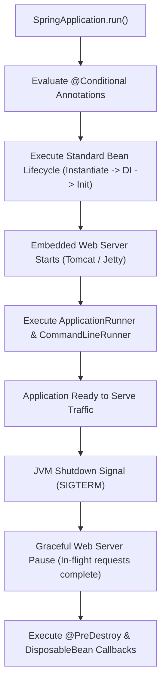

**Java / Spring Boot Example:**
```java
@Component
public class PostStartupWorker implements ApplicationRunner {

    private final ProductSearchRepository searchRepository;

    public PostStartupWorker(ProductSearchRepository searchRepository) {
        this.searchRepository = searchRepository;
    }

    @Override
    public void run(ApplicationArguments args) {
        // Runs only after ALL beans are fully initialized and Tomcat has started
        searchRepository.rebuildSearchIndex();
        System.out.println("Search index warmed up after application startup.");
    }
}
```

**Interview Tip:**
Distinguish between `@PostConstruct` and `CommandLineRunner`. `@PostConstruct` runs during individual bean initialization (web server is not yet listening). `CommandLineRunner` runs *after* the entire application and web server are fully up and ready.

---

## Q548 — 2) Explain the lifecycle of a bean

**Interview Answer (Short):**
To explain the bean lifecycle simply and clearly:
1. **Creation:** Spring instantiates the bean using its constructor.
2. **Population:** Injects collaborators into dependencies.
3. **Initialization:** Runs `@PostConstruct` and `afterPropertiesSet()`, then wraps with AOP proxies.
4. **Usage:** Serves application requests.
5. **Destruction:** Runs `@PreDestroy` and `destroy()` when shutting down.

**Detailed Explanation:**
Here is a concise summary table you can mentally reference during an interview:

| Phase | Milestone | Method / Interface | Responsibility |
| :--- | :--- | :--- | :--- |
| **1. Instantiation** | Constructor call | `new Bean()` via Reflection | Allocates memory for bean instance |
| **2. DI** | Property population | Setter / Field / Constructor | Injects required collaborator beans |
| **3. Aware** | Framework injection | `ApplicationContextAware`, etc. | Gives bean access to container APIs |
| **4. Pre-Init** | BeanPostProcessor | `@PostConstruct` | Custom setup, cache warm-up |
| **5. Init** | Contract initialization | `InitializingBean.afterPropertiesSet()` | Formal interface initialization |
| **6. Post-Init** | Proxy Creation | `BeanPostProcessor` | Wraps bean with AOP / `@Transactional` |
| **7. Ready** | Active Service | Method invocations | Handles business logic |
| **8. Pre-Destroy** | Shutdown Hook | `@PreDestroy` | Flushes queues, closes sockets |
| **9. Destroy** | Final Cleanup | `DisposableBean.destroy()` | Container releases all resources |

**Java / Spring Boot Example:**
```java
@Service
public class DocumentExportService implements InitializingBean, DisposableBean {

    private ExecutorService exportExecutor;

    @PostConstruct
    public void setup() {
        // Phase 4: Custom initialization
        this.exportExecutor = Executors.newFixedThreadPool(4);
    }

    @Override
    public void afterPropertiesSet() {
        // Phase 5: Verification check
        Assert.notNull(exportExecutor, "exportExecutor must be initialized");
    }

    @PreDestroy
    public void tearDown() {
        // Phase 8: Clean shutdown of thread pool
        if (exportExecutor != null) {
            exportExecutor.shutdown();
        }
    }

    @Override
    public void destroy() {
        // Phase 9: Final fallback
    }
}
```

**Interview Tip:**
When asked to explain the lifecycle, start with the high-level 3 phases (Instantiation, Initialization, Destruction) and then dive into `BeanPostProcessor` and `@PostConstruct` when asked for more depth.

---

## Q564 — 21. Spring bean lifecycle

**Interview Answer (Short):**
The Spring Bean lifecycle encompasses the step-by-step process of bean creation, wiring, initialization, and destruction. Key steps: Constructor Instantiation -> Dependency Injection -> Aware interfaces -> `@PostConstruct` (Pre-initialization) -> `InitializingBean` -> AOP Proxy Wrapping (Post-initialization) -> Active Lifetime -> `@PreDestroy` -> Context Disposal.

**Detailed Explanation:**
In senior engineering interviews, interviewers use this question to evaluate your understanding of internal Spring mechanics, such as:
1. **Circular Dependency Mechanics:** How the 3-level singleton cache (`singletonObjects`, `earlySingletonObjects`, `singletonFactories`) resolves circular dependencies during the instantiation phase.
2. **Custom Initialization:** When and why to use `@PostConstruct` vs `@Bean(initMethod = "...")`.
3. **Shutdown Hooks:** How `Runtime.getRuntime().addShutdownHook()` triggers Spring's `AbstractApplicationContext.close()` to ensure `@PreDestroy` runs gracefully when the process receives a `SIGTERM`.

**Java / Spring Boot Example:**
```java
@Configuration
public class ExternalServiceConfig {

    // Useful for third-party classes where you cannot add @PostConstruct or @PreDestroy
    @Bean(initMethod = "connect", destroyMethod = "disconnect")
    public ThirdPartyClient thirdPartyClient() {
        return new ThirdPartyClient("https://api.example.com");
    }
}
```

**Interview Tip:**
Mention that in Spring Boot web applications, shutdown hooks are registered automatically, so `@PreDestroy` is guaranteed to be invoked on normal application termination (e.g., Kubernetes pod scaling or `SIGTERM`).

---

## Topic: Component Scanning, Stereotypes & Annotations

## Q473 — • Difference between @Bean and @Component

**Interview Answer (Short):**
`@Component` is a **class-level** annotation used for auto-detecting and registering beans using classpath scanning. 

`@Bean` is a **method-level** annotation used inside `@Configuration` classes to explicitly instantiate, configure, and return a bean. `@Bean` is primarily used when configuring third-party library classes whose source code you do not own.

**Detailed Explanation:**

### Comparison Table: @Component vs @Bean

| Feature | `@Component` | `@Bean` |
| :--- | :--- | :--- |
| **Target Level** | Class level | Method level |
| **Where Declared** | On your custom classes | Inside `@Configuration` classes |
| **Discovery Mechanism** | Automatic via Component Scanning | Explicit invocation of the method |
| **Source Code Access** | Requires modifying the class source code | Works with external / third-party classes |
| **Custom Initialization** | Via `@PostConstruct` / `@PreDestroy` | Supports `initMethod` and `destroyMethod` attributes |
| **Typical Usage** | Services, Repositories, Controllers | `ObjectMapper`, `RestTemplate`, `DataSource` |

**Java / Spring Boot Example:**
```java
// 1. Using @Component (You own the class source code)
@Component
public class EmailNotificationSender {
    public void sendEmail(String to, String msg) { ... }
}

// 2. Using @Bean (Third-party class: com.fasterxml.jackson.databind.ObjectMapper)
@Configuration
public class JacksonConfig {

    @Bean
    public ObjectMapper customObjectMapper() {
        ObjectMapper mapper = new ObjectMapper();
        mapper.configure(DeserializationFeature.FAIL_ON_UNKNOWN_PROPERTIES, false);
        return mapper;
    }
}
```

**Real-World Usage:**
In real-world projects, 90% of business classes use `@Component` (or its stereotypes like `@Service`, `@Repository`). `@Bean` is used exclusively for infrastructure configuration: registering AWS SDK clients, database connection pools (`HikariDataSource`), Redis templates, and external HTTP clients.

**Interview Tip:**
If an interviewer asks: *"Can you place `@Component` on a class inside an external JAR library?"* 
Answer: *"No, because external JAR classes are compiled bytecode and cannot be edited. You must use `@Bean` inside a `@Configuration` class to instantiate and expose it."*

---

## Q474 — @bean annotation

**Interview Answer (Short):**
`@Bean` is a method-level annotation in Spring that indicates the method instantiates, configures, and initializes a new object to be managed by the Spring IoC container. The method name becomes the default bean name, and its return type becomes the registered bean type.

**Detailed Explanation:**
`@Bean` is used in `@Configuration` classes to declare beans explicitly. 

Key attributes of `@Bean`:
- **`name` / `value`:** Customizes the bean name in the container (e.g. `@Bean("primaryRedisTemplate")`).
- **`initMethod`:** Name of the custom initialization method to run after properties are set.
- **`destroyMethod`:** Name of the custom destruction method to call upon container shutdown (defaults to `(inferred)`, which automatically detects `close()` or `shutdown()`).
- **Full vs Lite mode:** 
  - When declared inside `@Configuration(proxyBeanMethods = true)` (Full Mode), calling another `@Bean` method directly intercepts the call via CGLIB proxy to ensure singleton semantics.
  - When declared inside `@Component` (Lite Mode), direct method invocations are treated as standard Java calls and do not guarantee singleton behavior.

**Java / Spring Boot Example:**
```java
@Configuration(proxyBeanMethods = true)
public class NetworkSecurityConfig {

    @Bean(initMethod = "start", destroyMethod = "stop")
    public SecurityTunnelClient securityTunnelClient() {
        return new SecurityTunnelClient("10.0.0.1", 8443);
    }
}
```

**Common Follow-up Questions:**
- What does `proxyBeanMethods = false` do in Spring Boot? (It switches configuration to Lite Mode, avoiding CGLIB subclass generation to improve startup time and reduce memory).

**Interview Tip:**
Remember that `@Bean` methods accept dependencies as method parameters, which Spring automatically autowires:
```java
@Bean
public OrderService orderService(OrderRepository repo) { return new OrderService(repo); }
```

---

## Q515 — 3  Difference btw @Bean and @Component?

**Interview Answer (Short):**
The primary difference is that `@Component` relies on auto-detection via classpath scanning and is placed on classes you write, whereas `@Bean` is declared on methods inside configuration classes to manually instantiate and customize objects, especially for third-party libraries.

**Detailed Explanation:**
When an interviewer asks this question, explain the architectural decision flow:
1. **Did our team write the class?**
   - Yes -> Use `@Component` (or `@Service`, `@Repository`, `@RestController`).
   - No (e.g. from Apache Commons, Jackson, AWS SDK) -> Use `@Bean`.
2. **Do we need complex programmatic setup before returning the instance?**
   - If setup requires reading environment flags, loops, or complex builder chaining, `@Bean` provides full programmatic control in Java code.

**Java / Spring Boot Example:**
```java
// @Component: Declarative auto-wiring
@Service
public class TaxCalculatorService { ... }

// @Bean: Imperative programmatic assembly
@Configuration
public class AwsClientConfig {
    @Value("${aws.region:us-east-1}")
    private String awsRegion;

    @Bean
    public S3Client s3Client() {
        return S3Client.builder()
                .region(Region.of(awsRegion))
                .credentialsProvider(DefaultCredentialsProvider.create())
                .build();
    }
}
```

**Interview Tip:**
Mention that `@Bean` gives you compiler type safety when constructing objects, whereas `@Component` relies on reflection at runtime.

---

## Q577 — 13. diff btwn component and @beans

**Interview Answer (Short):**
- `@Component` is a class-level stereotype annotation that tells Spring: *"Discover this class during scanning and create an instance using reflection."*
- `@Bean` is a method-level annotation that tells Spring: *"Execute this method and take the returned object to register as a managed bean in your context."*

**Detailed Explanation:**
Here is a clear architectural decision matrix:

| Scenario | Use `@Component` | Use `@Bean` |
| :--- | :---: | :---: |
| Internal service class (`UserService`) | Yes | No |
| Internal repository (`UserRepository`) | Yes | No |
| Third-party library (`Gson`, `HikariDataSource`) | No | Yes |
| Dynamic conditional configuration (`@ConditionalOnProperty`) | Possible | Very common |
| Class requires builder pattern for instantiation | Cumbersome | Idiomatic |

**Java / Spring Boot Example:**
```java
// Component approach: Spring controls constructor execution
@Component
public class FraudEngine { ... }

// Bean approach: Developer controls constructor execution
@Configuration
public class CacheConfig {
    @Bean
    public CacheManager cacheManager() {
        CaffeineCacheManager manager = new CaffeineCacheManager("users", "products");
        manager.setCaffeine(Caffeine.newBuilder().maximumSize(10_000).expireAfterWrite(Duration.ofMinutes(10)));
        return manager;
    }
}
```

**Interview Tip:**
Always state that `@Bean` is the modern Java alternative to old XML `<bean id="..." class="..."/>` declarations.

---

## Q516 — 4  @Component and its derivatives?

**Interview Answer (Short):**
`@Component` is the root stereotype annotation in Spring. Its specialized derivatives are:
1. **`@Service`:** Marks service-layer classes holding business logic.
2. **`@Repository`:** Marks persistence-layer classes and enables automatic database exception translation.
3. **`@Controller`:** Marks Spring MVC web controllers returning views/HTML.
4. **`@RestController`:** Combines `@Controller` and `@ResponseBody` for RESTful APIs.
5. **`@Configuration`:** Marks classes defining `@Bean` factory methods.

**Detailed Explanation:**
All these annotations are "meta-annotated" with `@Component`:

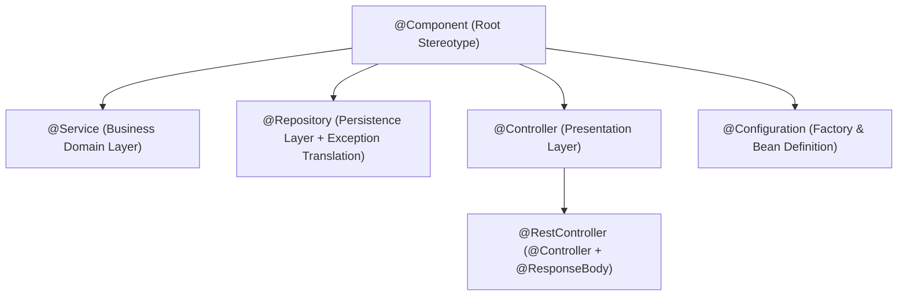

### Why derivatives exist:
1. **Layer Separation (DDD):** Clarifies architecture and intent to developers and tools.
2. **Specialized Processing:**
   - `@Repository` automatically triggers `PersistenceExceptionTranslationPostProcessor` to translate vendor SQL exceptions into Spring's uniform `DataAccessException` hierarchy.
   - `@RestController` automatically serializes method return values to JSON/XML via `HttpMessageConverter`.
   - `@Configuration` enables CGLIB proxying so calling `@Bean` methods directly preserves singleton semantics.
3. **AOP Pointcuts:** Allows targeting aspects to specific architectural layers (e.g. `@Around("within(@org.springframework.stereotype.Service *)")`).

**Java / Spring Boot Example:**
```java
// Spring inspects @Service:
// @Target(ElementType.TYPE)
// @Retention(RetentionPolicy.RUNTIME)
// @Documented
// @Component <--- Meta-annotated!
// public @interface Service { ... }
```

**Interview Tip:**
Emphasize that while the Spring container will discover and instantiate a class marked with plain `@Component`, using the proper derivative provides architectural clarity and enables framework features like exception translation.

---

## Q556 — • Difference between @Component, @Service, and @Repository.

**Interview Answer (Short):**
While `@Component`, `@Service`, and `@Repository` all register a Spring bean via component scanning:
- **`@Component`:** Generic stereotype for any container-managed component.
- **`@Service`:** Indicates business logic and domain processing; typically the target for transaction boundaries (`@Transactional`).
- **`@Repository`:** Indicates data access and persistence; **specifically enables automatic database exception translation** (`PersistenceExceptionTranslationPostProcessor`).

**Detailed Explanation:**

### Comparison Table:

| Annotation | Architectural Layer | Primary Responsibility | Special Framework Behavior |
| :--- | :--- | :--- | :--- |
| **`@Component`** | Any | Generic utility, scheduler, listener | Standard bean management only |
| **`@Service`** | Business Layer | Executes domain logic, coordinates workflows | Semantic indicator; common AOP pointcut target |
| **`@Repository`** | Data Access Layer | CRUD operations, queries on database | **Catches vendor-specific exceptions (SQLException, HibernateException) and rethrows them as unchecked Spring `DataAccessException`** |

**How Persistence Exception Translation Works:**
If your DAO throws a vendor-specific `org.hibernate.exception.ConstraintViolationException` or `java.sql.SQLException`, Spring intercepts it and translates it to `org.springframework.dao.DataIntegrityViolationException`. This prevents your service and web layers from leaking vendor-specific persistence details.

**Java / Spring Boot Example:**
```java
// 1. Data Access Layer
@Repository
public class JpaAccountRepository implements AccountRepository {
    @PersistenceContext
    private EntityManager entityManager;

    public Account findById(Long id) {
        return entityManager.find(Account.class, id); // SQL exceptions automatically translated!
    }
}

// 2. Business Logic Layer
@Service
public class AccountTransferService {
    private final AccountRepository accountRepository;

    public AccountTransferService(AccountRepository accountRepository) {
        this.accountRepository = accountRepository;
    }

    @Transactional
    public void transfer(Long fromId, Long toId, BigDecimal amount) { ... }
}

// 3. Generic Component
@Component
public class SystemHeartbeatScheduler {
    @Scheduled(fixedRate = 60000)
    public void ping() { ... }
}
```

**Interview Tip:**
Interviewers specifically look for the keyword: **"PersistenceExceptionTranslationPostProcessor"**. If you mention that `@Repository` translates JDBC/Hibernate exceptions into Spring's `DataAccessException` hierarchy, you demonstrate deep framework knowledge.

---

## Q565 — 15. diff btwn @component and @service

**Interview Answer (Short):**
`@Component` is a generic stereotype annotation for any Spring-managed class, whereas `@Service` is a specialization of `@Component` intended specifically for classes that encapsulate business logic, domain services, and workflow orchestration.

**Detailed Explanation:**
Under the hood, `@Service` is meta-annotated with `@Component`:
```java
@Target(ElementType.TYPE)
@Retention(RetentionPolicy.RUNTIME)
@Documented
@Component
public @interface Service {
    @AliasFor(annotation = Component.class)
    String value() default "";
}
```

### Why not just use `@Component` everywhere?
1. **Domain-Driven Design (DDD):** In an enterprise codebase with thousands of classes, seeing `@Service` immediately signals to the team that this class holds business rules, coordinates repositories, and manages transactional boundaries.
2. **Pointcut Targeting in AOP:** You can easily define logging, metrics, or auditing aspects for all business services:
   ```java
   @Pointcut("within(@org.springframework.stereotype.Service *)")
   public void allServiceMethods() {}
   ```

**Real-World Usage:**
- Use `@Service` on `OrderService`, `PaymentService`, `UserRegistrationService`.
- Use `@Component` on `AwsSqsConsumer`, `ImageResizeUtility`, `JwtTokenValidator`.

**Interview Tip:**
Always clarify that while Spring treats them identically for bean creation, using `@Service` is a best practice for clean layered architecture.

---

## Q566 — 16. Can use @service and @component interchangeably?

**Interview Answer (Short):**
Technically, **yes**, `@Service` and `@Component` can be used interchangeably without causing runtime errors because `@Service` is meta-annotated with `@Component`. 

However, architecturally, **no**, they should not be used interchangeably because it violates the principle of separation of concerns and impairs readability, maintainability, and AOP pointcut definitions.

**Detailed Explanation:**
If you replace `@Service` with `@Component` on `OrderService`:
- The application will compile and start without error.
- Dependency injection will function as expected.
- All transactional annotations (`@Transactional`) will still work if configured.

**Why you should NEVER interchange them in practice:**
1. **Loss of Architecture Clarity:** A developer looking at `@Component class OrderServiceImpl` cannot tell whether it is a business service, a technical helper, an event subscriber, or a background worker.
2. **AOP Aspect Failures:** Many enterprise applications apply aspects (like execution time monitoring, performance logging, or authorization checks) specifically to `@Service` classes:
   ```java
   @Around("@within(org.springframework.stereotype.Service)")
   public Object monitorServicePerformance(ProceedingJoinPoint joinPoint) throws Throwable { ... }
   ```
   If a developer marks a service with `@Component`, that service silently escapes monitoring.

**Interview Tip:**
Give a two-part answer: First address technical functionality (*"Yes, the Spring IoC container handles both identically"*), then address enterprise engineering standards (*"However, in production code, it is an architectural anti-pattern to interchange them"*).

---

## Q567 — 17. Can use @repository replaced by @component or each other?

**Interview Answer (Short):**
Technically, replacing `@Repository` with `@Component` allows the bean to be scanned and injected. 

However, they **cannot** truly replace each other because `@Repository` provides a critical framework feature: **Automatic Persistence Exception Translation**. Without `@Repository`, vendor-specific database exceptions (like `SQLException` or Hibernate's `JDBCException`) will not be translated into Spring's unified, unchecked `DataAccessException` hierarchy.

**Detailed Explanation:**
Spring includes a specialized bean post-processor: `PersistenceExceptionTranslationPostProcessor`. 

When this post-processor scans the `ApplicationContext`:
1. It looks for beans marked with `@Repository`.
2. It wraps the bean in an exception-translation proxy.
3. If any database method throws a vendor-specific checked/unchecked exception:
   - `java.sql.SQLException: ORA-00001: unique constraint violated` -> Translated into `org.springframework.dao.DuplicateKeyException`.
   - `HibernateException: EntityNotFoundException` -> Translated into `org.springframework.dao.EmptyResultDataAccessException`.

If you replace `@Repository` with `@Component`, this translation proxy is **not** applied. The calling service layer then receives raw Hibernate/JPA exceptions, tightly coupling the business layer to a specific database vendor or ORM.

**Java / Spring Boot Example:**
```java
// Bad: Vendor exceptions leak to caller
@Component
public class UserDao {
    @PersistenceContext
    private EntityManager em;
    // Throws raw PersistenceException on error
}

// Good: Exceptions translated to Spring DataAccessException
@Repository
public class UserDao {
    @PersistenceContext
    private EntityManager em;
    // Throws Spring's DataIntegrityViolationException on duplicate key
}
```

**Interview Tip:**
This is a favorite senior-level interview question. Stating that `@Repository` enables `PersistenceExceptionTranslationPostProcessor` immediately demonstrates that you know the framework internals beyond simple annotation syntax.

---

## Q568 — 9. Can use @service and @respository interchangeably?

**Interview Answer (Short):**
No, `@Service` and `@Repository` should **never** be used interchangeably. 

While Spring would technically register the bean in both cases, doing so completely breaks layered architecture, mixes business rules with persistence logic, and forfeits Spring's automated database exception translation on repositories.

**Detailed Explanation:**
In a well-architected 3-tier enterprise application:
- **`@Repository` (Data Layer):** Interacts with databases, executes SQL/JPQL, and maps records to domain models. It relies on Spring's persistence exception translation.
- **`@Service` (Business Layer):** Enforces business rules, coordinates multiple repositories, manages transactions (`@Transactional`), and interacts with external third-party APIs.

### Consequences of Interchanging Them:
1. **Placing `@Service` on a DAO:** You lose automatic persistence exception translation (`PersistenceExceptionTranslationPostProcessor`).
2. **Placing `@Repository` on a Business Service:** AOP pointcuts meant for repositories might intercept business methods, creating incorrect logging or transaction behavior.
3. **Severe Code Smell:** It confuses team members and breaks DDD boundaries.

**Comparison Table:**

| Aspect | `@Service` | `@Repository` |
| :--- | :--- | :--- |
| **Layer** | Business / Application Layer | Persistence / Data Access Layer |
| **Primary Task** | Business rules, calculations, workflows | CRUD, queries, database operations |
| **Exception Translation** | None | Automatic (`DataAccessException`) |
| **Transaction Boundary** | Typically initiates transactions (`@Transactional`) | Participates in existing transactions |

**Interview Tip:**
Emphasize that software architecture is about clear contracts. A service orchestrates; a repository persists. Using them interchangeably indicates a failure to respect Single Responsibility and Layered Architecture principles.

---

## Q478 — 15)@Qualifier and @Primary

**Interview Answer (Short):**
Both `@Qualifier` and `@Primary` are used to resolve ambiguity when multiple beans of the same type exist in the Spring container:
- **`@Primary`:** Designates a default bean when no specific bean is requested. Applied at the **bean definition** level.
- **`@Qualifier`:** Selects a specific bean by name at the **injection point**. Has higher priority than `@Primary`.

**Detailed Explanation:**

### Comparison Table: @Primary vs @Qualifier

| Feature | `@Primary` | `@Qualifier` |
| :--- | :--- | :--- |
| **Target Location** | On the class or `@Bean` declaration | On the constructor parameter, field, or setter |
| **Role** | Sets the default fallback bean | Explicitly picks a named target bean |
| **Precedence** | Lower (`@Qualifier` overrides `@Primary`) | Higher |
| **Coupling** | Loosely coupled (caller does not need bean name) | Tightly coupled to the bean name |
| **Multi-bean Resolution** | Resolves ambiguity globally | Resolves ambiguity locally at injection point |

**How It Works:**
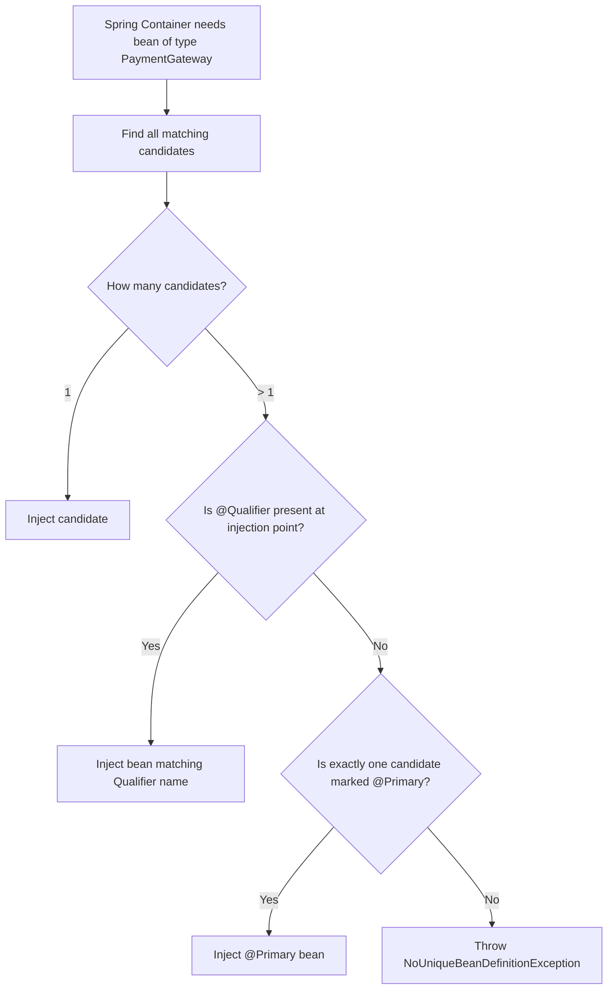

**Java / Spring Boot Example:**
```java
public interface PaymentGateway { void pay(BigDecimal amount); }

// Default bean (Primary)
@Component
@Primary
public class StripePaymentGateway implements PaymentGateway {
    public void pay(BigDecimal amount) { System.out.println("Paid via Stripe"); }
}

// Alternative bean
@Component("paypal")
public class PayPalPaymentGateway implements PaymentGateway {
    public void pay(BigDecimal amount) { System.out.println("Paid via PayPal"); }
}

@Service
public class CheckoutService {
    private final PaymentGateway defaultGateway;
    private final PaymentGateway paypalGateway;

    // Injects Stripe (due to @Primary) and PayPal (due to @Qualifier)
    public CheckoutService(
            PaymentGateway defaultGateway,
            @Qualifier("paypal") PaymentGateway paypalGateway) {
        this.defaultGateway = defaultGateway;
        this.paypalGateway = paypalGateway;
    }
}
```

**Interview Tip:**
Remember: `@Qualifier` always wins over `@Primary`. If a bean is marked `@Primary` but the injection point has `@Qualifier("otherBean")`, Spring will inject `otherBean`.

---

## Q483 — 10. What is annotation you use when you have same type of bean?

**Interview Answer (Short):**
When multiple beans of the same type exist in the Spring container, you use:
1. **`@Qualifier("beanName")`** at the injection point to explicitly specify which bean to inject.
2. **`@Primary`** on one of the bean definitions to designate it as the default choice.
3. Alternatively, name the constructor parameter/field to match the bean name (autowiring by name fallback).

**Detailed Explanation:**
If you have two implementations of `NotificationService` (`EmailNotificationService` and `SmsNotificationService`) and you inject `NotificationService` without disambiguation:
```
NoUniqueBeanDefinitionException: No qualifying bean of type 'NotificationService' available: 
expected single matching bean but found 2: emailNotificationService, smsNotificationService
```

### Solutions:
1. **`@Qualifier` (Most explicit and standard):**
   ```java
   @Autowired
   public NotificationService(@Qualifier("emailNotificationService") NotificationService service) {
       this.service = service;
   }
   ```
2. **`@Primary` (Best when 90% of services use one implementation):**
   ```java
   @Component
   @Primary
   public class EmailNotificationService implements NotificationService { ... }
   ```
3. **Custom Qualified Annotations:**
   You can create custom annotations meta-annotated with `@Qualifier`:
   ```java
   @Target({ElementType.FIELD, ElementType.PARAMETER, ElementType.TYPE})
   @Retention(RetentionPolicy.RUNTIME)
   @Qualifier
   public @interface FastNotification {}
   ```

**Interview Tip:**
Always mention custom qualifiers (`@Qualifier` meta-annotations) in senior interviews. It avoids string-based bean names (`@Qualifier("email")`) that can break during refactoring.

---

## Q557 — 8)@Primary vs @Qualifier in spring

**Interview Answer (Short):**
`@Primary` sets a default bean among multiple candidates at the **declaration level**, while `@Qualifier` selects a specific bean by name at the **injection point**. If both are present, `@Qualifier` takes precedence.

**Detailed Explanation:**

### Comparison Summary:
- **`@Primary`:** *"If nobody asks for a specific implementation, use me by default."*
- **`@Qualifier`:** *"Regardless of any defaults, inject the bean named exactly 'xyz' here."*

**Code Demonstration:**
```java
public interface AlertService { void alert(String msg); }

@Component
@Primary
public class SlackAlertService implements AlertService { ... }

@Component("pagerDuty")
public class PagerDutyAlertService implements AlertService { ... }

@Service
public class MonitoringService {
    // 1. Receives SlackAlertService (resolved via @Primary)
    @Autowired
    private AlertService standardAlert;

    // 2. Receives PagerDutyAlertService (resolved via @Qualifier overriding @Primary)
    @Autowired
    @Qualifier("pagerDuty")
    private AlertService criticalAlert;
}
```

**Interview Tip:**
Point out that using `@Primary` is ideal when introducing a new default implementation (like a Redis cache over an In-Memory cache) without having to touch every injection site in existing code.

---

## Q560 — 3. Spring boot Qualifier and Primary annotation

**Interview Answer (Short):**
In Spring Boot, `@Primary` and `@Qualifier` work identically to core Spring:
- `@Primary` marks a bean as the primary candidate when multiple beans of the same type exist.
- `@Qualifier` disambiguates at the injection point by specifying the exact bean identifier.

Spring Boot also provides specialized qualifiers like `@LoadBalanced` (for `RestTemplate` / `WebClient`) and `@Qualifier` on auto-configured components.

**Detailed Explanation:**
In Spring Boot applications, multiple beans of the same type are extremely common:
- Multiple `DataSource` beans (e.g. Primary MySQL DB and Secondary Analytics DB).
- Multiple `RedisTemplate` beans (e.g. `RedisTemplate<String, Object>` vs `RedisTemplate<String, byte[]>`).
- Multiple `RestClient` or `WebClient` beans with different timeouts or base URLs.

**Java / Spring Boot Example (Multiple DataSources):**
```java
@Configuration
public class DataSourceConfig {

    @Bean
    @Primary
    @ConfigurationProperties("spring.datasource.main")
    public DataSource mainDataSource() {
        return DataSourceBuilder.create().build();
    }

    @Bean("analyticsDataSource")
    @ConfigurationProperties("spring.datasource.analytics")
    public DataSource analyticsDataSource() {
        return DataSourceBuilder.create().build();
    }
}

@Service
public class ReportService {
    private final DataSource analyticsDs;

    // Explicitly requests the analyticsDataSource
    public ReportService(@Qualifier("analyticsDataSource") DataSource analyticsDs) {
        this.analyticsDs = analyticsDs;
    }
}
```

**Interview Tip:**
Mentioning the multi-datasource scenario is a classic, practical Spring Boot use case that interviewers immediately respect.

---

## Q576 — 12. If you have multiple beans, then what you will use in order to know which one to pick ?

**Interview Answer (Short):**
To determine which bean to pick when multiple beans of the same type exist:
1. Use **`@Qualifier("beanName")`** on the injection point.
2. Mark one bean with **`@Primary`** to act as default.
3. Rely on **autowiring by name** by naming the constructor parameter/field identical to the target bean name.
4. Alternatively, inject all beans as a **`List<MyInterface>`** or **`Map<String, MyInterface>`** to inspect or dispatch dynamically at runtime.

**Detailed Explanation:**
Spring's resolution algorithm checks candidates in the following strict order:
1. Check if `@Qualifier` is specified at the injection point -> Match bean name / qualifier value.
2. Check if a single candidate has `@Primary` -> Pick that bean.
3. Check if the variable or parameter name matches one of the candidate bean names -> Pick matching bean.
4. If none of the above resolve the ambiguity -> Throw `NoUniqueBeanDefinitionException`.

**Java / Spring Boot Example (Injecting Map of Beans):**
```java
public interface Exporter {
    String getFormat();
    byte[] export(ReportData data);
}

@Component("csvExporter")
public class CsvExporter implements Exporter { ... }

@Component("pdfExporter")
public class PdfExporter implements Exporter { ... }

@Service
public class ExportManager {
    // Spring injects all beans of type Exporter into a Map keyed by bean name!
    private final Map<String, Exporter> exporters;

    public ExportManager(Map<String, Exporter> exporters) {
        this.exporters = exporters;
    }

    public byte[] export(String format, ReportData data) {
        Exporter exporter = exporters.get(format + "Exporter");
        if (exporter == null) throw new IllegalArgumentException("Unknown format: " + format);
        return exporter.export(data);
    }
}
```

**Interview Tip:**
Mentioning the `Map<String, BeanType>` or `List<BeanType>` injection trick shows you know how to build clean Strategy patterns without writing `switch-case` statements!

---

## Q497 — 11. Why @orderd , @Qualifier annotations are used

**Interview Answer (Short):**
- **`@Qualifier`** is used for **disambiguation**: it identifies *which specific bean* to inject when multiple beans share the same type.
- **`@Order`** is used for **sequencing**: it controls the *execution order or sort priority* when multiple beans are injected into a collection (`List<T>`, array) or when ordered components (like filters, interceptors, or runners) execute.

**Detailed Explanation:**

### Comparison:

| Annotation | Purpose | Scope of Effect | Example Use Case |
| :--- | :--- | :--- | :--- |
| **`@Qualifier`** | Disambiguation (Picks 1 bean out of many) | Single injection point | Ingesting `PayPalService` instead of `StripeService` |
| **`@Order`** | Ordering / Priority (Sequences a collection of beans) | Ordered collections / AOP execution | Ordering web `Filter` chains, `CommandLineRunner`s |

**How `@Order` Works:**
`@Order(1)` runs **before** `@Order(2)`. The lowest integer has the highest priority (`Ordered.HIGHEST_PRECEDENCE = Integer.MIN_VALUE`).
Important: `@Order` does **not** change which bean is injected into a single-reference dependency; it only controls ordering in collections!

**Java / Spring Boot Example:**
```java
public interface SecurityRule {
    boolean validate(Request request);
}

// Higher precedence: runs first
@Component
@Order(1)
public class RateLimitRule implements SecurityRule { ... }

// Lower precedence: runs second
@Component
@Order(2)
public class RoleCheckRule implements SecurityRule { ... }

@Service
public class SecurityPipeline {
    // Spring populates the list in the exact order specified by @Order: [RateLimitRule, RoleCheckRule]
    private final List<SecurityRule> rules;

    public SecurityPipeline(List<SecurityRule> rules) {
        this.rules = rules;
    }

    public boolean validateAll(Request request) {
        return rules.stream().allMatch(rule -> rule.validate(request));
    }
}
```

**Interview Tip:**
Common trap: *"Does `@Order` determine the initialization order of singleton beans during startup?"*
Answer: **No.** Bean creation order is determined by the dependency graph (dependencies are instantiated first). `@Order` only applies to collections of beans and advice/aspect execution order.

---

## Topic: Spring Boot Fundamentals & Auto-configuration

## Q475 — 8.What is Spring Boot, and why choose Spring Boot over Spring Core?

**Interview Answer (Short):**
Spring Boot is an opinionated, production-ready extension of the Spring Framework designed to eliminate boilerplate configuration. 

We choose Spring Boot over Spring Core because:
1. **Auto-Configuration:** Automatically configures beans based on JAR dependencies present on the classpath.
2. **Starter Dependencies:** Curated dependency bundles that eliminate version mismatches.
3. **Embedded Web Servers:** Embeds Tomcat, Jetty, or Undertow, creating a standalone runnable JAR (`java -jar app.jar`) without requiring an external servlet container.
4. **Production Readiness:** Out-of-the-box monitoring, metrics, and health checks via Spring Boot Actuator.

**Detailed Explanation:**

### Comparison Table: Spring Core vs Spring Boot

| Feature | Spring Core / Spring Framework | Spring Boot |
| :--- | :--- | :--- |
| **Philosophy** | Unopinionated, maximum flexibility | Opinionated, convention-over-configuration |
| **Configuration** | Heavy manual XML or `@Configuration` boilerplate | Automatic via `@EnableAutoConfiguration` |
| **Deployment** | Requires deploying WAR to standalone Tomcat/WildFly | Standalone executable JAR with embedded Tomcat |
| **Dependency Management**| Manual dependency declarations with version conflicts | Curated Starter POMs (`spring-boot-starter-web`) |
| **Monitoring** | Requires manual JMX/logging setup | Built-in Actuator endpoints (`/actuator/health`, `/metrics`) |
| **Time to Market** | Days to set up and wire properly | Minutes from initial generation |

**Java / Spring Boot Example:**
In Spring Core, setting up a web app required writing `web.xml`, configuring `DispatcherServlet`, setting up `InternalResourceViewResolver`, and wiring `JacksonHttpMessageConverter`.

In Spring Boot, a single dependency and class is all you need:
```xml
<!-- In pom.xml: Spring Boot Starter web pulls in Tomcat, Spring MVC, Jackson, and Validation -->
<dependency>
    <groupId>org.springframework.boot</groupId>
    <artifactId>spring-boot-starter-web</artifactId>
</dependency>
```

```java
// Complete Spring Boot application:
@SpringBootApplication
@RestController
public class Application {
    @GetMapping("/hello")
    public String hello() { return "Hello, World!"; }

    public static void main(String[] args) {
        SpringApplication.run(Application.class, args);
    }
}
```

**Real-World Usage:**
Virtually all modern Java microservices and enterprise backends are built on Spring Boot because it allows developers to focus purely on business logic rather than infrastructure wiring.

**Interview Tip:**
Do not say *"Spring Boot replaces Spring Framework."* Spring Boot **is built on top of** Spring Framework. It uses the same Spring IoC container, Spring MVC, and Spring Data under the hood.

---

## Q500 — 1. Difference between java and springboot

**Interview Answer (Short):**
- **Java** is a high-level, class-based, object-oriented programming language designed for platform independence via the JVM (Java Virtual Machine).
- **Spring Boot** is an open-source, opinionated framework built *in* Java that simplifies the creation of enterprise-grade, production-ready web applications, microservices, and APIs.

**Detailed Explanation:**
Interviewers sometimes ask this basic question to evaluate whether a candidate understands the relationship between programming languages and frameworks:

### Core Distinctions:
1. **Language vs Framework:** Java provides language syntax, types, concurrency primitives, and the standard JDK library (`java.util`, `java.io`). Spring Boot is a software library ecosystem written using Java that provides architectural scaffolding (web servers, database connectors, security, dependency injection).
2. **Execution:** Java source code is compiled by `javac` into `.class` bytecode executed by the JVM. Spring Boot applications run on the JVM as standard Java programs with a `public static void main` method.
3. **Analogy:** Java is like raw building materials (steel, bricks, mortar); Spring Boot is a pre-fabricated house frame with plumbing and electrical systems already pre-installed.

**Comparison Table:**

| Aspect | Java | Spring Boot |
| :--- | :--- | :--- |
| **Nature** | Programming Language | Application Framework / Ecosystem |
| **Maintained By** | Oracle & OpenJDK Community | VMware Tanzu / Broadcom |
| **Core Components** | JDK, JVM, JRE, Language Syntax | IoC Container, Starters, Auto-config, Actuator |
| **Execution Entry** | JVM loads bytecode | `SpringApplication.run(App.class, args)` |

**Interview Tip:**
Keep the answer crisp and structured. State clearly: *"Java is the underlying programming language and runtime platform, while Spring Boot is an enterprise framework designed on top of Java to accelerate application development."*

---

## Q507 — 1. About Spring and SpringBoot

**Interview Answer (Short):**
- **Spring (Framework):** The foundational open-source enterprise Java framework providing Inversion of Control (IoC), Dependency Injection (DI), Aspect-Oriented Programming (AOP), Spring MVC, and database abstraction.
- **Spring Boot:** An extension built on top of the Spring Framework that provides rapid application development through opinionated defaults, embedded web servers, starter dependencies, and auto-configuration.

**Detailed Explanation:**
Spring Framework was created in 2003 as a lightweight alternative to complex, heavyweight Java EE (EJB). However, as Spring grew, configuring it became complex ("configuration hell" with thousands of lines of XML or verbose `@Configuration` classes).

Spring Boot was launched in 2014 to solve this configuration overhead. It introduces:
1. **Opinionated Defaults:** Assumes standard choices (e.g. HikariCP for connection pooling, Jackson for JSON, Tomcat on port 8080).
2. **Non-functional Features:** Actuator health checks, externalized YAML/properties configuration, and graceful shutdown.

**How They Relate:**
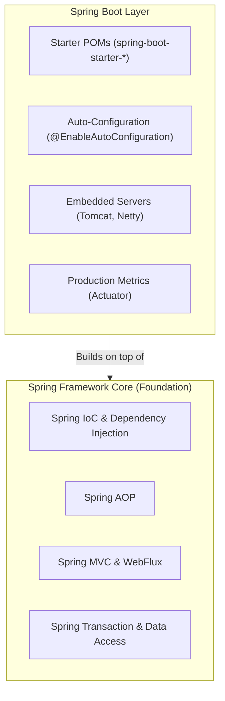

**Interview Tip:**
Always mention: *"Spring Boot does not write code for you; it configures the Spring Framework for you based on reasonable, battle-tested conventions."*

---

## Q510 — 6. SpringBoot advantages with examples

**Interview Answer (Short):**
The core advantages of Spring Boot are:
1. **Auto-Configuration:** Automatically creates beans based on classpath JARs.
2. **Starter Dependencies:** Single dependencies for complete feature sets (`spring-boot-starter-data-jpa`).
3. **Embedded Web Server:** Eliminates standalone server installation; runs with `java -jar`.
4. **Spring Boot Actuator:** Ready-made health, metrics, and environment inspection endpoints.
5. **No XML Boilerplate:** Completely annotation-driven and code-free setup.
6. **Simplified Externalized Config:** Unified `application.yml` with profile support (`dev`, `prod`).

**Detailed Explanation:**

### Examples of Advantages in Action:

1. **Auto-Configuration Example:**
   If you include `h2` and `spring-boot-starter-data-jpa`, Spring Boot automatically configures an in-memory `DataSource`, an `EntityManagerFactory`, and a `PlatformTransactionManager` without you writing a single line of config code.
2. **Starter Dependencies Example:**
   Instead of hunting down compatible versions of 10 different Hibernate, JPA, and JDBC jars, you specify one line:
   ```xml
   <dependency>
       <groupId>org.springframework.boot</groupId>
       <artifactId>spring-boot-starter-data-jpa</artifactId>
   </dependency>
   ```
3. **Embedded Server Example:**
   No need to download, configure, or administer Tomcat. The WAR deployment step is gone. Microservices are packaged as standalone executable JARs, perfect for Docker containers and Kubernetes.

**Java / Spring Boot Example:**
```java
// A fully functional microservice in under 20 lines of code:
@SpringBootApplication
@RestController
@RequestMapping("/orders")
public class OrderApp {
    private final List<String> orders = List.of("ORD-101", "ORD-102");

    @GetMapping
    public List<String> getOrders() { return orders; }

    public static void main(String[] args) {
        SpringApplication.run(OrderApp.class, args);
    }
}
```

**Real-World Usage:**
In cloud-native architectures, containerizing an executable Spring Boot JAR with Docker requires a simple multi-stage Dockerfile (`FROM eclipse-temurin:21-jre-alpine`).

**Interview Tip:**
Highlight containerization: Spring Boot's embedded server model is what made Java the dominant language for microservices and cloud-native deployments.

---

## Q529 — 4)Spring Boot

**Interview Answer (Short):**
Spring Boot is an enterprise-grade Java application framework built on top of the Spring Framework. It streamlines development through auto-configuration, starter dependency descriptors, embedded servlet containers, and production-ready operational metrics.

**Detailed Explanation:**
To deliver a senior-level answer on "Spring Boot", cover its four architectural pillars:
1. **Spring Boot Starters:** Aggregated Maven/Gradle dependencies guaranteeing tested, compatible version combinations.
2. **Auto-Configuration Engine:** Evaluates conditions (`@ConditionalOnClass`, `@ConditionalOnProperty`) at startup to configure default beans.
3. **Spring Boot CLI & Initializr:** Tools for scaffolding new projects instantly (`start.spring.io`).
4. **Actuator:** Production monitoring features providing operational insight into running applications.

**Java / Spring Boot Example:**
```java
// The entry point of every Spring Boot application
@SpringBootApplication
public class BackendServiceApplication {
    public static void main(String[] args) {
        // Initializes ApplicationContext, starts embedded Tomcat, runs CommandLineRunners
        SpringApplication.run(BackendServiceApplication.class, args);
    }
}
```

**Interview Tip:**
Mention `start.spring.io` (Spring Initializr) and explain that Spring Boot enables a developer to go from concept to a running REST API in under 5 minutes.

---

## Q530 — 4.1)difference between spring and springboot

**Interview Answer (Short):**
The core difference is that **Spring Framework** provides the fundamental capabilities (IoC, DI, AOP, MVC) but requires extensive manual configuration, whereas **Spring Boot** is a tool built on top of Spring that automates configuration, embeds servers, manages dependencies, and packages applications into standalone executable JARs.

**Detailed Explanation:**

### Deep Technical Comparison:

| Characteristic | Spring Framework | Spring Boot |
| :--- | :--- | :--- |
| **Entry Point** | Context loaded via `web.xml` or `AnnotationConfigWebApplicationContext` | `public static void main` invoking `SpringApplication.run()` |
| **Server Requirement** | External Application Server (Tomcat, JBoss, WebLogic) | Embedded Server (Tomcat, Jetty, Undertow) included inside JAR |
| **Configuration Style** | Explicit: Developer must define `DataSource`, `ViewResolver`, etc. | Implicit: Auto-configuration configures defaults unless overridden |
| **Dependency Management**| Manual version management across dozens of JARs | Starter POMs with curated dependency tree and version management |
| **Monitoring** | Manual implementation or third-party libraries | Native Actuator endpoints (`/health`, `/metrics`, `/prometheus`) |
| **Packaging** | Typically `.war` files | Typically standalone `.jar` files |

**Java / Spring Boot Example:**
```java
// Spring Framework requires explicit DispatcherServlet registration:
public class MyWebAppInitializer implements WebApplicationInitializer {
    @Override
    public void onStartup(ServletContext container) {
        AnnotationConfigWebApplicationContext context = new AnnotationConfigWebApplicationContext();
        context.register(AppConfig.class);
        ServletRegistration.Dynamic dispatcher = container.addServlet("dispatcher", new DispatcherServlet(context));
        dispatcher.setLoadOnStartup(1);
        dispatcher.addMapping("/");
    }
}

// Spring Boot replaces ALL the above with zero configuration:
@SpringBootApplication
public class Application {
    public static void main(String[] args) { SpringApplication.run(Application.class, args); }
}
```

**Interview Tip:**
Summarize with: *"Spring is the engine; Spring Boot is the complete luxury car built around that engine with automatic transmission and dashboard diagnostics."*

---

## Q535 — • Springboot vs spring

**Interview Answer (Short):**
Spring is the core framework providing Dependency Injection and architectural features. Spring Boot is an opinionated packaging and runtime tool that removes the configuration complexity of Spring by providing auto-configuration, starter dependencies, and embedded servers.

**Detailed Explanation:**
In interviews, summarize the evolution:
- **Phase 1 (Spring XML):** XML everywhere. High flexibility, but slow and verbose.
- **Phase 2 (Spring Annotations):** `@Configuration` and `@Bean` reduced XML, but configuration boilerplate remained high.
- **Phase 3 (Spring Boot):** Auto-configuration. If Spring Boot sees `spring-webmvc` on the classpath, it assumes you are building a web app and configures `DispatcherServlet` for you.

**Interview Tip:**
Reiterate that Spring Boot does not replace the Spring Framework; it embraces it while removing boilerplate.

---

## Q539 — 9. Why we use SpringBoot Over Spring Framework

**Interview Answer (Short):**
We use Spring Boot over the raw Spring Framework because it dramatically improves developer productivity, reduces time-to-market, eliminates dependency conflicts via Starter POMs, removes the operational overhead of managing external application servers through embedded containers, and provides built-in production telemetry via Actuator.

**Detailed Explanation:**
In modern enterprise development, agility and operational simplicity are paramount. 

### Why Enterprise Engineering Teams Choose Spring Boot:
1. **Microservices Ready:** Microservices need to boot quickly, run in isolated Docker containers, and require no external servlet container setup. Spring Boot standalone JARs are the gold standard for containerization.
2. **Dependency Convergence:** Upgrading Spring dependencies manually often led to version incompatibilities (e.g. Hibernate 5.4 requiring an older Jackson version). Spring Boot's Bill of Materials (BOM) guarantees all libraries are tested and compatible.
3. **Observability:** Cloud-native platforms (Kubernetes, AWS ECS) require standard health probes (`liveness` and `readiness`). Spring Boot Actuator provides these natively without extra coding.
4. **Rapid Prototyping:** A new engineer can build and test a functional microservice on day one without spending hours configuring build scripts and server XMLs.

**Real-World Usage:**
Kubernetes deployments leverage Spring Boot's built-in probes:
```yaml
livenessProbe:
  httpGet:
    path: /actuator/health/liveness
    port: 8080
readinessProbe:
  httpGet:
    path: /actuator/health/readiness
    port: 8080
```

**Interview Tip:**
Mentioning the Kubernetes liveness/readiness probes demonstrates that you think beyond local coding to production DevOps operations.

---

## Q514 — 2  Explain about @SpringBootApplication?

**Interview Answer (Short):**
`@SpringBootApplication` is the primary bootstrap annotation placed on the main class of a Spring Boot application. It is a composite (meta) annotation that combines three essential annotations:
1. **`@SpringBootConfiguration`:** A specialized form of `@Configuration` indicating that the class can define `@Bean` methods.
2. **`@EnableAutoConfiguration`:** Enables Spring Boot's auto-configuration engine to guess and configure beans based on classpath dependencies.
3. **`@ComponentScan`:** Enables automatic discovery of `@Component`, `@Service`, `@Repository`, and `@Controller` beans in the current package and all sub-packages.

**Detailed Explanation:**

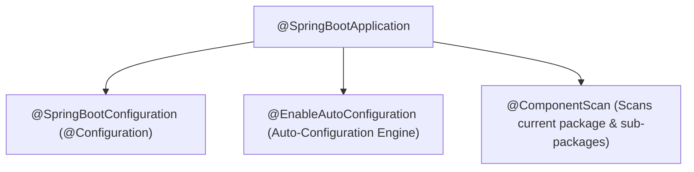

### The Three Annotations Deconstructed:
1. **`@SpringBootConfiguration`:**
   - Mentions that the annotated class is a configuration class.
   - Allows declaring `@Bean` methods directly in the main class.
2. **`@EnableAutoConfiguration`:**
   - Tells Spring Boot to start adding beans based on classpath settings, other beans, and property settings.
   - For example, if `spring-webmvc` is on the classpath, it sets up `DispatcherServlet`.
3. **`@ComponentScan`:**
   - Without parameters, it defaults to scanning the package of the declaring class and all child packages.
   - **Crucial Rule:** Always place your `@SpringBootApplication` class in the root package (e.g. `com.example.project`) so all sub-packages (`.controller`, `.service`, `.repository`) are scanned.

**Java / Spring Boot Example:**
```java
package com.mycompany.myapp;

// Meta-annotated: combines @Configuration, @EnableAutoConfiguration, @ComponentScan
@SpringBootApplication
public class MyApp {
    public static void main(String[] args) {
        SpringApplication.run(MyApp.class, args);
    }
}
```

**Common Follow-up Questions:**
- What happens if a service is located in a package outside the main application package? (It will NOT be scanned unless explicitly added via `@ComponentScan(basePackages = "com.other")`).
- Can you exclude specific auto-configurations? (Yes: `@SpringBootApplication(exclude = {DataSourceAutoConfiguration.class})`).

**Interview Tip:**
Always mention the package scanning boundary rule: placing your main class in the default (empty) package or in a child sub-package causes beans in other sibling packages to be silently ignored!

---

## Q526 — • @springbootapplication annotation explain the working.

**Interview Answer (Short):**
`@SpringBootApplication` works by triggering a three-phase bootstrap when `SpringApplication.run()` is called:
1. It registers the annotated class as a Spring `@Configuration` source.
2. It activates `@ComponentScan` from the base package downwards, discovering all application components.
3. It triggers `@EnableAutoConfiguration`, which reads configuration factories from `META-INF/spring/org.springframework.boot.autoconfigure.AutoConfiguration.imports`, evaluates conditional annotations (`@ConditionalOnClass`, `@ConditionalOnMissingBean`), and registers pre-configured framework beans.

**Detailed Explanation:**
Here is what happens step by step when you run `@SpringBootApplication`:

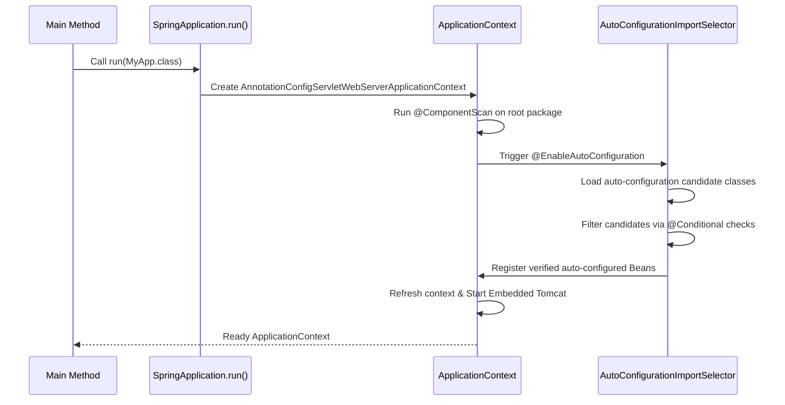

### The Auto-configuration Import Phase:
`@EnableAutoConfiguration` imports the `AutoConfigurationImportSelector`. 
In Spring Boot 3+, it reads candidate auto-configuration classes from:
`META-INF/spring/org.springframework.boot.autoconfigure.AutoConfiguration.imports`

Each candidate class is inspected:
- Does it meet `@ConditionalOnClass`? (Are required classes present on the classpath?)
- Does it meet `@ConditionalOnMissingBean`? (Has the developer NOT already defined their own bean?)
- Does it meet `@ConditionalOnProperty`? (Is the feature enabled in properties?)

If all conditions pass, Spring Boot instantiates and registers the auto-configured beans.

**Java / Spring Boot Example:**
```java
// Excluding unwanted auto-configuration:
@SpringBootApplication(exclude = {
    DataSourceAutoConfiguration.class,
    SecurityAutoConfiguration.class
})
public class LightweightApp {
    public static void main(String[] args) {
        SpringApplication.run(LightweightApp.class, args);
    }
}
```

**Interview Tip:**
Knowing the exact location of auto-configuration definitions (`META-INF/spring/org.springframework.boot.autoconfigure.AutoConfiguration.imports` in Spring Boot 3 vs `spring.factories` in Spring Boot 2) demonstrates current, up-to-date knowledge.

---

## Q537 — • Explain about Springbootapplication 
annotation

**Interview Answer (Short):**
`@SpringBootApplication` is the primary configuration annotation in Spring Boot. It combines `@SpringBootConfiguration` (enables Java-based bean definition), `@EnableAutoConfiguration` (enables intelligent convention-based configuration), and `@ComponentScan` (enables package-level bean discovery).

**Detailed Explanation:**
In interviews, be ready to explain the customization options available on `@SpringBootApplication`:

1. **`exclude` and `excludeName`:** Exclude specific auto-configuration classes you don't want (e.g. disabling default security or datasource config).
2. **`scanBasePackages`:** Manually configure the packages to scan if your project structure spans multiple root namespaces.
3. **`proxyBeanMethods`:** Inherited from `@SpringBootConfiguration`. Defaults to `true`, but setting to `false` disables CGLIB proxying on the main class for faster startup.

**Java / Spring Boot Example:**
```java
@SpringBootApplication(
    scanBasePackages = {"com.company.auth", "com.company.billing"},
    exclude = { RedisAutoConfiguration.class },
    proxyBeanMethods = false
)
public class BillingApplication {
    public static void main(String[] args) {
        SpringApplication.run(BillingApplication.class, args);
    }
}
```

**Interview Tip:**
Mention that `@SpringBootApplication` should be located at the top of your package hierarchy so component scanning automatically reaches all sub-modules without manual `scanBasePackages` configuration.

---

## Q559 — 4. Explain spring boot auto configuration.

**Interview Answer (Short):**
Spring Boot Auto-Configuration is an intelligent mechanism that automatically configures beans in the `ApplicationContext` based on the JAR libraries detected on the classpath and defined properties. 

It works using the `@EnableAutoConfiguration` annotation, which loads candidate auto-configuration classes and evaluates **Conditional Annotations** (`@ConditionalOnClass`, `@ConditionalOnMissingBean`, `@ConditionalOnProperty`). If conditions evaluate to true, Spring Boot automatically instantiates and registers those beans.

**Detailed Explanation:**

### The Engine Behind Auto-Configuration:
1. **Trigger:** `@EnableAutoConfiguration` (part of `@SpringBootApplication`).
2. **Selector:** `AutoConfigurationImportSelector` reads candidate classes listed in:
   - Spring Boot 3+: `META-INF/spring/org.springframework.boot.autoconfigure.AutoConfiguration.imports`
   - Spring Boot 2.x: `META-INF/spring.factories`
3. **Condition Evaluation:** Over 100 auto-configuration classes are evaluated at startup, but only those matching specific conditions are applied.

### Common Conditional Annotations:

| Annotation | Explanation | Real-World Example |
| :--- | :--- | :--- |
| **`@ConditionalOnClass`** | Applies only if specified classes are present on the classpath | `DataSourceAutoConfiguration` checks if `javax.sql.DataSource` is on classpath |
| **`@ConditionalOnMissingBean`**| Applies only if the developer has NOT already created a custom bean of that type | Spring creates default `ObjectMapper` only if you haven't declared your own |
| **`@ConditionalOnProperty`** | Applies only if an application property has a specific value | Enables caching only if `spring.cache.type=redis` |
| **`@ConditionalOnWebApplication`**| Applies only if running in a web application context | Configures `DispatcherServlet` only in web apps |

**How It Works:**
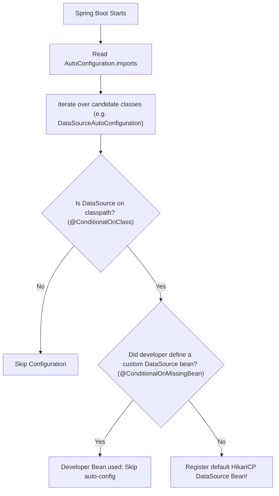

**Java / Spring Boot Example (Simulating Auto-Configuration):**
```java
@Configuration
@ConditionalOnClass(DataSource.class)
@AutoConfigureAfter(JmxAutoConfiguration.class)
public class CustomDatabaseAutoConfiguration {

    // Creates default connection pool only if developer hasn't created one
    @Bean
    @ConditionalOnMissingBean(DataSource.class)
    public DataSource defaultDataSource() {
        return new HikariDataSource();
    }
}
```

**Real-World Usage:**
Auto-configuration is why adding `spring-boot-starter-web` instantly boots an embedded Tomcat server with Jackson JSON serialization ready to go without configuring a single servlet or converter.

**Interview Tip:**
Always emphasize: **"Developer configuration always overrides auto-configuration."** Because auto-configured beans use `@ConditionalOnMissingBean`, as soon as you define your own `@Bean`, Spring Boot gracefully backs off and lets your bean take precedence.

---

# Priority 2 — High Priority

## Topic: Spring Boot Annotations Overview

## Q494 — Spring Boot annotations

**Interview Answer (Short):**
Spring Boot annotations can be grouped into five essential categories:
1. **Core / Bootstrapping:** `@SpringBootApplication`, `@EnableAutoConfiguration`, `@ConfigurationProperties`.
2. **Stereotypes:** `@Component`, `@Service`, `@Repository`, `@Controller`, `@RestController`.
3. **Dependency Injection:** `@Autowired`, `@Qualifier`, `@Primary`, `@Value`, `@Bean`.
4. **Web / REST:** `@GetMapping`, `@PostMapping`, `@RequestBody`, `@PathVariable`, `@RequestParam`.
5. **Conditional Configuration:** `@ConditionalOnClass`, `@ConditionalOnMissingBean`, `@ConditionalOnProperty`.

**Detailed Explanation:**
Annotations in Spring Boot eliminate boilerplate XML configuration and instruct the framework on how to discover, configure, and wire components:

### Key Annotation Categories:
- **Bootstrap & Config:** Configure the environment and enable automated features.
- **Stereotypes:** Define architectural layer responsibilities and register beans in the IoC container.
- **REST & HTTP:** Map HTTP request verbs and parse incoming headers, path parameters, query parameters, and JSON payloads.
- **Data & Transactions:** Manage database interactions (`@Transactional`, `@Entity`, `@Repository`).
- **Operational:** Feature flags and health monitors (`@Profile`, `@Endpoint`).

**Java / Spring Boot Example:**
```java
@RestController
@RequestMapping("/api/v1/products")
public class ProductApiController {

    private final ProductService productService;

    public ProductApiController(ProductService productService) {
        this.productService = productService;
    }

    @PostMapping
    public ResponseEntity<ProductResponse> createProduct(
            @Valid @RequestBody ProductCreateRequest request) {
        ProductResponse response = productService.create(request);
        return ResponseEntity.status(HttpStatus.CREATED).body(response);
    }
}
```

**Interview Tip:**
Structure your response by **categories** rather than reciting random annotation names. Interviewers appreciate candidates who think in architectural layers.

---

## Q498 — 12. Explain different annotations used in spring application

**Interview Answer (Short):**
In a typical Spring application, annotations drive the entire architecture:
- **Component Discovery:** `@Component`, `@Service`, `@Repository`, `@Controller`.
- **Bean Creation & Config:** `@Configuration`, `@Bean`, `@Scope`, `@Lazy`.
- **Dependency Wiring:** `@Autowired`, `@Qualifier`, `@Primary`.
- **Web Layer:** `@RestController`, `@RequestMapping`, `@PathVariable`, `@RequestBody`, `@ExceptionHandler`.
- **AOP & Cross-Cutting:** `@Transactional`, `@Async`, `@Aspect`, `@Cacheable`.

**Detailed Explanation:**
Spring annotations act as declarative metadata. Rather than writing procedural code to manage transactions or security, you annotate methods:

### Cross-Cutting Annotations:
- **`@Transactional`:** Manages database transaction boundaries automatically via an AOP proxy.
- **`@Async`:** Offloads method execution to a background thread pool managed by `TaskExecutor`.
- **`@Cacheable`:** Intercepts method calls and returns cached results if available, skipping method execution.
- **`@Scheduled`:** Executes methods periodically based on cron expressions or fixed delays.

**Java / Spring Boot Example:**
```java
@Service
public class OrderFulfillmentService {

    @Transactional // AOP wraps with begin, commit, rollback
    public void completeOrder(Long orderId) {
        // Database update logic
    }

    @Async // Runs on background worker thread
    public CompletableFuture<Void> sendFulfillmentNotification(String email) {
        // Non-blocking email dispatch
        return CompletableFuture.completedFuture(null);
    }

    @Cacheable(value = "orderCatalog", key = "#catalogId")
    public CatalogDetails getCatalog(String catalogId) {
        // Expensive query cached in Redis/Caffeine
        return fetchFromDatabase(catalogId);
    }
}
```

**Interview Tip:**
Mention that cross-cutting annotations like `@Transactional`, `@Async`, and `@Cacheable` rely on **Spring AOP Proxies**, meaning self-invocation (calling an annotated method from within the same class) will bypass the proxy!

---

## Q506 — 12) Are you familiar with Spring Boot annotations? Can you name a few?

**Interview Answer (Short):**
Yes, I work with Spring Boot annotations daily. The most critical ones I use are:
- `@SpringBootApplication`: Entry point combining configuration, auto-configuration, and component scanning.
- `@RestController` & `@RequestMapping` (with `@GetMapping`, `@PostMapping`): Building RESTful APIs.
- `@Service` & `@Repository`: Structuring business logic and database persistence.
- `@Autowired` / Constructor Injection: Wiring dependencies.
- `@Transactional`: Managing database transaction boundaries.
- `@ConfigurationProperties`: Type-safe mapping of `application.yml` properties.

**Detailed Explanation:**
When an interviewer asks *"Can you name a few annotations?"*, do not just list names—briefly explain the **purpose** and **production context** of each one.

### Top 6 Everyday Annotations Explained:
1. **`@SpringBootApplication`:** Sits on the main application class; powers the startup process.
2. **`@RestController`:** Tells Spring that every method writes its response directly into the HTTP response body as JSON.
3. **`@Service`:** Identifies domain services holding core business logic.
4. **`@ConfigurationProperties`:** Binds hierarchical configuration properties into validated Java objects.
5. **`@ExceptionHandler`:** Catches specific exceptions thrown by controllers to format standard error responses.
6. **`@Transactional`:** Ensures atomicity across multiple repository operations.

**Java / Spring Boot Example:**
```java
@ConfigurationProperties(prefix = "app.payment")
public record PaymentConfig(String apiKey, int timeoutSeconds, URI endpointUrl) {}
```

**Interview Tip:**
Mentioning `@ConfigurationProperties` shows you know modern, type-safe configuration management rather than relying solely on raw `@Value` strings.

---

## Q508 — 15. SpringBootAnnotations

**Interview Answer (Short):**
SpringBootAnnotations are annotations specific to or heavily utilized by Spring Boot to enable auto-configuration, configuration property binding, testing, and conditional bean creation. Examples include `@SpringBootApplication`, `@EnableAutoConfiguration`, `@ConfigurationProperties`, `@ConditionalOnProperty`, `@SpringBootTest`, and `@WebMvcTest`.

**Detailed Explanation:**
While many annotations originate from core Spring Framework, Spring Boot introduces specialized annotations that power its opinionated conventions:

### Spring Boot Specific Annotations:
- **`@SpringBootConfiguration`:** Replaces `@Configuration` for Spring Boot bootstrap classes.
- **`@EnableAutoConfiguration`:** Enables classpath scanning for auto-configuration classes.
- **`@ConfigurationProperties`:** Maps nested properties to strongly typed Java beans or records.
- **`@ConditionalOn*` Family:** Conditional annotations controlling bean creation based on environmental conditions.
- **Test Slices:** `@SpringBootTest` (full context), `@WebMvcTest` (controller slice), `@DataJpaTest` (repository slice).

**Comparison Table: Spring Boot Testing Slices:**

| Test Annotation | Context Loaded | Speed | Purpose |
| :--- | :--- | :--- | :--- |
| **`@SpringBootTest`** | Entire ApplicationContext (All beans) | Slow | End-to-end integration testing |
| **`@WebMvcTest`** | Controllers, Filters, Security only | Fast | Testing REST controller endpoints |
| **`@DataJpaTest`** | JPA Entities, Repositories, DataSource | Fast | Testing database queries and mappings |

**Interview Tip:**
Mentioning test slice annotations like `@WebMvcTest` and `@DataJpaTest` demonstrates that you know how to write fast, targeted Spring Boot unit and integration tests.

---

## Q513 — spring boot annotation

**Interview Answer (Short):**
Spring Boot annotations are the declarative building blocks used to configure applications without XML. They declare components (`@Service`, `@Repository`), map REST endpoints (`@GetMapping`, `@PostMapping`), manage dependencies, bind configuration (`@Value`, `@ConfigurationProperties`), and control conditional feature activation (`@ConditionalOnProperty`).

**Detailed Explanation:**
In interviews, you can categorize them into the lifecycle of an HTTP request:
1. **Entry:** Request hits `@RestController` mapped by `@GetMapping("/{id}")`.
2. **Extraction:** Path parameter parsed via `@PathVariable`, payload parsed via `@RequestBody`.
3. **Delegation:** Injected into `@Service` via constructor injection.
4. **Transaction:** Method annotated with `@Transactional` ensures atomicity.
5. **Persistence:** Executed via `@Repository` / Spring Data JPA repository.
6. **Exception:** Handled globally by `@RestControllerAdvice` and `@ExceptionHandler`.

**Real-World Usage:**
Every production REST API in Spring Boot is a composition of these layered annotations working in unison.

**Interview Tip:**
Walk through the request lifecycle above—it proves you understand how annotations connect across architectural layers.

---

## Q521 — 4            springboot and its annotations

**Interview Answer (Short):**
Spring Boot uses annotations to drive convention-over-configuration. Instead of manual XML or programmatic configuration, annotations instruct Spring Boot on how to build the application graph, what auto-configurations to apply, which endpoints to expose, and how to serialize data.

**Detailed Explanation:**
Key annotations that define the Spring Boot development experience:
- **`@SpringBootApplication`:** Automates discovery and auto-configuration.
- **`@RestController`:** Simplifies API creation by automatically including `@ResponseBody`.
- **`@ResponseStatus`:** Defines HTTP status codes (e.g. `201 CREATED`, `204 NO_CONTENT`) declaratively.
- **`@Validated` / `@Valid`:** Triggers Hibernate Validator on incoming DTOs.
- **`@Profile`:** Conditionally activates beans based on active environments (`dev`, `prod`).

**Java / Spring Boot Example:**
```java
@RestController
@RequestMapping("/api/users")
@Validated
public class UserController {

    @PostMapping
    @ResponseStatus(HttpStatus.CREATED)
    public UserResponse createUser(@Valid @RequestBody UserCreateDto dto) {
        // If validation fails, MethodArgumentNotValidException is thrown automatically
        return new UserResponse(101L, dto.name());
    }
}
```

**Interview Tip:**
Point out that combining `@Validated` with `@Valid` on controller methods enforces validation at the HTTP boundary before business logic ever executes.

---

## Q532 — 4.3)annotations used in springboot

**Interview Answer (Short):**
The core annotations used in Spring Boot are:
1. **App Level:** `@SpringBootApplication`, `@EnableScheduling`, `@EnableAsync`, `@EnableCaching`.
2. **Controller Level:** `@RestController`, `@RequestMapping`, `@GetMapping`, `@PostMapping`, `@PutMapping`, `@DeleteMapping`.
3. **Service & Data:** `@Service`, `@Repository`, `@Transactional`.
4. **Dependency & Injection:** `@Autowired`, `@Qualifier`, `@Primary`, `@Value`, `@Bean`.
5. **Exception Handling:** `@RestControllerAdvice`, `@ExceptionHandler`.

**Detailed Explanation:**
A comprehensive summary of how these annotations interact:
- **`@EnableScheduling`:** Turns on background cron and fixed-rate task execution.
- **`@EnableAsync`:** Activates Spring's asynchronous method execution via background thread pools.
- **`@EnableCaching`:** Activates annotation-driven cache management.
- **`@Value("${my.prop}")`:** Injects single configuration values from `application.yml`.
- **`@RestControllerAdvice`:** Centralizes exception handling across all controllers.

**Interview Tip:**
Mentioning the `@Enable*` annotations (`@EnableCaching`, `@EnableScheduling`, `@EnableAsync`) shows you know how to turn on Spring Boot's modular infrastructure features.

---

## Q533 — 8.  some annotations in springboot (Eg. controller, RestController etc.)

**Interview Answer (Short):**
The most important web annotations in Spring Boot are `@Controller` and `@RestController`:
- **`@Controller`:** Traditional Spring MVC controller used for returning **views (HTML/JSP)**. Methods return a String representing the view name resolved by a `ViewResolver`.
- **`@RestController`:** Specialized controller for **RESTful Web Services**. It is meta-annotated with `@Controller` and `@ResponseBody`. Every method automatically serializes its return value directly into HTTP response body (JSON/XML) via `HttpMessageConverter`.

**Detailed Explanation:**

### Comparison Table: @Controller vs @RestController

| Feature | `@Controller` | `@RestController` |
| :--- | :--- | :--- |
| **Meta-Annotations** | `@Component` | `@Controller` + `@ResponseBody` |
| **Primary Purpose** | Traditional MVC web applications (HTML views) | REST APIs (JSON / XML payloads) |
| **Return Value Meaning** | View template name (e.g., `"index"` -> `index.html`) | Response data payload (serialized to JSON) |
| **Requires `@ResponseBody`?** | Yes, if you want to return raw data/JSON | No, automatically applied to all methods |
| **View Resolver** | Invoked to render HTML | Bypassed completely |

**Java / Spring Boot Example:**
```java
// Traditional MVC: Returns view template name
@Controller
public class WebPageController {
    @GetMapping("/home")
    public String homePage(Model model) {
        model.addAttribute("username", "Abhijeet");
        return "home"; // Resolves to /templates/home.html (e.g. Thymeleaf)
    }
}

// REST API: Returns JSON data
@RestController
@RequestMapping("/api")
public class UserApiController {
    @GetMapping("/user")
    public UserDto getUser() {
        return new UserDto(1L, "Abhijeet"); // Jackson serializes to {"id":1,"name":"Abhijeet"}
    }
}
```

**Interview Tip:**
Always mention that `@RestController` is simply a convenience shortcut for `@Controller` + `@ResponseBody`. If you put `@ResponseBody` on a method in a `@Controller`, it behaves exactly like a method in a `@RestController`.

---

## Q550 — 10 spring annotation.@autowired,@primary,@bean

**Interview Answer (Short):**
- **`@Autowired`:** Marks a dependency to be injected automatically by type by the Spring container.
- **`@Primary`:** Gives higher preference to a bean when multiple beans of the same type exist.
- **`@Bean`:** Declares a method inside a `@Configuration` class whose returned object is registered as a Spring bean.

**Detailed Explanation:**

### How They Work Together:
Imagine you have an external payment SDK with two implementations:

```java
// Registering beans with @Bean and @Primary:
@Configuration
public class PaymentProviderConfig {

    @Bean
    @Primary // Default choice when no qualifier is specified
    public PaymentClient standardStripeClient() {
        return new StripeClient("live_key");
    }

    @Bean("sandboxStripe")
    public PaymentClient sandboxStripeClient() {
        return new StripeClient("test_key");
    }
}

// Consuming beans with @Autowired / Constructor Injection:
@Service
public class BillingService {
    private final PaymentClient defaultClient;
    private final PaymentClient sandboxClient;

    // @Autowired is implicitly active on constructor
    public BillingService(
            PaymentClient defaultClient, // Receives standardStripeClient (via @Primary)
            @Qualifier("sandboxStripe") PaymentClient sandboxClient) {
        this.defaultClient = defaultClient;
        this.sandboxClient = sandboxClient;
    }
}
```

**Interview Tip:**
Explain the interaction: `@Bean` defines and creates instances, `@Primary` resolves ambiguity at definition time, and `@Autowired` wires the resolved bean into dependent classes.

---

## Q572 — spring boot annotations 
what run method will do 
ioc and dependency injection 
few more which he is recollecting

**Interview Answer (Short):**
Spring Boot annotations provide a declarative model for building enterprise microservices. They replace XML configuration, activate auto-configuration, establish REST controllers, wire dependencies, manage transactions, handle global errors, and bind external properties.

**Detailed Explanation:**
In senior technical interviews, discuss annotations in terms of **underlying mechanics**:
1. **Processing Model:** Many annotations (like `@Autowired`, `@Value`, `@PostConstruct`) are processed at runtime by `BeanPostProcessor` implementations.
2. **Proxying Mechanisms:** Cross-cutting annotations (`@Transactional`, `@Async`, `@Cacheable`) cause Spring to wrap the target bean in a dynamic proxy using either **CGLIB** (class subclassing) or **JDK Dynamic Proxies** (interface implementation).
3. **Conditionals:** Annotations like `@ConditionalOnClass` inspect the ClassLoader before deciding whether to invoke `@Bean` methods.

**Interview Tip:**
Summarize by stating: *"Spring Boot annotations are not magic; they are metadata processed either by BeanPostProcessors during bean initialization or by AOP proxies to inject cross-cutting behavior."*

---

## Topic: Spring MVC, REST Controllers & Input Handling

## Q476 — 11.How do you take input from a client in a Spring Boot application and send a response 
back?

**Interview Answer (Short):**
In a Spring Boot application:
- **Taking Input:** We use annotations inside a `@RestController`:
  1. `@RequestBody`: Reads JSON/XML payload from HTTP request body.
  2. `@PathVariable`: Extracts dynamic values from URI path segments.
  3. `@RequestParam`: Extracts query parameters (`?page=1&size=10`).
  4. `@RequestHeader`: Reads HTTP headers (e.g., `Authorization`, `X-Correlation-Id`).
- **Sending Response:** Methods return DTO objects wrapped in `ResponseEntity<T>`, allowing explicit control over HTTP status codes, headers, and the response body. Jackson automatically serializes the object to JSON.

**Detailed Explanation:**

### Input Mechanisms:
- **`@PathVariable`:** Used for identifying specific resources (e.g. `/api/orders/{id}`).
- **`@RequestParam`:** Used for filtering, sorting, and pagination (e.g. `/api/orders?status=PENDING&page=0`).
- **`@RequestBody`:** Used for create and update payloads in `POST`, `PUT`, and `PATCH` requests.
- **`@RequestHeader`:** Used for passing metadata like authentication tokens, tenant IDs, and tracing IDs.

**Java / Spring Boot Example:**
```java
@RestController
@RequestMapping("/api/v1/orders")
public class OrderController {

    private final OrderService orderService;

    public OrderController(OrderService orderService) {
        this.orderService = orderService;
    }

    @PostMapping("/{customerId}")
    public ResponseEntity<OrderResponse> createOrder(
            @PathVariable Long customerId,
            @RequestParam(defaultValue = "STANDARD") String deliveryType,
            @RequestHeader("X-Trace-Id") String traceId,
            @Valid @RequestBody OrderRequest request) {

        OrderResponse response = orderService.processOrder(customerId, deliveryType, request, traceId);
        
        return ResponseEntity
                .status(HttpStatus.CREATED)
                .header("X-Response-Trace-Id", traceId)
                .body(response);
    }
}
```

**Interview Tip:**
Always mention returning `ResponseEntity<T>` rather than raw POJOs. `ResponseEntity` lets you explicitly set status codes (e.g. `201 CREATED`, `204 NO_CONTENT`, `404 NOT_FOUND`) and custom HTTP headers.

---

## Q517 — 8  Step by Step Process to create a spring boot application for a entity employee?

**Interview Answer (Short):**
To build a Spring Boot CRUD application for an Employee entity:
1. **Initialize Project:** Include `spring-boot-starter-web`, `spring-boot-starter-data-jpa`, `validation`, and database driver (e.g. PostgreSQL).
2. **Create Entity (`@Entity`):** Define `Employee` with primary key `@Id @GeneratedValue`.
3. **Create Repository:** Extend `JpaRepository<Employee, Long>`.
4. **Create DTOs & Validation:** Define Request/Response records with validation (`@NotBlank`, `@Email`).
5. **Create Service Layer (`@Service`):** Implement business logic and mark transactions with `@Transactional`.
6. **Create Controller (`@RestController`):** Expose REST endpoints with proper HTTP verbs.
7. **Add Global Exception Handler (`@RestControllerAdvice`):** Handle `ResourceNotFoundException`.

**Detailed Explanation:**

### Step-by-Step Architecture:
```text
HTTP Request ──> Controller ──> Service ──> JpaRepository ──> Database (PostgreSQL)
                   │              │              │
                DTO/Record    Business Logic  Hibernate Entity
```

**Java / Spring Boot Example:**
```java
// 1. Entity
@Entity
@Table(name = "employees")
public class Employee {
    @Id
    @GeneratedValue(strategy = GenerationType.IDENTITY)
    private Long id;
    private String name;
    private String department;
    private BigDecimal salary;
    // Getters and setters
}

// 2. Repository
@Repository
public interface EmployeeRepository extends JpaRepository<Employee, Long> {
    List<Employee> findByDepartment(String department);
}

// 3. DTO
public record EmployeeDto(@NotBlank String name, @NotBlank String department, @Positive BigDecimal salary) {}

// 4. Service
@Service
public class EmployeeService {
    private final EmployeeRepository repository;

    public EmployeeService(EmployeeRepository repository) { this.repository = repository; }

    @Transactional
    public Employee create(EmployeeDto dto) {
        Employee emp = new Employee();
        emp.setName(dto.name());
        emp.setDepartment(dto.department());
        emp.setSalary(dto.salary());
        return repository.save(emp);
    }
}

// 5. Controller
@RestController
@RequestMapping("/api/employees")
public class EmployeeController {
    private final EmployeeService service;

    public EmployeeController(EmployeeService service) { this.service = service; }

    @PostMapping
    public ResponseEntity<Employee> create(@Valid @RequestBody EmployeeDto dto) {
        return ResponseEntity.status(HttpStatus.CREATED).body(service.create(dto));
    }
}
```

**Interview Tip:**
Always use DTOs (Java records) rather than exposing JPA `@Entity` classes directly in `@RequestBody` or `@ResponseBody`. Exposing entities directly leads to security vulnerabilities (mass assignment) and Jackson serialization issues with lazy-loaded relationships.

---

## Q554 — 1) They asked the same catalog details, with results sorted by price, and asked me to 
design the complete Spring Boot API to support this

**Interview Answer (Short):**
To implement a catalog listing endpoint sorted by price and paginated:
1. Accept Spring Data's `Pageable` in the controller method (or extract `page`, `size`, and `sort` query parameters).
2. Pass `Pageable` to the Spring Data JPA repository method (`findAll(Pageable pageable)`).
3. The repository automatically executes a `SELECT` with `LIMIT`, `OFFSET`, and `ORDER BY price ASC/DESC`, plus an accompanying `COUNT` query.
4. Return `Page<ProductDto>` (or a custom pagination response DTO) to provide content along with total pages and elements.

**Detailed Explanation:**
In high-volume e-commerce catalogs, fetching all products without pagination causes Out-Of-Memory (OOM) errors and slow response times. Spring Data JPA provides native pagination support:

**Java / Spring Boot Example:**
```java
// Controller
@RestController
@RequestMapping("/api/catalog")
public class CatalogController {

    private final ProductRepository productRepository;

    public CatalogController(ProductRepository productRepository) {
        this.productRepository = productRepository;
    }

    // Example call: GET /api/catalog?page=0&size=10&sort=price,asc
    @GetMapping
    public ResponseEntity<Page<ProductSummaryDto>> getCatalog(
            @PageableDefault(page = 0, size = 20, sort = "price", direction = Sort.Direction.ASC) Pageable pageable) {

        Page<ProductSummaryDto> page = productRepository.findAll(pageable)
                .map(p -> new ProductSummaryDto(p.getId(), p.getName(), p.getPrice()));

        return ResponseEntity.ok(page);
    }
}
```

**Generated SQL Query:**
```sql
SELECT id, name, price FROM products ORDER BY price ASC LIMIT 20 OFFSET 0;
SELECT COUNT(id) FROM products;
```

**Interview Tip:**
Mention performance optimization: The count query generated by `Page<T>` can be expensive on massive tables. If total pages are not required by the UI, use `Slice<T>` instead of `Page<T>` because `Slice` executes `LIMIT N+1` to check if a next page exists without running an expensive `COUNT(*)` query!

---

## Topic: Global Exception Handling

## Q555 — • How to configure global exception handling in Spring Boot.

**Interview Answer (Short):**
Global exception handling in Spring Boot is configured using **`@RestControllerAdvice`** and **`@ExceptionHandler`**:
1. Create a centralized class annotated with `@RestControllerAdvice`.
2. Define methods annotated with `@ExceptionHandler(CustomException.class)`.
3. Return a consistent error structure (such as RFC 7807 `ProblemDetail` in Spring Boot 3 or a custom `ApiError` record) with the appropriate HTTP status code (`404 NOT_FOUND`, `400 BAD_REQUEST`, `500 INTERNAL_SERVER_ERROR`).

**Detailed Explanation:**
Without centralized exception handling, uncaught exceptions result in default HTML error pages or expose internal stack traces to clients (a security vulnerability).

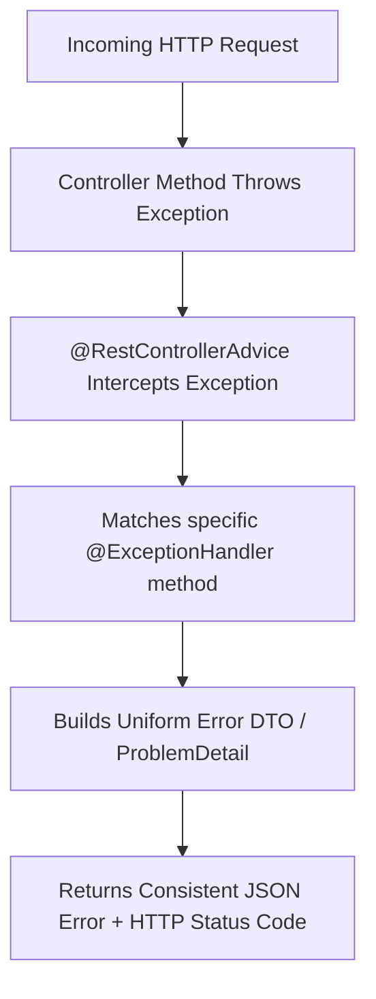

**Java / Spring Boot Example (Using Spring Boot 3 RFC 7807 ProblemDetail):**
```java
// Standard business exception
public class ResourceNotFoundException extends RuntimeException {
    public ResourceNotFoundException(String message) { super(message); }
}

// Global Exception Handler
@RestControllerAdvice
public class GlobalExceptionHandler {

    @ExceptionHandler(ResourceNotFoundException.class)
    public ProblemDetail handleNotFound(ResourceNotFoundException ex) {
        ProblemDetail problemDetail = ProblemDetail.forStatusAndDetail(HttpStatus.NOT_FOUND, ex.getMessage());
        problemDetail.setTitle("Resource Not Found");
        problemDetail.setProperty("timestamp", Instant.now());
        return problemDetail;
    }

    @ExceptionHandler(MethodArgumentNotValidException.class)
    public ProblemDetail handleValidationErrors(MethodArgumentNotValidException ex) {
        ProblemDetail problemDetail = ProblemDetail.forStatusAndDetail(HttpStatus.BAD_REQUEST, "Validation failed");
        Map<String, String> errors = new HashMap<>();
        ex.getBindingResult().getFieldErrors().forEach(error -> 
            errors.put(error.getField(), error.getDefaultMessage()));
        problemDetail.setProperty("invalidFields", errors);
        return problemDetail;
    }

    @ExceptionHandler(Exception.class)
    public ProblemDetail handleGenericError(Exception ex) {
        // Log stack trace for internal monitoring, return generic message to client
        return ProblemDetail.forStatusAndDetail(HttpStatus.INTERNAL_SERVER_ERROR, "An unexpected error occurred.");
    }
}
```

**Interview Tip:**
Mentioning RFC 7807 (`ProblemDetail`), introduced natively in Spring 6 / Spring Boot 3, demonstrates you are current with the latest Spring standards.

---

## Q571 — exception handling 
try with resource 
how spring boot application will start 
if you have same type beans what will happen 
primary and qualifier

**Interview Answer (Short):**
Exception handling in Spring Boot can be handled at three levels:
1. **Controller-Level:** Using `@ExceptionHandler` inside a specific `@Controller`.
2. **Global-Level (Best Practice):** Using `@RestControllerAdvice` to catch exceptions across the entire application.
3. **Container-Level:** Using `ErrorController` or custom `ErrorAttributes` for errors occurring before Spring MVC handles the request (e.g., 404 for non-existent endpoints or filter errors).

**Detailed Explanation:**

### Comparison of Exception Handling Strategies:

| Mechanism | Scope | Pros | Cons |
| :--- | :--- | :--- | :--- |
| **`@ResponseStatus` on Exception** | Class-level | Simple; no extra code | Cannot customize response body dynamically |
| **Controller `@ExceptionHandler`** | Single Controller | Handles controller-specific errors | Duplication across controllers |
| **`@RestControllerAdvice`** | Global (All Controllers) | Centralized, reusable, consistent API contracts | None |
| **`HandlerExceptionResolver`** | Low-level framework | Can intercept before controller advice | Verbose and low-level |

**Java / Spring Boot Example:**
```java
@RestControllerAdvice
public class GlobalApiExceptionHandler {

    // Custom Error Response DTO
    public record ErrorResponse(String errorCode, String message, Instant timestamp) {}

    @ExceptionHandler(PaymentProcessingException.class)
    public ResponseEntity<ErrorResponse> handlePaymentError(PaymentProcessingException ex) {
        ErrorResponse error = new ErrorResponse("PAYMENT_FAILED", ex.getMessage(), Instant.now());
        return ResponseEntity.status(HttpStatus.PAYMENT_REQUIRED).body(error);
    }
}
```

**Interview Tip:**
Interviewers often ask: *"How do you handle exceptions thrown inside a servlet Filter before reaching the DispatcherServlet?"*
Answer: `@RestControllerAdvice` **cannot** catch filter exceptions because filters execute outside the Spring MVC DispatcherServlet context. To handle filter exceptions, wrap the filter in a `try-catch` and use `HandlerExceptionResolver` to delegate the exception directly to your controller advice.

---

## Topic: Externalized Configuration & Profiles

## Q480 — 21) Explain about application.properties ?

**Interview Answer (Short):**
`application.properties` is the central configuration file in a Spring Boot application used to externalize key-value configuration settings. It controls server configurations (e.g. `server.port=8080`), database connections, logging levels, third-party API keys, and custom application properties.

**Detailed Explanation:**
Spring Boot automatically searches for `application.properties` (or `application.yml`) in several standard locations at startup:
1. `/config` subdirectory of the current directory.
2. Current directory.
3. Classpath `/config` package.
4. Classpath root (`src/main/resources/application.properties`).

Values from `application.properties` are injected using:
- **`@Value("${property.key}")`**: Injects individual scalar values.
- **`@ConfigurationProperties(prefix = "app")`**: Binds a group of related properties to a strongly typed Java object.
- **`Environment` abstraction**: Programmatic lookup via `environment.getProperty("key")`.

**Java / Spring Boot Example:**
```properties
# application.properties
server.port=8443
spring.datasource.url=jdbc:postgresql://localhost:5432/orders_db
spring.datasource.username=postgres
spring.datasource.password=secret
logging.level.com.example=DEBUG
```

**Interview Tip:**
Explain that Spring Boot allows overriding `application.properties` values from command-line arguments (`--server.port=9090`) or OS environment variables (`SERVER_PORT=9090`), following the 12-Factor App methodology.

---

## Q505 — 11) How do we load the application.properties file in Spring Boot?

**Interview Answer (Short):**
Spring Boot automatically loads `application.properties` during application bootstrap via the `ConfigDataEnvironmentPostProcessor` (in Spring Boot 2.4+) or `ConfigFileApplicationListener`. It searches predefined classpath and filesystem locations in a specific order of precedence, loading keys into Spring's `Environment`.

**Detailed Explanation:**

### Loading Order (Highest Precedence to Lowest):
1. Command line arguments (`--spring.config.location=...` or `--server.port=9090`).
2. Directory `./config/` in the application execution directory.
3. Current working directory `./`.
4. Classpath `/config/` directory.
5. Classpath root (`/src/main/resources/application.properties`).

### Custom Property Files:
If you have a custom properties file named `payment.properties`, you can load it using:
```java
@Configuration
@PropertySource("classpath:payment.properties")
public class PaymentFileConfig { ... }
```

**Interview Tip:**
Remember: Properties in `./config/` outside your JAR will **override** properties bundled inside the JAR's classpath! This allows operations teams to configure production settings without recompiling code.

---

## Q512 — Question related  application.properties file and application.yml file

**Interview Answer (Short):**
Both `application.properties` and `application.yml` serve the exact same purpose in Spring Boot. 
- **`application.properties`** uses flat key-value pairs (`server.port=8080`).
- **`application.yml`** uses hierarchical, indentation-based syntax (`server:
  port: 8080`), supports multi-profile documents separated by `---`, and eliminates redundant prefixes. 
- Note: `@PropertySource` does **not** natively support YAML files.

**Detailed Explanation:**

### Comparison Table: application.properties vs application.yml

| Feature | `application.properties` | `application.yml` |
| :--- | :--- | :--- |
| **Format** | Flat Key-Value pairs (`a.b.c=value`) | Hierarchical tree with indentation |
| **Readability** | Verbose with repeated prefixes | Clean, compact, visually structured |
| **Multi-document support** | No (requires separate files) | Yes (separated by `---`) |
| **List / Map Support** | Clunky (`list[0]=a, list[1]=b`) | Natural YAML lists (`- item1`) |
| **`@PropertySource` support**| Native support | Requires custom `PropertySourceFactory` |

**Java / Spring Boot Example:**
```yaml
# application.yml
server:
  port: 8080
spring:
  datasource:
    url: jdbc:postgresql://localhost:5432/app
    hikari:
      maximum-pool-size: 20
```

**Interview Tip:**
If both files exist in the same location, Spring Boot loads `application.properties` with higher priority than `application.yml`. However, having both in the same project is considered bad practice.

---

## Q520 — 20  How to externalize configuration in SpringBoot Application?

**Interview Answer (Short):**
Spring Boot externalizes configuration using a sophisticated **17-level hierarchy** of property sources. The most critical externalization channels are:
1. **Command-Line Arguments** (`--server.port=9090`)
2. **Java System Properties** (`-Dserver.port=9090`)
3. **OS Environment Variables** (`SERVER_PORT=9090`)
4. **Profile-specific Property Files** (`application-prod.yml`)
5. **Standard Property Files** (`application.yml`)

**Detailed Explanation:**
Externalized configuration is essential for cloud-native applications (12-Factor App methodology), allowing the exact same application binary (JAR) to run in Dev, QA, Staging, and Production environments without recompilation.

### Relaxed Binding Rules:
Spring Boot supports "relaxed binding", meaning environment variables match property keys regardless of casing:
- Property: `spring.datasource.password`
- Env Variable: `SPRING_DATASOURCE_PASSWORD` (all uppercase, dots replaced by underscores).

**Real-World Usage:**
In Kubernetes deployments, secrets (database passwords, API keys) are mounted as OS Environment Variables from Kubernetes `Secret` objects. Spring Boot reads them automatically without changing application code.

**Interview Tip:**
State the golden rule of precedence: **Command-line arguments override Environment variables, which override profile files, which override base application.properties.**

---

## Q523 — --Question related  application.properties file and application.yml file --spring boot annotation  --if we have to keep some code related to security and in future if we will do some changes

**Interview Answer (Short):**
Spring Boot supports externalizing configurations using both `.properties` and `.yml` files, with profile-specific variants (e.g. `application-dev.yml`, `application-prod.yml`). YAML provides a cleaner hierarchical syntax, while properties files are strictly flat. Both support overriding values at runtime via environment variables or command-line parameters.

**Detailed Explanation:**
In enterprise architectures, teams typically maintain a base `application.yml` for default values shared across all environments, and override specific settings in environment-specific profiles:

```yaml
# application.yml (Base defaults)
server:
  port: 8080
app:
  jwt:
    expiration-minutes: 60

---
# Embedded profile in YAML:
spring:
  config:
    activate:
      on-profile: prod
server:
  port: 443
app:
  jwt:
    expiration-minutes: 15
```

**Interview Tip:**
Point out that starting in Spring Boot 2.4, multi-document files use `spring.config.activate.on-profile` instead of the legacy `spring.profiles` attribute.

---

## Q546 — 20  How to externalize configuration in Spring Boot Application?

**Interview Answer (Short):**
To externalize configuration in Spring Boot:
1. Define default properties in `application.yml`.
2. Bind properties to Java classes using `@ConfigurationProperties`.
3. Override properties per environment using OS Environment variables, external config files (`--spring.config.location`), or centralized config servers like Spring Cloud Config or HashiCorp Vault.

**Detailed Explanation:**
Using `@ConfigurationProperties` is the enterprise standard for managing externalized config:

```java
@Configuration
@ConfigurationProperties(prefix = "cloud.aws")
@Validated
public class AwsProperties {
    @NotBlank
    private String region;
    @NotNull
    private S3Properties s3 = new S3Properties();

    // Getters, setters
    public static class S3Properties {
        private String bucketName;
        // Getters, setters
    }
}
```

**Benefits of `@ConfigurationProperties` over `@Value`:**
1. **Type-safe:** Strong typing with validation (`@NotNull`, `@Min`).
2. **Hierarchical binding:** Binds nested structures, lists, and maps cleanly.
3. **IDE Autocomplete:** Generates metadata for IDE auto-completion.
4. **Relaxed binding:** Works with `kebab-case`, `camelCase`, and `SNAKE_CASE`.

**Interview Tip:**
Always recommend `@ConfigurationProperties` over scattered `@Value` annotations in enterprise applications.

---

## Q536 — • Spring profile annotation

**Interview Answer (Short):**
The `@Profile` annotation in Spring is used to conditionally activate or register beans only when specific profiles are active. For example, `@Profile("dev")` ensures a bean is loaded only in development, while `@Profile("prod")` registers a production-specific bean.

**Detailed Explanation:**
Spring profiles provide a way to segregate parts of your application configuration and make it available only in certain environments.

### Where `@Profile` Can Be Applied:
1. **At the Class Level:** With `@Component`, `@Service`, or `@Configuration`.
2. **At the Method Level:** On `@Bean` factory methods inside configuration classes.

**Java / Spring Boot Example:**
```java
public interface EmailService { void send(String msg); }

// Dev implementation: Logs to console instead of sending real email
@Service
@Profile("dev")
public class MockEmailService implements EmailService {
    public void send(String msg) { System.out.println("DEV MOCK EMAIL: " + msg); }
}

// Prod implementation: Sends via AWS SES
@Service
@Profile("prod")
public class AwsSesEmailService implements EmailService {
    public void send(String msg) { /* AWS SES API call */ }
}
```

**Interview Tip:**
Mention profile expressions: Starting in Spring 5.1+, you can use boolean operators like `@Profile("dev | test")` or `@Profile("prod & cloud")`!

---

## Q542 — 14. Questions about @Profile annotation and categories

**Interview Answer (Short):**
`@Profile` categories include:
1. **Environment-based profiles:** `local`, `dev`, `qa`, `staging`, `prod`.
2. **Infrastructure-based profiles:** `cloud`, `on-prem`, `docker`, `k8s`.
3. **Feature-based profiles:** `mock-payments`, `async-disabled`, `metrics-enabled`.

Profiles can be activated via `application.yml`, JVM arguments (`-Dspring.profiles.active=prod`), or OS environment variables (`SPRING_PROFILES_ACTIVE=prod`).

**Detailed Explanation:**
Profiles are not limited to whole environments; they can be combined modularly:
```bash
java -jar app.jar -Dspring.profiles.active=prod,aws,datadog
```

### Profile Expressions:
- `@Profile("!prod")`: Active in all environments *except* production.
- `@Profile("dev | qa")`: Active in development *or* QA.
- `@Profile("prod & aws")`: Active only when *both* `prod` and `aws` are active.

**Interview Tip:**
Always warn against putting sensitive credentials (like production database passwords) directly in `application-prod.properties` stored in Git. Instead, use profile properties to point to environment variables.

---

## Q558 — 9)what is profiles in spring boot

**Interview Answer (Short):**
Profiles in Spring Boot provide a mechanism to segregate application configuration, beans, and property settings for different runtime environments (such as `dev`, `test`, `uat`, and `prod`). By setting `spring.profiles.active=prod`, Spring Boot activates `application-prod.yml` and registers only the beans marked with `@Profile("prod")`.

**Detailed Explanation:**
How Spring Boot resolves profile files:
1. `application.yml` is loaded first (base configuration).
2. `application-{profile}.yml` is loaded second and overrides matching keys from `application.yml`.
3. If no profile is active, `default` is used (`application-default.yml`).

**Java / Spring Boot Example:**
```yaml
# application-dev.yml
spring:
  datasource:
    url: jdbc:h2:mem:devdb
logging:
  level:
    root: DEBUG

# application-prod.yml
spring:
  datasource:
    url: jdbc:postgresql://prod-db.company.com:5432/app
logging:
  level:
    root: WARN
```

**Interview Tip:**
Mention `spring.profiles.default`: If no active profile is specified, Spring falls back to the default profile, which can be configured via `spring.profiles.default=local`.

---

## Topic: Transactions & Concurrency

## Q562 — 12. How to handle transactions in spring boot in case of any issue ?

**Interview Answer (Short):**
To handle transactions in Spring Boot:
1. Annotate business service methods with **`@Transactional`**.
2. By default, Spring rolls back transactions only on **unchecked exceptions** (`RuntimeException` and `Error`). To roll back on checked exceptions, specify `@Transactional(rollbackFor = Exception.class)`.
3. In case of issues, Spring initiates an automatic `ROLLBACK` on the database transaction.
4. For complex compensation or multi-service workflows, programmatic rollback can be invoked via `TransactionAspectSupport.currentTransactionStatus().setRollbackOnly()` or the Saga Pattern.

**Detailed Explanation:**
Spring manages transactions using Spring AOP dynamic proxies:

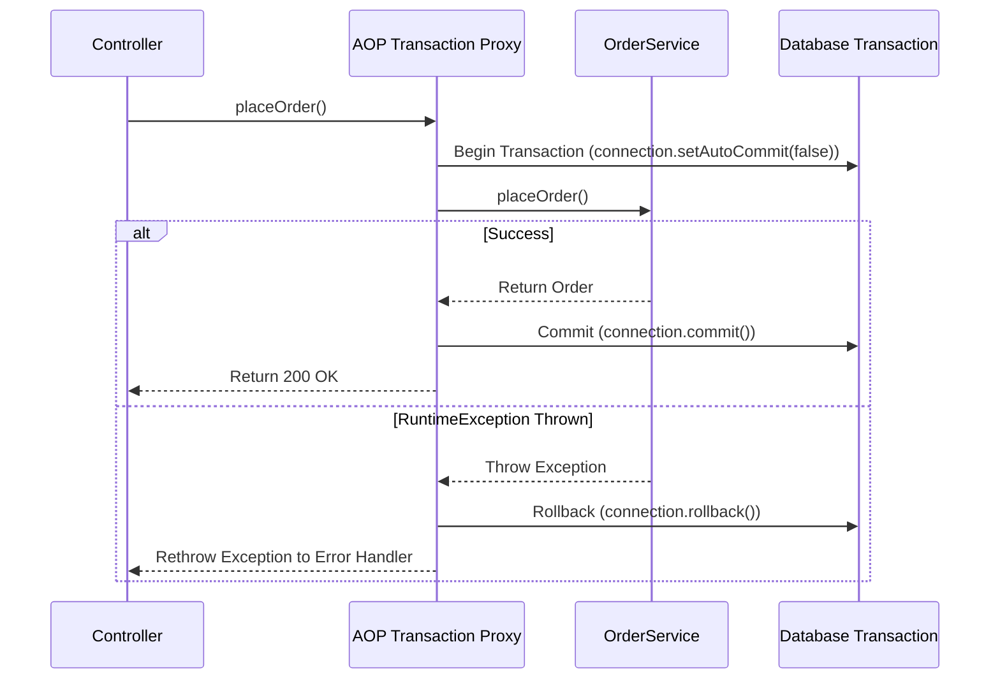

### Key `@Transactional` Attributes:
- **`propagation`:** Controls how transactions relate to existing ones (`REQUIRED` [default], `REQUIRES_NEW`, `MANDATORY`, `SUPPORTS`, `NOT_SUPPORTED`, `NEVER`).
- **`isolation`:** Database isolation level (`READ_COMMITTED`, `REPEATABLE_READ`, `SERIALIZABLE`).
- **`timeout`:** Maximum execution time before automatic rollback.
- **`rollbackFor`:** Explicitly lists checked exceptions that should trigger rollback.

**Java / Spring Boot Example:**
```java
@Service
public class BankTransferService {

    private final AccountRepository accountRepo;

    public BankTransferService(AccountRepository accountRepo) { this.accountRepo = accountRepo; }

    @Transactional(rollbackFor = Exception.class, timeout = 5)
    public void transfer(Long fromId, Long toId, BigDecimal amount) throws InsufficientFundsException {
        Account from = accountRepo.findById(fromId).orElseThrow();
        Account to = accountRepo.findById(toId).orElseThrow();

        if (from.getBalance().compareTo(amount) < 0) {
            throw new InsufficientFundsException("Not enough balance"); // Triggers rollback!
        }

        from.debit(amount);
        to.credit(amount);
        accountRepo.save(from);
        accountRepo.save(to);
    }
}
```

**Interview Tip:**
Be ready for the famous **Self-Invocation Trap**: If method `a()` calls method `b()` within the same class, and `b()` is annotated with `@Transactional`, the transaction will **NOT** start! This happens because the call bypasses the Spring AOP proxy. To fix it, move `b()` to a separate service class or inject the service into itself via self-injection.

---

## Q553 — 4.Fetching and inserting data at the same time by different users spring boot real-time 
implementation

**Interview Answer (Short):**
To handle simultaneous fetching and inserting of data by different users in real time:
1. **Concurrency Control:** Use **Optimistic Locking** (`@Version`) for low-contention reads/writes, or **Pessimistic Locking** (`@Lock(LockModeType.PESSIMISTIC_WRITE)`) for critical financial records.
2. **Transaction Isolation:** Set appropriate isolation levels (e.g. `Isolation.READ_COMMITTED` or `REPEATABLE_READ`) to avoid dirty reads or non-repeatable reads.
3. **Database Indexing:** Ensure query filters use indexes to minimize row-level and table-level locks.
4. **Connection Pooling:** Size HikariCP connection pools appropriately to prevent thread starvation under concurrent load.

**Detailed Explanation:**

### Optimistic vs Pessimistic Locking:
- **Optimistic Locking (`@Version`):**
  - Assumes conflicts are rare.
  - Adds a `version` column. When updating: `UPDATE table SET val = ?, version = version + 1 WHERE id = ? AND version = ?`.
  - If another user updated the record in the meantime, Spring throws `OptimisticLockingFailureException`.
- **Pessimistic Locking (`SELECT FOR UPDATE`):**
  - Locks the database row at the SQL level, forcing concurrent users to wait until the current transaction commits or rolls back.

**Java / Spring Boot Example (Optimistic Locking):**
```java
@Entity
public class ProductStock {
    @Id
    private Long id;
    private int availableQuantity;

    @Version // Spring Data JPA automatically handles optimistic lock checks
    private Long version;
}

@Service
public class InventoryService {

    private final ProductStockRepository repository;

    public InventoryService(ProductStockRepository repository) { this.repository = repository; }

    @Transactional
    public void deductStock(Long productId, int quantity) {
        ProductStock stock = repository.findById(productId).orElseThrow();
        stock.deduct(quantity);
        repository.save(stock); // Throws OptimisticLockingFailureException on conflict
    }
}
```

**Interview Tip:**
Explain that for high-throughput read-heavy systems, optimistic locking is far superior because it holds zero database locks, avoiding database connection pool exhaustion.

---

## Topic: Production Readiness & Monitoring: Actuator

## Q501 — 3. Actuator

**Interview Answer (Short):**
Spring Boot Actuator is a production-ready feature module that provides built-in HTTP and JMX endpoints to monitor, manage, and inspect the health, metrics, environment, and operational state of a running Spring Boot application.

**Detailed Explanation:**
In production, you cannot attach an IDE debugger to a running server. Actuator provides operational transparency via REST endpoints:
- `/actuator/health`: Shows application and subsystem health (DB, Redis, Disk space).
- `/actuator/metrics`: Provides CPU, JVM memory, HTTP request latencies, and garbage collection metrics.
- `/actuator/env`: Displays environment properties and configuration sources.
- `/actuator/loggers`: Allows changing logging levels at runtime without restarting the application!

**Java / Spring Boot Example:**
```xml
<dependency>
    <groupId>org.springframework.boot</groupId>
    <artifactId>spring-boot-starter-actuator</artifactId>
</dependency>
```

```yaml
# application.yml
management:
  endpoints:
    web:
      exposure:
        include: health, info, metrics, prometheus
  endpoint:
    health:
      show-details: always
```

**Interview Tip:**
Highlight the runtime logging trick: `POST /actuator/loggers/com.example {"configuredLevel": "DEBUG"}` dynamically changes logging to `DEBUG` in production to diagnose an incident without restarting the container.

---

## Q509 — 21. What is actuator

**Interview Answer (Short):**
Actuator is Spring Boot's operational subsystem. It exposes health checks, telemetry, thread dumps, and audit trails over HTTP or JMX, allowing DevOps tools like Prometheus, Grafana, and Kubernetes to monitor and manage application availability.

**Detailed Explanation:**
Key Actuator Endpoints:
1. **`/actuator/health`:** Evaluates composite health indicators (`DataSourceHealthIndicator`, `DiskSpaceHealthIndicator`).
2. **`/actuator/prometheus`:** Formats application metrics into Prometheus scrape format for Grafana dashboards.
3. **`/actuator/threaddump`:** Generates a full JVM thread dump to debug deadlocks and CPU spikes.
4. **`/actuator/httpexchanges`:** Tracks recent HTTP request/response traces.

**Interview Tip:**
Always note security: Never expose all actuator endpoints publicly (`include: "*"`). Sensitive endpoints like `/env`, `/beans`, and `/threaddump` must be secured behind Spring Security roles (`ROLE_ADMIN`) to prevent sensitive data leakage.

---

## Q543 — 15. What is actuator in SpringBoot and Where it is defined in the application

**Interview Answer (Short):**
Actuator is defined by adding the `spring-boot-starter-actuator` dependency to `pom.xml` or `build.gradle`. Its behavior, security, and exposed endpoints are configured inside `application.properties` or `application.yml` under the `management.*` configuration namespace.

**Detailed Explanation:**
By default, only `/actuator/health` is exposed over the web for security reasons.

### Configuring Actuator:
```properties
# Expose health, info, and prometheus endpoints
management.endpoints.web.exposure.include=health,info,prometheus

# Change the base management path or port (for security)
management.server.port=9001
management.endpoints.web.base-path=/internal-actuator

# Show full health details
management.endpoint.health.show-details=when_authorized
```

### Custom Health Indicator Example:
```java
@Component
public class ExternalApiHealthIndicator implements HealthIndicator {

    @Override
    public Health health() {
        boolean serviceUp = checkExternalApi();
        if (serviceUp) {
            return Health.up().withDetail("ExternalAPI", "Available and responsive").build();
        }
        return Health.down().withDetail("ExternalAPI", "Timeout or connection refused").build();
    }

    private boolean checkExternalApi() { return true; }
}
```

**Interview Tip:**
Running Actuator on a **separate management port** (`management.server.port=9001`) is an enterprise security best practice. It allows internal firewalls to block external public access to monitoring endpoints while keeping port 8080 open for customer traffic.

---

## Topic: Spring Security & JWT Basics

## Q499 — 3. There were some questions related to Spring Security and JWT authentication.

**Interview Answer (Short):**
In a stateless Spring Boot microservice, Spring Security and JWT (JSON Web Token) authentication work together by:
1. Validating user credentials during login (`/api/auth/login`) and issuing a signed JWT containing user claims and expiration.
2. Intercepting subsequent requests via a custom `OncePerRequestFilter`.
3. Validating the JWT cryptographic signature and expiration.
4. Extracting user details and authorities and setting an `Authentication` token inside `SecurityContextHolder.getContext().setAuthentication(...)`.

**Detailed Explanation:**

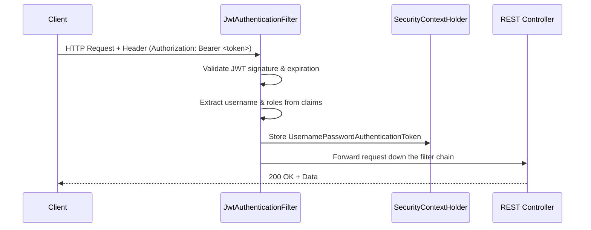

**Key Components in Modern Spring Security 6+:**
- **`SecurityFilterChain` `@Bean`:** Configures endpoint authorization rules, disables CSRF (stateless), and sets session policy to `SessionCreationPolicy.STATELESS`.
- **`JwtAuthenticationFilter`:** Custom filter positioned before `UsernamePasswordAuthenticationFilter`.

**Interview Tip:**
In Spring Security 6 (Spring Boot 3), `SecurityConfigurerAdapter` and `authorizeRequests()` are deprecated. Always reference the modern lambda DSL: `http.authorizeHttpRequests(auth -> auth.requestMatchers("/public/**").permitAll().anyRequest().authenticated())`.

---

## Q519 — 13  Spring security, JWT token?

**Interview Answer (Short):**
- **Spring Security:** The framework that provides authentication (who you are), authorization (what you can do), and protection against common attacks (CSRF, session fixation).
- **JWT (JSON Web Token):** A compact, URL-safe, digitally signed token consisting of Header, Payload, and Signature. It enables **stateless authentication**, eliminating server-side session replication across microservice clusters.

**Detailed Explanation:**

### Anatomy of a JWT:
`header.payload.signature`
- **Header:** Algorithm and token type (`{"alg": "HS256", "typ": "JWT"}`).
- **Payload:** Claims (`{"sub": "user123", "roles": ["ROLE_ADMIN"], "exp": 1718000000}`).
- **Signature:** HMACSHA256(base64(header) + "." + base64(payload), secretKey).

**Java / Spring Boot Example:**
```java
@Configuration
@EnableWebSecurity
public class SecurityConfig {

    private final JwtAuthenticationFilter jwtAuthFilter;

    public SecurityConfig(JwtAuthenticationFilter jwtAuthFilter) {
        this.jwtAuthFilter = jwtAuthFilter;
    }

    @Bean
    public SecurityFilterChain securityFilterChain(HttpSecurity http) throws Exception {
        return http
                .csrf(AbstractHttpConfigurer::disable)
                .sessionManagement(s -> s.sessionCreationPolicy(SessionCreationPolicy.STATELESS))
                .authorizeHttpRequests(auth -> auth
                        .requestMatchers("/api/auth/**").permitAll()
                        .requestMatchers("/api/admin/**").hasRole("ADMIN")
                        .anyRequest().authenticated()
                )
                .addFilterBefore(jwtAuthFilter, UsernamePasswordAuthenticationFilter.class)
                .build();
    }
}
```

**Interview Tip:**
Always state that because JWT is stateless, revoking a token before its expiration requires an external distributed blacklist (like Redis with a TTL matching the token's remaining lifetime).

---

# Priority 3 — Important

## Topic: Bean Creation Mechanics, DI Edge Cases & Infrastructure

## Q477 — 14)How do you register a third-party library class as a Spring bean ?

**Interview Answer (Short):**
To register a third-party library class as a Spring bean:
1. Create a class annotated with `@Configuration`.
2. Inside it, define a public method that instantiates, configures, and returns an instance of the third-party class.
3. Annotate this method with `@Bean`.
Spring will execute this method during context startup and register the returned object as a managed bean.

**Detailed Explanation:**
Because you cannot edit the source code of an external JAR library to add `@Component`, you must use a Java-based `@Configuration` class.

**Java / Spring Boot Example:**
```java
// Registering third-party AmazonS3 client from AWS SDK:
@Configuration
public class ExternalAwsConfig {

    @Value("${aws.region}")
    private String region;

    @Bean
    public S3Client s3Client() {
        return S3Client.builder()
                .region(Region.of(region))
                .credentialsProvider(DefaultCredentialsProvider.create())
                .build();
    }
}
```

**Interview Tip:**
Mention that you can also configure `initMethod` and `destroyMethod` on the `@Bean` annotation to invoke lifecycle methods on third-party classes that don't have Spring annotations.

---

## Q541 — 12. What is Bean and How many ways to implement in spring

**Interview Answer (Short):**
A Spring Bean is a container-managed object. There are five main ways to implement or declare a bean in Spring:
1. **Stereotype Annotations:** `@Component`, `@Service`, `@Repository`, `@Controller` discovered via `@ComponentScan`.
2. **Java Configuration:** `@Bean` methods inside `@Configuration` classes.
3. **FactoryBean Interface:** Implementing `FactoryBean<T>` for complex instantiation logic.
4. **Programmatic Registration:** Using `GenericApplicationContext.registerBean()`.
5. **XML Configuration:** Legacy `<bean id="..." class="..."/>`.

**Detailed Explanation:**
In modern enterprise applications, `@Component` and `@Bean` represent 99% of use cases. However, knowing `FactoryBean` and programmatic registration highlights deep engineering expertise:

- **`FactoryBean<T>`:** Used when instantiating a bean requires complex factory logic (e.g. `LocalContainerEntityManagerFactoryBean`, `ProxyFactoryBean`).
- **Programmatic (`registerBean`):** Added in Spring 5, allows dynamically registering beans during runtime lambdas without reflection overhead.

**Java / Spring Boot Example (Programmatic Registration):**
```java
public class DynamicBeanInitializer implements ApplicationContextInitializer<GenericApplicationContext> {
    @Override
    public void initialize(GenericApplicationContext context) {
        context.registerBean("dynamicService", CustomService.class, () -> new CustomService("active"));
    }
}
```

**Interview Tip:**
Distinguish between `BeanFactory` (the core container interface) and `FactoryBean` (a bean that acts as a factory producing other beans).

---

## Q569 — 11. Ways of Creating a Spring bean

**Interview Answer (Short):**
The primary ways of creating a Spring bean are:
1. Declarative automatic scanning using stereotypes (`@Component`, `@Service`, `@Repository`).
2. Declarative manual definition using `@Configuration` and `@Bean`.
3. Specialized factory encapsulation using `FactoryBean<T>`.
4. Dynamic programmatic registration via `GenericApplicationContext`.

**Detailed Explanation:**
The choice of creation mechanism depends on ownership and complexity:
- **Own code with standard constructor:** `@Component`.
- **Third-party code or custom parameters:** `@Bean`.
- **Complex lifecycle or proxy encapsulation:** `FactoryBean`.
- **High-performance ahead-of-time (AOT) or dynamic plugins:** Programmatic registration.

**Interview Tip:**
Always note that declarative annotations (`@Component` and `@Bean`) are the industry standard for 99% of business applications.

---

## Q570 — 12. How Spring beans are instantiated?

**Interview Answer (Short):**
Spring beans are instantiated using **Java Reflection**. 
The Spring container reads the bean's `BeanDefinition`, determines the constructor to use (based on `@Autowired` or single-constructor convention), resolves all parameter dependencies recursively, and invokes `Constructor.newInstance(args)`. If CGLIB proxying is required, Spring generates a dynamic subclass bytecode instance.

**Detailed Explanation:**
Internally, Spring uses `ConstructorResolver` inside `AbstractAutowireCapableBeanFactory`:
1. It inspects all constructors of the target class.
2. It chooses the single candidate constructor, or the one annotated with `@Autowired`.
3. It queries the `ApplicationContext` to resolve the arguments.
4. It calls `BeanUtils.instantiateClass(constructor, args)`.
5. If the bean requires class-based proxying (e.g. `@Configuration` or `@Transactional` without an interface), it uses **CGLIB / ByteBuddy** to generate an enhanced subclass in memory.

**Interview Tip:**
If an interviewer asks: *"Does Spring require a default no-arg constructor?"* 
Answer: *"No! As long as all parameters in a parameterized constructor can be resolved from the container, Spring does not require a no-arg constructor."*

---

## Q551 — 13 How to use multiple classes in spring boot.

**Interview Answer (Short):**
To use multiple classes in Spring Boot:
1. Place classes in the same base package (or sub-packages) as your `@SpringBootApplication` class so they are automatically discovered by `@ComponentScan`.
2. If classes reside in external packages, use `@ComponentScan(basePackages = {"com.pkg1", "com.pkg2"})`.
3. If importing configuration classes from other modules, use `@Import({SecurityConfig.class, DatabaseConfig.class})`.
4. Inject collaborating classes via constructor injection.

**Detailed Explanation:**
In multi-module enterprise systems (e.g. `core`, `billing`, `notification`), package management is critical:

**Java / Spring Boot Example:**
```java
// Main application class importing configurations from separate shared libraries
@SpringBootApplication
@Import({AwsInfrastructureConfig.class, SharedSecurityConfig.class})
public class ECommerceApplication {
    public static void main(String[] args) {
        SpringApplication.run(ECommerceApplication.class, args);
    }
}
```

**Interview Tip:**
Mention `@Import`: It is the cleanest way to include explicit configuration classes from external libraries or shared common JARs without scanning unnecessary packages.

---

## Q468 — 8. You have a rest controller, where a final field and constructor is declared as below.  
 
When application is started it fails with error,  
Parameter 0 of constructor in com.example.simultaneousinsert.runner.TestController 
required a bean of type 'org.springframework.web.client.RestTemplate' that could not be 
found. 
What should be done to fix this error?

**Interview Answer (Short):**
The application fails at startup with:
`Parameter 0 of constructor in TestController required a bean of type 'org.springframework.web.client.RestTemplate' that could not be found.`

**Cause:** Spring Boot does **not** auto-configure a `RestTemplate` bean by default because it encourages developers to customize its timeouts, interceptors, and message converters.
**Fix:** Define a `@Bean` method returning `RestTemplate` inside a `@Configuration` class using `RestTemplateBuilder`:
```java
@Bean
public RestTemplate restTemplate(RestTemplateBuilder builder) {
    return builder.build();
}
```

**Detailed Explanation:**
This is a very common practical interview scenario testing your understanding of Spring Boot's opinionated auto-configuration rules.

### Why doesn't Spring Boot auto-configure RestTemplate?
Because `RestTemplate` is stateful regarding its underlying HTTP connection pool and client factories. Spring Boot provides `RestTemplateBuilder` as a pre-configured bean instead, forcing you to explicitly build your own `RestTemplate` instance with application-specific timeouts.

**Java / Spring Boot Example:**
```java
// The failing controller:
@RestController
public class TestController {
    private final RestTemplate restTemplate;

    public TestController(RestTemplate restTemplate) {
        this.restTemplate = restTemplate;
    }
}

// The Fix (Add this Configuration class):
@Configuration
public class RestClientConfig {

    @Bean
    public RestTemplate restTemplate(RestTemplateBuilder builder) {
        return builder
                .setConnectTimeout(Duration.ofSeconds(3))
                .setReadTimeout(Duration.ofSeconds(5))
                .build();
    }
}
```

**Interview Tip:**
Mention modern Spring Boot 3: While `RestTemplate` is still supported, Spring 6 / Spring Boot 3 introduced **`RestClient`** as the modern, synchronous fluent HTTP client replacing `RestTemplate`.

---

## Q471 — 9. Difference between @requiredargconstructor and @autowired -----------------------------------------------------------------------------------------------

**Interview Answer (Short):**
- **`@RequiredArgsConstructor`** is a **Lombok** annotation that generates a constructor for all `final` fields and `@NonNull` fields at compile time.
- **`@Autowired`** is a **Spring** annotation that instructs the container to inject a dependency at runtime.
- **Difference:** Combining `@RequiredArgsConstructor` with `final` fields enables clean constructor injection **without writing `@Autowired` or manual constructor boilerplate**.

**Detailed Explanation:**

### Comparison Table:

| Feature | `@RequiredArgsConstructor` | `@Autowired` |
| :--- | :--- | :--- |
| **Origin** | Project Lombok (Compile-time) | Spring Framework (Runtime) |
| **Mechanism** | Generates Java constructor bytecode | Tells Spring where to inject dependencies |
| **Immutability** | Enforces `final` fields | Does not require or enforce `final` fields |
| **Spring Dependency** | Zero coupling to Spring annotations | Coupled to Spring framework |

### Second Part: Constructor vs Method in Java:
- **Constructor:** Special member with no return type; name matches class name; invoked once when creating an object (`new`); initializes instance state.
- **Method:** Standard member with a return type; invoked multiple times on existing objects; performs behavior and logic.

**Java / Spring Boot Example:**
```java
// Clean modern pattern using Lombok:
@Service
@RequiredArgsConstructor
public class CustomerService {
    // Lombok generates: public CustomerService(CustomerRepository customerRepo) { this.customerRepo = customerRepo; }
    // Spring Boot automatically injects it!
    private final CustomerRepository customerRepo;
}
```

**Interview Tip:**
Explain that `@RequiredArgsConstructor` with `final` fields is the most popular idiom in modern Spring Boot codebases because it gives all the benefits of constructor injection with zero boilerplate.

---

## Q573 — • How do you detect and resolve circular dependencies in Spring applications?

**Interview Answer (Short):**
A circular dependency occurs when Bean A requires Bean B, and Bean B requires Bean A (A -> B -> A). 
- **Detection:** Spring detects this during dependency resolution and throws a **`BeanCurrentlyInCreationException`** at startup.
- **Resolution:**
  1. **Architectural Redesign (Best):** Extract the shared collaborator into a third bean (C), breaking the cycle (A -> C <- B).
  2. **`@Lazy`:** Break the startup deadlock by proxying one bean with `@Lazy`.
  3. **Event-driven:** Decouple using Spring `ApplicationEventPublisher`.
  4. Note: Since Spring Boot 2.6+, circular dependencies are **forbidden by default**.

**Detailed Explanation:**

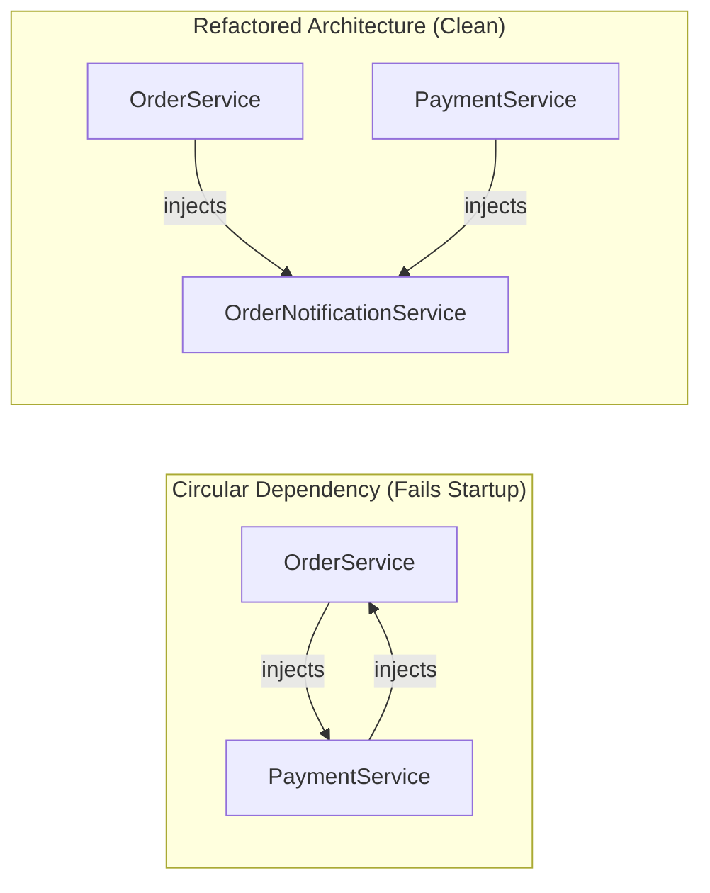

### Resolution Options in Code:

**Option 1: Break the Cycle with a 3rd Bean (Recommended):**
Extract the mutual dependency into a shared service.

**Option 2: Using `@Lazy` (Quick workaround):**
```java
@Service
public class OrderService {
    private final PaymentService paymentService;

    public OrderService(@Lazy PaymentService paymentService) {
        this.paymentService = paymentService;
    }
}
```
`@Lazy` tells Spring to inject a dynamic CGLIB proxy instead of the real bean at startup. The real bean is only instantiated upon the first method call.

**Interview Tip:**
Emphasize that starting in Spring Boot 2.6, `spring.main.allow-circular-references` defaults to `false`. Fixing the design is always preferred over setting `allow-circular-references=true`.

---

## Q549 — 5) What is caching and how it is implemented in Spring Boot

**Interview Answer (Short):**
Caching in Spring Boot temporarily stores the results of expensive operations (e.g. slow database queries or remote API calls) in fast memory. 
- **Implementation:**
  1. Add `@EnableCaching` on a `@Configuration` class.
  2. Annotate methods with **`@Cacheable(value = "users", key = "#id")`**.
  3. Update caches with **`@CachePut`**.
  4. Invalidate caches with **`@CacheEvict`**.
  5. Back by an in-memory provider (Caffeine) or distributed cache (Redis).

**Detailed Explanation:**
Spring provides an abstraction layer (`CacheManager`) so your code doesn't depend directly on Redis or Ehcache APIs.

### The 4 Core Caching Annotations:
- **`@Cacheable`:** Checks cache first. If found, returns cached value; if not found, executes method and stores result.
- **`@CachePut`:** Always executes the method and updates the cache with the returned result.
- **`@CacheEvict`:** Removes entries from the cache (e.g. `@CacheEvict(value = "users", key = "#id")` or `allEntries = true`).
- **`@Caching`:** Groups multiple caching operations together.

**Java / Spring Boot Example:**
```java
@Service
public class ProductService {

    @Cacheable(value = "products", key = "#productId", unless = "#result == null")
    public ProductDto getProductById(Long productId) {
        // Only executes on cache miss!
        return fetchFromDatabase(productId);
    }

    @CacheEvict(value = "products", key = "#productId")
    public void deleteProduct(Long productId) {
        databaseDelete(productId);
    }
}
```

**Interview Tip:**
Remember: Spring Caching uses **Spring AOP proxies**. Calling a `@Cacheable` method from within the same class (self-invocation) will bypass the cache!

---

## Q538 — • Spring starter methods

**Interview Answer (Short):**
Spring Boot Starters are dependency descriptors that aggregate all required libraries, transitive dependencies, and default configurations for a specific capability into a single import. Examples include `spring-boot-starter-web`, `spring-boot-starter-data-jpa`, and `spring-boot-starter-security`.

**Detailed Explanation:**
Before Starters, setting up Spring MVC required manually declaring 10+ dependencies in `pom.xml` and resolving version conflicts between them.

### What is Inside a Starter?
A Starter is essentially an empty JAR whose `pom.xml` contains:
1. Dependencies on core libraries (e.g., Tomcat, Jackson, Hibernate).
2. Dependency on the matching auto-configuration module (`spring-boot-autoconfigure`).

### Custom Starters:
Enterprise companies build custom starters (e.g. `company-audit-starter`) containing standard security filters, logging formatters, and telemetry configurations that all internal microservices import.

**Interview Tip:**
Naming convention rule: Official Spring Boot starters are named `spring-boot-starter-*`. Third-party or custom starters must be named `*-spring-boot-starter` (e.g. `mybatis-spring-boot-starter`).

---

## Q524 — 5. Questions about Spring.

**Interview Answer (Short):**
Spring Framework is an enterprise Java framework comprising several modular components:
1. **Core Container:** Beans, Core, Context, SpEL (IoC & DI).
2. **AOP & Aspects:** Cross-cutting concerns (Transactions, Security, Logging).
3. **Data Access & Integration:** JDBC, ORM (Hibernate/JPA), Transactions, Messaging.
4. **Web:** Spring MVC and Spring WebFlux.
5. **Testing:** Spring TestContext Framework, MockMvc.

**Detailed Explanation:**
In general interview rounds, provide a clear, high-level map of the Spring landscape and how each module solves enterprise architectural challenges.

**Interview Tip:**
Emphasize modularity: You only include the Spring modules your application actually needs.

---

## Q525 — Class and Interface,functional interface,string pool, spring & spring boot

**Interview Answer (Short):**
This multi-topic question tests fundamental Java concepts and how Spring leverages them:
- **Class vs Interface:** A class provides implementation and state; an interface defines a contract. Spring uses interfaces extensively to decouple service layers and enable JDK dynamic proxies.
- **Functional Interface:** An interface with exactly one abstract method (e.g. `Function<T,R>`, `Predicate<T>`). Spring uses them in functional routing (`RouterFunction`) and stream APIs.
- **String Pool:** Special memory region in JVM Heap where String literals are cached for immutability and memory optimization.
- **Spring & Spring Boot:** Spring Boot builds on Spring and Java to automate enterprise configurations.

**Detailed Explanation:**
In interviews with broad prompts, concisely demonstrate your Java fundamentals and connect them to Spring design patterns:
1. **Interfaces in Spring:** Enable loose coupling for Dependency Injection and allow Spring to create JDK Dynamic Proxies for transaction management.
2. **Immutability:** Strings in the String Pool and Java Records are immutable, perfectly matching Spring's preference for thread-safe singleton beans.

**Interview Tip:**
When asked a bundled question, organize your response into distinct bullet points so the interviewer knows you answered every sub-topic.

---

## Q528 — Java 8 features, spring boot

**Interview Answer (Short):**
Spring Boot deeply integrates Java 8+ features:
1. **Lambda Expressions & Functional Interfaces:** Power functional web routing (`RouterFunctions`), Spring Cloud Stream, and configuration callbacks.
2. **Streams API:** Used heavily in service layers for collection transformation and filtering.
3. **`Optional<T>`:** Spring Data JPA returns `Optional<Entity>` for clean null handling; Spring DI supports injecting `Optional<Bean>` for optional dependencies.
4. **Default Methods in Interfaces:** Used across Spring interfaces (e.g. `WebMvcConfigurer`) to provide no-op defaults.
5. **`java.time` API:** Jackson in Spring Boot natively serializes `LocalDate` and `Instant`.

**Java / Spring Boot Example:**
```java
// Spring Data JPA returning Optional:
Optional<User> user = userRepository.findById(id);
return user.map(UserResponse::from).orElseThrow(() -> new UserNotFoundException(id));
```

**Interview Tip:**
Mention `Optional` in Spring Data repositories: it eliminates `NullPointerException` and forces developers to explicitly handle missing database entities.

---

## Q547 — Explain oops principles 
Arraylist and Linked list differences explain with examples 
How encapsulation is different from abstraction 
Explain what is polymorphism and why we need that 
What is multi threading 
Explain thread life cycle 
Wait() and sleep() method differences 
What is notify() and join() explain how they will work 
What is executor framework 
What is forkForkJoinPool 
Why @orderd , @Qualifier annotatons are used 
Explain different annotations used in spring application 
  
Coding question: 
Convert Digits Into Alpha-numerical Format.

**Interview Answer (Short):**
The four core Object-Oriented Programming (OOP) principles are:
1. **Encapsulation:** Bundling data and methods while hiding internal state via access modifiers. In Spring: `@Component` classes hide internal logic behind clean public API methods.
2. **Abstraction:** Exposing only essential features through interfaces. In Spring: Services depend on `Repository` interfaces, not concrete database classes.
3. **Inheritance:** Reusing code via class hierarchies. In Spring: Custom controllers or repositories extend base frameworks classes (`JpaRepository`).
4. **Polymorphism:** Performing actions in multiple ways. In Spring: Dependency Injection injects different implementations (e.g. `PayPalGateway` vs `StripeGateway`) at runtime using the same interface.

**Detailed Explanation:**
Spring Framework is one of the world's most prominent examples of OOP and SOLID principles applied at enterprise scale:
- **Dependency Inversion Principle (DIP):** Spring IoC container inverts the dependency graph so high-level business services depend on abstractions.
- **Single Responsibility Principle (SRP):** Layered architecture separates Controllers, Services, and Repositories into dedicated classes.
- **Open/Closed Principle (OCP):** You can extend functionality by creating new beans or `@EventListener` classes without modifying existing code.

**Interview Tip:**
Always ground abstract OOP principles in concrete Spring architectural patterns. It shows you understand how theory translates into real-world code.

---

# Priority 4 — Advanced

## Topic: Reactive Programming & Spring WebFlux

## Q491 — 16. How will you implement Reactive Programming in Springboot

**Interview Answer (Short):**
To implement Reactive Programming in Spring Boot:
1. Add `spring-boot-starter-webflux` instead of `spring-boot-starter-web`.
2. Build on **Project Reactor** using non-blocking reactive publishers: **`Mono<T>`** (0 or 1 item) and **`Flux<T>`** (0 to N items).
3. The underlying runtime runs on **Netty** (non-blocking event-loop architecture) rather than Tomcat's thread-per-request model.
4. For database interactions, use reactive database drivers like **Spring Data R2DBC** (Reactive Relational Database Connectivity) or Reactive MongoDB.

**Detailed Explanation:**

### Servlet (MVC) vs Reactive (WebFlux):
- **Spring MVC (Tomcat):** Synchronous, blocking I/O. Each incoming HTTP request holds a dedicated thread from a thread pool (`max-threads=200`). If a thread blocks waiting for a slow database query, it wastes memory and limits concurrency.
- **Spring WebFlux (Netty):** Asynchronous, non-blocking I/O. Uses an event loop with a very small number of worker threads (typically equal to the number of CPU cores). When an I/O operation begins, the thread is released immediately to serve other requests; a callback resumes processing when data arrives.

**How It Works:**
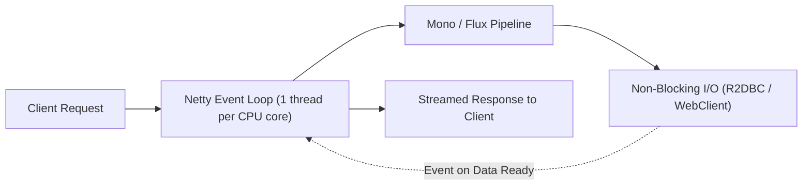

**Java / Spring Boot Example:**
```java
@RestController
@RequestMapping("/api/reactive/stocks")
public class StockPriceController {

    private final StockPriceService stockService;

    public StockPriceController(StockPriceService stockService) {
        this.stockService = stockService;
    }

    // Server-Sent Events (SSE) streaming real-time prices every second
    @GetMapping(value = "/stream", produces = MediaType.TEXT_EVENT_STREAM_VALUE)
    public Flux<StockPrice> streamStockPrices() {
        return stockService.getLivePriceStream();
    }
}
```

**Real-World Usage:**
WebFlux is ideal for high-concurrency gateway proxies (e.g. Spring Cloud Gateway), real-time streaming dashboards, and microservices that call multiple downstream HTTP APIs concurrently.

**Interview Tip:**
Interview trap: *"Can you use standard Spring Data JPA / Hibernate inside Spring WebFlux?"*
Answer: **No!** Standard JPA/JDBC is inherently blocking. Running blocking JDBC calls on Netty's event loop will block the event loop and freeze your application. You must use R2DBC or offload blocking calls to a dedicated `Schedulers.boundedElastic()` thread pool.

---

## Q492 — 18. Difference between flux and mono

**Interview Answer (Short):**
Both `Mono` and `Flux` are reactive publishers implementing the Reactive Streams `Publisher<T>` specification from Project Reactor:
- **`Mono<T>`:** Emits **at most one item** (0 or 1 item), followed by an `onComplete` or `onError` signal. Conceptually similar to a non-blocking `Optional<T>` or `CompletableFuture<T>`.
- **`Flux<T>`:** Emits **0 to N items** (or an infinite stream), followed by an `onComplete` or `onError` signal. Conceptually similar to a non-blocking `List<T>` or reactive `Stream<T>`.

**Detailed Explanation:**

### Comparison Table: Mono vs Flux

| Feature | `Mono<T>` | `Flux<T>` |
| :--- | :--- | :--- |
| **Emitted Elements** | 0 or 1 | 0 to N (finite or infinite) |
| **Traditional Analog** | `Optional<T>` / `CompletableFuture<T>` | `List<T>` / `Stream<T>` / RxJava `Observable` |
| **Standard Use Cases** | `findById()`, `save()`, `delete()` | `findAll()`, real-time event streaming |
| **Conversion** | `mono.flux()` converts to `Flux` | `flux.collectList()` converts to `Mono<List<T>>` |

**Java / Spring Boot Example:**
```java
@Service
public class ReactiveUserService {

    // Returns a single user (0 or 1 item)
    public Mono<User> getUserById(String id) {
        return Mono.just(new User(id, "Abhijeet"));
    }

    // Returns a stream of users (0 to N items)
    public Flux<User> getAllUsers() {
        return Flux.just(
            new User("1", "Alice"),
            new User("2", "Bob"),
            new User("3", "Charlie")
        );
    }
}
```

**Interview Tip:**
Always remember: **"Nothing happens until you subscribe!"** If you create a `Mono` or `Flux` pipeline but do not subscribe (or return it from a Spring WebFlux controller where Spring subscribes for you), no code will actually execute!

---

## Q496 — Mono and Flux

**Interview Answer (Short):**
`Mono` and `Flux` are the core abstractions of Project Reactor used in Spring WebFlux:
- `Mono<T>` represents an asynchronous publisher of 0 or 1 element.
- `Flux<T>` represents an asynchronous publisher of 0 to N elements with backpressure support.

**Detailed Explanation:**
Both implement the Reactive Streams specification, which defines 4 core interfaces:
1. `Publisher<T>`: Emits items (`onNext`), completion (`onComplete`), or failures (`onError`).
2. `Subscriber<T>`: Listens for items and handles events.
3. `Subscription`: Represents the link between publisher and subscriber, allowing the subscriber to request items (`request(n)`).
4. `Processor<T, R>`: Represents a processing stage that acts as both Subscriber and Publisher.

**Backpressure:**
Unlike traditional push streams, Reactive Streams support **backpressure**. A subscriber tells the publisher: *"Send me only 5 items at a time (`request(5)`)."* This prevents fast producers from overwhelming slow consumers and causing Out-Of-Memory errors.

**Interview Tip:**
Mentioning the concept of **Backpressure** when discussing `Mono` and `Flux` is what separates junior answers from senior engineers.

---

## Q563 — 20. Spring webflux basic

**Interview Answer (Short):**
Spring WebFlux is Spring's fully asynchronous, non-blocking reactive web framework introduced in Spring 5. It runs on reactive runtimes like Netty or Undertow, uses Project Reactor (`Mono` and `Flux`), and can handle huge numbers of concurrent connections with minimal memory footprint compared to Spring MVC.

**Detailed Explanation:**
WebFlux supports two programming models:
1. **Annotation-based:** Uses familiar `@RestController`, `@GetMapping`, and `@PostMapping` annotations, but return types are `Mono<T>` or `Flux<T>`.
2. **Functional Endpoints:** Uses `RouterFunction` and `HandlerFunction` for lightweight, programmatic routing.

**Java / Spring Boot Example (Functional Endpoints):**
```java
@Configuration
public class UserRouterConfig {

    @Bean
    public RouterFunction<ServerResponse> userRoutes(UserHandler handler) {
        return RouterFunctions.route()
                .GET("/api/reactive/users", handler::listUsers)
                .GET("/api/reactive/users/{id}", handler::getUser)
                .build();
    }
}
```

**Interview Tip:**
Clarify that WebFlux is not automatically "faster" for simple CRUD apps with low concurrency. It shines when you have thousands of concurrent idle connections (e.g. WebSocket chat, streaming) or need to fan-out non-blocking HTTP requests.

---

## Q574 — • Can you explain the architecture of Spring WebFlux?

**Interview Answer (Short):**
The architecture of Spring WebFlux is built on a non-blocking reactive pipeline:
1. **Server Layer:** Default server is embedded **Netty** running an Event Loop.
2. **HTTP Abstraction:** Uses `ServerHttpRequest` and `ServerHttpResponse` (reactive streams) instead of blocking `HttpServletRequest`.
3. **Core Processing:** `HttpHandler` and `WebHandler` process requests through a chain of `WebFilter` instances.
4. **Dispatcher:** `DispatcherHandler` routes requests to either `@Controller` handler methods or `HandlerFunction` lambdas.
5. **Data Engine:** Powered by Project Reactor (`Flux` and `Mono`) with end-to-end backpressure from the client socket to the database.

**Detailed Explanation:**

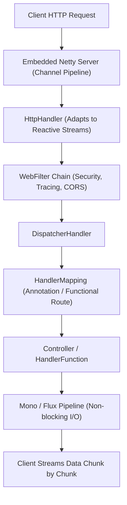

**Interview Tip:**
Highlight that in WebFlux, the execution thread is never blocked waiting for network I/O. When an external I/O call is made, Netty registers a channel future and frees the thread immediately.

---

## Topic: Advanced Configuration, Testing & Candidate Transcripts

## Q490 — 13 how will you handle multiple spring profiles using JVM args

**Interview Answer (Short):**
To activate multiple Spring profiles using JVM arguments:
Pass `-Dspring.profiles.active=profile1,profile2` as a comma-separated list when launching the application:
```bash
java -Dspring.profiles.active=dev,k8s,mock-payment -jar myapp.jar
```
Spring Boot will merge configurations from `application.yml`, `application-dev.yml`, and `application-k8s.yml`, with later profiles overriding matching properties from earlier ones.

**Detailed Explanation:**
In containerized Kubernetes environments, activating multiple profiles allows modular environment layering:
- `prod`: Standard production database connections and logging.
- `k8s`: Kubernetes service discovery and internal DNS.
- `datadog`: Enables APM tracing and metrics exporters.

### Precedence in Multiple Profiles:
If `application-dev.yml` sets `server.port=8081` and `application-k8s.yml` sets `server.port=8082`:
Because `k8s` was specified second (`dev,k8s`), **`8082` wins**.

**Interview Tip:**
Mention alternative ways to pass active profiles:
1. Environment Variable: `export SPRING_PROFILES_ACTIVE=dev,k8s`
2. Command-line program argument: `java -jar myapp.jar --spring.profiles.active=dev,k8s`

---

## Q493 — 23. How did you do the volume testing in the TLR 
Find maximum in list using stream 
Group student on the basis of grade using stream 
Diff between stream and parallel stream 
Life cycle of beans 
Difference between spring and springboot

**Interview Answer (Short):**
Volume testing in enterprise systems (such as TLR - Transaction Logging and Reconciliation systems) verifies how the application performs when processing massive data volumes over sustained periods. 

In Spring Boot, volume testing is conducted by:
1. **Test Tooling:** Generating realistic mock transaction streams using **Apache JMeter** or **Gatling**.
2. **Batch & Ingestion Performance:** Benchmarking Spring Batch processing chunks (`chunk(1000)`), JDBC batch updates (`rewriteBatchedStatements=true`), and asynchronous Kafka ingestion.
3. **Resource Profiling:** Monitoring heap allocations, garbage collection pauses (using VisualVM / JProfiler), and HikariCP connection pool metrics.
4. **Database Tuning:** Identifying missing indexes, deadlocks, and table partition bottlenecks under high load.

**Detailed Explanation:**
In financial and transaction-heavy applications:
- **Objective:** Ensure the system does not crash with `OutOfMemoryError: Java heap space` or suffer from performance degradation as database tables grow from 100K to 50M rows.
- **Key Bottlenecks to Watch in Spring Boot:**
  - **Hibernate First-Level Cache:** Accumulating millions of entity objects in the `EntityManager` causes memory exhaustion. Fix by calling `entityManager.clear()` periodically in batch jobs.
  - **Connection Pool Exhaustion:** Threads waiting for database connections timeout if connection pool size is too small or queries take too long.

**Interview Tip:**
When asked about volume testing from your project experience, structure your answer around: **Preparation (realistic data) -> Execution (load generation) -> Monitoring (JVM & DB) -> Tuning (indexes, batching, caching).**

---

## Q481 — 7. What is AR system? how do you prioritise features. 
 
 
Introduce about yourself 
Difference between Abstract and Interface and write syntax 
Difference between map and flat map 
Spring bean 
Dependency injection 
Spring IOC container 
Explain about project with example

**Interview Answer (Short):**
This transcript question covers two main dimensions:
1. **AR (Accounts Receivable) System & Feature Prioritization:** An AR system manages invoicing, customer credit, payment reconciliation, and aging reports. Features are prioritized using frameworks like **MoSCoW** (Must have, Should have, Could have, Won't have) or **RICE** (Reach, Impact, Confidence, Effort) based on business value, compliance deadlines, and technical dependencies.
2. **Spring Core Sub-questions:**
   - **Abstract Class vs Interface:** An abstract class defines identity and code reuse (`is-a`); an interface defines a behavioral contract (`can-do`).
   - **`map` vs `flatMap`:** `map` transforms values 1-to-1 (`T -> R`); `flatMap` transforms values 1-to-many and flattens nested structures (`T -> Stream<R>`).
   - **Spring Bean & IoC:** Managed objects assembled by the `ApplicationContext` via Dependency Injection.

**Detailed Explanation:**
In full-stack and domain-focused backend rounds, interviewers often evaluate domain understanding alongside technical acumen:
- **Accounts Receivable Domain:** Core flows include generating invoices upon order completion, processing incoming payments (credit card, bank transfer), matching payments to outstanding invoices (reconciliation), and tracking overdue accounts.
- **Feature Prioritization Framework (RICE):**
  $$\text{RICE Score} = \frac{\text{Reach} \times \text{Impact} \times \text{Confidence}}{\text{Effort}}$$
  High RICE scores (e.g. automated payment retry logic) get prioritized first.

**Interview Tip:**
Always demonstrate that you think like a product-minded engineer: technical decisions (Spring architecture) serve business goals (reducing payment failure rates and improving reconciliation accuracy).

---

## Q522 — ```text
Write the jave code to find the duplicate element in an array using streams 
what are streams ? 
why we use springboot alternate to other traditional  frameworks 
what is different between spring and springboot 
what is restFull api 
what is inversion of control in spring? 
what is dependency injection ?  
what is dependency inversion?  
what is the features of java8; - 
what is bean? what is @configuartion?  
what is different between interface and abstract class? 
what is functional interface?  
what are the  custom functional interface?- 
what is difference between interface and functional interface; 
what is @Autowaired? stereotype of @compounts; 
some questions on the collection famework; 
some basic questions on java; 
  
At last of the interview he asked to select any data structure comfortable , i told arrays 
,spring and recursion, he told to print the premutation of the spring abcd using the 
recursion.
```

**Interview Answer (Short):**
This transcript excerpt contains a comprehensive technical interview block:
1. **Finding Duplicates in an Array using Streams:**
   ```java
   List<Integer> numbers = List.of(1, 2, 3, 2, 4, 5, 1);
   Set<Integer> duplicates = numbers.stream()
           .filter(n -> !seen.add(n)) // HashSet.add() returns false if already present
           .collect(Collectors.toSet());
   ```
2. **Why Spring Boot over traditional frameworks:** Built-in auto-configuration, embedded servers, starter dependencies, and production-ready monitoring.
3. **IoC, DI & Dependency Inversion:** Inversion of Control is the design principle, Dependency Injection is the pattern, and Dependency Inversion is the SOLID principle stating high-level modules should depend on abstractions.
4. **Recursion (String Permutation):** Permutations generated by swapping characters recursively.

**Detailed Explanation:**

### Finding Duplicates Using Collectors.groupingBy:
```java
public class StreamDuplicatesFinder {
    public static void main(String[] args) {
        int[] arr = {10, 20, 30, 20, 40, 10, 50};

        // Method 1: Using frequency counting via groupingBy
        List<Integer> duplicates = Arrays.stream(arr)
                .boxed()
                .collect(Collectors.groupingBy(Function.identity(), Collectors.counting()))
                .entrySet().stream()
                .filter(entry -> entry.getValue() > 1)
                .map(Map.Entry::getKey)
                .toList();

        System.out.println("Duplicate elements: " + duplicates); // [10, 20]
    }
}
```

### String Permutations Using Recursion:
```java
public class StringPermutations {
    public static void permute(String str, String result) {
        if (str.isEmpty()) {
            System.out.println(result);
            return;
        }
        for (int i = 0; i < str.length(); i++) {
            char ch = str.charAt(i);
            String remaining = str.substring(0, i) + str.substring(i + 1);
            permute(remaining, result + ch);
        }
    }
}
```

**Interview Tip:**
In coding rounds where interviewers ask for duplicates using streams, mentioning both approaches—`seen.add(n)` for $O(N)$ single-pass filtering and `groupingBy(Function.identity(), counting())` for full frequency counting—shows complete mastery of the Java Streams API.

---

## Q552 — Introduction & previous projects 
tools and technologies used in previous projects 
how to deploy applications in production 
how to specify which end points needs to be authenticated in a spring boot application 
Spring security 
how to implement jwt authentication step by step and what all files are needed explain in 
detail

**Interview Answer (Short):**
A professional self-introduction framework for a Spring Boot Backend Engineer:
1. **Present (Who you are):** *"I am a Senior Java Backend Developer with X years of experience designing and building scalable microservices and RESTful APIs using Java 21, Spring Boot, and PostgreSQL."*
2. **Past (Key projects & achievements):** *"In my previous project, I designed a distributed order-processing pipeline using Spring Boot and Kafka, implementing optimistic locking and Redis caching to handle 5,000 requests per second with sub-50ms latency."*
3. **Future (Why you are here):** *"I am excited about this role because of your focus on building resilient, cloud-native distributed systems."*

**Detailed Explanation:**
When an interviewer asks *"Tell me about yourself and your previous projects"*, do not recite your resume line by line. Structure your response into a compelling 90-second technical narrative:
- **Scale:** Mention concrete metrics (throughput, database size, latency improvements).
- **Architecture:** Mention how you applied Spring patterns (IoC, AOP for audit logging, `@Transactional` boundaries, resilience patterns like Circuit Breaker).
- **Ownership:** Emphasize what **you** designed, implemented, and optimized rather than what the team did passively.

**Interview Tip:**
Anchor your self-introduction around **problem -> architecture -> Spring Boot implementation -> measurable result**. Interviewers will naturally base their technical follow-up questions on the technologies you highlight in this intro.

---

