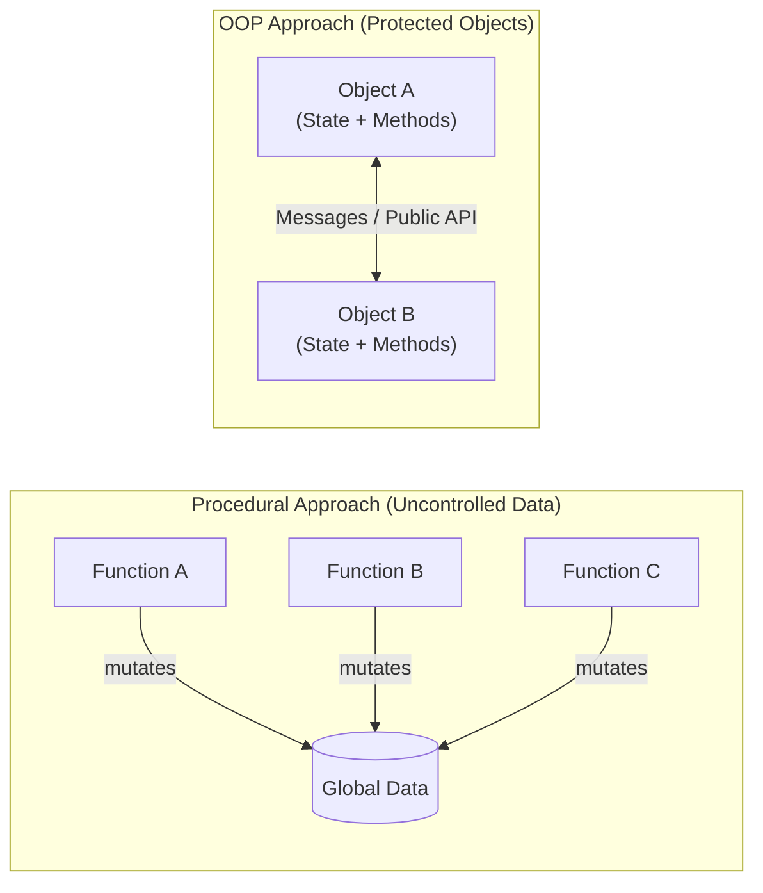

# 01. Object-Oriented Programming (OOP) Overview

## 1. What is it?

**Object-Oriented Programming (OOP)** is a programming paradigm that organizes software design around **data (attributes)** and **behavior (methods)** combined into unified entities called **objects**, rather than functions and sequential logic alone.

Instead of writing programs as lists of linear instructions operating on detached global data (procedural style), OOP models a system as a network of collaborative objects that communicate by passing messages to each other.

OOP stands on **four foundational pillars**:
1. **Encapsulation**: Bundling state and methods together while hiding internal details.
2. **Abstraction**: Exposing high-level contracts while hiding complex implementation mechanics.
3. **Inheritance**: Deriving new classes from existing ones to share structure and behavior.
4. **Polymorphism**: Allowing different objects to respond to the same message in their own specific ways.

---

## 2. Why do we need it?

As software grows beyond trivial scripts, procedural code suffers from several critical failure modes:

* **Uncontrolled Data Mutation**: In procedural systems, multiple functions freely mutate shared data structures, causing subtle bugs and race conditions.
* **Tight Coupling**: Modifying the format of a data structure breaks every single function accessing that structure across the entire codebase.
* **Poor Code Reusability**: Functions become coupled to specific contexts and data shapes, making reuse difficult without copy-pasting.
* **High Cognitive Load**: Developers must keep track of global execution flows instead of reasoning about localized, self-contained business concepts.

OOP solves these problems by providing modular boundaries, clear ownership of data, and extensible architectures that mirror real-world domain concepts.

---

## 3. How does it work?

In OOP, the system is designed through two core conceptual layers:

1. **Definitions (Classes)**: You author blueprints defining which fields an entity owns and which operations it can safely perform.
2. **Instances (Objects)**: At runtime, you create discrete instances from those blueprints. Each object maintains its own identity and independent state in memory.
3. **Message Passing**: Objects interact exclusively through defined public methods. An object receives a request, validates its internal invariants, updates its state, and optionally returns a result or notifies other objects.

---

## 4. One Simple Real-World Analogy

Think of a **Commercial Kitchen in a Restaurant**:
* In a **procedural model**, all raw ingredients lie on a huge open table. Waiters, chefs, dishwashers, and managers all walk up and slice, boil, or move whatever they want at any time. Chaos ensues if someone misplaces or contaminates an ingredient.
* In an **OOP model**, there are distinct stations: the **Chef**, the **Pantry Manager**, and the **Cashier**. 
  - The Cashier cannot directly tamper with the Chef's pans.
  - The Cashier sends a message: *"Please prepare Order #42"*.
  - The Chef manages their own tools, cooks the meal, and hands back the finished dish.
  - Each role protects its own station (encapsulation) and coordinates through clear requests (message passing).

---

## 5. Small Java Code Example (Java 21)

```java
package com.systemdesign.lld.fundamentals.oop;

// 1. Encapsulation & Abstraction: Domain entity protects its state
public class BankAccount {
    private final String accountNumber;
    private double balance;

    public BankAccount(String accountNumber, double initialDeposit) {
        if (accountNumber == null || accountNumber.isBlank()) {
            throw new IllegalArgumentException("Account number cannot be empty");
        }
        if (initialDeposit < 0) {
            throw new IllegalArgumentException("Initial deposit cannot be negative");
        }
        this.accountNumber = accountNumber;
        this.balance = initialDeposit;
    }

    public void deposit(double amount) {
        if (amount <= 0) {
            throw new IllegalArgumentException("Deposit amount must be positive");
        }
        this.balance += amount;
    }

    public void withdraw(double amount) {
        if (amount <= 0) {
            throw new IllegalArgumentException("Withdrawal amount must be positive");
        }
        if (amount > this.balance) {
            throw new IllegalStateException("Insufficient funds");
        }
        this.balance -= amount;
    }

    public double getBalance() {
        return balance;
    }

    public String getAccountNumber() {
        return accountNumber;
    }
}
```

```java
// Client demonstrating message passing and state encapsulation
public class Main {
    public static void main(String[] args) {
        BankAccount account = new BankAccount("ACC-9021", 500.0);
        
        // Interacting via public methods (messages)
        account.deposit(250.0);
        account.withdraw(100.0);

        System.out.println("Final Balance: " + account.getBalance()); // 650.0
        
        // Invalid operations are safely rejected by the object
        // account.withdraw(1000.0); // Throws IllegalStateException: Insufficient funds
    }
}
```

---

## 6. Diagram



### Explanation of Diagram
In the procedural model on the left, disparate functions directly access and mutate raw shared data structures, making bugs hard to isolate. In the OOP model on the right, state is enclosed inside autonomous objects; interaction happens purely through validated message requests across public method boundaries.

---

## 7. Advantages and Disadvantages

### Advantages
* **Maintainability**: Changes to internal algorithms or data representations are localized to single classes without breaking external callers.
* **Real-World Modeling**: Domain problems (e.g., Orders, Customers, Inventory) map directly to intuitive code structures.
* **Reusability & Extensibility**: Polymorphic interfaces allow adding new behaviors without rewriting existing clients (Open/Closed Principle).
* **Testability**: Discrete objects with well-defined interfaces can be easily isolated, mocked, and unit tested.

### Disadvantages
* **Slight Overhead**: Dynamic dispatch and heap allocation introduce minor performance and memory overhead compared to raw procedural or cache-localized memory layouts.
* **Risk of Over-Engineering**: Beginners often construct overly complex inheritance hierarchies and superfluous abstractions for simple problems.
* **Larger Initial Footprint**: Requires more upfront planning and boilerplate than quick procedural scripts.

---

## 8. When to Use It and When Not to Use It

### When to Use It
* Building enterprise applications, domain-driven microservices, or backend services with rich business rules.
* Systems requiring long-term maintenance, evolving feature sets, and team collaboration.
* Low-Level Design (LLD) interviews where candidate ability to model real-world domains and apply SOLID principles is evaluated.

### When Not to Use It
* Short, disposable command-line automation scripts or one-off data parsing tasks.
* Pure numerical, signal processing, or mathematical algorithms where high-performance flat data arrays and cache locality are critical.
* Pure functional programming environments where immutable data transformations and pure function pipelines are preferred.

---

## 9. Common Mistakes and Misconceptions

* **Misconception: OOP is just creating classes with getters and setters**: Exposing raw getters and setters for all fields is simply procedural programming disguised with Java syntax ("anemic domain model"). True OOP encapsulates business behavior inside the entity.
* **Mistake: Deep inheritance trees**: Creating 5-level inheritance hierarchies (`LivingThing -> Animal -> Mammal -> Canine -> Dog`) leads to rigid, fragile architectures. Prefer composition over inheritance.
* **Mistake: God Objects**: Creating monolithic classes like `SystemManager` or `OrderProcessor` that do everything while other classes act as dumb data bags.

---

## 10. Common LLD Interview Questions with Answers

### Q1: What is the difference between Procedural Programming and Object-Oriented Programming?
**Answer**: Procedural programming divides tasks into sequential procedures and functions operating on detached data structures; data is passive and exposed. OOP unifies data and operations into autonomous objects; data is private and hidden behind public methods that enforce business rules.

### Q2: What are the four core pillars of OOP and how do they collaborate?
**Answer**:
1. **Encapsulation** protects an object's internal data.
2. **Abstraction** hides implementation complexity behind high-level interfaces.
3. **Inheritance** lets subclasses reuse common behaviors and establish subtyping contracts.
4. **Polymorphism** allows treating different concrete objects uniformly through shared supertypes/interfaces.

### Q3: Why is an "Anemic Domain Model" considered an anti-pattern in OOP?
**Answer**: An anemic domain model consists of classes that hold only private fields with public getters and setters, with all business logic located in external service classes. This strips entities of their behavior, breaks encapsulation, spreads business validation everywhere, and regresses OOP back to procedural programming.

---

## 11. Short Revision Notes

* **Core Essence**: OOP = State + Behavior bundled together + Message Passing.
* **4 Pillars**: Encapsulation (protect), Abstraction (simplify), Inheritance (derive), Polymorphism (adapt).
* **Golden Rule**: Always favor rich domain models with behavior over dumb data holders with endless getters/setters.
* **LLD Focus**: Focus on clean object boundaries, high cohesion within objects, and loose coupling between objects.
