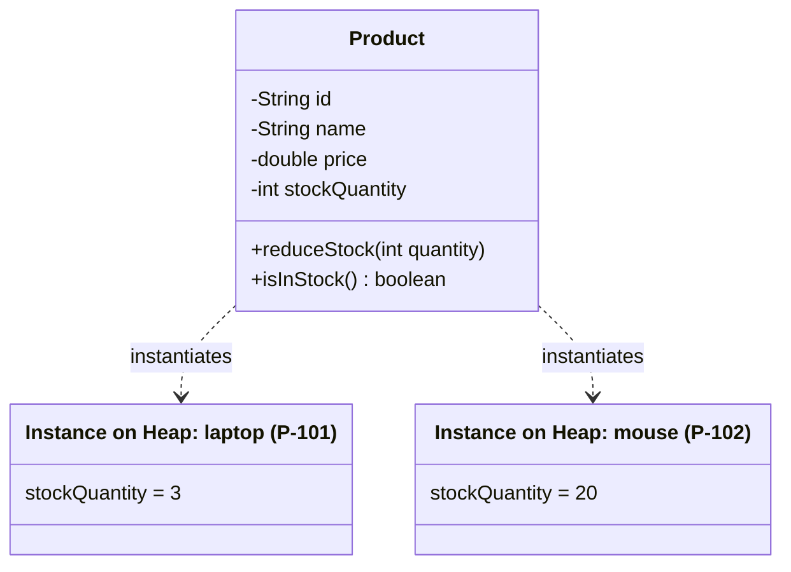

# 02. Classes and Objects

## 1. What is it?

* A **Class** is a blueprint, prototype, or user-defined type that specifies what data fields (state) and what methods (behavior) objects of that type will possess.
* An **Object** is a concrete instance of a class created in memory at runtime. It has its own **identity**, holds its own **state**, and responds to **behavior**.

In Java:
```
Class  = The Type Definition (Code sitting in class files / Metaspace)
Object = The Runtime Instance (Allocated on the Java Heap)
```

---

## 2. Why do we need it?

Without classes and objects:
* You would have to declare separate parallel variables for every single entity (e.g., `user1Name`, `user1Email`, `user2Name`, `user2Email`).
* You cannot easily pass a complete conceptual entity across function boundaries as a single cohesive unit.
* You cannot stamp out dozens or thousands of independent entities that follow identical rules and invariants.

Classes give us **reusability and structure**, while objects give us **independent, runtime execution units**.

---

## 3. How does it work?

1. **Compilation & Loading**: When Java compiles your code, the class definition is written to a `.class` bytecode file. When the application runs, the JVM loads this class definition into **Metaspace**.
2. **Instantiation (`new` keyword)**:
   ```java
   User user = new User("Alice", "alice@example.com");
   ```
   - The `new` keyword allocates memory for the object's instance fields on the **Heap**.
   - The constructor initializes the object's internal fields.
   - A reference (memory address pointer) is stored in the variable `user` on the **Call Stack**.
3. **Identity vs State**:
   - **Identity**: Even if two `User` objects have identical names and emails, they reside at different memory addresses and are distinct objects (`user1 != user2`).
   - **State**: The specific values stored in an object's fields at any given point in time.
   - **Behavior**: The methods defined in the class that read or modify the object's state.

---

## 4. One Simple Real-World Analogy

Think of an **Architectural Blueprint vs Houses in a Suburb**:
* The **Class** is the blueprint drawn on paper. It defines that every house must have 3 bedrooms, 2 bathrooms, a front door, and an electric lock. You cannot live inside a blueprint.
* The **Objects** are the actual brick-and-mortar houses built on 101 Oak Street, 102 Oak Street, and 103 Oak Street. 
  - Each house was stamped out from the same blueprint.
  - Painting the bedroom in House 101 does not change the paint color in House 102.
  - Each house has its own unique address (identity) and current condition (state).

---

## 5. Small Java Code Example (Java 21)

```java
package com.systemdesign.lld.fundamentals.classesobjects;

// Blueprint (Class)
public class Product {
    // State (Attributes)
    private final String id;
    private final String name;
    private double price;
    private int stockQuantity;

    // Constructor to ensure valid initial state
    public Product(String id, String name, double price, int stockQuantity) {
        if (price < 0 || stockQuantity < 0) {
            throw new IllegalArgumentException("Price and stock cannot be negative");
        }
        this.id = id;
        this.name = name;
        this.price = price;
        this.stockQuantity = stockQuantity;
    }

    // Behavior (Methods)
    public void reduceStock(int quantity) {
        if (quantity <= 0) {
            throw new IllegalArgumentException("Quantity must be positive");
        }
        if (quantity > this.stockQuantity) {
            throw new IllegalStateException("Insufficient stock for product: " + name);
        }
        this.stockQuantity -= quantity;
    }

    public boolean isInStock() {
        return this.stockQuantity > 0;
    }

    public String getName() { return name; }
    public double getPrice() { return price; }
    public int getStockQuantity() { return stockQuantity; }
}
```

```java
// Instantiation and usage (Objects)
public class Main {
    public static void main(String[] args) {
        // Creating distinct object instances from the Product blueprint
        Product laptop = new Product("P-101", "MacBook Pro", 1999.99, 5);
        Product mouse = new Product("P-102", "Wireless Mouse", 49.99, 20);

        // Mutating laptop state has zero impact on mouse state
        laptop.reduceStock(2);

        System.out.println(laptop.getName() + " remaining stock: " + laptop.getStockQuantity()); // 3
        System.out.println(mouse.getName() + " remaining stock: " + mouse.getStockQuantity());   // 20
    }
}
```

---

## 6. Diagram



### Explanation of Diagram
`Product` serves as the static blueprint specifying variables and operations. At runtime, multiple distinct instances (`laptop` and `mouse`) are spawned in heap memory, each holding isolated values for `stockQuantity`.

---

## 7. Advantages and Disadvantages

### Advantages
* **Modular Type Creation**: Allows you to create domain-rich types that perfectly describe your business domain (e.g., `Order`, `Payment`, `Inventory`).
* **Independent Lifecycles**: Objects can be created on-demand, mutated independently, and reclaimed by garbage collection when no longer referenced.
* **Encapsulated Scope**: Variable names do not clash because state is scoped to each individual object instance.

### Disadvantages
* **Memory Footprint**: Every object in Java carries header overhead (mark word + class word = 12 to 16 bytes) plus memory alignment padding.
* **Garbage Collection Pressure**: Careless creation of millions of short-lived objects causes JVM GC pauses.

---

## 8. When to Use It and When Not to Use It

### When to Use It
* Whenever you need to represent entities with both distinct data and specialized operations.
* When modeling business state that needs to live for a specific lifecycle (session, request, transaction).

### When Not to Use It
* For pure stateless mathematical utilities (e.g., `Math.max`, `Collections.sort`), prefer static utility methods or stateless singleton services.
* For pure lightweight transparent data holders with no internal state mutation, consider Java `record` types instead of full mutable classes.

---

## 9. Common Mistakes and Misconceptions

* **Mistake: Confusing the reference with the object**: `Product p = new Product(...)` — `p` is not the object; `p` is a pointer/reference variable stored on the stack holding the memory address of the object living on the heap.
* **Mistake: Forgetting that static fields belong to the class, not the object**: If a field is marked `static`, all instances share that exact same single memory location.
* **Mistake: Calling methods on `null`**: Declaring a class variable without instantiating it leaves it pointing to `null`, causing runtime `NullPointerException` when invoked.

---

## 10. Common LLD Interview Questions with Answers

### Q1: What are the three essential characteristics of an Object in OOP?
**Answer**:
1. **State**: The data values stored in its fields at any point in time.
2. **Behavior**: The actions it can perform via its methods.
3. **Identity**: The unique handle/address distinguishing it from all other objects, even if their state is identical.

### Q2: What happens in JVM memory when you execute `Customer c = new Customer("John");`?
**Answer**:
1. The JVM checks if `Customer` class is loaded; if not, classloader loads it into Metaspace.
2. The `new` keyword allocates raw bytes on the **Heap** for the instance variables of `Customer`.
3. The constructor runs, setting the field `name` to `"John"`.
4. A reference variable `c` is created on the current thread's **Stack**, storing the heap address of the newly allocated `Customer` object.

### Q3: When should you use a Java `record` instead of a traditional `class`?
**Answer**: Use a `record` (introduced in modern Java) when you need an immutable, transparent carrier for data (like DTOs, query results, or value objects) where `equals()`, `hashCode()`, `toString()`, and getters should be automatically generated without boilerplate. Use a traditional `class` when you need mutable state, encapsulation of complex hidden representations, or custom inheritance hierarchies.

---

## 11. Short Revision Notes

* **Class**: The compile-time blueprint (code in Metaspace).
* **Object**: The runtime instance (data on the Heap).
* **State + Behavior + Identity**: The definition of an object.
* **Static vs Instance**: Instance variables belong to each object; static variables belong to the class.
