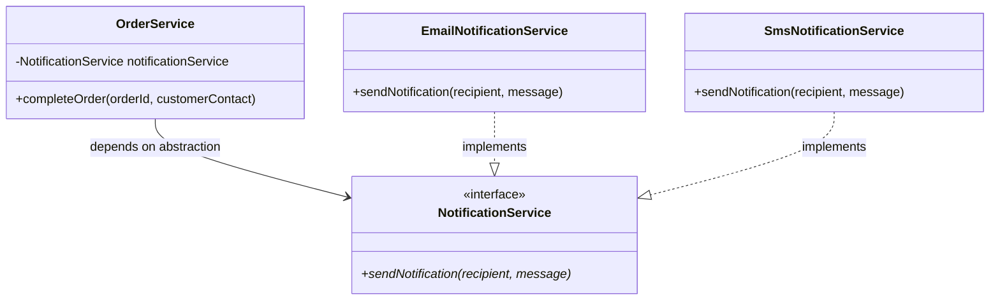

# 04. Abstraction

## 1. What is it?

**Abstraction** is the design principle of exposing only the **essential, high-level features** of an entity while hiding the underlying mechanics, operational complexities, and implementation details.

In software design, abstraction establishes a clear boundary between **"What an object does"** (the contract) and **"How it does it"** (the concrete execution). In Java, abstraction is primarily realized through **interfaces** and **abstract classes**.

---

## 2. Why do we need it?

Without abstraction:
* **Severe Coupling**: High-level business logic becomes tightly coupled to specific low-level technologies (e.g., an `OrderService` directly invoking PayPal SDK classes). Switching to Stripe or a mock payment provider would require rewriting the entire order service.
* **Cognitive Overload**: Every engineer working on the system would need to understand every low-level network protocol, database driver, and algorithm instead of working with intuitive concepts like `save()`, `notify()`, or `charge()`.
* **Untestable Code**: You cannot easily swap real external dependencies with fake/mock objects during unit testing.

Abstraction allows you to change the underlying engine without breaking the driver.

---

## 3. How does it work?

Abstraction works through layers and contracts:

1. **Define the Contract (The "What")**:
   An `interface` or `abstract class` declares the set of operations available to callers without writing the method body.
2. **Implement the Contract (The "How")**:
   Concrete classes implement the contract, handling hardware, databases, third-party APIs, or specific algorithms.
3. **Program to an Interface, Not an Implementation**:
   Client code depends strictly on the abstraction type, allowing any conforming implementation to be plugged in seamlessly at runtime.

---

## 4. One Simple Real-World Analogy

Think of a **Car's Gas Pedal and Steering Wheel**:
* When you press the accelerator pedal, the car speeds up.
* You do not need to know whether the car is gasoline-powered, turbocharged diesel, or 100% electric.
* You do not need to manage fuel injectors, spark timing, or lithium-ion battery inverter voltage frequencies.
* The steering wheel and pedals provide a clean **abstraction**. The complex mechanics are hidden under the hood, and you can drive a Tesla, a Ford, or a Ferrari using the exact same abstract interface.

---

## 5. Small Java Code Example (Java 21)

```java
package com.systemdesign.lld.fundamentals.abstraction;

// 1. The Abstraction: Defines WHAT can be done, hiding HOW
public interface NotificationService {
    void sendNotification(String recipient, String message);
}
```

```java
// 2. Concrete Implementation A: Email mechanism
public class EmailNotificationService implements NotificationService {
    @Override
    public void sendNotification(String recipient, String message) {
        // Complex SMTP handshake, TLS encryption, header formatting hidden here
        System.out.println("Connecting to SMTP server... Sending EMAIL to " + recipient + ": " + message);
    }
}

// 3. Concrete Implementation B: SMS mechanism
public class SmsNotificationService implements NotificationService {
    @Override
    public void sendNotification(String recipient, String message) {
        // Cellular gateway REST payload and authentication hidden here
        System.out.println("Connecting to SMS Gateway... Sending SMS to " + recipient + ": " + message);
    }
}
```

```java
// 4. Client depends only on the abstraction
public class OrderService {
    private final NotificationService notificationService;

    // Injected via constructor - OrderService has NO idea which concrete notification is used!
    public OrderService(NotificationService notificationService) {
        this.notificationService = notificationService;
    }

    public void completeOrder(String orderId, String customerContact) {
        System.out.println("Order " + orderId + " processed successfully.");
        // Calling high-level abstraction
        notificationService.sendNotification(customerContact, "Your order " + orderId + " is confirmed!");
    }
}
```

```java
public class Main {
    public static void main(String[] args) {
        // Easily swap implementations without modifying OrderService
        NotificationService emailService = new EmailNotificationService();
        OrderService order1 = new OrderService(emailService);
        order1.completeOrder("ORD-101", "user@example.com");

        NotificationService smsService = new SmsNotificationService();
        OrderService order2 = new OrderService(smsService);
        order2.completeOrder("ORD-102", "+1-555-0199");
    }
}
```

---

## 6. Diagram



### Explanation of Diagram
`OrderService` only knows about the `NotificationService` interface. Concrete implementations (`EmailNotificationService` and `SmsNotificationService`) fulfill the contract behind the scenes. `OrderService` remains decoupled from email and SMS technical details.

---

## 7. Advantages and Disadvantages

### Advantages
* **Loose Coupling**: High-level modules do not depend on low-level implementation details.
* **Extensibility**: Add new concrete implementations (e.g., `PushNotificationService`) without changing existing business services.
* **Simplicity for Callers**: Reduces mental fatigue by exposing a concise, focused set of operations.
* **Mockability**: Simplifies automated testing by allowing mock or stub implementations.

### Disadvantages
* **Indirection Overhead**: Navigating through interfaces adds extra files and layers of indirection during code reading.
* **Leaky Abstractions**: In poorly designed systems, implementation details leak out (e.g., an interface method throwing a `SQLException`, revealing the database under the hood).

---

## 8. When to Use It and When Not to Use It

### When to Use It
* At system boundaries (database access, third-party payment gateways, message brokers, notification channels).
* Whenever multiple variations of an algorithm or business process exist (e.g., pricing strategies, shipping calculators).
* In all LLD problems to separate business coordination from infrastructure services.

### When Not to Use It
* For simple, stable, internal helper classes that will only ever have one single straightforward implementation (avoid "interfaceitis" where every single 5-line class has an interface).
* Prematurely abstracting before you actually understand the variance or requirements.

---

## 9. Common Mistakes and Misconceptions

* **Mistake: Confusing Abstraction with Encapsulation**:
  - *Encapsulation* = Hiding internal data and state details (`private` variables).
  - *Abstraction* = Hiding implementation mechanics and complexity behind a clean contract (`interface`).
* **Mistake: Leaky Abstraction**:
  Allowing concrete details to escape through the abstraction layer (e.g., an interface returning an AWS S3 `S3Object` instead of a generic `InputStream`).
* **Mistake: Creating bloated interfaces**:
  Putting 20 unrelated methods in one interface violates the Interface Segregation Principle (ISP). Keep abstractions lean and focused.

---

## 10. Common LLD Interview Questions with Answers

### Q1: What does "Program to an interface, not an implementation" mean?
**Answer**: It means declaring variable types, method parameters, and dependencies using abstract interfaces (e.g., `List<String> list = new ArrayList<>()` or `private final PaymentGateway gateway;`) rather than concrete classes (`ArrayList` or `StripeGateway`). This prevents caller code from coupling to specific concrete implementations and allows runtime substitution.

### Q2: When should you use an `interface` vs an `abstract class` in Java?
**Answer**:
* Use an **`interface`** when defining a behavioral contract or capability across unrelated classes (e.g., `Serializable`, `Comparable`, `NotificationService`). Classes can implement multiple interfaces.
* Use an **`abstract class`** when related classes share common state (non-static fields), constructors, and partial base implementation code (template method pattern) while enforcing subclass specialization.

### Q3: What is a "Leaky Abstraction" and how do you prevent it in LLD?
**Answer**: A leaky abstraction occurs when the underlying implementation details bleed through the interface, forcing the caller to handle implementation-specific issues (e.g., an interface method signature declaring `throws SQLException` or taking a `HibernateSession` parameter). Prevent it by catching low-level checked exceptions, translating them to domain exceptions, and keeping all parameters and return types technology-agnostic.

---

## 11. Short Revision Notes

* **Focus**: Defines **WHAT** to do, leaves **HOW** to concrete classes.
* **Primary Java Tools**: `interface` (contract of behavior) and `abstract class` (shared state + partial behavior).
* **Key Benefit**: Swappable implementations, easy unit testing, and decoupled architecture.
* **Remember**: Don't leak implementation details (like vendor-specific exceptions or data structures) through the abstraction contract.
