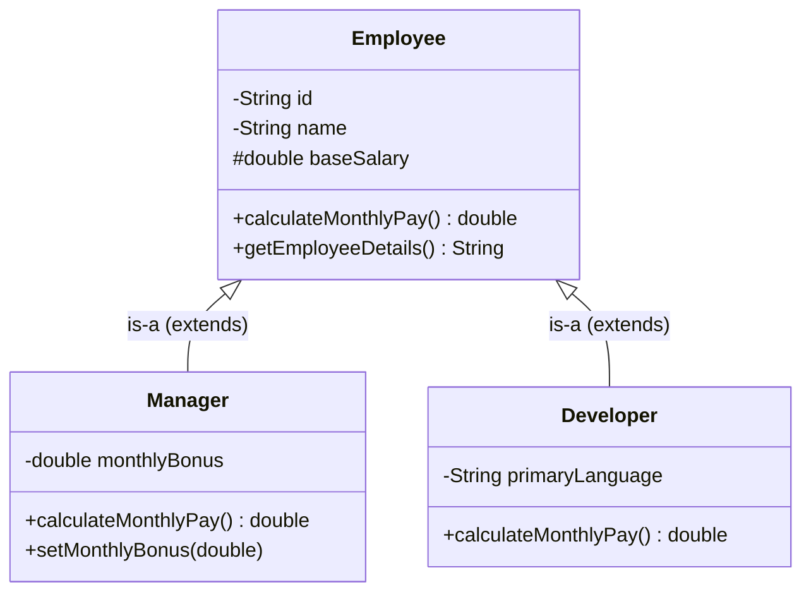

# 05. Inheritance

## 1. What is it?

**Inheritance** is a mechanism in object-oriented programming where a new class (known as a **subclass** or **child class**) derives properties (fields) and behaviors (methods) from an existing class (known as a **superclass** or **parent class**).

Inheritance models an **"is-a" relationship** (e.g., a `Dog` *is-a* `Mammal`, a `SavingsAccount` *is-a* `BankAccount`). In Java, inheritance is established using the `extends` keyword.

Java supports **single class inheritance** (a class can extend at most one direct superclass) to prevent ambiguity issues like the Diamond Problem, but permits **multiple interface implementation**.

---

## 2. Why do we need it?

Without inheritance:
* **Code Duplication**: If `Manager`, `Developer`, and `Intern` all share common employee properties (`id`, `name`, `salary`, `taxId`), you would have to duplicate the same fields, validation logic, and methods in every class.
* **Lack of Polymorphic Treatment**: You could not write a generalized payroll method like `processSalary(Employee e)` that accepts any specific employee type.
* **Scattered Maintenance**: Bug fixes or modifications to common logic would have to be manually copied across dozens of separate classes.

Inheritance provides **centralized code reuse** and establishes a formal **type hierarchy**.

---

## 3. How does it work?

1. **The `extends` keyword**: A child class inherits all `public` and `protected` fields and methods of its parent. `private` members exist in the memory of the object but are not directly accessible by the child's code.
2. **Constructor Chaining (`super()`)**:
   Before a child class initializes its own fields, it **must** call the superclass constructor (either explicitly via `super(...)` or implicitly via default `super()`). This guarantees that base state is valid.
3. **Method Overriding (`@Override`)**:
   A subclass can provide its own specialized implementation of an inherited method, replacing the superclass behavior when invoked on the subclass instance at runtime.
4. **Keyword `final`**:
   - Marking a class `final` prevents it from being inherited (e.g., `java.lang.String`).
   - Marking a method `final` prevents subclasses from overriding it.

---

## 4. One Simple Real-World Analogy

Think of **Vehicles**:
* A **Vehicle** has basic attributes: a vehicle identification number (VIN), speed, and common behaviors like `startEngine()` and `applyBrakes()`.
* A **Truck** *is-a* Vehicle. It inherits VIN, speed, and braking logic without reinventing them.
* However, a Truck adds specialized features: `bedPayloadCapacity` and overrides `startEngine()` to preheat heavy diesel glow plugs.
* The Truck is a specialized extension of the generic Vehicle concept.

---

## 5. Small Java Code Example (Java 21)

```java
package com.systemdesign.lld.fundamentals.inheritance;

// Superclass (Base / Parent)
public class Employee {
    private final String id;
    private final String name;
    protected double baseSalary; // accessible to subclasses

    public Employee(String id, String name, double baseSalary) {
        if (id == null || name == null || baseSalary < 0) {
            throw new IllegalArgumentException("Invalid employee attributes");
        }
        this.id = id;
        this.name = name;
        this.baseSalary = baseSalary;
    }

    public double calculateMonthlyPay() {
        return this.baseSalary;
    }

    public String getEmployeeDetails() {
        return "ID: " + id + ", Name: " + name;
    }
}
```

```java
// Subclass (Derived / Child)
public class Manager extends Employee {
    private double monthlyBonus;

    public Manager(String id, String name, double baseSalary, double monthlyBonus) {
        // Must invoke parent constructor first to ensure valid base state
        super(id, name, baseSalary);
        this.monthlyBonus = Math.max(0, monthlyBonus);
    }

    // Overriding parent method to include specialized manager bonus
    @Override
    public double calculateMonthlyPay() {
        return super.calculateMonthlyPay() + this.monthlyBonus;
    }

    public void setMonthlyBonus(double monthlyBonus) {
        this.monthlyBonus = Math.max(0, monthlyBonus);
    }
}
```

```java
public class Main {
    public static void main(String[] args) {
        Employee dev = new Employee("E-1", "Bob", 5000.0);
        Employee mgr = new Manager("M-1", "Alice", 7000.0, 2000.0); // Polymorphic reference

        System.out.println(dev.getEmployeeDetails() + " -> Pay: $" + dev.calculateMonthlyPay()); // 5000.0
        System.out.println(mgr.getEmployeeDetails() + " -> Pay: $" + mgr.calculateMonthlyPay()); // 9000.0
    }
}
```

---

## 6. Diagram



### Explanation of Diagram
`Employee` acts as the superclass defining common fields (`id`, `name`, `baseSalary`). `Manager` and `Developer` extend `Employee`, inheriting its core fields and behavior while providing their own specialized overrides for `calculateMonthlyPay()`.

---

## 7. Advantages and Disadvantages

### Advantages
* **Elimination of Boilerplate**: Common attributes and methods are written once in the superclass.
* **Polymorphic Subtyping**: Subclasses can be passed anywhere the superclass type is expected (Liskov Substitution Principle).
* **Extensibility**: You can introduce new derived types without modifying existing callers.

### Disadvantages
* **Fragile Base Class Problem**: Changes to superclass methods can unintentionally break subclass behavior in unexpected ways.
* **Tight Compile-Time Coupling**: The subclass is deeply bound to the parent implementation; inheritance cannot be altered or swapped at runtime.
* **Hierarchy Explosion**: Deep or inappropriate inheritance hierarchies (`Vehicle -> LandVehicle -> WheeledVehicle -> FourWheeledVehicle -> Car`) become unmaintainable and rigid.

---

## 8. When to Use It and When Not to Use It

### When to Use It
* When there is a **true, permanent "is-a" relationship** that holds universally across the entire domain.
* When the subclass genuinely conforms to the **Liskov Substitution Principle (LSP)** (any code expecting the superclass behaves correctly when given the subclass).
* When implementing framework template patterns (e.g., extending a base framework class to hook into lifecycle events).

### When Not to Use It
* Do **not** use inheritance purely to reuse code if no natural "is-a" relationship exists (e.g., making `Stack` extend `ArrayList`). Use **composition** instead.
* When relationships can change dynamically at runtime (e.g., an `Employee` becoming a `Manager`; an object cannot change its class at runtime).
* When base class methods do not make semantic sense in the child (e.g., `Penguin` extending `Bird` with a `fly()` method).

---

## 9. Common Mistakes and Misconceptions

* **Mistake: Violating the Liskov Substitution Principle (LSP)**:
  The classic `Square extends Rectangle` flaw. A square breaks the caller's assumption that width and height can be set independently.
* **Mistake: Forgetting to annotate with `@Override`**:
  If the method signature has a subtle typo or argument difference, the compiler treats it as a new overloaded method instead of an override, leading to silent bugs.
* **Mistake: Deep inheritance trees**:
  Inheritance hierarchies deeper than 2 or 3 levels become nightmare mazes to debug. Always favor shallow hierarchies.

---

## 10. Common LLD Interview Questions with Answers

### Q1: Why doesn't Java support multiple inheritance of classes?
**Answer**: Java disallows multiple class inheritance to avoid ambiguity, specifically the **Diamond Problem** (where class D extends both B and C, which both inherit and override a method from A; the compiler cannot resolve which method D inherits). Java solves this safely by allowing multiple **interface** implementation, where behavior is defined by clean contracts and default method conflicts must be explicitly resolved.

### Q2: What is the "Fragile Base Class" problem?
**Answer**: The fragile base class problem occurs when a seemingly safe modification to a parent class breaks subclasses that depend on the parent's internal execution details. For example, if a parent method is modified to call another self-method that a subclass has overridden, an infinite recursion or duplicate state mutation can occur in the subclass.

### Q3: What is the difference between Method Overloading and Method Overriding?
**Answer**:
* **Overloading** (Compile-time / Static): Methods in the same class share the same name but have different parameter lists (types, number, or order). Resolved at compile time.
* **Overriding** (Runtime / Dynamic): A subclass provides a specific implementation of a method already declared in its superclass with the exact same signature and return type. Resolved at runtime via virtual method table dispatch.

---

## 11. Short Revision Notes

* **Relationship**: Strict **is-a** relationship (`extends`).
* **Java Rule**: Single class inheritance; multiple interface implementation.
* **Constructor Rule**: Parent constructor (`super(...)`) always executes first.
* **Golden Warning**: Never inherit just to steal code. If it is not a true sub-type, use **composition**.
