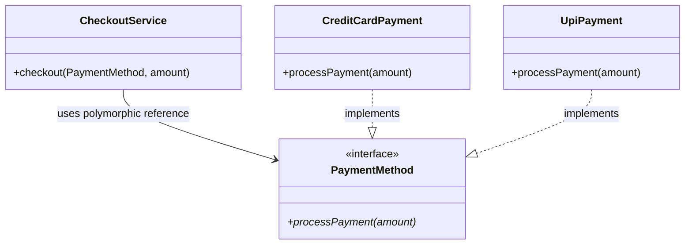

# 06. Polymorphism

## 1. What is it?

**Polymorphism** (from the Greek meaning "many forms") is the ability of an entity (such as a variable, method, or object) to take on different forms and exhibit different behaviors depending on the context.

In Object-Oriented Programming, polymorphism allows you to treat objects of different subclasses through a common superclass or interface reference, while executing the subclass-specific behavior at runtime.

Polymorphism manifests in two primary flavors:
1. **Compile-Time Polymorphism (Static Binding / Method Overloading)**: Resolved during compilation based on method signatures.
2. **Runtime Polymorphism (Dynamic Binding / Method Overriding)**: Resolved at runtime based on the actual object type residing in heap memory.

---

## 2. Why do we need it?

Without polymorphism, software architectures degrade into massive conditional checks:
```java
// Anti-pattern without polymorphism
if (paymentType.equals("UPI")) {
    processUpi(payment);
} else if (paymentType.equals("CREDIT_CARD")) {
    processCard(payment);
} else if (paymentType.equals("CRYPTO")) {
    processCrypto(payment);
}
```
* **Violates Open/Closed Principle (OCP)**: Every time you add a new payment method, you must find and modify every single `if/else` block across the application.
* **Fragile and Error-Prone**: Missing a condition in one place introduces silent production bugs.
* **Tight Coupling**: Callers must know every concrete implementation variant in advance.

With polymorphism, you simply call `paymentMethod.pay(amount)` and let the runtime dispatch the appropriate behavior automatically.

---

## 3. How does it work?

### Compile-Time Polymorphism (Overloading)
Methods in the same class share the same name but have **different parameter lists** (number, type, or order of arguments). The Java compiler inspects the call site and binds it directly to the matching method signature at compile time.

### Runtime Polymorphism (Overriding & Dynamic Method Dispatch)
A subclass overrides a method declared in its parent class or interface.
* When you declare a reference: `PaymentMethod payment = new UpiPayment();`
  - The variable type (`PaymentMethod`) is the **reference type** checked at compile time.
  - The actual instance (`UpiPayment`) is the **runtime object** on the heap.
* When `payment.pay(100)` is invoked, the JVM looks up the method in the object's **Virtual Method Table (vtable)** on the heap and dispatches to the `UpiPayment.pay()` implementation.

---

## 4. One Simple Real-World Analogy

Think of a **Universal USB-C Port**:
* Your laptop has a standard USB-C port (the interface / contract).
* You can plug in:
  - An external **SSD** $\to$ transfers files at high speed.
  - A **Monitor** $\to$ transmits video output.
  - A **Charger** $\to$ draws electrical power.
* The laptop does not have a separate customized physical hole for every manufacturer or accessory type. It sends signals through the universal USB-C standard, and each connected accessory responds according to its own nature.

---

## 5. Small Java Code Example (Java 21)

```java
package com.systemdesign.lld.fundamentals.polymorphism;

// 1. Common abstraction
public interface PaymentMethod {
    void processPayment(double amount);
}
```

```java
// 2. Concrete implementation A
public class CreditCardPayment implements PaymentMethod {
    private final String cardNumber;

    public CreditCardPayment(String cardNumber) {
        this.cardNumber = cardNumber;
    }

    @Override
    public void processPayment(double amount) {
        System.out.println("Charging $" + amount + " to Credit Card [" + cardNumber + "]");
    }
}

// 3. Concrete implementation B
public class UpiPayment implements PaymentMethod {
    private final String upiId;

    public UpiPayment(String upiId) {
        this.upiId = upiId;
    }

    @Override
    public void processPayment(double amount) {
        System.out.println("Transferring $" + amount + " via UPI to [" + upiId + "]");
    }
}
```

```java
// 4. Client demonstrating dynamic polymorphism + compile-time overloading
public class CheckoutService {

    // Compile-Time Polymorphism (Overloading): Same method name, different signatures
    public void applyDiscount(double percentage) {
        System.out.println("Applying percentage discount: " + percentage + "%");
    }

    public void applyDiscount(double fixedAmount, String couponCode) {
        System.out.println("Applying coupon " + couponCode + " with fixed discount: $" + fixedAmount);
    }

    // Runtime Polymorphism: Decoupled checkout logic
    public void checkout(PaymentMethod paymentMethod, double amount) {
        System.out.println("Initiating checkout...");
        // Dispatches dynamically at runtime based on the actual object passed
        paymentMethod.processPayment(amount);
    }
}
```

```java
public class Main {
    public static void main(String[] args) {
        CheckoutService checkoutService = new CheckoutService();

        // Testing compile-time overloading
        checkoutService.applyDiscount(10.0);
        checkoutService.applyDiscount(50.0, "SAVE50");

        // Testing runtime dynamic polymorphism
        PaymentMethod card = new CreditCardPayment("4111-XXXX-XXXX-1111");
        PaymentMethod upi = new UpiPayment("user@okaxis");

        checkoutService.checkout(card, 250.0);
        checkoutService.checkout(upi, 75.0);
    }
}
```

---

## 6. Diagram



### Explanation of Diagram
`CheckoutService` interacts exclusively with the `PaymentMethod` interface. When calling `processPayment()`, the JVM dynamically delegates to either `CreditCardPayment` or `UpiPayment` depending on the actual instance provided at runtime.

---

## 7. Advantages and Disadvantages

### Advantages
* **Extensibility (Open/Closed Principle)**: Add new implementations without changing or recompiling existing client services.
* **Eliminates Conditional Spaghetti**: Removes brittle `switch` or `if/else` checks based on type tags.
* **Clean APIs**: Allows clients to express intent at a high conceptual level.

### Disadvantages
* **Slight Runtime Cost**: Dynamic method dispatch uses a vtable lookup, causing a negligible nanosecond overhead (though heavily optimized by JVM JIT inline caching).
* **Debugging Complexity**: Stepping through code in a debugger can be less obvious because the executed method is determined dynamically at runtime.

---

## 8. When to Use It and When Not to Use It

### When to Use It
* Implementing design patterns like Strategy, State, Command, Factory, and Observer.
* When multiple business algorithms or behaviors fulfill the same contract.
* Any time you are tempted to write a `switch` statement over an object's type code.

### When Not to Use It
* When behavior is identical and only primitive data varies.
* For simple, one-off utility scripts where a single function is sufficient.

---

## 9. Common Mistakes and Misconceptions

* **Misconception: Overloading is decided at runtime**: Method overloading is decided **strictly at compile time** by the compiler based on the declared reference type, not the runtime object.
* **Mistake: Downcasting (`(ChildClass) parentRef`)**:
  Relying on `instanceof` and explicit downcasting defeats the purpose of polymorphism. If you need child-specific methods, your abstraction may be incomplete.
* **Mistake: Forgetting that private, static, and final methods cannot be polymorphic**:
  In Java, `static` methods belong to the class (static binding / hiding), and `private` methods are not inherited, so they cannot be overridden dynamically.

---

## 10. Common LLD Interview Questions with Answers

### Q1: What is the difference between Static Binding and Dynamic Binding?
**Answer**:
* **Static Binding (Compile-Time)**: Occurs when method resolution happens at compile time (used for `static`, `private`, `final` methods, and method overloading).
* **Dynamic Binding (Runtime)**: Occurs when method resolution happens at runtime based on the actual object on the heap (used for virtual / overridden instance methods).

### Q2: Can you override a `static` method in Java?
**Answer**: No. `static` methods are bound to the class at compile time, not to runtime object instances. If a subclass declares a static method with the same signature, it **hides** the parent method rather than overriding it. Dynamic dispatch does not apply to static methods.

### Q3: How does the JVM implement dynamic method dispatch internally?
**Answer**: The JVM maintains an internal table for each loaded class called the **Virtual Method Table (vtable)**. The vtable contains pointers to the actual bytecode of each method. When an overridden method is called on an object reference, the JVM looks up the vtable of the object's concrete class at runtime and executes the method pointer stored there.

---

## 11. Short Revision Notes

* **Overloading** = Same method name, different parameters = **Compile-time**.
* **Overriding** = Same method signature in subclass = **Runtime**.
* **Core Benefit**: Eliminates `if-else` type-checking; makes systems open for extension.
* **Remember**: Static, private, and final methods **cannot** be dynamically overridden.
