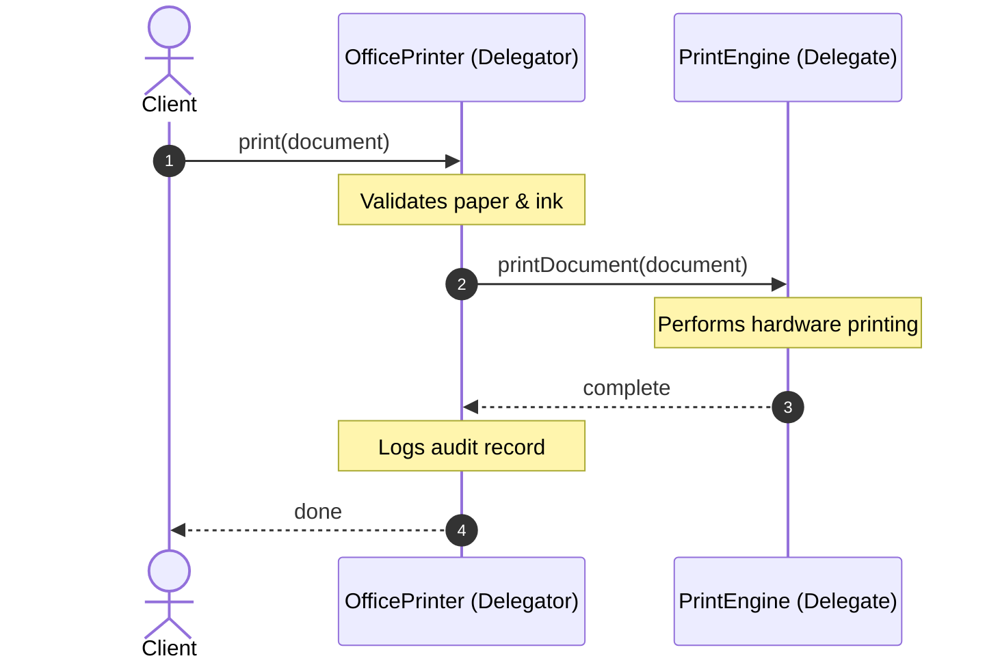

# 08. Delegation

## 1. What is it?

**Delegation** is an object-oriented design technique where an object handles an incoming request by **passing the responsibility** (delegating) to another helper object, called the **delegate**.

Instead of performing the task directly or inheriting the code via subclassing, the *delegator* object acts as a coordinator, forwarding the method call to the *delegate* which has the specialized knowledge to execute the work.

In short:
> *"Don't do it yourself if you have a specialist coworker who can do it for you."*

---

## 2. Why do we need it?

* **Eliminates Unnecessary Inheritance**: Delegation lets you achieve code reuse and behavior extension without the tight coupling and fragility of class inheritance.
* **Enforces Single Responsibility Principle (SRP)**: A class does not have to become bloated by implementing every utility algorithm; it can delegate printing, sorting, logging, or calculating to dedicated collaborators.
* **Enables Dynamic Behavior Switching**: Since the delegate is held as a reference (field), you can replace the delegate instance at runtime, changing the delegator's behavior dynamically.
* **Foundation for Design Patterns**: Delegation is the core engine behind the **State**, **Strategy**, **Proxy**, and **Decorator** design patterns.

---

## 3. How does it work?

1. **The Delegator** holds a reference to a **Delegate** (preferably defined as an interface).
2. When a client calls a method on the delegator, the delegator simply invokes the corresponding method on the delegate.
3. Optionally, the delegator can pass a reference to itself (`this`) to the delegate if the delegate needs access to the delegator's context (known as *explicit delegation*).
4. The delegator can add pre-processing or post-processing around the delegated call.

---

## 4. One Simple Real-World Analogy

Think of a **Company CEO and an Executive Assistant**:
* A client calls the **CEO** and asks: *"Please schedule an international conference room for Tuesday."*
* The CEO does not personally call IT, check room availability, or order catering.
* The CEO **delegates** the task to their **Executive Assistant**:
  ```java
  assistant.scheduleConferenceRoom("Tuesday", details);
  ```
* To the outside client, the request was made to the CEO's office. Behind the scenes, the actual work was performed by the assistant.

---

## 5. Small Java Code Example (Java 21)

```java
package com.systemdesign.lld.fundamentals.delegation;

// 1. Delegate contract
public interface PrintEngine {
    void printDocument(String content);
}
```

```java
// 2. Concrete Delegates
public class CanonPrintEngine implements PrintEngine {
    @Override
    public void printDocument(String content) {
        System.out.println("[Canon Laser] High-precision thermal printing: " + content);
    }
}

public class EpsonPrintEngine implements PrintEngine {
    @Override
    public void printDocument(String content) {
        System.out.println("[Epson Inkjet] Micro-piezo color printing: " + content);
    }
}
```

```java
// 3. Delegator class: Exposes print API, but delegates execution
public class OfficePrinter {
    private PrintEngine engine; // The delegate

    public OfficePrinter(PrintEngine engine) {
        this.engine = engine;
    }

    public void print(String document) {
        // Optional pre-processing
        System.out.println("Validating paper tray and ink levels...");
        
        // DELEGATION: Forwarding the actual work to the engine
        this.engine.printDocument(document);
        
        // Optional post-processing
        System.out.println("Print job logged to audit system.");
    }

    // Dynamic delegate swapping
    public void setEngine(PrintEngine engine) {
        this.engine = engine;
    }
}
```

```java
public class Main {
    public static void main(String[] args) {
        // OfficePrinter uses Canon delegate
        OfficePrinter printer = new OfficePrinter(new CanonPrintEngine());
        printer.print("Annual Financial Report.pdf");

        // Swap to Epson delegate without modifying OfficePrinter
        printer.setEngine(new EpsonPrintEngine());
        printer.print("Marketing Presentation.pdf");
    }
}
```

---

## 6. Diagram



### Explanation of Diagram
The client only communicates with `OfficePrinter`. `OfficePrinter` does not implement hardware printing logic itself; it forwards the request directly to its internal `PrintEngine` collaborator and returns the result.

---

## 7. Advantages and Disadvantages

### Advantages
* **Loose Coupling**: Delegator and delegate are coupled only by an interface contract.
* **Runtime Flexibility**: You can switch delegates at runtime (unlike inheritance, which is permanently frozen at compile time).
* **High Cohesion**: Keeps classes small and focused on a single responsibility.
* **Controlled Access**: The delegator can filter, transform, or cache requests before handing them off.

### Disadvantages
* **Forwarding Boilerplate**: You have to write boilerplate forwarding methods in the delegator class.
* **Micro-Overhead**: An extra method call layer of indirection is introduced.

---

## 8. When to Use It and When Not to Use It

### When to Use It
* When an object needs to reuse functionality from another class without an "is-a" relationship.
* When implementing structural design patterns like **Proxy**, **Decorator**, **Adapter**, or behavioral patterns like **State** and **Strategy**.
* When you want to restrict or customize access to a subset of another object's methods.

### When Not to Use It
* When every single method of a class is merely forwarding directly without adding any value, logic, or abstraction (useless "pass-through" layers).
* When a genuine, permanent "is-a" subtyping relationship exists.

---

## 9. Common Mistakes and Misconceptions

* **Mistake: Confusing Delegation with simple Calling**:
  Simply calling a method on another class isn't necessarily delegation. Delegation specifically means the delegator is masquerading as the provider of the service to its own callers, but passing the core responsibility to the delegate.
* **Mistake: The Delegate needing parent context**:
  If the delegate needs to call back into the delegator, you must pass `this` as a parameter. Forgetting this breaks two-way collaboration.
* **Mistake: Exposing the delegate publicly**:
  Making the delegate field `public` bypasses the delegator entirely and breaks encapsulation.

---

## 10. Common LLD Interview Questions with Answers

### Q1: What is the difference between Inheritance and Delegation?
**Answer**:
* **Inheritance**: Code reuse is static and happens at compile-time via subclassing (`extends`). Subclasses inherit everything and are tightly coupled to the superclass.
* **Delegation**: Code reuse is dynamic and happens at runtime via composition. The delegator maintains a reference to a delegate object and forwards method calls to it, keeping classes loosely coupled.

### Q2: How does the Decorator Pattern utilize Delegation?
**Answer**: The Decorator pattern wraps an object of an interface and implements that same interface. It delegates all core operations to the wrapped component while interjecting additional behavior (like encryption, compression, or logging) before or after the delegated call.

### Q3: What is "Inversion of Control" in relation to Delegation?
**Answer**: In classic delegation, the delegator chooses its delegate directly. With Inversion of Control (IoC) and Dependency Injection, the external framework or caller passes the delegate into the delegator (via constructor injection), allowing the delegator's behavior to be completely reconfigured from the outside.

---

## 11. Short Revision Notes

* **Essence**: An object forwards a request to a helper instead of doing the work itself.
* **Formula**: `Delegator.doWork() { delegate.doWork(); }`.
* **Key Benefit**: Gives the flexibility of inheritance without the rigid compile-time coupling.
* **Pattern Power**: Powers Proxy, Adapter, Decorator, State, and Strategy patterns.
