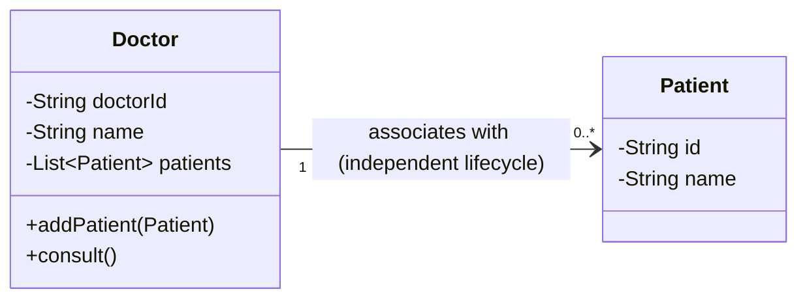

# 09. Association

## 1. What is it?

**Association** is the most general structural relationship between two or more independent classes that establishes a connection so objects of one class can interact with or "know about" objects of another class.

Association represents a **"knows-a"** or **"uses-a"** peer relationship. Crucially, in a pure association, both objects have **completely independent lifecycles**: creating or destroying one object has zero impact on the existence of the other.

---

## 2. Why do we need it?

In any real-world software system, objects do not exist in total isolation.
* A `Driver` needs to drive a `Car`.
* A `Doctor` needs to consult with a `Patient`.
* A `Student` needs to enroll in a `Course`.

Association provides the conceptual and structural mechanism for classes to maintain references to each other, enabling coordinated collaboration while keeping their lifecycles independent.

---

## 3. How does it work?

Association is implemented by storing an object reference (or collection of references) as an **instance field** in a class.

### 1. Directionality
* **Unidirectional**: Only one class knows about the other (e.g., `Order` holds a reference to `Customer`, but `Customer` class does not hold an `Order` reference).
* **Bidirectional**: Both classes hold references to each other (e.g., `Doctor` has a list of `Patient` objects, and `Patient` has a reference to their assigned `Doctor`).

### 2. Multiplicity (Cardinality)
* **One-to-One (1:1)**: E.g., `Person` and `Passport`.
* **One-to-Many (1:N)**: E.g., `Doctor` and multiple `Patients`.
* **Many-to-Many (M:N)**: E.g., `Student` and `Course`.

---

## 4. One Simple Real-World Analogy

Think of a **Doctor and a Patient**:
* Dr. Smith consults with Patient Alice.
* Dr. Smith knows Alice, and Alice knows Dr. Smith.
* If Dr. Smith retires or resigns from the clinic, Patient Alice does **not** cease to exist; she simply schedules an appointment with another doctor.
* If Patient Alice moves to another city, Dr. Smith continues practicing medicine.
* Their association is a peer relationship with **independent lifecycles**.

---

## 5. Small Java Code Example (Java 21)

```java
package com.systemdesign.lld.fundamentals.association;

import java.util.ArrayList;
import java.util.Collections;
import java.util.List;

// Independent Entity 1
public class Patient {
    private final String id;
    private final String name;

    public Patient(String id, String name) {
        this.id = id;
        this.name = name;
    }

    public String getId() { return id; }
    public String getName() { return name; }
}
```

```java
// Independent Entity 2: Associated with Patient
public class Doctor {
    private final String doctorId;
    private final String name;
    
    // Association: Doctor maintains references to independent Patient objects
    private final List<Patient> patients;

    public Doctor(String doctorId, String name) {
        this.doctorId = doctorId;
        this.name = name;
        this.patients = new ArrayList<>();
    }

    public void addPatient(Patient patient) {
        if (patient != null && !patients.contains(patient)) {
            this.patients.add(patient);
        }
    }

    public void consult() {
        System.out.println("Dr. " + name + " is starting consultations:");
        for (Patient p : patients) {
            System.out.println(" -> Consulting with patient: " + p.getName());
        }
    }

    public List<Patient> getPatients() {
        return Collections.unmodifiableList(patients);
    }
}
```

```java
public class Main {
    public static void main(String[] args) {
        // Both objects are instantiated independently
        Patient p1 = new Patient("P-1", "Alice");
        Patient p2 = new Patient("P-2", "Bob");

        Doctor doc = new Doctor("D-101", "Dr. Gregory House");

        // Associating patients with doctor
        doc.addPatient(p1);
        doc.addPatient(p2);
        doc.consult();

        // If doc reference is cleared, p1 and p2 remain unaffected in memory!
        doc = null;
        System.out.println("Patient " + p1.getName() + " still exists independently.");
    }
}
```

---

## 6. Diagram



### Explanation of Diagram
The arrow indicates an association from `Doctor` to `Patient`. The multiplicity `1` to `0..*` shows that one doctor can treat zero or more patients. Neither class owns or dictates the lifespan of the other.

---

## 7. Advantages and Disadvantages

### Advantages
* **Loose Structural Coupling**: Represents peer connections without enforcing rigid ownership hierarchies.
* **Independent Lifecycles**: Deleting or recycling one object does not trigger cascading deletes of associated objects.
* **Accurate Domain Modeling**: Mirrors realistic relationships in enterprise models.

### Disadvantages
* **Bidirectional Maintenance Overhead**: Keeping both sides of a bidirectional association synchronized (e.g., `doc.addPatient(p)` must also set `p.setDoctor(doc)`) can lead to inconsistencies.
* **Risk of Memory Leaks**: Lingering references in collection-based associations prevent garbage collection if not cleared.

---

## 8. When to Use It and When Not to Use It

### When to Use It
* When two classes need to interact, but neither class owns or creates the other.
* For peer-to-peer domain concepts (e.g., `Passenger` and `Flight`, `User` and `ChatRoom`).

### When Not to Use It
* When an object is a strict internal sub-part of another and cannot exist without it (use **Composition** instead).
* When an object is used only momentarily inside a single method without being stored as an instance field (use **Dependency** instead).

---

## 9. Common Mistakes and Misconceptions

* **Mistake: Confusing Association with Dependency**:
  - *Association*: Stored as an **instance field** in the class (structural, persistent).
  - *Dependency*: Passed merely as a **method parameter** or local variable (transient, temporary).
* **Mistake: Infinite recursion in `toString()` or `hashCode()`**:
  In bidirectional associations (`Doctor <-> Patient`), calling `toString()` on Doctor calls `Patient.toString()`, which calls `Doctor.toString()`, resulting in a `StackOverflowError`.
* **Mistake: Treating association as ownership**:
  Assuming that deleting a `Customer` must delete their associated `Store` is a design flaw.

---

## 10. Common LLD Interview Questions with Answers

### Q1: How does Association differ from Aggregation and Composition?
**Answer**: Association is the broad umbrella term for any structural relationship between classes.
* **Association**: Peer relationship; completely independent lifecycles.
* **Aggregation**: A specialized "has-a" association with weak ownership; whole and part have independent lifecycles (e.g., Department and Teacher).
* **Composition**: A specialized "has-a" association with strong ownership; part cannot exist without the whole (e.g., Order and OrderLineItem).

### Q2: Why should you prefer Unidirectional Association over Bidirectional Association when possible?
**Answer**: Bidirectional associations couple both classes to each other, making them harder to understand, test, and reuse independently. They also require complex synchronization logic to ensure both references remain consistent when one side changes, and they introduce risks of cyclic dependencies and serialization loops.

### Q3: How do you represent an association in a relational database vs in Java memory?
**Answer**: In Java, association is represented by an object holding a memory reference or a `List<T>` of references to another object. In a relational database, association is represented through Foreign Key (FK) columns or many-to-many join tables (`doctor_patient`).

---

## 11. Short Revision Notes

* **Nature**: "Knows-a" structural peer relationship.
* **Storage**: Stored as an **instance variable / field**.
* **Lifecycle**: **Completely independent**. Neither object controls the other's lifespan.
* **Watch Out**: Keep associations unidirectional whenever possible to avoid cyclic dependency headaches.
