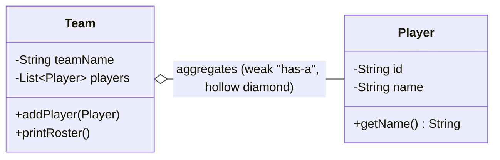

# 10. Aggregation

## 1. What is it?

**Aggregation** is a specialized form of association that represents a **"has-a" relationship with weak ownership (shared lifecycle)**.

In aggregation, one class represents the **"Whole" (container)** and another class represents the **"Part" (component)**, but the part **can exist independently** of the whole. Destroying or garbage-collecting the container does **not** destroy the components it contains.

In UML terminology:
* Aggregation is denoted by a **hollow diamond** ($\diamond$) pointing to the container/whole.

---

## 2. Why do we need it?

Real-world architectures often group multiple pre-existing objects together into larger organizational units:
* A `University` has `Professors`.
* A `Playlist` has `Songs`.
* A `Team` has `Players`.

If a sports team disbands, the players do not die; they can join another team or exist as free agents. Aggregation allows software models to reflect this **non-destructive grouping**, enabling components to be reused across multiple containers.

---

## 3. How does it work?

Aggregation differs from strong composition in how components are **created and lifecycle-managed**:

1. **External Creation**: The component objects are created *outside* the container class.
2. **Injection**: Components are passed into the container via constructor injection or setter methods (`team.addPlayer(player)`).
3. **Independent Survival**: The container stores references to the components. If the container is destroyed, the components remain intact in memory because external references to them still exist.

---

## 4. One Simple Real-World Analogy

Think of a **Library and Books**:
* A **Library** *has-a* collection of **Books**.
* The books were printed in a factory long before the library bought them.
* If the library building catches fire or permanently shuts down, the books that were checked out by patrons continue to exist.
* The library groups the books, but it does not own their ultimate existence.

---

## 5. Small Java Code Example (Java 21)

```java
package com.systemdesign.lld.fundamentals.aggregation;

import java.util.ArrayList;
import java.util.Collections;
import java.util.List;

// The Part (Can exist completely independently)
public class Player {
    private final String id;
    private final String name;

    public Player(String id, String name) {
        this.id = id;
        this.name = name;
    }

    public String getName() { return name; }
}
```

```java
// The Whole (Aggregates pre-existing Players)
public class Team {
    private final String teamName;
    private final List<Player> players; // Aggregated references

    public Team(String teamName) {
        this.teamName = teamName;
        this.players = new ArrayList<>();
    }

    // Weak ownership: Players are passed in from outside
    public void addPlayer(Player player) {
        if (player != null && !players.contains(player)) {
            players.add(player);
        }
    }

    public void printRoster() {
        System.out.println("Team: " + teamName);
        for (Player p : players) {
            System.out.println(" - " + p.getName());
        }
    }

    public List<Player> getPlayers() {
        return Collections.unmodifiableList(players);
    }
}
```

```java
public class Main {
    public static void main(String[] args) {
        // 1. Players created independently of any team
        Player messi = new Player("P-10", "Lionel Messi");
        Player suarez = new Player("P-9", "Luis Suarez");

        // 2. Team aggregates players
        Team miami = new Team("Inter Miami");
        miami.addPlayer(messi);
        miami.addPlayer(suarez);
        miami.printRoster();

        // 3. Disband the team (destroy the container)
        miami = null;

        // 4. Players still exist safely and independently!
        System.out.println("\nAfter team is disbanded:");
        System.out.println("Player " + messi.getName() + " is a free agent and ready to play.");
    }
}
```

---

## 6. Diagram



### Explanation of Diagram
The hollow diamond `o--` represents **Aggregation**. `Team` has a collection of `Player` objects, but does not own their lifecycles. A `Player` can exist without belonging to any `Team`.

---

## 7. Advantages and Disadvantages

### Advantages
* **Component Reusability**: The same component object can be associated with multiple aggregates or transferred between them.
* **Separation of Lifecycles**: Creating or destroying containers has zero destructive side-effects on underlying domain entities.
* **High Flexibility**: Makes testing straightforward because mock or real components can be easily passed into the container.

### Disadvantages
* **Shared State Complexity**: Since components are shared externally, concurrent mutations by other holders can affect the container unexpectedly.
* **Weak Enforceability in Pure Java**: Java has no built-in `aggregate` keyword; aggregation relies entirely on developer discipline in constructor injection and lifecycle management.

---

## 8. When to Use It and When Not to Use It

### When to Use It
* When modeling containers, groups, catalogues, or rosters (e.g., `Course` and `Student`, `Department` and `Employee`, `Folder` and `Document`).
* When child entities have their own independent identities and lifespans.

### When Not to Use It
* When the child entity is strictly an internal private part of the parent with no meaning outside it (e.g., an `Invoice` and its `InvoiceLineItem`s — use **Composition**).
* When passing an object purely as a temporary method argument (use **Dependency**).

---

## 9. Common Mistakes and Misconceptions

* **Mistake: Instantiating components inside the container constructor**:
  If `Team` does `this.players.add(new Player(...))` inside its own code, it is behaving like **composition**, not aggregation. In aggregation, components should be supplied from the outside.
* **Mistake: Confusing Aggregation with Composition**:
  - *Aggregation*: Weak "has-a" $\to$ Child outlives Parent (Hollow diamond $\diamond$).
  - *Composition*: Strong "has-a" $\to$ Child dies with Parent (Filled diamond $\blacklozenge$).

---

## 10. Common LLD Interview Questions with Answers

### Q1: What is the primary difference between Aggregation and Composition?
**Answer**:
* **Aggregation (Weak "has-a")**: The child component has an independent lifecycle from the parent container. Destroying the container leaves the child alive (e.g., `Department` and `Professor`). Components are injected from outside.
* **Composition (Strong "has-a")**: The child component's lifecycle is strictly bound to the parent container. The parent creates and manages the child; destroying the parent destroys the child (e.g., `Order` and `OrderItem`).

### Q2: How do you identify whether a relationship in an LLD interview is Aggregation or Composition?
**Answer**: Ask the **"Death Test" question**:
> *"If the parent object is deleted from the system, does it make business sense for the child object to continue existing?"*
* If **YES** $\to$ It is **Aggregation** (e.g., if a `Company` closes, its `Employees` still exist).
* If **NO** $\to$ It is **Composition** (e.g., if a `House` is demolished, its `Rooms` cease to exist).

### Q3: How do you prevent accidental mutation of an aggregated list?
**Answer**: By returning an unmodifiable view using `Collections.unmodifiableList(players)` in the getter method. This ensures outside callers cannot modify the container's internal reference list directly.

---

## 11. Short Revision Notes

* **Definition**: Weak "has-a" relationship (container + reusable parts).
* **UML Symbol**: Hollow Diamond ($\diamond$).
* **Lifecycle**: **Independent**. Part survives if Whole is destroyed.
* **Injection**: Components are created externally and injected into the container.
