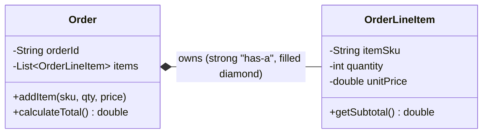

# 11. Composition

## 1. What is it?

**Composition** is a specialized form of association that models a **"has-a" relationship with strong ownership (coincident lifecycle)**.

In composition, one class represents the **"Whole" (container)** and another class represents the **"Part" (component)**. Unlike aggregation, the component **cannot exist independently** of the container. 
* The container creates and controls the lifecycle of the component.
* If the container is destroyed or garbage-collected, all of its composed parts are destroyed along with it.

In UML terminology:
* Composition is denoted by a **filled diamond** ($\blacklozenge$) pointing to the container/whole.

---

## 2. Why do we need it?

* **Enforces Aggregate Boundaries**: In Domain-Driven Design (DDD) and LLD, entities like `Order` and `OrderLineItem` belong together. An `OrderLineItem` has zero business meaning or validity without the parent `Order`.
* **Guarantees Invariant Consistency**: Because the parent creates and manages the child, external code cannot tamper with the child or create orphaned parts.
* **Encapsulates Structural Complexity**: Callers interact with the container root, while internal components remain shielded from outside interference.

---

## 3. How does it work?

Composition is enforced in code through three strict design choices:

1. **Internal Creation**: The container class instantiates its internal components directly inside its constructor or private factory methods (or accepts raw parameters to build them).
2. **Coincident Lifecycle**: Outside code does not hold a separate lifecycle handle to the components. When the container becomes unreachable and is garbage collected, the internal components are garbage collected as well.
3. **No Direct Exposure**: The container never returns raw, directly mutable references to its internal parts. It exposes operations on the container that internally manipulate the parts.

---

## 4. One Simple Real-World Analogy

Think of a **House and its Rooms** (or a **Human Body and Heart**):
* A **House** is composed of a **Kitchen**, a **Living Room**, and a **Bedroom**.
* You cannot sell, relocate, or demolish the living room by itself while leaving the house intact.
* If the house is demolished, the rooms cease to exist.
* The rooms are created when the house is constructed, and their lifespans are 100% bound to the house.

---

## 5. Small Java Code Example (Java 21)

```java
package com.systemdesign.lld.fundamentals.composition;

import java.util.ArrayList;
import java.util.Collections;
import java.util.List;

// The Part: Cannot and should not exist without an Order
public class OrderLineItem {
    private final String itemSku;
    private final int quantity;
    private final double unitPrice;

    // Package-private: Created exclusively by the parent Order!
    OrderLineItem(String itemSku, int quantity, double unitPrice) {
        if (itemSku == null || itemSku.isBlank() || quantity <= 0 || unitPrice < 0) {
            throw new IllegalArgumentException("Invalid line item parameters");
        }
        this.itemSku = itemSku;
        this.quantity = quantity;
        this.unitPrice = unitPrice;
    }

    public double getSubtotal() {
        return quantity * unitPrice;
    }

    public String getItemSku() { return itemSku; }
    public int getQuantity() { return quantity; }
}
```

```java
// The Whole: Owns and manages the lifecycle of its OrderLineItems
public class Order {
    private final String orderId;
    private final List<OrderLineItem> items; // Strongly owned components

    public Order(String orderId) {
        if (orderId == null || orderId.isBlank()) {
            throw new IllegalArgumentException("Order ID cannot be empty");
        }
        this.orderId = orderId;
        this.items = new ArrayList<>();
    }

    // Composition: The parent Order controls the creation of its line items
    public void addItem(String itemSku, int quantity, double unitPrice) {
        OrderLineItem item = new OrderLineItem(itemSku, quantity, unitPrice);
        this.items.add(item);
    }

    public double calculateTotal() {
        return items.stream().mapToDouble(OrderLineItem::getSubtotal).sum();
    }

    // Defensive read-only view: Outside callers cannot alter internal composition
    public List<OrderLineItem> getItems() {
        return Collections.unmodifiableList(items);
    }
}
```

```java
public class Main {
    public static void main(String[] args) {
        Order order = new Order("ORD-9901");
        
        // Items are created through the order aggregate
        order.addItem("LAPTOP-X", 1, 1200.0);
        order.addItem("MOUSE-Y", 2, 25.0);

        System.out.println("Order Total: $" + order.calculateTotal()); // $1250.0

        // If order is dereferenced, line items have no standalone reference and are GC'd
        order = null; 
    }
}
```

---

## 6. Diagram



### Explanation of Diagram
The filled diamond `*--` denotes **Composition**. The `Order` object exclusively owns its `OrderLineItem` components. The items cannot exist without an order and are destroyed when the order is removed.

---

## 7. Advantages and Disadvantages

### Advantages
* **Strong Invariant Protection**: The container guarantees that its parts are always in a valid, synchronized state.
* **Encapsulated Memory Management**: The lifecycle of parts is tied to the parent, preventing dangling references and memory leaks.
* **Prevents Leaky Domain Boundaries**: Clients interact with the top-level aggregate root rather than micromanaging internal child records.

### Disadvantages
* **Zero Component Sharing**: A composed part cannot be shared or simultaneously referenced by multiple containers.
* **Higher Construction Responsibility**: The parent container must know how to build or assemble its parts.

---

## 8. When to Use It and When Not to Use It

### When to Use It
* When the child entity makes no conceptual or commercial sense without the parent (e.g., `Order` and `OrderLineItem`, `Invoice` and `InvoiceTaxLine`, `ChessBoard` and `Square`).
* In Domain-Driven Design (DDD) to implement **Aggregate Roots**.

### When Not to Use It
* When the component needs to be shared among multiple owners (use **Aggregation**).
* When the component must survive after the container is destroyed (e.g., a `Car` and its `Driver` — use **Association** or **Aggregation**).

---

## 9. Common Mistakes and Misconceptions

* **Mistake: Leaking internal references via getters**:
  Returning `items` directly allows callers to call `order.getItems().clear()`, destroying the internal composition. Always use `Collections.unmodifiableList()`.
* **Mistake: Confusing Composition with Aggregation**:
  Remember: Aggregation = Shared lifecycle (hollow diamond). Composition = Exclusive lifecycle (filled diamond).
* **Mistake: Passing already-instantiated components and assuming composition**:
  If the caller retains an outside reference to the component, the component can outlive the container, which degrades the relationship to aggregation.

---

## 10. Common LLD Interview Questions with Answers

### Q1: What happens to composed objects in Java when the parent object is garbage collected?
**Answer**: In Java, garbage collection is based on reachability. If the parent object is garbage collected and no external active references point to the internal composed objects, those composed objects also become unreachable and are collected by the JVM garbage collector during the same or subsequent GC cycles.

### Q2: What is an "Aggregate Root" in DDD, and how does it relate to Composition?
**Answer**: An Aggregate Root is the primary entry-point entity of a cluster of associated objects (an aggregate). Outside callers are only allowed to hold references to the aggregate root. The aggregate root uses **composition** to manage its internal child entities, guaranteeing that all business rules and invariants across the entire boundary remain strictly consistent.

### Q3: How do you choose between Composition and Aggregation when designing a Car and Engine?
**Answer**:
* If you are modeling a **standard road vehicle domain**, an `Engine` is physically installed into the `Car` and operates only with that car; if the car is scrapped, its engine is scrapped with it $\to$ **Composition**.
* If you are modeling an **auto parts repair shop or warehouse inventory**, an `Engine` is an independent SKU that can be removed from one car, stored on a shelf, and installed into another car $\to$ **Aggregation**.
* *Lesson*: The choice always depends on the specific business domain!

---

## 11. Short Revision Notes

* **Definition**: Strong "has-a" relationship (exclusive ownership + coincident lifecycle).
* **UML Symbol**: Filled Diamond ($\blacklozenge$).
* **Lifecycle**: **Dependent**. When the Whole dies, the Part dies.
* **Rule**: Shield the parts; clients must interact through the container.
