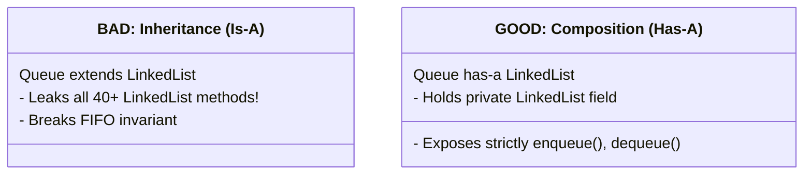

# 12. Is-A vs Has-A

## 1. What is it?

**"Is-A" vs "Has-A"** is the fundamental decision matrix in object-oriented design used to determine whether two classes should be connected via **Inheritance** or via **Composition / Aggregation**.

* **"Is-A" (Inheritance)**: Represents subtyping and taxonomic classification. Class B is a specialized, fully compatible variety of Class A.
  - *Syntax*: `class Dog extends Mammal` / `class Square extends Shape`
* **"Has-A" (Composition / Aggregation)**: Represents possession, containment, or collaboration. Class B holds a reference to Class A as part of its state.
  - *Syntax*: `class Car { private Engine engine; }`

---

## 2. Why do we need it?

Choosing the wrong relationship is one of the most destructive mistakes in Low-Level Design:
* Modeling a relationship as **"Is-A"** when it is actually **"Has-A"** breaks the Liskov Substitution Principle (LSP), introduces tight coupling, exposes unnecessary methods, and causes the fragile base class problem.
* Modeling a relationship as **"Has-A"** when it is genuinely **"Is-A"** forces redundant boilerplate forwarding methods and prevents clean polymorphic treatment.

Having a clear mental framework lets you make the right structural choice every time.

---

## 3. How does it work? (The Decision Framework)

To choose between **Is-A** and **Has-A**, apply these three litmus tests:

### 1. The Linguistic Substitution Test
* Does sentence *"B is a kind of A"* make universal sense in your domain?
  - *"A Sparrow is a Bird"* $\to$ True (Potential Is-A).
  - *"A Police Officer is a Badge"* $\to$ False. An officer *has* a badge (Has-A).

### 2. The Liskov Substitution Test
* Can class B be used **anywhere** class A is expected without violating caller assumptions or throwing `UnsupportedOperationException`?
  - If a caller expects `Bird.fly()`, but `Penguin extends Bird` throws an exception, the Is-A relationship is broken.

### 3. The Lifecycle & Mutability Test
* Can the relationship change dynamically at runtime?
  - Can an `Employee` become a `Customer` or a `Manager`? An object cannot change its class at runtime in Java. If the role or capability changes at runtime, use **Has-A**!

---

## 4. One Simple Real-World Analogy

Think of a **Smartphone, Battery, and Electronic Device**:
* A **Smartphone is an Electronic Device** ("Is-A"):
  - It conforms to all electrical safety regulations, voltage ratings, and on/off behaviors of electronic devices.
* A **Smartphone has a Battery** ("Has-A"):
  - It would be ridiculous to say: `class Smartphone extends Battery`.
  - A smartphone is not a battery; it *contains* a battery to power its electronics. If the battery dies or needs upgrading to a higher mAh capacity, you swap the battery without altering what a smartphone is.

---

## 5. Small Java Code Example (Java 21)

### The Anti-Pattern: Misusing "Is-A"
```java
import java.util.LinkedList;

// BAD DESIGN: Queue "is-a" LinkedList
// This leaks addFirst(), removeLast(), and get(5) to the outside world, breaking Queue FIFO contract!
public class BadQueue<T> extends LinkedList<T> {
    public void enqueue(T item) { addLast(item); }
    public T dequeue() { return removeFirst(); }
}
```

### The Correct Design: Using "Has-A" (Composition)
```java
package com.systemdesign.lld.fundamentals.isavshasa;

import java.util.LinkedList;

// GOOD DESIGN: Queue "has-a" LinkedList internally
public class BoundedQueue<T> {
    // Hidden internal representation (Has-A)
    private final LinkedList<T> elements;
    private final int capacity;

    public BoundedQueue(int capacity) {
        if (capacity <= 0) throw new IllegalArgumentException("Capacity must be positive");
        this.capacity = capacity;
        this.elements = new LinkedList<>();
    }

    public void enqueue(T item) {
        if (elements.size() >= capacity) {
            throw new IllegalStateException("Queue is full");
        }
        elements.addLast(item);
    }

    public T dequeue() {
        if (elements.isEmpty()) {
            throw new IllegalStateException("Queue is empty");
        }
        return elements.removeFirst();
    }

    public int size() {
        return elements.size();
    }

    // Callers CANNOT call elements.add(0, item) because LinkedList is private!
}
```

```java
public class Main {
    public static void main(String[] args) {
        BoundedQueue<String> queue = new BoundedQueue<>(2);
        queue.enqueue("Task 1");
        queue.enqueue("Task 2");

        System.out.println("Dequeued: " + queue.dequeue()); // Task 1
        System.out.println("Remaining size: " + queue.size()); // 1
    }
}
```

---

## 6. Diagram



### Explanation of Diagram
When `Queue` extends `LinkedList` (Is-A), it inherits and exposes dozens of random-access methods that destroy the queue invariant. When `Queue` encapsulates a `LinkedList` (Has-A), it exposes only the intended FIFO methods, keeping its state secure.

---

## 7. Advantages and Disadvantages

### Advantages of "Is-A" (Inheritance)
* **True Polymorphic Subtyping**: Enables clean substitutability when Liskov Substitution Principle holds.
* **Direct Taxonomy Modeling**: Naturally maps real-world taxonomies into code.

### Disadvantages of "Is-A" (Inheritance)
* **Tight Compile-Time Coupling**: Fragile base class problem; changes to superclass can break subclasses.
* **Exposes All Methods**: Leaks every public method of parent, even those inappropriate for the child.

### Advantages of "Has-A" (Composition / Aggregation)
* **Loose Coupling & Encapsulation**: Components are black boxes; internal details stay hidden.
* **Runtime Dynamic Flexibility**: Components can be swapped dynamically at runtime.
* **Controlled Method Exposure**: Container exposes only its curated public API.

### Disadvantages of "Has-A" (Composition / Aggregation)
* **Forwarding Boilerplate**: Requires writing manual forwarding methods to delegate calls.

### Summary Comparison Matrix

| Criteria | Is-A (Inheritance) | Has-A (Composition / Aggregation) |
|---|---|---|
| **Mechanism** | `extends SuperClass` | Holds private instance variable |
| **Relationship** | Strict subtype / classification | Possession / capability / collaboration |
| **Coupling** | **Tight** (Compile-time dependency) | **Loose** (Runtime dependency) |
| **Encapsulation** | **Weak** (Base internals visible to child) | **Strong** (Component is a black-box) |
| **Flexibility** | **Rigid** (Class hierarchy cannot change at runtime) | **High** (Components can be swapped at runtime) |
| **Method Exposure** | Exposes **all** public parent methods | Exposes **only** selected, curated methods |

---

## 8. When to Use It and When Not to Use It

### Use "Is-A" When:
* There is a natural, immutable taxonomic hierarchy (e.g., `SavingsAccount extends BankAccount`).
* The subclass will **never** need to hide, disable, or throw exceptions on any parent method.
* You need genuine polymorphic substitution across all callers.

### Use "Has-A" When:
* You only want to reuse code or capabilities from another class.
* The behavior or role needs to change during application execution (e.g., `User` has a `Role`).
* You are wrapping a complex data structure to expose a simpler, restricted interface.

---

## 9. Common Mistakes and Misconceptions

* **Mistake: Modeling roles as "Is-A"**:
  Creating `Manager extends Employee`, `Director extends Employee`. What happens when an employee is promoted from Developer to Manager? In Java, an object cannot change its class. Better design: `Employee has-a Role`.
* **Mistake: Inheriting to avoid typing forwarding methods**:
  Laziness is the number one cause of bad inheritance. Saving 5 lines of forwarding code creates permanent architectural debt.

---

## 10. Common LLD Interview Questions with Answers

### Q1: Why is the relationship between `User` and `Role` better modeled as "Has-A" rather than "Is-A"?
**Answer**: Because roles in real-world systems are dynamic. A user can gain new roles (e.g., `ADMIN`, `MODERATOR`), lose roles, or have multiple roles simultaneously. If modeled as `AdminUser extends User`, you cannot dynamically promote or demote a user at runtime without recreating the entire object and copying all its historical state.

### Q2: How does the Liskov Substitution Principle (LSP) validate an "Is-A" relationship?
**Answer**: LSP states that if class S is a subtype of class T, any program using T must continue to function correctly and preserve all expected invariants when an instance of S is provided instead. If a subclass cannot honor every single postcondition, precondition, or method contract of its superclass, it is **not** a true "Is-A" relationship and should be refactored to "Has-A".

### Q3: When an interviewer asks you to design a Parking Lot, should `Car` extend `Vehicle` ("Is-A") or contain `VehicleType` ("Has-A")?
**Answer**: `Car extends Vehicle` is a valid "Is-A" relationship because a car fundamentally is a physical vehicle with dimensions and a license plate. However, within `Vehicle`, the parking fee strategy or size category should be modeled as **"Has-A"** (`Vehicle has-a ParkingFeeStrategy` or `has-a VehicleSize`), ensuring pricing and space logic remain decoupled from the physical vehicle taxonomy.

---

## 11. Short Revision Notes

* **Is-A** = Inheritance (`extends`) = Strict taxonomic subtype.
* **Has-A** = Composition / Aggregation = Possession and collaboration.
* **The Rule of Thumb**: When in doubt, **default to Has-A**. Use Is-A only when Liskov Substitution is 100% satisfied.
* **Roles are Has-A**: Never model transient roles or capabilities with inheritance.
