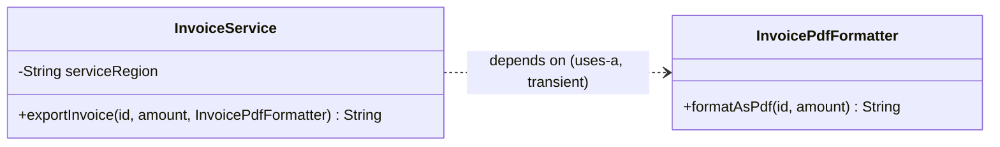

# 13. Dependency

## 1. What is it?

**Dependency** is the weakest, most transient relationship between two classes in object-oriented design. It represents a temporary **"uses-a" relationship** where one class requires another class to execute a specific operation, but **does not store a persistent reference** to it as an instance field.

If class `A` changes, class `B` might be affected, but class `B` does not maintain long-term ownership or state of class `A`.

In UML diagrams:
* Dependency is represented by a **dashed arrow with an open arrowhead** ($-\!-\!\blacktriangleright$ or `..>`) pointing from the dependent class to the required class.

---

## 2. Why do we need it?

Not every object in a system needs to be held as a long-lived member variable:
* Storing every helper, utility, serializer, or query parameter as an instance variable causes **severe memory bloat**.
* Long-lived fields introduce **accidental state retention** and thread-safety hazards.
* Temporary parameters keep classes **lightweight, stateless, and loosely coupled**.

Dependency lets you pass objects only for the exact duration of a method execution, then release them immediately for garbage collection.

---

## 3. How does it work?

A class `A` has a dependency on class `B` if class `B` appears in any of the following three ways:

1. **As a Method Parameter**:
   ```java
   public void printReceipt(Printer printer) { /* printer used only here */ }
   ```
2. **As a Local Variable inside a Method**:
   ```java
   public void calculate() {
       TaxCalculator calc = new TaxCalculator(); // exists only on stack
       calc.compute();
   }
   ```
3. **As a Method Return Type**:
   ```java
   public Report generateReport() { return new Report(); }
   ```

Crucially: **Class `A` has NO `private B b;` field!** The connection exists solely on the thread's call stack during method execution.

---

## 4. One Simple Real-World Analogy

Think of a **Carpenter and a Tape Measure**:
* A carpenter owns a toolbox.
* To check the length of a plank, the carpenter picks up a **tape measure**, measures the wood for 10 seconds, and puts the tape measure down on the bench.
* The tape measure is **not permanently bolted to the carpenter's arm** (that would be association/composition).
* The carpenter merely *depends* on the tape measure for that quick measuring task.

---

## 5. Small Java Code Example (Java 21)

```java
package com.systemdesign.lld.fundamentals.dependency;

// The independent utility/service
public class InvoicePdfFormatter {
    public String formatAsPdf(String invoiceId, double amount) {
        return "%PDF-1.4\nInvoice ID: " + invoiceId + "\nAmount Due: $" + amount + "\n%%EOF";
    }
}
```

```java
// InvoiceService DOES NOT store InvoicePdfFormatter as an instance field.
// It receives it purely as a transient method dependency!
public class InvoiceService {
    private final String serviceRegion;

    public InvoiceService(String serviceRegion) {
        this.serviceRegion = serviceRegion;
    }

    // DEPENDENCY: InvoicePdfFormatter is used ONLY for the duration of this method
    public String exportInvoice(String invoiceId, double amount, InvoicePdfFormatter formatter) {
        System.out.println("Processing invoice in region: " + serviceRegion);
        
        // Using the transient dependency
        return formatter.formatAsPdf(invoiceId, amount);
    }
}
```

```java
public class Main {
    public static void main(String[] args) {
        InvoiceService service = new InvoiceService("US-East");
        InvoicePdfFormatter formatter = new InvoicePdfFormatter();

        // Passed temporarily as a parameter
        String pdf = service.exportInvoice("INV-5001", 349.99, formatter);
        System.out.println("Exported Document:\n" + pdf);
    }
}
```

---

## 6. Diagram



### Explanation of Diagram
The dashed arrow `..>` represents a **Dependency**. `InvoiceService` does not have a member variable of type `InvoicePdfFormatter`; it only accepts it as an argument inside `exportInvoice()`.

---

## 7. Advantages and Disadvantages

### Advantages
* **Minimal Coupling**: The absolute weakest coupling between two classes in OOP.
* **Low Memory Footprint**: No instance fields stored on the heap; reference exists purely on the stack for the duration of the method.
* **Enhanced Thread Safety**: Stateless method-scoped dependencies prevent shared-state concurrency bugs.
* **High Reusability & Testability**: Callers can pass mock or alternative implementations on a per-call basis.

### Disadvantages
* **Parameter List Bloat**: Overusing method dependencies can cause parameter lists to grow excessively long.
* **Repetitive Passing**: If the same dependency is needed in 20 different methods of a class, passing it into every single method becomes tedious (in which case it should be promoted to constructor-injected association).

### The Relationship Hierarchy Matrix

Here is how Dependency compares to all related structural relationships:

| Relationship | Type | Stored as Field? | Lifecycle Coupling | UML Symbol |
|---|---|---|---|---|
| **Dependency** | Transient "uses-a" | **No** (parameter/local) | None (exists during method call) | Dashed arrow `..>` |
| **Association** | Structural "knows-a" | **Yes** (field) | Independent lifecycles | Solid line `-->` |
| **Aggregation** | Weak "has-a" | **Yes** (field) | Independent (child outlives container) | Hollow diamond `o--` |
| **Composition** | Strong "has-a" | **Yes** (field) | Coincident (child dies with container) | Filled diamond `*--` |
| **Inheritance** | Strict "is-a" | **N/A** (`extends`) | Compile-time locked | Solid arrow `<|--` |

---

## 8. When to Use It and When Not to Use It

### When to Use It
* For stateless utility operations, formatters, builders, validators, and serializers.
* When an operation requires an external tool that varies on every invocation.
* To keep objects lightweight and minimize thread contention.

### When Not to Use It
* When an object needs to interact with the same collaborator repeatedly across dozens of method calls throughout its lifetime (store it as an **Association / Injected Field** instead).
* When an object represents a permanent subcomponent of an entity (use **Composition**).

---

## 9. Common Mistakes and Misconceptions

* **Mistake: Promoting every dependency to an instance field**:
  Declaring a field `private DateFormatter formatter;` inside an entity when it is only used once in a `toString()` method bloats the heap and risks thread-safety issues if the formatter is mutable.
* **Mistake: Instantiating concrete dependencies inside methods**:
  Doing `new ConcreteDatabaseClient()` inside a method creates hardwired hidden dependencies that cannot be mocked in unit tests. Prefer passing dependencies into the method or injecting them.

---

## 10. Common LLD Interview Questions with Answers

### Q1: What is the architectural difference between Dependency and Association?
**Answer**:
* **Association**: A structural relationship where an object maintains a persistent reference to another object as an **instance field**. The connection exists as long as the object lives.
* **Dependency**: A behavioral relationship where an object uses another object temporarily within the scope of a **single method** (as a parameter, local variable, or return value). No instance field is retained.

### Q2: What is the "Dependency Inversion Principle" (DIP) in SOLID?
**Answer**: DIP states that high-level modules should not depend on low-level modules; both should depend on abstractions. Furthermore, abstractions should not depend on details; details should depend on abstractions. In practice, this means declaring dependencies as interfaces rather than concrete classes.

### Q3: When should a helper be passed as a method parameter versus injected in the constructor?
**Answer**:
* **Constructor Injection (Association)**: Use when the collaborator is an integral part of the service's ongoing responsibility (e.g., `OrderRepository` inside `OrderService`).
* **Method Parameter (Dependency)**: Use when the collaborator varies per request, is stateless, or is supplied directly by the caller for that specific call (e.g., passing a specific `DiscountCoupon` or `ReportFormat` into a calculation method).

---

## 11. Short Revision Notes

* **Nature**: Transient, temporary "uses-a" relationship.
* **Storage**: **Never stored as an instance field**. Lives on the stack (parameter or local variable).
* **Coupling**: The weakest and cleanest form of coupling between classes.
* **UML**: Dashed arrow with open arrowhead (`..>`).
