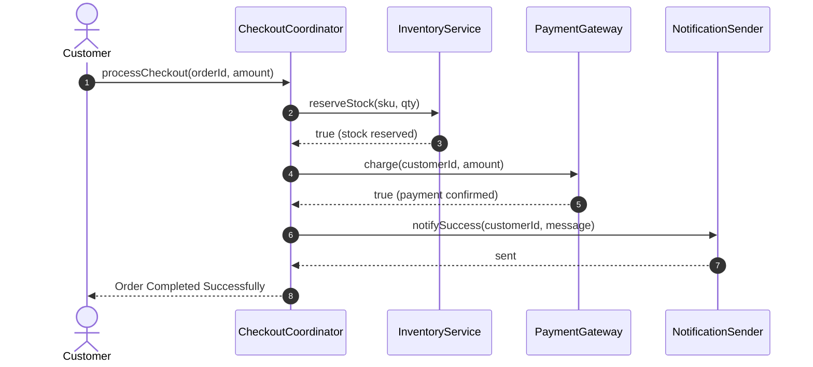

# 14. Object Collaboration

## 1. What is it?

**Object Collaboration** describes how multiple autonomous objects interact, coordinate, and communicate through **message passing (method invocations)** to fulfill a system use-case that none of the objects could accomplish alone.

In object-oriented design, real work is never completed by a single "God Object" executing all logic. Instead, responsibilities are distributed among cohesive objects that collaborate across well-defined boundaries.

---

## 2. Why do we need it?

If objects do not collaborate:
* **The Monolith Anti-Pattern**: A single massive class ends up containing thousands of lines of code handling database access, business rules, payment processing, and email generation.
* **Zero Reusability**: When all logic is crammed together, individual business rules cannot be reused in other flows.
* **Testing Nightmare**: You cannot test payment processing without simultaneously triggering real databases and notifications.

Object collaboration enforces **Separation of Concerns (SoC)** and the **Single Responsibility Principle (SRP)**.

---

## 3. How does it work?

Object collaboration relies on three foundational pillars:

1. **Contracts (Interfaces)**: Objects interact through stable interfaces rather than concrete classes.
2. **Roles and Responsibilities (CRC Modeling)**:
   - **Class**: The entity name.
   - **Responsibility**: What the object knows and what it does.
   - **Collaborators**: Which other objects it communicates with to fulfill its duties.
3. **Message Passing**: Object A calls a method on Object B, passing required context parameters. Object B processes the request according to its own state and returns a response or triggers downstream collaborations.

---

## 4. One Simple Real-World Analogy

Think of an **Airport Flight Departure**:
* A safe flight departure cannot be managed by the Airplane alone.
* It requires seamless **collaboration** among distinct roles:
  1. The **Passenger** checks in luggage with the **Desk Agent**.
  2. The **Desk Agent** collaborates with the **Baggage Routing System**.
  3. The **Pilot** requests clearance from the **Air Traffic Controller (ATC)**.
  4. The **ATC** checks runway sensors and sends back the authorization message: *"Clear for takeoff on Runway 09L"*.
* Each participant has a single focused responsibility and collaborates by passing clear, unambiguous messages.

---

## 5. Small Java Code Example (Java 21)

```java
package com.systemdesign.lld.fundamentals.objectcollaboration;

// Collaborator 1: Inventory Management
public interface InventoryService {
    boolean reserveStock(String itemSku, int quantity);
}

// Collaborator 2: Payment Processing
public interface PaymentGateway {
    boolean charge(String customerId, double amount);
}

// Collaborator 3: Notification Delivery
public interface NotificationSender {
    void notifySuccess(String customerId, String message);
}
```

```java
// Orchestrator: Coordinates collaboration to complete the Checkout use case
public class CheckoutCoordinator {
    private final InventoryService inventoryService;
    private final PaymentGateway paymentGateway;
    private final NotificationSender notificationSender;

    // Collaborators injected via constructor
    public CheckoutCoordinator(InventoryService inventoryService,
                               PaymentGateway paymentGateway,
                               NotificationSender notificationSender) {
        this.inventoryService = inventoryService;
        this.paymentGateway = paymentGateway;
        this.notificationSender = notificationSender;
    }

    public boolean processCheckout(String orderId, String customerId, String sku, int qty, double amount) {
        System.out.println("Starting collaboration for Order: " + orderId);

        // Step 1: Collaborate with Inventory
        if (!inventoryService.reserveStock(sku, qty)) {
            System.out.println("Inventory reservation failed for: " + sku);
            return false;
        }

        // Step 2: Collaborate with Payment
        if (!paymentGateway.charge(customerId, amount)) {
            System.out.println("Payment failed for customer: " + customerId);
            return false;
        }

        // Step 3: Collaborate with Notification
        notificationSender.notifySuccess(customerId, "Order " + orderId + " placed successfully!");
        System.out.println("Checkout completed successfully.");
        return true;
    }
}
```

```java
public class Main {
    public static void main(String[] args) {
        // Assemble collaborators (can be real services or mocks)
        InventoryService inventory = (sku, qty) -> {
            System.out.println(" -> [Inventory] Reserved " + qty + " units of " + sku);
            return true;
        };

        PaymentGateway payment = (cust, amt) -> {
            System.out.println(" -> [Payment] Charged $" + amt + " to " + cust);
            return true;
        };

        NotificationSender notifier = (cust, msg) -> {
            System.out.println(" -> [Notification] Sent to " + cust + ": " + msg);
        };

        CheckoutCoordinator checkout = new CheckoutCoordinator(inventory, payment, notifier);
        checkout.processCheckout("ORD-77", "CUST-42", "PHONE-15", 1, 999.0);
    }
}
```

---

## 6. Diagram



### Explanation of Diagram
`CheckoutCoordinator` does not handle raw inventory database rows or payment network protocols. It acts as the use-case orchestrator, passing messages sequentially to specialized collaborators to fulfill the order placement workflow.

---

## 7. Advantages and Disadvantages

### Advantages
* **High Modularity & Maintainability**: Each collaborator is small, self-contained, and can be modified or refactored independently.
* **Extreme Testability**: Every collaborator can be replaced with a mock or stub during unit testing.
* **Separation of Policy and Detail**: High-level workflow orchestration is separated from low-level technical execution.

### Disadvantages
* **Tracing Complexity**: Flow of execution jumps across multiple classes, requiring logging or distributed tracing to debug.
* **Risk of Over-Fragmentation**: Creating too many tiny collaborators for trivial operations leads to "class explosion" and cognitive overhead.

---

## 8. When to Use It and When Not to Use It

### When to Use It
* In all application services, workflow coordinators, and domain use-cases.
* Whenever a business operation involves multiple distinct sub-domains (e.g., billing, fulfillment, inventory, shipping).

### When Not to Use It
* For simple, self-contained math computations or pure algorithmic utility functions.
* When objects have to exchange hundreds of microscopic internal state details (indicates bad class boundaries; consider merging them).

---

## 9. Common Mistakes and Misconceptions

* **Mistake: Circular Collaboration Loops**:
  Class A calls Class B, which calls Class C, which calls Class A. Circular dependencies create tight coupling, memory leaks, and stack overflows.
* **Mistake: Violating Law of Demeter (Principle of Least Knowledge)**:
  Calling `order.getCustomer().getWallet().getBank().charge()` forces `Order` to know the entire object graph. Only talk to your immediate collaborators!
* **Mistake: Anemic Collaboration**:
  Having an orchestrator that pulls all data out of dumb objects with getters, does all the computation itself, and pushes it back with setters. Let collaborators execute their own behavior.

---

## 10. Common LLD Interview Questions with Answers

### Q1: What is CRC (Class-Responsibility-Collaborator) modeling and how does it help in an LLD interview?
**Answer**: CRC modeling is a design technique where you define:
1. **Class**: What the entity represents.
2. **Responsibilities**: What tasks the entity performs and what data it manages.
3. **Collaborators**: Which other classes it interacts with to achieve those tasks.
Using CRC cards in an LLD interview allows you to systematically partition a complex problem (like designing an elevator or ride-sharing system) into small, collaborating components before writing code.

### Q2: What is the Law of Demeter (LoD) and why is it critical for object collaboration?
**Answer**: The Law of Demeter (also known as the "Principle of Least Knowledge") states that a method of an object should only call methods on:
1. Itself.
2. Parameters passed to the method.
3. Objects it creates or instantiates.
4. Its own direct component fields.
It must **not** call methods on objects returned by another collaborator (avoid "train wrecks" like `a.getB().getC().doSomething()`). This prevents deep coupling across the object graph.

### Q3: How do you prevent circular dependencies between collaborating objects?
**Answer**:
1. Introduce an **event-driven or observer pattern** so the caller emits an event and does not know about the listener.
2. Extract the shared interaction logic into a **Mediator** or **Coordinator** class that orchestrates both objects from above.
3. Invert the dependency by introducing an **interface** that one of the classes implements.

---

## 11. Short Revision Notes

* **Essence**: Autonomous objects working together via message passing.
* **Key Principles**: High cohesion within objects, loose coupling between collaborators.
* **Crucial Rule**: Obey the **Law of Demeter** — talk only to immediate friends.
* **Interview Power**: Use **CRC thinking** (Class, Responsibility, Collaborators) to design clean object systems.
