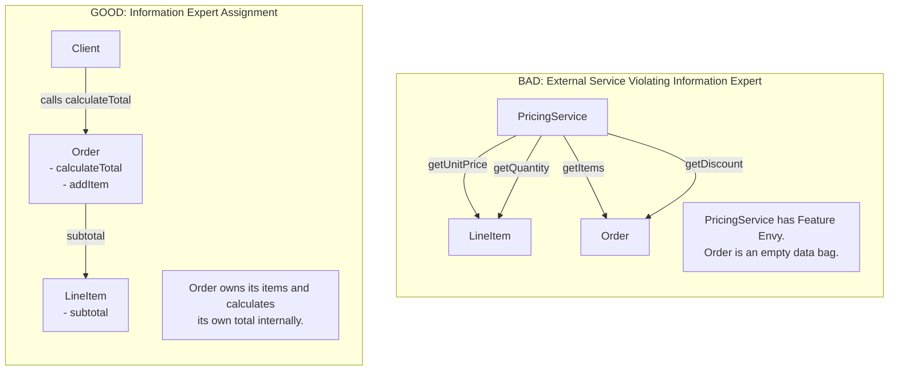

# 15. Responsibility Assignment

## 1. What is it?

**Responsibility Assignment** is the process of deciding which class in an object-oriented system should own a specific piece of business data or execute a specific behavior.

In software design, every feature breaks down into responsibilities:
* **Doing responsibilities**: Performing a calculation, creating an object, validating business rules, or coordinating other objects.
* **Knowing responsibilities**: Knowing private encapsulated state, knowing related entities, or knowing derived values.

The most widely accepted framework for responsibility assignment is **GRASP (General Responsibility Assignment Software Patterns)**, which provides practical heuristics (like *Information Expert*, *Creator*, and *Controller*) to guide these decisions.

---

## 2. Why do we need it?

When responsibilities are assigned randomly or carelessly:
* **God Objects Emerge**: A single `OrderManager` or `SystemController` handles thousands of lines of disparate logic while other classes act as empty data bags.
* **Feature Envy**: Methods in Class A spend all their time querying getters on Class B to make decisions that Class B should have made itself.
* **Scattered Invariants**: Validation rules are duplicated across controllers, UI forms, and background jobs.

Proper responsibility assignment ensures that logic lives **where the data already exists**, leading to high cohesion, low coupling, and maintainable systems.

---

## 3. How does it work? (Core GRASP Principles)

### 1. Information Expert
> *"Assign a responsibility to the class that has the information necessary to fulfill it."*
- Who should calculate the total of an `Order`? The `Order` itself, because it already holds the list of `OrderLineItem`s and applied discounts. Do not create an external `OrderTotalCalculator` just to do basic arithmetic on an order's own list.

### 2. Creator
> *"Assign class B the responsibility to create instance A if B aggregates A, contains A, or closely uses A."*
- An `Order` should create its `OrderLineItem`s, because the order contains and exclusively manages them.

### 3. Controller
> *"Assign the responsibility for receiving and coordinating system events to a non-UI coordinator class."*
- Handle incoming HTTP requests or CLI commands in an Application Service (e.g., `OrderApplicationService`), rather than putting business logic inside UI controllers.

### 4. Low Coupling & High Cohesion
- Favor assignments that keep classes focused on a single logical duty and minimize unnecessary connections between classes.

---

## 4. One Simple Real-World Analogy

Think of a **Hospital Emergency Room**:
* When a patient arrives, responsibilities are assigned strictly based on **Information Expertise**:
  - The **Triage Nurse** checks vital signs and assigns priority (holds triage information).
  - The **Radiologist** interprets the X-ray (holds diagnostic imaging expertise).
  - The **Surgeon** performs the operation (holds surgical tools and expertise).
  - The **Hospital Administrator** handles billing.
* If the Hospital Administrator attempted to perform brain surgery while the Surgeon did medical billing, the hospital would collapse. Each role owns the duties matching its specific knowledge and tools.

---

## 5. Small Java Code Example (Java 21)

### Bad Assignment (Feature Envy / Anemic Entity)
```java
// BAD: Service extracts data from Order to do work Order should do
public class BadPricingService {
    public double calculateTotal(Order order) {
        double total = 0;
        for (LineItem item : order.getItems()) { // Feature Envy
            total += item.getPrice() * item.getQuantity();
        }
        return total - order.getDiscount();
    }
}
```

### Good Assignment (Information Expert)
```java
package com.systemdesign.lld.fundamentals.responsibilityassignment;

import java.util.ArrayList;
import java.util.Collections;
import java.util.List;

public record LineItem(String itemName, double unitPrice, int quantity) {
    public double subtotal() {
        return unitPrice * quantity;
    }
}
```

```java
public class Order {
    private final String orderId;
    private final List<LineItem> items;
    private final double discountAmount;

    public Order(String orderId, double discountAmount) {
        this.orderId = orderId;
        this.discountAmount = Math.max(0, discountAmount);
        this.items = new ArrayList<>();
    }

    // CREATOR pattern: Order creates its line items
    public void addItem(String itemName, double unitPrice, int quantity) {
        items.add(new LineItem(itemName, unitPrice, quantity));
    }

    // INFORMATION EXPERT pattern: Order owns the items, so it calculates the total!
    public double calculateTotal() {
        double subtotal = items.stream().mapToDouble(LineItem::subtotal).sum();
        return Math.max(0, subtotal - discountAmount);
    }

    public List<LineItem> getItems() {
        return Collections.unmodifiableList(items);
    }
}
```

```java
public class Main {
    public static void main(String[] args) {
        Order order = new Order("ORD-1", 15.0);
        order.addItem("Wireless Keyboard", 45.0, 1);
        order.addItem("USB-C Cable", 10.0, 2);

        // Client simply tells the order to give its total
        System.out.println("Total Amount Due: $" + order.calculateTotal()); // $50.0
    }
}
```

---

## 6. Diagram



### Explanation of Diagram
In the bad design, an external service repeatedly reaches into `Order` and `LineItem` to pull raw numbers, violating encapsulation. In the good design, the responsibility is assigned to `Order` (the Information Expert), which collaborates naturally with `LineItem`.

---

## 7. Advantages and Disadvantages

### Advantages
* **High Encapsulation**: Data and the operations using that data stay in the same class.
* **Zero Duplication**: Business algorithms live in one canonical place rather than being re-implemented across callers.
* **Natural Domain Clarity**: Classes mirror real-world mental models (e.g., an `Account` debits itself; a `Cart` totals itself).

### Disadvantages
* **Risk of Bloat**: Over-applying Information Expert can turn an entity into a "Fat Entity" if too many secondary concerns (like database persistence or email formatting) are assigned to it.
* **Requires Discipline**: Developers must resist the habit of writing procedural helper classes for basic entity logic.

---

## 8. When to Use It and When Not to Use It

### When to Assign to the Domain Entity (Information Expert)
* Business rules, validation logic, calculations, and state transitions that depend directly on the entity's fields.
* Creating child components that belong exclusively to the entity aggregate (Creator).

### When to Assign to a Dedicated Service or Factory
* Cross-cutting concerns like logging, database persistence, external payment network calls, or notification delivery.
* Complex multi-entity workflows that require coordinating multiple disparate aggregates.

---

## 9. Common Mistakes and Misconceptions

* **Mistake: "Anemic Domain Model"**:
  Making domain models contain only fields and getters/setters, while assigning all logic to an army of procedural `XxxService` and `XxxManager` classes.
* **Mistake: Overloading an entity with infrastructure responsibilities**:
  Assigning `order.saveToDatabase()` or `order.sendSlackNotification()` to the `Order` entity. An entity should own domain rules, not I/O or networking!
* **Mistake: Ignoring the Creator pattern**:
  Having external controllers instantiate internal child items and push them into the parent.

---

## 10. Common LLD Interview Questions with Answers

### Q1: What is the "Information Expert" pattern and how do you apply it during an interview?
**Answer**: Information Expert is a GRASP heuristic stating that responsibility for an action should be assigned to the class that holds the information necessary to perform it. In an interview, whenever you need to compute a value or enforce a rule, look at which class owns the relevant fields; place the method in that class rather than creating an external manager.

### Q2: What is "Feature Envy" and how does proper responsibility assignment fix it?
**Answer**: Feature Envy is a code smell where a method in one class spends more time accessing fields and methods of another class than its own. You fix it by using refactorings like *Move Method* to shift that logic into the class whose data is being envied, adhering to Information Expert and "Tell, Don't Ask".

### Q3: When should responsibility be given to a Domain Service instead of an Entity?
**Answer**: When an operation involves multiple independent entities with no obvious single owner (e.g., transferring money between two `Account` objects), or when the operation requires calling external infrastructure (e.g., payment gateways, repositories). A `MoneyTransferDomainService` coordinates the accounts without forcing one account to manage the other.

---

## 11. Short Revision Notes

* **Core Heuristic**: Put behavior **where the data lives** (Information Expert).
* **Creation Rule**: The parent container creates its internal parts (Creator).
* **Keep Entities Pure**: Assign business logic to entities; assign I/O, persistence, and external APIs to application services.
* **Smell to Eliminate**: Feature Envy — if class A queries class B repeatedly, move the method into B!
