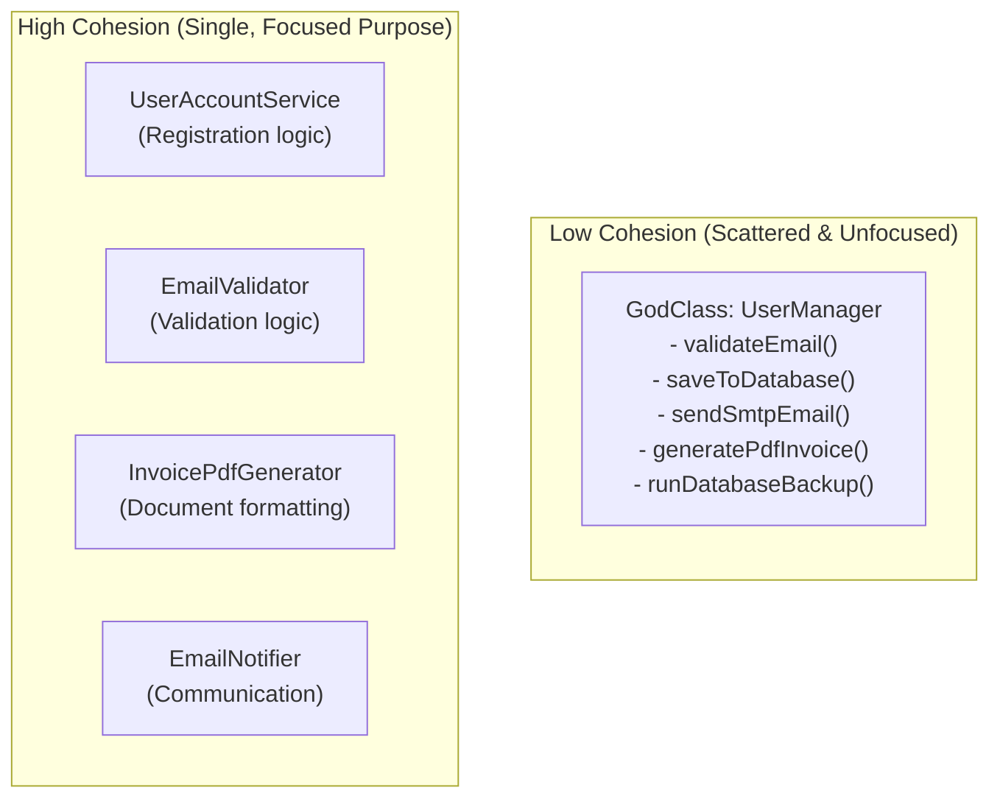

# 17. Cohesion

## 1. What is it?

**Cohesion** is a measure of how strongly related, focused, and dedicated the responsibilities of a single module, class, or method are.

* **High Cohesion**: A class has a single, well-defined purpose. All of its fields and methods are closely aligned with that single responsibility (e.g., a `TaxCalculator` class only calculates taxes).
* **Low Cohesion**: A class attempts to do multiple, unrelated things at once (e.g., a `UserManager` that validates passwords, formats HTML emails, logs database queries, and processes credit card payments).

The universal design goal is **High Cohesion**.

---

## 2. Why do we need it?

In classes with low cohesion:
* **Brittle Code**: A bug fix in email formatting might accidentally break the password validation logic living in the same giant class.
* **Cognitive Overload**: Developers must read through thousands of lines of irrelevant code to understand a simple feature.
* **Difficult Testing**: Writing a unit test for one small calculation requires setting up dozens of unrelated mock objects.
* **Merge Conflicts**: Multiple developers working on different features constantly modify the exact same monolithic file.

High cohesion keeps code **focused, understandable, and resilient to change**.

---

## 3. How does it work? (Levels of Cohesion from Worst to Best)

Cohesion levels are categorized from lowest (worst) to highest (best):

1. **Coincidental Cohesion (Worst)**: Unrelated functions thrown into a single file purely by accident (e.g., `CommonUtils` or `MiscHelper`).
2. **Logical Cohesion**: Grouping operations that belong to the same logical category but perform completely different tasks (e.g., an `InputHandler` that parses keyboard clicks, MP3 audio streams, and network packets).
3. **Temporal Cohesion**: Grouping operations together solely because they happen at the same time (e.g., a `StartupManager` that initializes database pools, displays a GUI banner, and cleans temp files).
4. **Procedural Cohesion**: Methods grouped because they execute in a specific sequential order, even if they operate on different data.
5. **Communicational Cohesion**: Methods operate on the exact same data structure, but perform unrelated tasks.
6. **Sequential Cohesion**: Output of one operation serves as the input to the next operation (pipeline style).
7. **Functional Cohesion (Best)**: Every single part of the class contributes directly to one single, well-defined business capability.

---

## 4. One Simple Real-World Analogy

Think of **Tools in a Workshop**:
* **Low Cohesion**: A novelty multi-tool that combines a pair of scissors, a USB thumb drive, a cigarette lighter, a ballpoint pen, and a compass. It tries to do everything, is clumsy to use for any real job, and breaks easily.
* **High Cohesion**: A **Chef's Knife** or a **Precision Screwdriver**.
  - It does one thing exceptionally well.
  - Its blade, handle, and balance all serve that exact single purpose.
  - When you need a screwdriver, you don't accidentally ignite a lighter.

---

## 5. Small Java Code Example (Java 21)

### Low Cohesion (Anti-Pattern)
```java
// BAD: Low Cohesion (God Class doing 4 unrelated things)
public class BadUserAccountManager {
    public void registerUser(String email, String password) { /* ... */ }
    public void generatePdfMonthlyReport(String userId) { /* ... */ }
    public void sendSmtpWelcomeEmail(String email) { /* ... */ }
    public void executeDatabaseBackup() { /* ... */ } // What is this doing here?!
}
```

### High Cohesion (Preferred Pattern)
```java
package com.systemdesign.lld.fundamentals.cohesion;

// 1. High Cohesion: Exclusively handles User Account lifecycle
public class UserAccountService {
    private final EmailValidator validator;

    public UserAccountService(EmailValidator validator) {
        this.validator = validator;
    }

    public void registerUser(String email, String password) {
        if (!validator.isValid(email)) {
            throw new IllegalArgumentException("Invalid email format");
        }
        System.out.println("User registered successfully: " + email);
    }
}
```

```java
// 2. High Cohesion: Exclusively handles Email Validation
public class EmailValidator {
    public boolean isValid(String email) {
        return email != null && email.contains("@") && email.contains(".");
    }
}

// 3. High Cohesion: Exclusively handles Notification dispatch
public class WelcomeEmailNotifier {
    public void sendWelcome(String email) {
        System.out.println("Dispatching welcome email to: " + email);
    }
}
```

```java
public class Main {
    public static void main(String[] args) {
        EmailValidator validator = new EmailValidator();
        UserAccountService userService = new UserAccountService(validator);
        WelcomeEmailNotifier notifier = new WelcomeEmailNotifier();

        String email = "alex@example.com";
        userService.registerUser(email, "secretPassword123");
        notifier.sendWelcome(email);
    }
}
```

---

## 6. Diagram



### Explanation of Diagram
In the low-cohesion model, one bloated class takes on conflicting duties, making it fragile and confusing. In the high-cohesion model, each class handles one distinct responsibility, making each component easy to read, test, and reuse.

---

## 7. Advantages and Disadvantages

### Advantages of High Cohesion
* **Readability**: Code is intuitive and easy to understand because a class does exactly what its name says.
* **Isolated Testing**: Unit tests are tiny and require few or no mock dependencies.
* **Low Maintenance Cost**: Changes to one feature (e.g., invoice generation) cannot break unrelated features (e.g., user registration).

### Disadvantages of High Cohesion
* **More Files**: Decomposing large classes results in more individual classes and files in the project.
* **Coordination Needed**: Requires higher-level orchestrator services to coordinate multiple cohesive objects.

---

## 8. When to Use It and When Not to Use It

### Always Strive for High Cohesion:
* In all domain entities, value objects, and business services.
* In design interviews to demonstrate understanding of the Single Responsibility Principle (SRP).

### Pragmatic Compromise:
* Avoid micro-splitting classes to the extreme (e.g., creating a separate class for a single two-line `add(a, b)` function). Group methods that genuinely operate on the same cohesive state together.

---

## 9. Common Mistakes and Misconceptions

* **Mistake: Creating "Junk Drawer" classes**:
  Naming a class `Utils`, `Helper`, `CommonManager`, or `GeneralHandler` is an immediate sign of zero cohesion. Always name classes after specific domain concepts.
* **Mistake: Confusing Cohesion with Coupling**:
  - *Cohesion*: Measures internal focus within **one** class.
  - *Coupling*: Measures relationship between **different** classes.
  - The goal is always: **High Cohesion + Low Coupling**.

---

## 10. Common LLD Interview Questions with Answers

### Q1: How do you measure or detect whether a class has high or low cohesion?
**Answer**:
1. **LCOM metric (Lack of Cohesion of Methods)**: In software metrics, LCOM measures how many instance methods access how many instance fields. If method A only uses fields 1 and 2, while method B only uses fields 3 and 4, the class has low cohesion and should be split into two classes.
2. **The "AND" Rule**: If you cannot describe what a class does in one short sentence without using the word "AND", the class has low cohesion.

### Q2: What is the relationship between Cohesion and the Single Responsibility Principle (SRP)?
**Answer**: SRP is the modern incarnation of Functional Cohesion. SRP states that a class should have one, and only one, reason to change. High cohesion is the structural property achieved when a class adheres strictly to SRP.

### Q3: Why is Coincidental Cohesion dangerous in enterprise codebases?
**Answer**: Coincidental cohesion occurs when unrelated utility functions are dumped into a single generic file (like `StringUtils` or `AppHelper`). As different teams modify this file for unrelated features, merge conflicts spike, testing becomes unmanageable, and unnecessary dependencies are introduced everywhere.

---

## 11. Short Revision Notes

* **Definition**: How focused and related the methods and data within a single class are.
* **Target**: **High Cohesion**.
* **Gold Standard**: **Functional Cohesion** (does one complete job well).
* **Code Smells**: God Objects, classes named `Utils`/`Manager`, and classes with multiple reasons to change.
