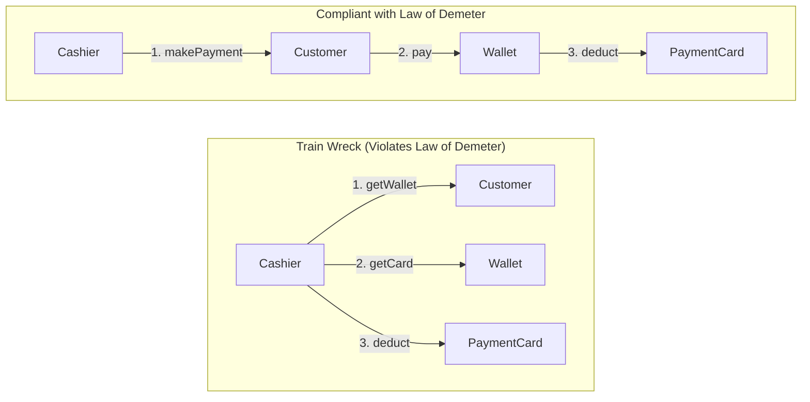

# 19. Law of Demeter (Principle of Least Knowledge)

## 1. What is it?

The **Law of Demeter (LoD)**, formally known as the **Principle of Least Knowledge**, is an object-oriented design guideline that states:
> *"A module should not know about the internal details or structural navigation paths of the objects it manipulates."*

In informal terms:
> **"Only talk to your immediate friends, and do not talk to strangers."**

The Law of Demeter specifically forbids navigating through chains of object references (commonly referred to as the **"train wreck" code smell**, such as `a.getB().getC().getD().doSomething()`).

---

## 2. Why do we need it?

When code navigates through nested object graphs:
* **Deep Structural Coupling**: If Class A calls `order.getCustomer().getWallet().getCard().charge()`, Class A is intimately coupled to the structure of `Order`, `Customer`, `Wallet`, and `Card`.
* **Extreme Fragility**: If the `Wallet` class is refactored, renamed, or replaced with an Apple Pay token, Class A (and dozens of other callers) break instantly.
* **Violates Encapsulation**: It treats objects like open data structures rather than encapsulated units that manage their own behavior.

Adhering to the Law of Demeter ensures that changes to an object's internal structure do not ripple through the rest of the application.

---

## 3. How does it work? (The Strict Demeter Rules)

Inside a method `m()` of an object `O`, you should **only** call methods belonging to:
1. The object `O` itself (`this`).
2. Any object passed as a **parameter** to `m()`.
3. Any object **created or instantiated** within `m()`.
4. Any object held as a **direct instance variable (field)** of `O`.
5. Static utility methods or global constants (when appropriate).

You must **not** call methods on an object returned by another method call (i.e., avoid chaining getters to reach third-party objects).

---

## 4. One Simple Real-World Analogy

Think of the classic **Paperboy and Customer**:
* A paperboy arrives at a customer's front door to collect \$2 for the weekly newspaper.
* **Violating Demeter**: The paperboy reaches into the customer's jacket, pulls out the customer's wallet, unzips the coin pocket, extracts two \$1 coins, zips the wallet back up, and shoves it back into the jacket.
* **Respecting Demeter**: The paperboy asks: *"That will be \$2, please."* The customer takes out their own wallet, extracts the money, and hands the \$2 to the paperboy.
* The paperboy does not need to know where the customer keeps their cash.

---

## 5. Small Java Code Example (Java 21)

### Demeter Violation: The "Train Wreck"
```java
// BAD: Caller navigates through 3 layers of object hierarchy
public class BadPaymentService {
    public void billCustomer(Customer customer, double amount) {
        // Train wreck: Customer -> Wallet -> PaymentCard
        customer.getWallet().getPaymentCard().deduct(amount);
    }
}
```

### Demeter Compliant: Clean Encapsulation and Delegation
```java
package com.systemdesign.lld.fundamentals.lawofdemeter;

// 1. Deep component: manages card transactions
public class PaymentCard {
    private final String cardNumber;
    private double balance;

    public PaymentCard(String cardNumber, double balance) {
        this.cardNumber = cardNumber;
        this.balance = balance;
    }

    public void deduct(double amount) {
        if (amount > balance) throw new IllegalStateException("Insufficient funds on card");
        this.balance -= amount;
        System.out.println("Deducted $" + amount + " from card [" + cardNumber + "]");
    }
}
```

```java
// 2. Middle component: manages payment instruments
public class Wallet {
    private final PaymentCard primaryCard;

    public Wallet(PaymentCard primaryCard) {
        this.primaryCard = primaryCard;
    }

    // Encapsulates card deduction
    public void pay(double amount) {
        this.primaryCard.deduct(amount);
    }
}

// 3. Top component: Customer delegates payment to its own wallet
public class Customer {
    private final String name;
    private final Wallet wallet;

    public Customer(String name, Wallet wallet) {
        this.name = name;
        this.wallet = wallet;
    }

    // Demeter compliant: Customer exposes its own payment capability
    public void makePayment(double amount) {
        System.out.println("Customer " + name + " initiating payment of $" + amount);
        this.wallet.pay(amount);
    }
}
```

```java
// 4. Client talks ONLY to its immediate friend (Customer)
public class Cashier {
    public void checkout(Customer customer, double amount) {
        // Clean single method call! Cashier has NO idea about Wallet or PaymentCard.
        customer.makePayment(amount);
    }
}
```

```java
public class Main {
    public static void main(String[] args) {
        PaymentCard card = new PaymentCard("4532-XXXX-XXXX-9901", 500.0);
        Wallet wallet = new Wallet(card);
        Customer customer = new Customer("John Doe", wallet);

        Cashier cashier = new Cashier();
        cashier.checkout(customer, 45.0);
    }
}
```

---

## 6. Diagram



### Explanation of Diagram
In the top violation diagram, `Cashier` knows and directly manipulates `Customer`, `Wallet`, and `PaymentCard`. In the bottom compliant diagram, `Cashier` talks only to `Customer`, and each layer delegates to its immediate neighbor.

---

## 7. Advantages and Disadvantages

### Advantages
* **Information Hiding**: Callers are immune to internal refactoring of nested objects.
* **Low Structural Coupling**: Decreases the number of types any given class must know about.
* **Higher Readability**: Code reads as business intentions (`customer.makePayment(amount)`) rather than pointer traversals.

### Disadvantages
* **Wrapper / Delegation Boilerplate**: May require writing forwarding methods in intermediate classes.
* **Over-Engineering Risk**: Blindly wrapping simple, public immutable data structures can introduce unnecessary bloat.

---

## 8. When to Use It and When Not to Use It

### Strictly Apply Law of Demeter:
* When navigating **domain entities and service objects** where business rules and state mutations are involved.
* In public APIs and across architectural layer boundaries.

### Law of Demeter Does NOT Apply To:
* **Fluent APIs and Builder Patterns**: e.g., `StringBuilder.append("a").append("b")` or `Stream.of(list).filter(...).map(...).toList()` (because you are transforming the same conceptual stream, not navigating an arbitrary object hierarchy).
* Pure transparent **Data Transfer Objects (DTOs)** or Java records whose sole purpose is data serialization.

---

## 9. Common Mistakes and Misconceptions

* **Misconception: "Any code with more than one dot violates Demeter"**:
  Chaining methods on a fluent builder (`userBuilder.name("A").email("B").build()`) or Java streams (`list.stream().filter().toList()`) does **not** violate Demeter. Demeter is about **not talking to strangers**, not about counting dots in Java syntax.
* **Mistake: Creating thousands of pass-through getters**:
  Simply writing `customer.getCardNumber()` so the caller can still do the work does not fix the problem. Instead, move the actual **behavior** (`customer.charge(...)`) into the appropriate class.

---

## 10. Common LLD Interview Questions with Answers

### Q1: What is the "Train Wreck" code smell and how is it resolved?
**Answer**: A "Train Wreck" occurs when multiple method calls are chained together across distinct object boundaries (e.g., `a.getB().getC().doAction()`). It indicates that the caller knows too much about the internal object graph. It is resolved by applying the **"Tell, Don't Ask"** principle and delegating the action down the chain so the caller only invokes a method on its direct collaborator `a.doAction()`.

### Q2: Why are Java 8+ Streams and Builders not considered violations of the Law of Demeter?
**Answer**: The Law of Demeter targets structural coupling to intermediate domain objects (strangers). In a Builder, each method returns either `this` (the same builder instance) or the built object. In the Stream API, you are transforming elements within the same monad pipeline, not traversing private foreign domain entities.

### Q3: How does the Law of Demeter help with unit testing?
**Answer**: When code violates Demeter, writing a unit test requires setting up deep hierarchies of mock objects (e.g., `when(order.getCustomer()).thenReturn(mockCustomer); when(mockCustomer.getWallet()).thenReturn(mockWallet); ...`). With Demeter, the class only interacts with its immediate dependency, requiring only one simple mock.

---

## 11. Short Revision Notes

* **The Rule**: "Talk only to your immediate friends; don't talk to strangers."
* **Code Smell to Spot**: Train wrecks (`a.getB().getC().action()`).
* **The Fix**: Delegate the behavior inward using **"Tell, Don't Ask"**.
* **Exceptions**: Builders, Fluent Interfaces, and Stream pipelines are **not** Demeter violations.
