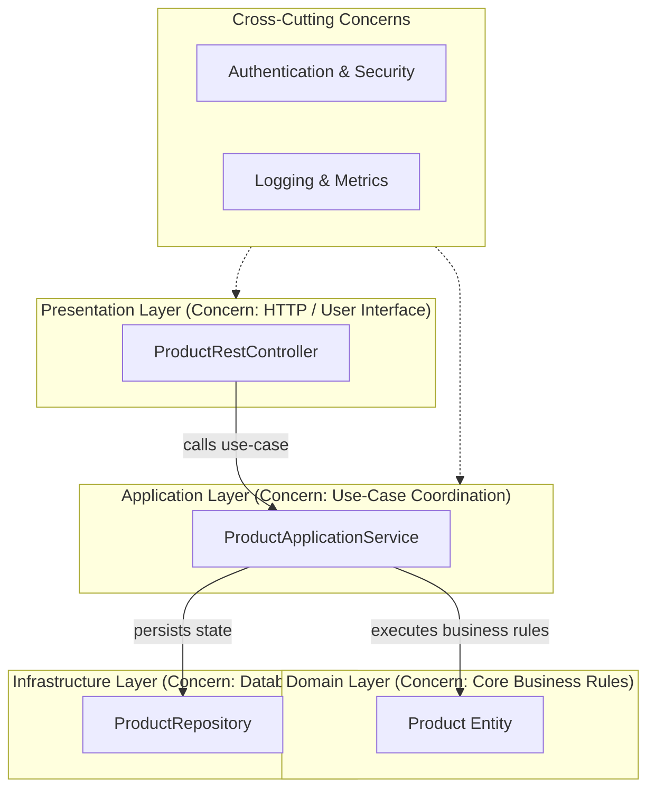

# 20. Separation of Concerns (SoC)

## 1. What is it?

**Separation of Concerns (SoC)** is a core software architecture principle stating that a software system should be divided into distinct, non-overlapping sections, where each section addresses a separate, dedicated **"concern"** (a specific area of interest or responsibility).

A "concern" can be:
* **Functional (Business Logic)**: Calculating order pricing, validating promo codes, assigning delivery drivers.
* **Technical (Infrastructure)**: Parsing HTTP JSON payloads, executing SQL database queries, writing audit logs, handling network authentication.

SoC dictates that business rules should not care how data is stored, and data storage should not care how web pages are rendered.

---

## 2. Why do we need it?

When concerns are entangled into a single monolithic layer:
* **The "Spaghetti Code" Effect**: Modifying an HTML button layout or database column accidentally breaks pricing tax calculations.
* **Inability to Evolve**: Switching from PostgreSQL to MongoDB or from a REST API to gRPC requires rewriting core business rules.
* **Duplication**: Common concerns like security authentication and transaction logging get copy-pasted across dozens of endpoints.

SoC ensures that each part of the system can evolve, scale, and be tested completely independently.

---

## 3. How does it work? (Layered Architecture & Cross-Cutting Concerns)

SoC organizes applications along two distinct dimensions:

### 1. Horizontal Layering (Core Concerns)
* **Presentation Layer (Web/API)**: Converts HTTP/JSON to DTOs; handles routing and HTTP status codes.
* **Application Layer (Use-Case Coordination)**: Orchestrates transactions and domain services.
* **Domain Layer (Business Core)**: Pure entities, value objects, and business algorithms with zero framework dependencies.
* **Infrastructure Layer (Persistence & External I/O)**: Database repositories, cloud storage, payment gateway SDKs.

### 2. Vertical / Cross-Cutting Concerns
Concerns that span across multiple layers (like **Logging**, **Security**, **Caching**, and **Transaction Management**) are isolated into independent aspects, filters, or middleware using techniques like **Aspect-Oriented Programming (AOP)** or the **Decorator pattern**.

---

## 4. One Simple Real-World Analogy

Think of a **Commercial Airline Flight**:
* **The Flight Attendants (Presentation Layer)**: Greet passengers, check boarding passes, serve meals. They do not navigate the aircraft.
* **The Pilots (Domain & Business Logic)**: Fly the aircraft, manage fuel burn, plot coordinates. They do not check ticket barcodes.
* **The Mechanics & Ground Crew (Infrastructure Layer)**: Refuel tanks, inspect landing gear hydraulics, perform engine maintenance.
* **Airport Security / Air Traffic Control (Cross-Cutting Concerns)**: Enforce security and clearance across all flights uniformly.

Each team has a single, isolated concern, allowing the entire airline operation to run reliably.

---

## 5. Small Java Code Example (Java 21)

```java
package com.systemdesign.lld.fundamentals.separationofconcerns;

// 1. DOMAIN CONCERN: Pure business entity (Zero framework or database imports)
public class Product {
    private final String id;
    private double price;

    public Product(String id, double price) {
        if (price < 0) throw new IllegalArgumentException("Price cannot be negative");
        this.id = id;
        this.price = price;
    }

    public void applyDiscount(double percent) {
        this.price -= this.price * (percent / 100.0);
    }

    public String getId() { return id; }
    public double getPrice() { return price; }
}
```

```java
// 2. INFRASTRUCTURE CONCERN: Exclusively handles data storage & retrieval
public interface ProductRepository {
    Product findById(String id);
    void save(Product product);
}

// 3. APPLICATION CONCERN: Orchestrates the use-case
public class ProductApplicationService {
    private final ProductRepository repository;

    public ProductApplicationService(ProductRepository repository) {
        this.repository = repository;
    }

    public void applyFlashSale(String productId, double discountPercentage) {
        // Orchestrates: load -> business operation -> persist
        Product product = repository.findById(productId);
        product.applyDiscount(discountPercentage);
        repository.save(product);
        System.out.println("Flash sale applied successfully for: " + productId);
    }
}
```

```java
// 4. PRESENTATION CONCERN: Translates external HTTP/CLI inputs to service calls
public class ProductRestController {
    private final ProductApplicationService service;

    public ProductRestController(ProductApplicationService service) {
        this.service = service;
    }

    // Handles HTTP request mapping and parameter validation
    public void handleDiscountEndpoint(String productId, String discountParam) {
        try {
            double discount = Double.parseDouble(discountParam);
            service.applyFlashSale(productId, discount);
        } catch (NumberFormatException e) {
            System.err.println("HTTP 400: Invalid discount parameter format");
        }
    }
}
```

---

## 6. Diagram



### Explanation of Diagram
The system is divided into clean, decoupled layers. Each layer handles one isolated concern. Cross-cutting concerns (like security and logging) wrap the application without polluting the pure domain logic.

---

## 7. Advantages and Disadvantages

### Advantages
* **Interchangeability**: You can replace MySQL with DynamoDB or your REST API with a GraphQL endpoint without modifying domain logic.
* **Team Specialization**: Frontend engineers, backend developers, and database administrators can work on their respective layers simultaneously.
* **High Maintainability**: Finding where a bug lives is trivial (e.g., query bug $\to$ Repository; discount calculation bug $\to$ Domain entity).

### Disadvantages
* **Layering Overhead**: Passing data through multiple layers (Controller $\to$ DTO $\to$ Service $\to$ Entity $\to$ Repo) adds boilerplate.
* **Risk of Pass-Through Bloat**: For trivial CRUD apps, every layer might feel like a redundant pass-through wrapper.

---

## 8. When to Use It and When Not to Use It

### Strictly Enforce Separation of Concerns:
* Enterprise applications, microservices, and medium-to-large backend architectures.
* Any application intended to live in production for multiple years.
* During Low-Level Design interviews to show architectural maturity.

### Relax Separation of Concerns:
* Single-file scripting utilities, data pipeline glue scripts, or throwaway prototypes.

---

## 9. Common Mistakes and Misconceptions

* **Mistake: Putting SQL queries inside Controllers or Domain Entities**:
  Writing raw SQL queries or Spring Data calls inside an `Order` domain model or a REST controller is a critical violation of SoC.
* **Mistake: Leaking HTTP objects into Domain Services**:
  Passing `HttpServletRequest` or `HttpSession` into business services couples the business logic directly to the Servlet container. Convert HTTP inputs into pure DTOs first!

---

## 10. Common LLD Interview Questions with Answers

### Q1: What is the difference between Separation of Concerns (SoC) and Single Responsibility Principle (SRP)?
**Answer**:
* **SoC** is an **architectural-level principle** about dividing an entire system into distinct layers and areas of concern (e.g., Presentation vs Business vs Infrastructure).
* **SRP** is an **object/class-level principle** (a specific application of SoC) stating that a single class should have only one reason to change.

### Q2: What are "Cross-Cutting Concerns" and how are they managed in clean architecture?
**Answer**: Cross-cutting concerns are system features that apply across multiple architectural layers (such as authentication, distributed tracing, transaction management, rate limiting, and exception handling). Rather than cluttering every business method with logging and auth checks, they are managed via middleware, interceptors, decorators, or Aspect-Oriented Programming (AOP).

### Q3: Why should the Domain Layer have zero dependencies on frameworks or libraries?
**Answer**: The domain layer represents the core intellectual property of the business (invariants, pricing calculations, business rules). If the domain layer is coupled to frameworks (like Spring, Hibernate, or AWS SDKs), upgrading or replacing the framework puts the company's core business rules at risk of regression.

---

## 11. Short Revision Notes

* **Essence**: Keep business rules, user interface, and data persistence in separate rooms.
* **The Standard Layers**: Presentation $\to$ Application Service $\to$ Domain $\to$ Infrastructure.
* **Golden Rule**: Never let HTTP or database concerns contaminate your pure domain models.
* **Cross-Cutting Concerns**: Handled via filters, interceptors, or decorators.
