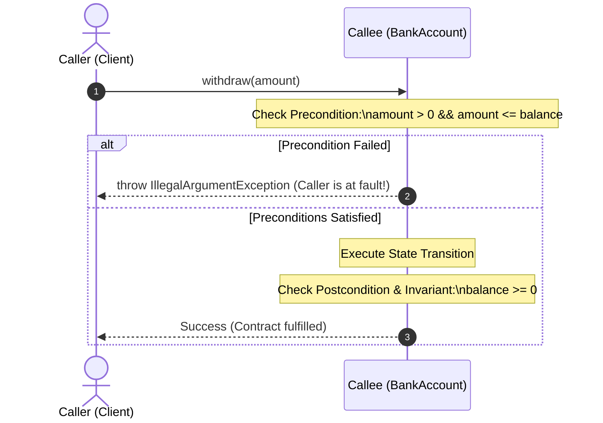

# 21. Design by Contract and Invariants

## 1. What is it?

**Design by Contract (DbC)** is an approach to software design pioneered by Bertrand Meyer that views software execution as a **formal legal agreement (contract)** between collaborating components.

A contract specifies the mutual obligations and guarantees between the **Caller (Client)** and the **Callee (Supplier)** using three core concepts:
1. **Preconditions**: What must be true *before* a method is executed (the caller's obligation).
2. **Postconditions**: What the method guarantees to be true *after* execution (the supplier's obligation).
3. **Class Invariants**: Conditions that must **always remain true** for every valid instance of the class throughout its entire lifetime.

---

## 2. Why do we need it?

Without clear contracts and invariants:
* **Defensive Programming Paranoia**: Every single method duplicates null checks, range checks, and type validations over and over again.
* **Corrupted Object State**: Invariants break silently (e.g., a bank account balance becomes negative, or an order has negative item quantities).
* **Unclear Blame**: When a NullPointerException or crash occurs in production, nobody knows whether the caller passed bad data or the callee had a logic flaw.

Design by Contract provides clear rules: if the caller satisfies the precondition, the callee guarantees the postcondition; if the caller violates the precondition, the method **fails immediately (fail-fast)**.

---

## 3. How does it work?

```
┌─────────────────────────────────────────────────────────────────┐
│                          THE CONTRACT                           │
│                                                                 │
│ 1. PRECONDITION  : Caller's obligation.                         │
│                    e.g., "amount must be > 0 and <= balance"    │
│                                                                 │
│ 2. METHOD RUNS   : Callee performs state transition.            │
│                                                                 │
│ 3. POSTCONDITION : Callee's guarantee.                          │
│                    e.g., "new balance == old balance - amount"  │
│                                                                 │
│ 4. INVARIANT     : Global object rule that must never break.    │
│                    e.g., "balance >= 0 at all times"            │
└─────────────────────────────────────────────────────────────────┘
```

In Java:
* **Preconditions** are enforced via explicit argument validation throwing `IllegalArgumentException` or `Objects.requireNonNull()`.
* **Invariants** are enforced by making fields `private` and validating state inside constructors and mutator methods.

---

## 4. One Simple Real-World Analogy

Think of a **Bank Cash Withdrawal Contract**:
* **Precondition (Customer's Duty)**: You must enter a valid PIN and request an amount greater than \$0 and less than or equal to your current balance.
* **The Bank's Action**: The ATM counts the bills and updates your ledger.
* **Postcondition (Bank's Duty)**: The ATM dispenses the exact cash requested and provides an updated receipt reflecting the reduction.
* **Invariant (Law of the Bank)**: The vault cash balance and customer account balances can never be negative numbers under any circumstance.

---

## 5. Small Java Code Example (Java 21)

```java
package com.systemdesign.lld.fundamentals.designbycontract;

import java.util.Objects;

public class BankAccount {
    private final String accountNumber;
    private double balance;

    public BankAccount(String accountNumber, double initialBalance) {
        // Precondition checks in constructor
        this.accountNumber = Objects.requireNonNull(accountNumber, "Account number cannot be null");
        if (initialBalance < 0) {
            throw new IllegalArgumentException("Initial balance cannot be negative");
        }
        this.balance = initialBalance;
        
        // Check invariant upon initialization
        assertInvariant();
    }

    public void withdraw(double amount) {
        // 1. PRECONDITION: Caller's obligation
        if (amount <= 0) {
            throw new IllegalArgumentException("Precondition failed: Withdrawal amount must be positive");
        }
        if (amount > this.balance) {
            throw new IllegalStateException("Precondition failed: Insufficient funds (balance=" + balance + ", req=" + amount + ")");
        }

        double oldBalance = this.balance;

        // 2. STATE TRANSITION
        this.balance -= amount;

        // 3. POSTCONDITION: Callee's guarantee
        if (this.balance != oldBalance - amount) {
            throw new AssertionError("Postcondition violated: Balance calculation mismatch");
        }

        // 4. INVARIANT: Must hold true before returning
        assertInvariant();
    }

    // Invariant check: Balance must NEVER drop below 0
    private void assertInvariant() {
        if (this.balance < 0) {
            throw new IllegalStateException("INVARIANT VIOLATION: Balance corrupted to negative value: " + this.balance);
        }
    }

    public double getBalance() { return balance; }
}
```

```java
public class Main {
    public static void main(String[] args) {
        BankAccount account = new BankAccount("ACC-8800", 200.0);

        // Preconditions met: Succeeds
        account.withdraw(50.0);
        System.out.println("Balance after withdrawal: $" + account.getBalance()); // $150.0

        // Precondition violated: Fails fast with clear explanation
        try {
            account.withdraw(300.0);
        } catch (IllegalStateException e) {
            System.err.println("Rejected safely: " + e.getMessage());
        }
    }
}
```

---

## 6. Diagram



### Explanation of Diagram
When `withdraw()` is invoked, the callee first evaluates the precondition. If the caller violated it, an exception is thrown immediately (the caller is responsible). If preconditions pass, the callee executes the logic and guarantees invariants before returning.

---

## 7. Advantages and Disadvantages

### Advantages
* **Fail-Fast Behavior**: Bugs and invalid data are caught the instant they occur, rather than propagating deep into downstream code.
* **Crystal-Clear Accountability**: If a precondition fails, the caller is at fault; if a postcondition or invariant fails, the callee is at fault.
* **Self-Documenting Code**: Preconditions explicitly state what input values are legal without requiring lengthy comments.

### Disadvantages
* **Performance Consideration**: Running expensive invariant checks on every single method call in high-throughput hot paths can add CPU overhead.
* **Java Language Limitation**: Java does not have native language-level keywords for DbC (unlike languages like Eiffel), requiring manual validation code.

---

## 8. When to Use It and When Not to Use It

### Strictly Enforce Contracts & Invariants:
* In all Domain Models, Aggregate Roots, and financial/security transactions.
* At system entry boundaries (public APIs, user input handlers, message listeners).

### Relax Detailed Invariant Checking:
* In performance-critical micro-benchmarks or inner loops where calculations run millions of times per second (validate once before entering the loop).

---

## 9. Common Mistakes and Misconceptions

* **Mistake: Relying on the Java `assert` keyword for production business rules**:
  Java's built-in `assert` statement is **disabled by default** in production JVMs! Never use `assert` for business validation; use standard `if (...) throw new IllegalArgumentException(...)`.
* **Mistake: Blaming the callee when caller passes bad arguments**:
  If a caller passes a negative amount to `withdraw()`, that is a caller bug. The callee should reject it with an exception, not silently return or attempt to correct the input.

---

## 10. Common LLD Interview Questions with Answers

### Q1: What is the difference between a Precondition and an Invariant?
**Answer**:
* A **Precondition** applies to a **specific method** and defines what the caller must guarantee *before* that method executes (e.g., `amount > 0`).
* An **Invariant** applies to the **entire object** and defines a condition that must remain true across the object's entire lifetime (before and after every public method call, e.g., `balance >= 0`).

### Q2: How does the Liskov Substitution Principle (LSP) relate to Design by Contract?
**Answer**: LSP is formally defined in terms of contracts:
1. Subclasses **cannot strengthen preconditions** (they cannot demand more than their parent demanded).
2. Subclasses **cannot weaken postconditions** (they must guarantee at least as much as the parent guaranteed).
3. Subclasses **must preserve all class invariants** of the parent.

### Q3: What is "Fail-Fast" and why is it preferred over "Fail-Silent"?
**Answer**: Fail-fast means terminating an invalid operation immediately with an informative exception at the earliest possible moment. Fail-silent (e.g., silently ignoring an error or returning `null`) allows corrupted state to spread, making the eventual crash happen far away from the root cause, which makes debugging extremely difficult.

---

## 11. Short Revision Notes

* **Precondition**: Caller's obligation before method runs.
* **Postcondition**: Callee's guarantee after method runs.
* **Invariant**: Universal object truth that must never be broken.
* **Golden Rule**: **Fail-Fast** — validate preconditions at the top of every method!
