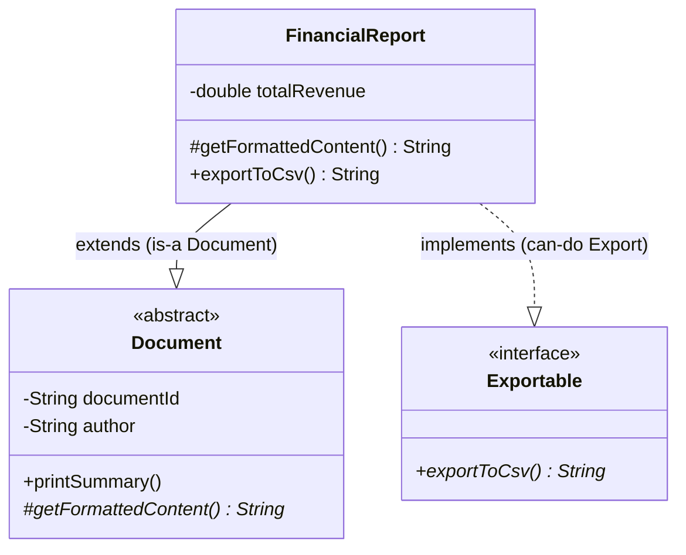

# 22. Interfaces vs Abstract Classes

## 1. What is it?

**Interfaces** and **Abstract Classes** are the two primary mechanisms in Java used to achieve **abstraction** and define extensible types.

* **Interface**: A pure behavioral contract that specifies **what** an implementing class can do (`can-do` / capability). It cannot hold mutable instance state.
* **Abstract Class**: An incomplete base class that captures shared state and behavior in a strict **"is-a"** taxonomy. It cannot be instantiated directly and serves as a blueprint for concrete subclasses.

---

## 2. Why do we need it?

Object-oriented design requires modeling two distinct concepts:
1. **Shared Taxonomy**: Related entities that share common internal variables, constructors, and partial algorithms (e.g., `Vehicle` sharing engine size, VIN, and registration logic).
2. **Orthogonal Capabilities**: Unrelated entities that can perform the same action (e.g., both a `UserReport` and an `AudioFile` can be `Printable` or `Serializable`).

Choosing the correct mechanism ensures clean code reuse without forcing classes into unnatural inheritance hierarchies.

---

## 3. How does it work? (Direct Comparison)

| Feature | Interface (`interface`) | Abstract Class (`abstract class`) |
|---|---|---|
| **Relationship** | "Can-do" / Capability contract | "Is-a" / Base identity |
| **Inheritance in Java** | **Multiple** (`implements A, B, C`) | **Single** (`extends SuperClass`) |
| **Instance Fields** | **None** (only `public static final` constants) | **Yes** (`private`, `protected`, mutable fields) |
| **Constructors** | **No** constructors allowed | **Yes** (invoked via `super(...)`) |
| **Default Methods** | Yes (since Java 8, via `default`) | Yes (standard concrete methods) |
| **Access Modifiers** | Public by default (private helpers since Java 9) | Full control (`public`, `protected`, `private`) |
| **Speed / Dispatch** | Interface table lookup (`invokeinterface`) | Virtual table lookup (`invokevirtual`) |

---

## 4. One Simple Real-World Analogy

Think of **Flying in Aviation**:
* **Abstract Class (`Aircraft`)**:
  - A Boeing 737 and a Helicopter are both `Aircraft`.
  - They inherit physical state: wings, fuselage, jet fuel tanks, altimeters, and pre-flight engine checklists.
* **Interface (`Flyable`)**:
  - A Boeing 737 is `Flyable`.
  - A Falcon (bird) is `Flyable`.
  - Superman is `Flyable`.
  - A Falcon and an Airplane share **zero** mechanical parts or physical DNA; they merely share the *capability* to fly.

---

## 5. Small Java Code Example (Java 21)

```java
package com.systemdesign.lld.fundamentals.interfacesvsabstractclasses;

// 1. INTERFACE: Behavioral capability across unrelated types
public interface Exportable {
    String exportToCsv();
}
```

```java
// 2. ABSTRACT CLASS: Base class capturing shared state and template workflow
public abstract class Document {
    private final String documentId;
    private final String author;

    public Document(String documentId, String author) {
        this.documentId = documentId;
        this.author = author;
    }

    // Template Method Pattern: Defines the algorithm structure
    public final void printSummary() {
        System.out.println("Document ID: " + documentId + ", Author: " + author);
        System.out.println("Body Content: " + getFormattedContent());
    }

    // Abstract method: Subclass MUST provide specific content
    protected abstract String getFormattedContent();

    public String getDocumentId() { return documentId; }
    public String getAuthor() { return author; }
}
```

```java
// 3. CONCRETE CLASS: Extends base Document ("is-a") AND implements Exportable ("can-do")
public class FinancialReport extends Document implements Exportable {
    private final double totalRevenue;

    public FinancialReport(String id, String author, double totalRevenue) {
        super(id, author); // Invokes abstract class constructor
        this.totalRevenue = totalRevenue;
    }

    @Override
    protected String getFormattedContent() {
        return "Q4 Net Revenue: $" + totalRevenue;
    }

    @Override
    public String exportToCsv() {
        return getDocumentId() + "," + getAuthor() + "," + totalRevenue;
    }
}
```

```java
public class Main {
    public static void main(String[] args) {
        FinancialReport report = new FinancialReport("DOC-101", "Alice CFO", 1500000.0);

        // Uses abstract class behavior
        report.printSummary();

        // Uses interface capability
        Exportable exporter = report;
        System.out.println("CSV Export: " + exporter.exportToCsv());
    }
}
```

---

## 6. Diagram



### Explanation of Diagram
`FinancialReport` inherits state and the template workflow from `Document` (Abstract Class) via single inheritance. It also implements `Exportable` (Interface), declaring its ability to be exported without coupling to other exportable classes.

---

## 7. Advantages and Disadvantages

### Advantages of Interfaces
* **Multiple Inheritance of Type**: A class can implement 5, 10, or more interfaces.
* **Maximum Decoupling**: Completely isolates callers from class inheritance hierarchies.
* **Modern Java Features**: Default methods enable safe API evolution without breaking existing implementors.

### Advantages of Abstract Classes
* **State Encapsulation**: Can hold `private` mutable or `final` fields and constructors.
* **Code Reuse (Template Method)**: Can enforce a fixed algorithmic skeleton with hooks for subclass customization.

### Disadvantages
* **Abstract Classes**: Consumes a class's single inheritance slot; creates compile-time coupling to the base class.
* **Interfaces**: Cannot store instance state or define constructors.

---

## 8. When to Use It and When Not to Use It

### Use an Interface When:
* You are defining a behavioral contract that diverse, unrelated classes will implement (e.g., `Comparable`, `Closeable`, `PaymentStrategy`).
* You want to enable multiple capabilities on a single class.
* You are decoupling business services from external infrastructure (DIP).

### Use an Abstract Class When:
* Closely related classes share significant amounts of state (fields) and common constructors.
* You are implementing the **Template Method Pattern** where a base class controls the overall algorithm and subclasses override specific steps.

---

## 9. Common Mistakes and Misconceptions

* **Misconception: "Since Java 8 introduced default methods, abstract classes are obsolete"**:
  False. Interface default methods can **never hold instance state** (instance variables). They can only compute results based on other interface methods. If you need fields, constructors, or non-public state, you **must** use an abstract class.
* **Mistake: Using an abstract class when an interface was appropriate**:
  Forcing subclasses into a rigid hierarchy just to share one or two helper methods burns the single inheritance slot and causes tight coupling.

---

## 10. Common LLD Interview Questions with Answers

### Q1: Can an Interface have private methods or fields in modern Java?
**Answer**:
* **Fields**: No. All fields in an interface are implicitly `public static final` (constants). Interfaces cannot hold instance state.
* **Methods**: Yes. Since Java 9, interfaces can have `private` (and `private static`) methods used strictly as helper routines to share common code between default methods within the interface.

### Q2: What is the "Template Method Pattern" and why does it require an Abstract Class?
**Answer**: The Template Method Pattern defines the skeleton of an algorithm in a base class method, deferring some steps to subclasses without altering the algorithm's structure. It requires an abstract class because the template method is typically marked `final` with `protected abstract` hook methods, and it frequently interacts with internal base class instance state.

### Q3: What is a "Sealed Interface" in Java 21?
**Answer**: A `sealed` interface (or class) restricts which other classes or interfaces may extend or implement it using the `permits` keyword. It allows developers to create closed, exhaustive type hierarchies (algebraic data types), enabling compile-time pattern matching with `switch` expressions where no `default` branch is required.

---

## 11. Short Revision Notes

* **Interface** = "Can-do" = Multiple implementation = No instance state.
* **Abstract Class** = "Is-a" = Single inheritance = Has state & constructors.
* **Modern Java**: Interfaces support `default`, `static`, and `private` methods, plus `sealed` hierarchies.
* **Rule of Thumb**: Default to **Interface** unless you genuinely need shared instance fields or constructors.
