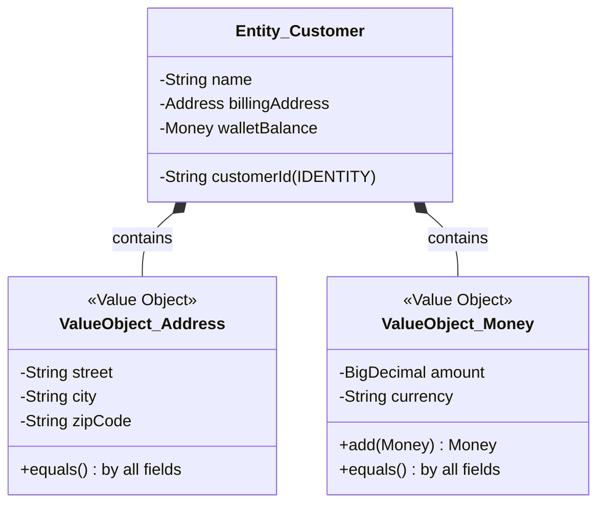

# 24. Value Objects

## 1. What is it?

A **Value Object (VO)** is a design concept from Domain-Driven Design (DDD) that represents an object whose identity is defined entirely by its **attributes (values)**, rather than by a unique database identifier or memory reference.

Two Value Objects with identical attributes are considered completely **interchangeable and equal**.

Value Objects possess three mandatory characteristics:
1. **No Unique Identity**: They do not have an `id`, `uuid`, or database primary key.
2. **Strict Immutability**: Once created, their attributes never change.
3. **Attribute-Based Equality**: Two instances are equal if and only if all their field values are equal (`equals()` and `hashCode()` are based on fields).

---

## 2. Why do we need it?

Without Value Objects, codebases suffer from **Primitive Obsession**:
```java
// BAD: Primitive Obsession
public void transferMoney(double amount, String currency, String recipient) { ... }
// What prevents someone from passing -50.0?
// What prevents adding USD 100 to EUR 50?
// What ensures the currency code is valid ISO-4217?
```
Passing raw primitives (`double`, `String`, `int`) spreads validation logic across every single method in the system.

Value Objects bundle data with its **domain invariants** (e.g., `Money`, `EmailAddress`, `GeoLocation`, `DateRange`), ensuring invalid domain concepts can never exist in memory.

---

## 3. How does it work?

| Dimension | Entity | Value Object |
|---|---|---|
| **Identity** | Has a unique ID (`id = "CUST-100"`) | **No ID**; defined purely by values |
| **Continuity** | State changes over time (tracks history) | **Immutable**; replaced, never mutated |
| **Equality** | Compared by ID (`id.equals(other.id)`) | Compared by all fields (`equals()`) |
| **Lifecycle** | Has its own independent database table | Embedded inside an Entity's table |
| **Java 21 Type** | Standard class with identity | Ideal fit for a Java **`record`** |

---

## 4. One Simple Real-World Analogy

Think of **Your Driver's License vs a \$20 Bill**:
* **Driver's License (Entity)**: It has a unique license number. If you change your address, cut your hair, or gain weight, it is still *your* license. You cannot swap it for someone else's license.
* **\$20 Bill (Value Object)**: It has no personal identity to you. If you lend a \$20 bill to a friend and they pay you back with a different crisp \$20 bill, you are completely satisfied. The value is defined by the \$20 amount and the currency, not by that specific piece of paper.

---

## 5. Small Java Code Example (Java 21)

```java
package com.systemdesign.lld.fundamentals.valueobjects;

import java.math.BigDecimal;
import java.util.Objects;

// Value Object implemented cleanly as a Java 21 Record
public record Money(BigDecimal amount, String currency) {

    // Compact constructor enforces invariants at creation time
    public Money {
        Objects.requireNonNull(amount, "Amount cannot be null");
        Objects.requireNonNull(currency, "Currency cannot be null");
        
        if (amount.compareTo(BigDecimal.ZERO) < 0) {
            throw new IllegalArgumentException("Money amount cannot be negative: " + amount);
        }
        if (currency.length() != 3) {
            throw new IllegalArgumentException("Currency must be a 3-letter ISO code: " + currency);
        }
    }

    // Value objects return a NEW instance on arithmetic operations
    public Money add(Money other) {
        Objects.requireNonNull(other, "Cannot add null money");
        if (!this.currency.equals(other.currency)) {
            throw new IllegalArgumentException("Currency mismatch: " + this.currency + " vs " + other.currency);
        }
        return new Money(this.amount.add(other.amount), this.currency);
    }
}
```

```java
public class Main {
    public static void main(String[] args) {
        Money price1 = new Money(new BigDecimal("50.00"), "USD");
        Money price2 = new Money(new BigDecimal("50.00"), "USD");

        // 1. Structural Equality: Two distinct instances with identical fields are EQUAL!
        System.out.println("price1.equals(price2): " + price1.equals(price2)); // true
        System.out.println("Same memory reference? " + (price1 == price2));     // false

        // 2. Addition returns a new Value Object
        Money fee = new Money(new BigDecimal("15.00"), "USD");
        Money total = price1.add(fee);
        System.out.println("Total: " + total.amount() + " " + total.currency()); // 65.00 USD

        // 3. Domain invariant protection prevents illegal operations
        // Money bad = new Money(new BigDecimal("-10.00"), "USD"); // Throws IllegalArgumentException!
    }
}
```

---

## 6. Diagram



### Explanation of Diagram
`Customer` is an **Entity** tracked by its unique `customerId`. Inside `Customer`, `Address` and `Money` are **Value Objects**. They have no IDs of their own, are immutable, and are compared strictly by their field values.

---

## 7. Advantages and Disadvantages

### Advantages
* **Eliminates Primitive Obsession**: Replaces error-prone raw strings and numbers with rich, self-validating types.
* **Guaranteed Invariants**: A `Money` or `EmailAddress` object cannot be instantiated in an invalid state.
* **Side-Effect Free**: Because they are immutable, they can be freely shared across methods and threads without locks or defensive copying.

### Disadvantages
* **Object Allocation Count**: Creating new instances for every calculation produces lightweight heap churn (mitigated by modern JVM escape analysis).
* **ORM Mapping Complexity**: Relational databases naturally prefer flat rows, requiring JPA `@Embeddable` or custom column converters.

---

## 8. When to Use It and When Not to Use It

### Use Value Objects For:
* Concepts defined by measurements, quantities, or coordinates: `Money`, `Color`, `DateRange`, `Dimensions`, `Location`.
* Formatted business strings: `EmailAddress`, `PhoneNumber`, `PostalCode`, `ISBN`.

### Do NOT Use Value Objects For:
* Entities that have a continuous lifecycle and change state over time (e.g., `User`, `Order`, `BankAccount`, `Vehicle`). These are **Entities**, not Value Objects.

---

## 9. Common Mistakes and Misconceptions

* **Mistake: Giving a Value Object an ID**:
  Adding a `private Long id;` to a `Money` or `Address` class turns it into an Entity. If two addresses have the exact same street, city, and zip code, they must be equal regardless of database keys.
* **Mistake: Adding setters to a Value Object**:
  Value Objects **must be strictly immutable**. If a field changes, you must construct a brand new Value Object.

---

## 10. Common LLD Interview Questions with Answers

### Q1: What is the primary difference between an Entity and a Value Object?
**Answer**:
* **Entity**: Has a unique identity (like an ID) that runs through time and across states. Two entities with identical attributes but different IDs are distinct objects (e.g., two people named "John Doe").
* **Value Object**: Has no unique identity; it is defined entirely by its attributes. Two value objects with identical attributes are completely equal and interchangeable (e.g., two \$10 bills).

### Q2: Why are Java 21 Records the perfect tool for implementing Value Objects?
**Answer**: Java `record` types provide:
1. Private, final fields by default.
2. Automatic value-based implementations of `equals()` and `hashCode()`.
3. Compact constructors for invariant validation.
4. Clean immutability semantics with zero boilerplate.

### Q3: How do you persist a Value Object in a relational database with JPA/Hibernate?
**Answer**: Using the `@Embeddable` annotation on the Value Object class and `@Embedded` on the field inside the parent Entity class. This flattens the Value Object's attributes into columns of the parent entity's database table without creating a separate foreign key table.

---

## 11. Short Revision Notes

* **Definition**: An immutable object defined solely by its values, with **no identity/ID**.
* **Key Traits**: Immutable, equals based on all fields, self-validating.
* **Code Smell Cured**: **Primitive Obsession** (`double` $\to$ `Money`, `String` $\to$ `EmailAddress`).
* **Modern Java**: Always use **`record`** for Value Objects.
