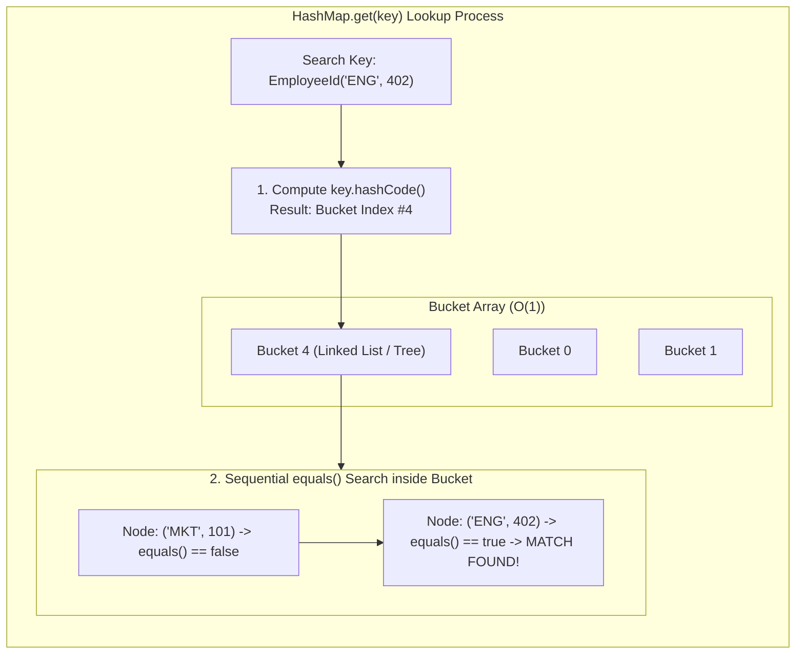

# 25. Equals and HashCode

## 1. What is it?

In Java, `equals()` and `hashCode()` are two fundamental methods inherited by every single class from `java.lang.Object`. Together, they govern how objects are **compared for equality** and how they are stored and retrieved in **hash-based collections** like `HashMap`, `HashSet`, and `Hashtable`.

* **`equals(Object obj)`**: Determines whether two object references are logically equivalent.
* **`hashCode()`**: Returns an integer representation (hash value) used by hash buckets to locate objects in $O(1)$ constant average time.

---

## 2. Why do we need it?

By default, `java.lang.Object` implements:
* `equals()` as **reference equality (`==`)**: Two objects are only equal if they point to the exact same memory address on the heap.
* `hashCode()` based on the internal memory address of the object.

If you create two distinct objects with identical fields:
```java
Customer c1 = new Customer("C-101", "Alice");
Customer c2 = new Customer("C-101", "Alice");
```
* `c1.equals(c2)` returns **`false`**!
* If you insert `c1` into a `HashSet`, and then check `set.contains(c2)`, it returns **`false`**!
* If you use `c1` as a key in a `HashMap`, you will **never** be able to retrieve the value using `c2`!

Overriding both methods is mandatory whenever objects need to be compared by logical values or used in hash collections.

---

## 3. How does it work? (The Strict Java Contract)

The official Java contract between `equals()` and `hashCode()` states:

1. **If two objects are equal according to `equals()`, they MUST produce the exact same `hashCode()` value**:
   $$\text{if } a.equals(b) \implies a.hashCode() == b.hashCode()$$
2. **If two objects produce the same `hashCode()`, they are NOT required to be equal** (this is known as a **hash collision**).
3. **Consistency**: If an object does not mutate, its `hashCode()` must return the exact same value throughout the entire program run.
4. **The `equals()` Mathematical Contract**:
   - **Reflexive**: `x.equals(x)` is always `true`.
   - **Symmetric**: `x.equals(y)` returns `true` if and only if `y.equals(x)` returns `true`.
   - **Transitive**: If `x.equals(y)` and `y.equals(z)`, then `x.equals(z)`.
   - **Non-nullity**: `x.equals(null)` must always return `false`.

---

## 4. One Simple Real-World Analogy

Think of **Postal Zip Codes and House Addresses**:
* **`hashCode()`** is the **Postal Zip Code**:
  - The postal sorting facility looks at the Zip Code (`hashCode`) to direct the letter to a specific neighborhood postal box (hash bucket).
  - Many different houses share the exact same Zip Code (hash collision).
* **`equals()`** is the **Exact Street Number and Name**:
  - Once the mail carrier arrives at the neighborhood box, they look at the exact street number and name (`equals()`) to put the letter into the right mail slot.
* **The Rule**: Two letters addressed to the exact same house address **must** have the exact same Zip Code! If two letters have different Zip Codes, they cannot possibly be the same house.

---

## 5. Small Java Code Example (Java 21)

```java
package com.systemdesign.lld.fundamentals.equalshashcode;

import java.util.HashSet;
import java.util.Objects;
import java.util.Set;

public class EmployeeId {
    private final String departmentCode;
    private final int employeeNumber;

    public EmployeeId(String departmentCode, int employeeNumber) {
        this.departmentCode = Objects.requireNonNull(departmentCode, "Dept code required");
        this.employeeNumber = employeeNumber;
    }

    // 1. Correct implementation of equals()
    @Override
    public boolean equals(Object o) {
        // Step 1: Reference check
        if (this == o) return true;
        // Step 2: Null and class comparison
        if (o == null || getClass() != o.getClass()) return false;
        // Step 3: Type cast and field comparison
        EmployeeId that = (EmployeeId) o;
        return this.employeeNumber == that.employeeNumber &&
               Objects.equals(this.departmentCode, that.departmentCode);
    }

    // 2. Consistent hashCode() using the EXACT same fields used in equals()
    @Override
    public int hashCode() {
        return Objects.hash(departmentCode, employeeNumber);
    }
}
```

```java
public class Main {
    public static void main(String[] args) {
        Set<EmployeeId> employeeSet = new HashSet<>();

        EmployeeId id1 = new EmployeeId("ENG", 402);
        EmployeeId id2 = new EmployeeId("ENG", 402);

        employeeSet.add(id1);

        // Demonstrating the contract in action
        System.out.println("id1.equals(id2): " + id1.equals(id2)); // true
        System.out.println("Same hashCode: " + (id1.hashCode() == id2.hashCode())); // true
        
        // HashSet correctly identifies id2 as already present!
        System.out.println("Set contains id2: " + employeeSet.contains(id2)); // true
        System.out.println("Set size: " + employeeSet.size()); // 1
    }
}
```

---

## 6. Diagram



### Explanation of Diagram
When querying a `HashMap`, Java first calculates `key.hashCode()` to jump to the correct bucket index in $O(1)$ time. Once inside the bucket, it calls `key.equals(nodeKey)` to locate the exact match among any colliding entries.

---

## 7. Advantages and Disadvantages

### Advantages
* **High-Performance Lookups**: Enables $O(1)$ average time complexity for lookups, insertions, and deletions in `HashMap` and `HashSet`.
* **Predictable Domain Semantics**: Allows business entities to be compared logically by their values rather than by fragile memory addresses.

### Disadvantages
* **Subtle Bug Hazard**: Violating the contract causes silent data loss in maps that is notoriously difficult to diagnose.
* **Maintenance Burden**: If a new field is added to a class, developers must remember to update both `equals()` and `hashCode()` (avoided by using Java `record`s).

---

## 8. When to Use It and When Not to Use It

### Always Override Both:
* Whenever an object is used as a key in a `Map` or an element in a `Set`.
* On all **Value Objects**, DTOs, and domain identifiers.
* On **Entities** (typically using their unique business identifier/ID).

### Do NOT Override:
* Stateless utility classes, singleton application services, or factory classes where identity is purely reference-based.

---

## 9. Common Mistakes and Misconceptions

* **Mistake #1: Overriding `equals()` but forgetting `hashCode()`**:
  This is the #1 most common Java interview mistake. Two objects will be equal according to `equals()`, but will produce different hash codes and land in different buckets in a `HashMap`, making lookups fail!
* **Mistake #2: Using mutable fields in `hashCode()`**:
  If you use `balance` in your hash code, and `balance` is mutated after inserting the object into a `HashSet`, its bucket index changes, and you will never be able to retrieve or remove it from the set!
* **Mistake #3: Overloading instead of Overriding**:
  Writing `public boolean equals(EmployeeId other)` instead of `public boolean equals(Object other)`. The compiler treats this as an overload, not an override, and the JVM collections will completely ignore your method!

---

## 10. Common LLD Interview Questions with Answers

### Q1: What happens if two distinct objects return the same `hashCode()`?
**Answer**: This is a **hash collision**. Hash collections (like `HashMap`) handle collisions by storing colliding elements in the same bucket using a linked list (or a balanced red-black tree when the bucket size exceeds 8 elements in Java 8+). The collection then calls `equals()` on each element in that bucket to find the exact match.

### Q2: What happens if an object's field is mutated after it is placed as a key in a `HashMap`?
**Answer**: If the mutated field was used to compute the object's `hashCode()`, the object's hash code changes. However, the `HashMap` does not know this and leaves the entry in its original bucket. When you later call `map.get(key)`, the map calculates the new hash code, looks in the wrong bucket, and returns `null`. The original entry becomes an unretrievable memory leak.

### Q3: Why does `equals()` use `getClass() != o.getClass()` instead of `instanceof`?
**Answer**:
* `getClass() != o.getClass()` guarantees strict **symmetry**; a subclass will never equal a parent class.
* `instanceof` allows a subclass to equal a parent class, but frequently violates symmetry when the subclass adds new fields (the parent equals the child, but the child rejects the parent).

---

## 11. Short Revision Notes

* **The Cardinal Rule**: If you override `equals()`, you **MUST** override `hashCode()`.
* **Contract**: Equal objects $\to$ Identical hashCodes. Identical hashCodes $\to$ Might be a collision.
* **Signature Guard**: Signature **must** be `equals(Object o)`, not `equals(MyType o)`.
* **Immutability Advice**: Only calculate `hashCode` on **immutable** fields!
