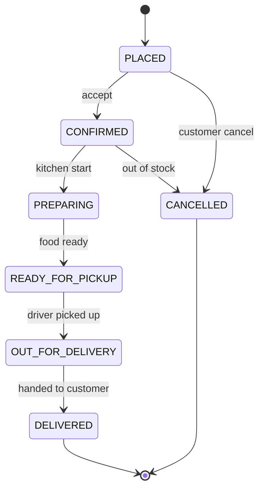

# 26. Enums and State Modeling

## 1. What is it?

In Java, an **`enum` (Enumeration)** is a specialized, type-safe class used to represent a fixed, exhaustive set of predefined constants (such as order statuses, food categories, or compass directions).

Unlike enums in C++ or C (which are mere integer aliases), Java enums are **full-fledged classes**:
* They can have **instance fields**, **constructors**, and **methods**.
* They can implement **interfaces**.
* They can encapsulate **state machine transition logic** directly within the enum itself.

**State Modeling** is the technique of using enums to define the legal states of an entity and strictly validate which transitions are permitted.

---

## 2. Why do we need it?

Before Java enums, developers used String constants or magic numbers:
```java
// ANTI-PATTERN: String constants / magic integers
public static final int STATUS_PLACED = 1;
public static final int STATUS_DELIVERED = 2;
```
This leads to serious bugs:
* **Zero Compile-Time Safety**: Any integer (`-999`) or typo in a string (`"DELIVRED"`) compiles cleanly and crashes in production.
* **No Logic Encapsulation**: State transition validation rules are scattered across 10 different service classes.
* **No Namespace Protection**: Constant names clash and pollute code completion.

Enums provide **absolute compile-time type safety** and a centralized home for state transition rules.

---

## 3. How does it work?

1. **Singleton Guarantees**: Each enum constant is a `public static final` singleton instance created exactly once when the enum class is loaded. Java guarantees that only one instance of each constant exists in the JVM.
2. **Comparison**: Because enum constants are singletons, you can safely compare them using reference equality (**`==`**) instead of `.equals()`.
3. **State Machine Modeling**: By embedding a `canTransitionTo(TargetStatus next)` method inside the enum, the enum becomes an active, self-policing state machine.

---

## 4. One Simple Real-World Analogy

Think of a **Traffic Light**:
* A traffic light has a fixed, immutable set of states: `RED`, `YELLOW`, `GREEN`.
* It can **never** be "BLUE", "PURPLE", or -5.
* State transitions follow strict, legal rules:
  - `GREEN` can only transition to `YELLOW`.
  - `YELLOW` can only transition to `RED`.
  - `RED` can only transition to `GREEN`.
* A transition from `RED` directly to `YELLOW` is illegal and prevented by the hardware controller.

---

## 5. Small Java Code Example (Java 21)

```java
package com.systemdesign.lld.fundamentals.enumsstatemodeling;

// Type-safe enum modeling an Order State Machine
public enum OrderStatus {
    PLACED("Order received by system"),
    CONFIRMED("Restaurant accepted order"),
    PREPARING("Food being cooked"),
    READY_FOR_PICKUP("Packed and waiting for driver"),
    OUT_FOR_DELIVERY("Driver on the way"),
    DELIVERED("Handed to customer"),
    CANCELLED("Order cancelled");

    private final String description;

    OrderStatus(String description) {
        this.description = description;
    }

    // STATE MACHINE: Java 21 Pattern Matching Switch Expression enforcing legal transitions
    public boolean canTransitionTo(OrderStatus next) {
        if (next == null) return false;
        
        return switch (this) {
            case PLACED -> next == CONFIRMED || next == CANCELLED;
            case CONFIRMED -> next == PREPARING || next == CANCELLED;
            case PREPARING -> next == READY_FOR_PICKUP; // Cannot cancel while cooking!
            case READY_FOR_PICKUP -> next == OUT_FOR_DELIVERY;
            case OUT_FOR_DELIVERY -> next == DELIVERED;
            case DELIVERED, CANCELLED -> false; // Terminal states: No transitions allowed
        };
    }

    public String getDescription() { return description; }
}
```

```java
// Entity using the state machine
public class Order {
    private final String orderId;
    private OrderStatus status;

    public Order(String orderId) {
        this.orderId = orderId;
        this.status = OrderStatus.PLACED;
    }

    public void transitionTo(OrderStatus nextStatus) {
        if (!this.status.canTransitionTo(nextStatus)) {
            throw new IllegalStateException("Illegal state transition from " + this.status + " to " + nextStatus);
        }
        System.out.println("Order " + orderId + " transitioned: " + this.status + " -> " + nextStatus);
        this.status = nextStatus;
    }

    public OrderStatus getStatus() { return status; }
}
```

```java
public class Main {
    public static void main(String[] args) {
        Order order = new Order("ORD-901");

        // Legal transitions:
        order.transitionTo(OrderStatus.CONFIRMED);
        order.transitionTo(OrderStatus.PREPARING);

        // Illegal transition: Attempting to cancel an order already being prepared!
        try {
            order.transitionTo(OrderStatus.CANCELLED);
        } catch (IllegalStateException e) {
            System.err.println("Transition blocked: " + e.getMessage());
        }
    }
}
```

---

## 6. Diagram



### Explanation of Diagram
The state diagram shows the legal lifecycle paths of an order. The enum's `canTransitionTo()` method mirrors this exact graph in code, guaranteeing that invalid leaps (like jumping from `PREPARING` directly to `DELIVERED` or cancelling during food prep) are rejected.

---

## 7. Advantages and Disadvantages

### Advantages
* **Compile-Time Safety**: Eliminates invalid values and typos entirely.
* **Exhaustive Pattern Matching**: In Java 21 `switch` expressions, the compiler verifies that all enum cases are handled without needing a `default` case.
* **Memory & Performance**: Enums can be compared with fast `==` reference equality, and special high-speed collections exist (`EnumSet`, `EnumMap`).

### Disadvantages
* **Closed Set**: Adding a new enum state requires recompiling the enum class (not suitable for dynamic, user-configured categories stored in a database).
* **Cannot Be Extended**: Enums cannot extend another class (they implicitly extend `java.lang.Enum`).

---

## 8. When to Use It and When Not to Use It

### Use Enums For:
* Fixed, known domain sets (e.g., `DaysOfWeek`, `PaymentMethod`, `UserRole`, `TrafficLightColor`).
* Discrete entity lifecycles and state machines (e.g., `OrderStatus`, `RideStatus`, `BookingStatus`).
* Implementing the thread-safe **Singleton Pattern**.

### Do NOT Use Enums For:
* Dynamic data categories that business users can add, rename, or delete at runtime via a database admin portal (use database lookup tables instead).
* Open-ended, unbounded sets.

---

## 9. Common Mistakes and Misconceptions

* **Mistake: Adding setters to an enum**:
  Enum constants are shared application-wide singletons. Mutating an enum's field mutates it for every thread and user across the entire JVM! **All enum fields must be `private final`**.
* **Mistake: Using `ordinal()` for database storage**:
  `enum.ordinal()` returns the numerical index (0, 1, 2). If someone reorders or inserts an enum value, all historical database records become corrupted! Always persist `enum.name()`.

---

## 10. Common LLD Interview Questions with Answers

### Q1: Why is an Enum the safest way to implement a Singleton in Java?
**Answer**: As Joshua Bloch noted in *Effective Java*, an enum singleton provides:
1. Guaranteed single instance creation handled by JVM classloading.
2. Free, JVM-enforced protection against **reflection attacks** (reflection cannot instantiate enums).
3. Automatic, bulletproof **serialization** guarantees without needing `readResolve()`.

### Q2: Why is comparing enums with `==` preferred over `.equals()`?
**Answer**:
1. **Null-Safety**: `status == OrderStatus.PLACED` will not throw a `NullPointerException` even if `status` is `null` (it simply evaluates to `false`). Calling `status.equals(...)` when `status` is `null` causes a crash.
2. **Compile-Time Check**: `==` prevents comparing incompatible types at compile time (e.g., comparing `OrderStatus` with `PaymentStatus` produces a compiler error).

### Q3: What is the State Pattern, and when should you use the State Pattern vs an Enum?
**Answer**:
* Use an **Enum** when the states and transition rules are straightforward and the behavior in each state is lightweight (like our `canTransitionTo()` switch).
* Use the **State Pattern (GoF)** when each state has complex, distinct polymorphic behavior across dozens of methods (e.g., a Document state where `Draft`, `Moderation`, and `Published` handle `render()`, `edit()`, and `publish()` in completely different 50-line algorithms).

---

## 11. Short Revision Notes

* **Nature**: Type-safe, singleton-backed class representing a fixed set of constants.
* **Comparison**: Always compare with **`==`** for speed and null-safety.
* **State Machines**: Embed transition validation (`canTransitionTo`) directly inside the enum.
* **Storage Warning**: Never store `ordinal()` in databases; always store `name()`.
