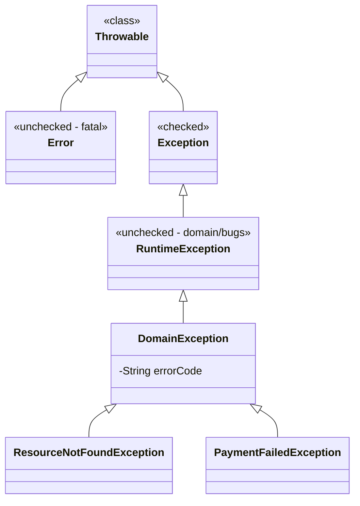

# 27. Exception Design

## 1. What is it?

**Exception Design** is the architectural practice of designing, organizing, and handling errors and exceptional conditions in software using structured exception hierarchies.

In Java, exceptions are represented by classes extending `java.lang.Throwable`:
* **Checked Exceptions (`extends Exception`)**: Exceptional conditions that a well-written application should anticipate and recover from. The compiler enforces that callers must either catch them or declare them in their method signature (`throws`).
* **Unchecked Exceptions (`extends RuntimeException`)**: Conditions indicating programming bugs, illegal arguments, or unrecoverable domain invariant violations. Compiler does not force explicit handling.
* **Errors (`extends Error`)**: Severe JVM-level failures (e.g., `OutOfMemoryError`, `StackOverflowError`) that user applications should never attempt to catch.

---

## 2. Why do we need it?

Before structured exceptions, systems relied on error return codes (e.g., returning `-1`, `false`, or `null`):
```java
// ANTI-PATTERN: C-style error codes
int status = processPayment(order);
if (status == -1) { /* what went wrong? */ }
```
* **Silent Bug Propagation**: Callers forget to check return codes, causing `null` pointers and data corruption far downstream.
* **Tangled Control Flow**: Happy-path business logic becomes choked with hundreds of nested `if (result == ERROR)` checks.
* **Loss of Context**: Return codes cannot carry stack traces, timestamps, error codes, or domain parameters.

Well-designed exceptions cleanly separate the **happy path** from **error recovery**, provide rich diagnostic context, and guarantee that unhandled errors cannot silently corrupt state.

---

## 3. How does it work?

A production-grade exception architecture uses three foundational practices:

1. **Domain Exception Hierarchy**:
   Create a common base unchecked exception for your domain (`DomainException extends RuntimeException`), with specific child exceptions (`ResourceNotFoundException`, `InvalidOrderStateException`, `PaymentFailedException`).
2. **Exception Translation / Wrapping**:
   Catch low-level technical checked exceptions at the infrastructure boundary (like a SQL `SQLException` or network `IOException`), wrap them inside a high-level domain exception (`DataAccessException`), preserving the root cause.
3. **Fail-Fast & Meaningful Messages**:
   Include relevant entity IDs and parameters in the error message so on-call engineers can diagnose issues instantly from logs.

---

## 4. One Simple Real-World Analogy

Think of an **Airplane Warning System**:
* **Checked Exception (Recoverable Advisory)**:
  - *"Left wing auxiliary fuel tank is empty."*
  - The pilot is alerted (enforced check), flips the valve switch to the main tank, and continues flying safely.
* **Unchecked Exception (Critical Invariant Failure)**:
  - *"Hydraulic fluid line severed during flight."*
  - The normal landing gear cannot be deployed via standard levers; the aircraft aborts standard approach and enters an emergency protocol.
* **Error (Catastrophic Engine Loss)**:
  - *"Both wings detached."*
  - The software running the cabin entertainment system cannot fix this; execution halts immediately.

---

## 5. Small Java Code Example (Java 21)

```java
package com.systemdesign.lld.fundamentals.exceptiondesign;

// 1. Root Domain Exception (Unchecked)
public abstract class DomainException extends RuntimeException {
    private final String errorCode;

    public DomainException(String errorCode, String message) {
        super(message);
        this.errorCode = errorCode;
    }

    public DomainException(String errorCode, String message, Throwable cause) {
        super(message, cause);
        this.errorCode = errorCode;
    }

    public String getErrorCode() { return errorCode; }
}
```

```java
// 2. Specialized Business Exceptions
public class ResourceNotFoundException extends DomainException {
    public ResourceNotFoundException(String resourceType, String id) {
        super("RESOURCE_NOT_FOUND", resourceType + " with ID '" + id + "' was not found");
    }
}

public class PaymentFailedException extends DomainException {
    public PaymentFailedException(String orderId, String reason, Throwable cause) {
        super("PAYMENT_FAILED", "Payment for order '" + orderId + "' failed: " + reason, cause);
    }
}
```

```java
// 3. Exception Translation at System Boundary
public class CheckoutService {
    public void processCheckout(String orderId) {
        try {
            simulatePaymentGatewayCall(orderId);
        } catch (java.io.IOException networkEx) {
            // EXCEPTION TRANSLATION: Wrap low-level I/O error into domain exception with root cause preserved!
            throw new PaymentFailedException(orderId, "Payment gateway unreachable", networkEx);
        }
    }

    private void simulatePaymentGatewayCall(String orderId) throws java.io.IOException {
        throw new java.io.IOException("Socket timeout while connecting to Visa gateway");
    }
}
```

```java
public class Main {
    public static void main(String[] args) {
        CheckoutService service = new CheckoutService();
        try {
            service.processCheckout("ORD-770");
        } catch (DomainException e) {
            System.err.println("Caught Domain Error [" + e.getErrorCode() + "]: " + e.getMessage());
            System.err.println("Root Cause: " + e.getCause().getClass().getName() + " - " + e.getCause().getMessage());
        }
    }
}
```

---

## 6. Diagram



### Explanation of Diagram
Java divides errors into `Error` (fatal JVM crashes) and `Exception`. Under `Exception`, `RuntimeException` represents unchecked exceptions. In modern LLD, domain business exceptions extend `RuntimeException` to avoid cluttering business contracts with checked exceptions.

---

## 7. Advantages and Disadvantages

### Advantages
* **Clean Code**: Business logic stays focused on the happy path without being obscured by error return checks.
* **Context Preservation**: Exceptions carry full call-stack traces and root-cause exceptions (`cause`).
* **Centralized Handling**: High-level handlers (like Spring's `@RestControllerAdvice`) can translate domain exceptions into uniform HTTP status codes (404, 400, 500).

### Disadvantages
* **Performance Cost**: Creating an exception captures the thread's stack trace (`fillInStackTrace()`), which adds a small nanosecond CPU cost (never use exceptions for standard control flow!).
* **Checked Exception Friction**: Excessive checked exceptions lead to boilerplate or lazy antipatterns like `throws Exception`.

---

## 8. When to Use It and When Not to Use It

### Use Exceptions For:
* Truly exceptional, erroneous conditions (e.g., database connection dropped, account balance insufficient, invalid state transitions).
* Guarding preconditions and class invariants.

### Do NOT Use Exceptions For:
* Normal, expected business flow control (e.g., do not throw `ItemNotFoundException` during a standard loop searching for an item; return `Optional<T>` instead).
* Validating standard user input forms where returning a list of validation messages is expected.

---

## 9. Common Mistakes and Misconceptions

* **Mistake #1: Swallowing Exceptions**:
  ```java
  try { doSomething(); } catch (Exception e) {} // CATASTROPHIC! Silently hides all failures.
  ```
* **Mistake #2: Catching `Throwable` or `Exception` indiscriminately**:
  Catches `OutOfMemoryError` and unexpected system bugs, preventing proper JVM termination. Catch specific exceptions.
* **Mistake #3: Losing the Root Cause**:
  ```java
  catch (SQLException e) {
      throw new RuntimeException("DB failed"); // Missing 'e'! Root cause stack trace is lost forever.
  }
  ```
  Always pass the original exception as the cause: `throw new RuntimeException("DB failed", e);`.

---

## 10. Common LLD Interview Questions with Answers

### Q1: Why do modern Java frameworks and libraries favor Unchecked Exceptions (`RuntimeException`) over Checked Exceptions?
**Answer**: Checked exceptions violate the Open/Closed Principle and encapsulation: if a repository method signature adds `throws SQLException`, every calling service and controller method must also declare `throws SQLException`, coupling them to database technologies. Unchecked exceptions allow low-level components to throw exceptions that bubble up to centralized global error handlers without polluting intermediate business interfaces.

### Q2: When is `Optional<T>` preferred over throwing an exception?
**Answer**: Use `Optional<T>` when the absence of a value is a **normal, expected outcome** (e.g., `userRepository.findByEmail(email)` — the user might legitimately not exist yet). Throw an exception when the condition represents an **abnormal error or broken precondition** (e.g., `userRepository.getById(id)` where the ID was guaranteed to be present).

### Q3: How do you achieve centralized exception handling in a RESTful Spring Boot application?
**Answer**: Using `@RestControllerAdvice` and `@ExceptionHandler` methods. When a domain exception (like `ResourceNotFoundException`) is thrown anywhere in the service layer, it bubbles up to the controller advice, which automatically translates it into a structured JSON error response with an HTTP `404 Not Found` status.

---

## 11. Short Revision Notes

* **Checked**: Compiler-enforced (`Exception`) $\to$ Recoverable external faults.
* **Unchecked**: Free (`RuntimeException`) $\to$ Domain errors & programming bugs.
* **Never use exceptions for control flow**: Use `Optional<T>` for expected missing data.
* **Always Chain Causes**: Pass `e` as the cause to preserve the stack trace!
