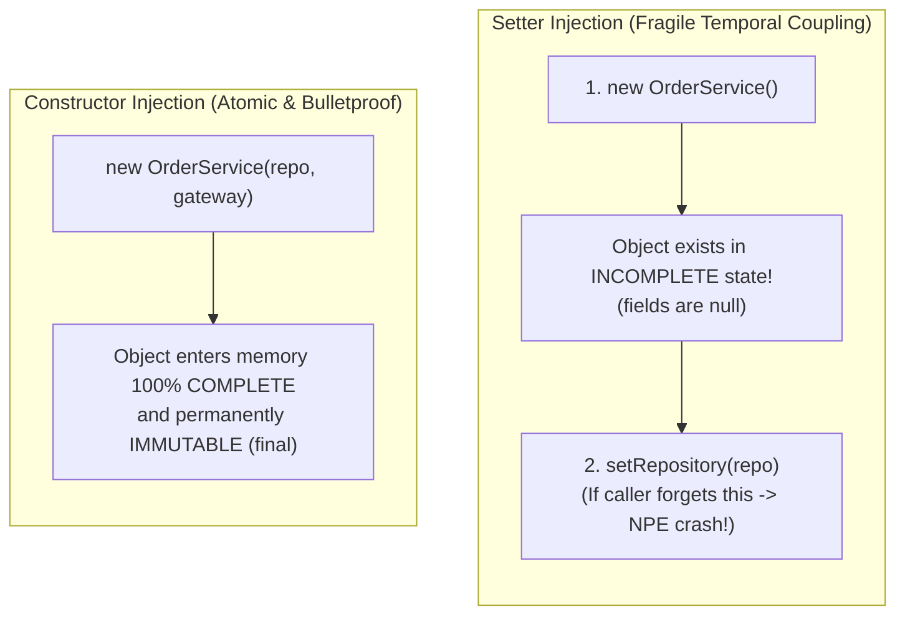

# 29. Constructor Injection

## 1. What is it?

**Constructor Injection** is the gold-standard style of Dependency Injection where all mandatory dependencies required by a class are supplied **exclusively as arguments to its constructor**.

By receiving dependencies during instantiation, the class declares its prerequisites upfront:
```java
public class OrderService {
    private final OrderRepository repository;
    private final PaymentGateway gateway;

    // CONSTRUCTOR INJECTION
    public OrderService(OrderRepository repository, PaymentGateway gateway) {
        this.repository = Objects.requireNonNull(repository);
        this.gateway = Objects.requireNonNull(gateway);
    }
}
```

---

## 2. Why do we need it?

Before constructor injection became standard practice, developers relied heavily on **Setter Injection** or **Field Injection** (`@Autowired` on private fields):

* **The Partially Initialized Object Hazard (Setter Injection)**: If someone calls `new OrderService()`, but forgets to call `service.setRepository(...)`, invoking `service.placeOrder()` crashes with a `NullPointerException` at runtime.
* **Testing Nightmare (Field Injection)**: To write a simple JUnit test for a class with field injection, you must either boot up an entire Spring container or use reflection hacks to set private fields.
* **Loss of Immutability**: Setter injection prevents fields from being declared `final`.

Constructor Injection guarantees that an object is **100% valid, initialized, and thread-safe** the moment it exists in memory.

---

## 3. How does it work?

1. **Declare fields as `private final`**:
   The `final` keyword guarantees that once the constructor completes, the dependency cannot be reassigned or set to `null` later.
2. **Validate in the constructor (Fail-Fast)**:
   Use `Objects.requireNonNull(dependency)` to ensure no caller passes a `null` reference.
3. **Pure POJO Testing**:
   In unit tests, you can instantiate the class using simple `new` operators and pass mock implementations directly, without needing Spring, reflection, or Mockito annotations.

---

## 4. One Simple Real-World Analogy

Think of **Buying a Car from an Automobile Dealer**:
* **Constructor Injection**: When the car is delivered to you, the engine, transmission, and steering wheel are already fully bolted in and wired up. You turn the key and drive away immediately.
* **Setter Injection**: The dealership delivers a hollow car body with no engine. They hand you an engine in a separate crate and say: *"Call `.setEngine()` sometime before you drive on the highway, otherwise the car will crash."*

---

## 5. Small Java Code Example (Java 21)

```java
package com.systemdesign.lld.fundamentals.constructorinjection;

import java.util.Objects;

public interface NotificationClient {
    void notifyUser(String message);
}

public interface AccountRepository {
    void updateBalance(String accountId, double newBalance);
}
```

```java
public class BankTransferService {
    // 1. Mandatory dependencies are permanently immutable
    private final AccountRepository accountRepository;
    private final NotificationClient notificationClient;

    // 2. CONSTRUCTOR INJECTION: Fails fast if any dependency is missing
    public BankTransferService(AccountRepository accountRepository, NotificationClient notificationClient) {
        this.accountRepository = Objects.requireNonNull(accountRepository, "AccountRepository is mandatory");
        this.notificationClient = Objects.requireNonNull(notificationClient, "NotificationClient is mandatory");
    }

    public void transfer(String fromAccount, String toAccount, double amount) {
        System.out.println("Transferring $" + amount + " from " + fromAccount + " to " + toAccount);
        accountRepository.updateBalance(fromAccount, -amount);
        accountRepository.updateBalance(toAccount, amount);
        notificationClient.notifyUser("Transfer complete: $" + amount);
    }
}
```

```java
// 3. Frictionless Unit Testing (No Spring Context required!)
public class Main {
    public static void main(String[] args) {
        // Mock collaborators passed directly into constructor
        AccountRepository mockRepo = (id, bal) -> System.out.println("[TEST DB] Updated " + id + " by " + bal);
        NotificationClient mockNotifier = msg -> System.out.println("[TEST ALERT] " + msg);

        // Instant, safe instantiation
        BankTransferService service = new BankTransferService(mockRepo, mockNotifier);
        service.transfer("ACC-1", "ACC-2", 250.0);

        // Immediate fail-fast protection:
        try {
            new BankTransferService(mockRepo, null); // Will throw NullPointerException immediately!
        } catch (NullPointerException e) {
            System.err.println("Prevented invalid object creation: " + e.getMessage());
        }
    }
}
```

---

## 6. Diagram



### Explanation of Diagram
With Setter Injection, the object spends time in an uninitialized, fragile state where fields are `null`. With Constructor Injection, the object is created atomically in a single step with all dependencies satisfied and validated.

---

## 7. Advantages and Disadvantages

### Advantages
* **Guaranteed Object Immutability**: Enables the use of `final` fields for all injected dependencies.
* **Elimination of NullPointerExceptions**: An object cannot be instantiated in a half-configured state.
* **Frictionless Unit Testing**: Requires zero test framework reflection; pass mocks directly into `new Service(mockA, mockB)`.
* **Smell Detector**: If a constructor has 8+ parameters, it instantly reveals that the class is violating the **Single Responsibility Principle (SRP)**.

### Disadvantages
* **Parameter List Length**: Can feel verbose if a class legitimately requires several collaborators (though this is usually a sign to refactor).
* **Subclassing Boilerplate**: If a class extends a base class that uses constructor injection, the child must explicitly declare and pass all dependencies to `super(...)`.

---

## 8. When to Use It and When Not to Use It

### Always Use Constructor Injection For:
* **All mandatory dependencies** in backend services, repositories, and controllers.
* All production Spring Boot applications (Spring Boot automatically auto-wires single constructors without needing `@Autowired`).

### Consider Setter Injection Only For:
* Truly **optional dependencies** with safe fallback defaults (e.g., an optional metric-recording interceptor).

---

## 9. Common Mistakes and Misconceptions

* **Mistake: Using Field Injection in production code**:
  Writing `@Autowired private OrderRepository repo;` without a constructor is an anti-pattern banned in modern engineering standards.
* **Mistake: Swallowing `null` without validation**:
  Always wrap constructor parameters in `Objects.requireNonNull(...)` to ensure fail-fast behavior.
* **Mistake: Massive 12-parameter constructors**:
  If a constructor requires 10 different services, do not "fix" it by switching back to field injection! Fix the architectural problem: split the class into smaller, more cohesive services.

---

## 10. Common LLD Interview Questions with Answers

### Q1: Why does the Spring Framework team officially recommend Constructor Injection over Field Injection?
**Answer**:
1. It allows dependencies to be `final`, ensuring **immutability and thread safety**.
2. It prevents `NullPointerException`s caused by uninitialized fields.
3. It makes **unit testing effortless** because dependencies can be passed directly via `new Service(mockRepo)` without reflection or Spring test contexts.
4. It detects **circular dependencies** immediately at application startup.

### Q2: How does Constructor Injection detect Circular Dependencies?
**Answer**: If Service A requires Service B in its constructor, and Service B requires Service A in its constructor, neither service can be constructed first. The JVM or Spring container detects this cycle at startup and throws an explicit `BeanCurrentlyInCreationException`, alerting the developer to an architectural circular dependency that must be refactored.

### Q3: When is Setter Injection acceptable over Constructor Injection?
**Answer**: Only for purely optional dependencies that have sensible in-memory default implementations. For example, a `PaymentService` might default to a `NoOpAuditLogger`, but provide a `setAuditLogger(AuditLogger logger)` method if the caller wishes to customize auditing.

---

## 11. Short Revision Notes

* **The Rule**: All mandatory dependencies must be injected via the **constructor**.
* **Modifiers**: Always mark injected fields **`private final`**.
* **Validation**: Guard with **`Objects.requireNonNull()`** for immediate fail-fast behavior.
* **Test Benefit**: Tests run in microseconds using vanilla `new Service(mock1, mock2)`.
