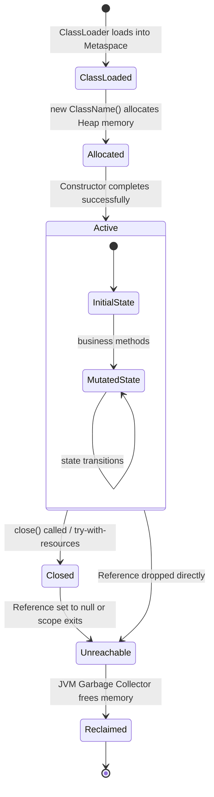

# 30. Object Lifecycle

## 1. What is it?

The **Object Lifecycle** represents the entire sequence of stages an object goes through from its initial instantiation in JVM memory to its active usage, state transitions, and eventual destruction and garbage collection.

In Java, managing an object's lifecycle properly ensures that system resources (such as heap memory, database connections, thread pools, and file handles) are allocated safely and released promptly when no longer needed.

---

## 2. Why do we need it?

Careless lifecycle management leads to the most notorious production failures:
* **Memory Leaks**: Objects that are no longer needed remain referenced in static maps or long-lived caches, preventing the Garbage Collector from freeing heap memory and eventually causing `java.lang.OutOfMemoryError: Java heap space`.
* **Resource Starvation**: Forgetting to close database connections or file descriptors exhausts OS-level file handles, crashing the entire application.
* **Use-After-Close Bugs**: Invoking methods on objects that have already released their underlying sockets or resources.

Understanding the lifecycle ensures robust state modeling, deterministic resource cleanup, and high application stability.

---

## 3. How does it work? (The 5 Stages of the Java Object Lifecycle)

```
┌────────────────────────────────────────────────────────────────────────┐
│                      THE JAVA OBJECT LIFECYCLE                         │
│                                                                        │
│ 1. LOADING & LINKING      : Class loaded into Metaspace.               │
│                             Static variables initialized.              │
│                                                                        │
│ 2. ALLOCATION & CREATION  : 'new' keyword allocates heap bytes.        │
│                             Constructor initializes instance fields.   │
│                                                                        │
│ 3. ACTIVE IN-FLIGHT STATE : Object receives messages and mutates.      │
│                             State transitions occur.                   │
│                                                                        │
│ 4. RESOURCE DISPOSAL      : Explicit close via AutoCloseable /         │
│                             try-with-resources.                        │
│                                                                        │
│ 5. UNREACHABILITY & GC    : References cleared. Object becomes         │
│                             unreachable. GC reclaims heap memory.      │
└────────────────────────────────────────────────────────────────────────┘
```

### Deterministic Cleanup via `AutoCloseable`
Java does not have C++ style deterministic destructors. Instead, any object holding native OS or network resources implements **`java.lang.AutoCloseable`** and is consumed using **`try-with-resources`** to guarantee immediate cleanup.

---

## 4. One Simple Real-World Analogy

Think of a **Rental Car Lifecycle**:
1. **Manufacture & Acquisition (Loading & Allocation)**: The rental agency purchases the car, registers the VIN, and parks it in the lot.
2. **Key Handover & Driving (Active State)**: A customer rents the car, drives to their destination, changes gears, and refuels (state transitions).
3. **Return & Inspection (Resource Cleanup / `close()`)**: The customer returns the keys, the agency inspects the tank, and the car's active session is terminated.
4. **Scrapping / Recycling (Garbage Collection)**: Years later, when the car is worn out and completely de-registered, it is crushed for scrap metal at the junkyard.

---

## 5. Small Java Code Example (Java 21)

```java
package com.systemdesign.lld.fundamentals.objectlifecycle;

import java.io.IOException;

// Resource-holding object implementing AutoCloseable for deterministic lifecycle cleanup
public class DatabaseConnectionSession implements AutoCloseable {
    private final String sessionId;
    private boolean active;

    public DatabaseConnectionSession(String sessionId) {
        this.sessionId = sessionId;
        this.active = true;
        System.out.println("[LIFECYCLE: CREATED] Database session opened: " + sessionId);
    }

    public void executeQuery(String sql) {
        if (!active) {
            throw new IllegalStateException("Cannot execute query on closed session!");
        }
        System.out.println("[LIFECYCLE: ACTIVE] Executing SQL on " + sessionId + ": " + sql);
    }

    // Deterministic disposal hook
    @Override
    public void close() {
        if (active) {
            this.active = false;
            System.out.println("[LIFECYCLE: DISPOSED] Database session connection cleanly closed: " + sessionId);
        }
    }

    public boolean isActive() { return active; }
}
```

```java
public class Main {
    public static void main(String[] args) {
        // Guaranteed lifecycle management using try-with-resources (Automatic Cleanup)
        try (DatabaseConnectionSession session = new DatabaseConnectionSession("SESSION-SQL-901")) {
            session.executeQuery("SELECT * FROM users WHERE status = 'ACTIVE'");
            // Session automatically closed right here, even if an exception occurs!
        }

        System.out.println("Outside try-with-resources: Session is already dead and cleaned up.");
    }
}
```

---

## 6. Diagram



### Explanation of Diagram
An object moves from classloading and heap allocation into the active state. When operations conclude, native resources are released via `close()`. Once all references from GC roots disappear, the object becomes unreachable and the garbage collector reclaims its heap memory.

---

## 7. Advantages and Disadvantages

### Advantages
* **Deterministic Resource Management**: `try-with-resources` guarantees that file handles and network sockets are closed even when runtime exceptions occur.
* **Automatic Memory Reclamation**: Java developers do not have to manually allocate (`malloc`) or free (`free`) memory pointers.
* **Predictable Invariants**: Constructor chaining ensures base state is fully initialized before child methods can run.

### Disadvantages
* **Non-Deterministic GC Timing**: You cannot predict the exact millisecond when the garbage collector will physically free an unreachable object from the heap.
* **Hidden Memory Leak Risks**: A single lingering reference stored in a static collection prevents the GC from freeing an entire object tree.

---

## 8. When to Use It and When Not to Use It

### Explicit Lifecycle Management (`AutoCloseable`):
* Always for classes managing non-memory OS resources: database connections, network sockets, thread pools, file descriptors, and hardware locks.

### Rely Purely on Garbage Collection:
* Standard in-memory data structures, DTOs, domain models, and Value Objects.

---

## 9. Common Mistakes and Misconceptions

* **Mistake #1: Using the deprecated `finalize()` method**:
  `finalize()` is deeply flawed, unpredictable, causes deadlocks, and has been **deprecated for removal** in modern Java. Never override `finalize()`; use `AutoCloseable` or `java.lang.ref.Cleaner`.
* **Mistake #2: Holding references in static collections**:
  Adding objects to a `public static List<User> cache = new ArrayList<>()` without an eviction policy creates a permanent GC root; the objects will never be garbage collected, leading to an inevitable `OutOfMemoryError`.
* **Mistake #3: Forgetting to close resources**:
  Opening an `InputStream` or `Connection` outside a `try-with-resources` block leaks OS handles.

---

## 10. Common LLD Interview Questions with Answers

### Q1: What are "GC Roots" in Java, and how does the JVM determine if an object is ready for collection?
**Answer**: An object is eligible for garbage collection when it becomes **unreachable** from any active **GC Root**. GC Roots include:
1. Local variables currently on thread call stacks.
2. Active running Thread objects.
3. Static variables referenced by loaded classes in Metaspace.
4. JNI (native code) global and local references.
The JVM uses reachability analysis (tracing): starting from all GC roots, it traverses references. Any object not reachable in the reference graph is marked for collection.

### Q2: Why is `try-with-resources` superior to standard `try-finally` blocks?
**Answer**:
1. **Suppressed Exceptions**: In a classic `try-finally`, if both the `try` block and the `finally` block throw an exception, the exception from `finally` swallows and hides the primary exception from `try`. `try-with-resources` preserves the primary exception and attaches the secondary exception as a *suppressed exception* (`ex.getSuppressed()`).
2. **Zero Boilerplate**: Avoids nested null checks and try-catches inside `finally`.

### Q3: What is the purpose of `java.lang.ref.Cleaner` introduced in Java 9?
**Answer**: `Cleaner` is the modern, safe replacement for `finalize()`. It provides lightweight notification when an object becomes phantom-reachable, allowing background cleanup of native resources using a separate dedicated thread without resurrecting objects or stalling the garbage collector.

---

## 11. Short Revision Notes

* **Allocation**: Done on the **Heap** via `new`; constructor initializes instance fields.
* **Cleanup**: For non-memory resources (sockets, files, DB), always implement **`AutoCloseable`**.
* **Idiom**: Always consume resources with **`try-with-resources`**.
* **Memory Safety**: Clean up static collections to avoid permanent GC roots and `OutOfMemoryError`.
