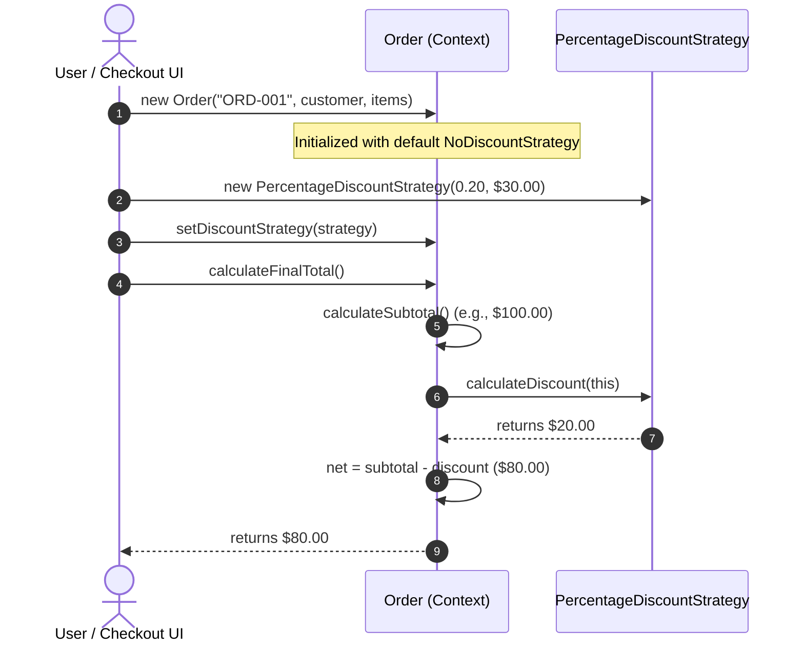

# Example 01: Discount Calculation (E-Commerce Pricing)

## 1. The Problem

An e-commerce checkout engine must calculate promotional discounts for customer carts. Promotional campaigns vary significantly across business initiatives:
- **Flat dollar discounts:** $15 off if cart subtotal is at least $50.
- **Percentage discounts:** 20% off total cart value, capped at a maximum of $40.
- **Volume/Tiered discounts:** 5% off for carts with > 5 items, 10% off for > 10 items.
- **VIP Customer loyalty discounts:** Base 15% discount plus bonus dollars earned from accumulated customer loyalty points.
- **Flash/Seasonal promotions:** Dynamic or ad-hoc marketing campaigns.

If modeled using conditional branching (`switch` or `if-else`), the `Order` class quickly becomes a monolithic maintenance nightmare.

---

## 2. Bad Design Analysis

In `bad/Order.java`, discount calculations are hardcoded into a single `switch` statement based on `DiscountType`:

```java
public BigDecimal calculateDiscount(DiscountType discountType) {
    switch (discountType) {
        case FLAT_10:
            if (subtotal.compareTo(new BigDecimal("50.00")) >= 0) {
                return new BigDecimal("10.00");
            }
            return BigDecimal.ZERO;
        case PERCENTAGE_20:
            BigDecimal discount = subtotal.multiply(new BigDecimal("0.20"));
            return discount.min(new BigDecimal("40.00"));
        case VIP_LOYALTY:
            // Math for VIPs and points
            ...
    }
}
```

### Why This Design Fails
1. **Violation of Open/Closed Principle (OCP):** Introducing a new promotional campaign (e.g., `BUY_ONE_GET_ONE` or `HOLIDAY_SALE`) forces modifications to `Order.java` and `DiscountType.java`. Existing, production-tested checkout code is risked.
2. **Violation of Single Responsibility Principle (SRP):** The `Order` class is burdened with both order management (items, customer, subtotal) and mathematical formulas for every discount variant.
3. **No Dynamic Strategy Switching:** You cannot pass a dynamic rule or lambda; the system is constrained by hardcoded enum branches.
4. **Poor Testability:** Testing the 20% percentage discount cap requires instantiating an entire `Order` with items and testing through `Order.calculateDiscount(...)`. The algorithm cannot be unit tested in isolation.

---

## 3. Improved Design (Strategy Pattern)

The improved design in `good/` models discount algorithms as interchangeable strategies conforming to a common interface:

```
[ Order (Context) ] ──> delegates to ──> [ DiscountStrategy (Interface) ]
                                                ▲
         ┌───────────────────┬──────────────────┴──────────────────┬─────────────────┐
         │                   │                                     │                 │
[ FlatDiscountStrategy ] [ PercentageDiscountStrategy ] [ TieredVolumeDiscountStrategy ] [ VipCustomerDiscountStrategy ]
```

### Participants
- **Strategy Interface (`DiscountStrategy`):** Declares `BigDecimal calculateDiscount(Order order)`.
- **Concrete Strategies:**
  - `NoDiscountStrategy`: Default fallback returning `0.00`.
  - `FlatDiscountStrategy`: Deducts a flat monetary amount subject to a minimum subtotal.
  - `PercentageDiscountStrategy`: Deducts a percentage with an optional maximum cap.
  - `TieredVolumeDiscountStrategy`: Calculates volume-based tier discounts based on cart item count.
  - `VipCustomerDiscountStrategy`: Rewards VIP customers with percentage discounts and loyalty point bonuses.
- **Context (`Order`):** Encapsulates order items and customer information. Aggregates a `DiscountStrategy` reference and exposes `setDiscountStrategy(DiscountStrategy)` to allow runtime swapping.

---

## 4. Execution Flow: How Runtime Swapping Works



### Explanation of Sequence
1. The checkout process initializes an `Order`. By default, it uses `NoDiscountStrategy`.
2. When the customer enters a coupon code, the checkout controller instantiates `PercentageDiscountStrategy` and calls `order.setDiscountStrategy(strategy)`.
3. When `calculateFinalTotal()` is invoked, `Order` computes the subtotal and delegates to `strategy.calculateDiscount(this)`.
4. The strategy executes its isolated logic and returns the discount amount.
5. The `Order` subtracts the discount from the subtotal and returns the final payable total.

---

## 5. Relationship to SOLID Principles

- **Open/Closed Principle (OCP):** Adding a new promotional strategy (e.g., `EmployeeDiscountStrategy`) requires creating a single new class. Zero lines of existing order or strategy code are modified.
- **Single Responsibility Principle (SRP):** `Order` manages cart state and delegating calculation. Each strategy class manages its own isolated mathematical algorithm.
- **Dependency Inversion Principle (DIP):** `Order` depends on the `DiscountStrategy` interface, never on concrete classes like `FlatDiscountStrategy`.
- **Liskov Substitution Principle (LSP):** Any implementation of `DiscountStrategy` can be plugged into `Order` without altering the correctness of `calculateFinalTotal()`.
