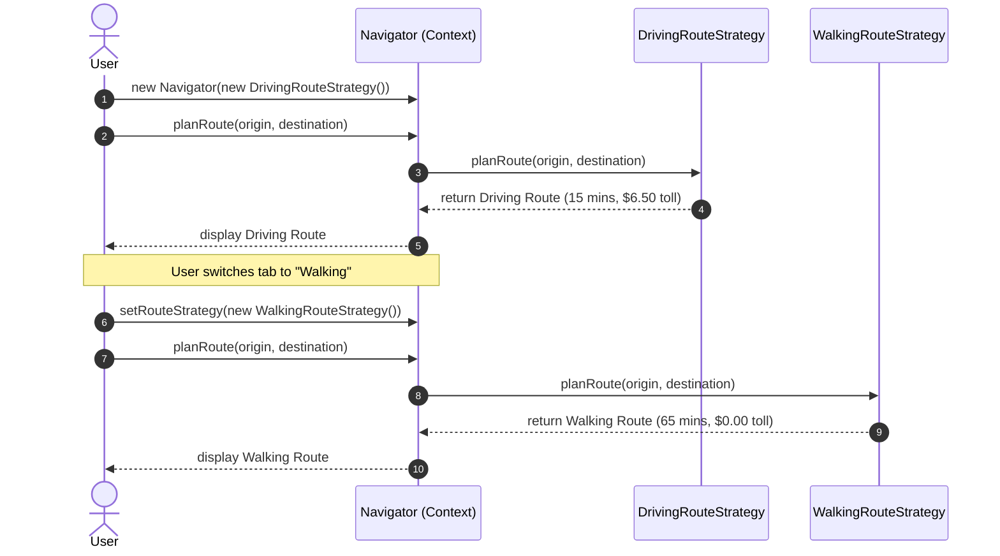

# Example 02: Route Selection (GPS Navigation Engine)

## 1. The Problem

A GPS navigation application (similar to Google Maps or Apple Maps) must compute optimal routing itineraries between two coordinates. Users travel using widely different modalities:
- **Driving:** High speeds, highway preferred, sensitive to live traffic congestion, subject to electronic toll charges.
- **Walking:** Pedestrian sidewalks, cuts through public parks, strictly prohibits highways, zero tolls.
- **Bicycling:** Dedicated bike lanes, greenways, elevation/grade avoidance, moderate speeds.
- **Public Transit:** Multimodal combination of walking, train line schedules, transfer wait times, fixed ticket fares.

If all routing rules are embedded into a single `Navigator` class with conditional branching, the engine quickly becomes brittle, unmaintainable, and impossible to scale.

---

## 2. Bad Design Analysis

In `bad/Navigator.java`, all routing logic is concentrated into a single monolithic method:

```java
public Route buildRoute(Coordinate origin, Coordinate destination, TravelMode mode) {
    switch (mode) {
        case DRIVING:
            // Calculate highway routes, traffic multiplier, toll costs
            ...
        case WALKING:
            // Calculate sidewalk paths, parks, 4.8 km/h pace
            ...
        case BICYCLING:
            // Calculate cycle paths, bike lanes
            ...
        case PUBLIC_TRANSIT:
            // Calculate train transfers, bus connections, ticket fares
            ...
    }
}
```

### Why This Design Fails
1. **Violation of the Open/Closed Principle (OCP):** Adding a new mode (e.g., Electric Scooter, Ferry, or Aerial Cable Car) requires modifying `Navigator.java` and `TravelMode.java`. This risks introducing bugs into existing, stable vehicle routing routines.
2. **Violation of the Single Responsibility Principle (SRP):** `Navigator` is responsible for user navigation coordination *and* the fine details of highway traffic algorithms, sidewalk restrictions, transit schedule intervals, and toll calculations.
3. **High Coupling:** Unit testing walking routes requires loading the entire class containing vehicular toll calculation rules and transit timetable code.

---

## 3. Improved Design (Strategy Pattern)

The improved design in `good/` isolates each transportation algorithm into a concrete strategy conforming to the `RouteStrategy` interface:

```
[ Navigator (Context) ] ──> delegates to ──> [ RouteStrategy (Interface) ]
                                                    ▲
         ┌───────────────────┬──────────────────────┴───────────────────┬──────────────────────┐
         │                   │                                          │                      │
[ DrivingRouteStrategy ] [ WalkingRouteStrategy ]             [ BicyclingRouteStrategy ] [ PublicTransitRouteStrategy ]
```

### Participants
- **Strategy Abstraction (`RouteStrategy`):** Declares `Route planRoute(Coordinate origin, Coordinate destination)`.
- **Concrete Strategies:**
  - `DrivingRouteStrategy`: Calculates driving path, traffic congestion multiplier, and highway tolls.
  - `WalkingRouteStrategy`: Selects pedestrian paths, avoids highways, zero toll cost.
  - `BicyclingRouteStrategy`: Selects protected cycle tracks and greenways.
  - `PublicTransitRouteStrategy`: Models scheduled train and bus transfers with fare calculation.
- **Context (`Navigator`):** Aggregates a `RouteStrategy` and exposes `setRouteStrategy()`, enabling seamless runtime mode switching.

---

## 4. Execution Flow: Switching Travel Modes



### Explanation of Sequence
1. The user initially requests directions by car. The `Navigator` delegates to `DrivingRouteStrategy`.
2. When the user taps the pedestrian icon in the app, the UI calls `navigator.setRouteStrategy(new WalkingRouteStrategy())`.
3. The next invocation of `planRoute()` transparently executes the walking algorithm without changing the `Navigator`'s internal structure.

---

## 5. Relationship to SOLID Principles

- **Open/Closed Principle (OCP):** Introducing a new transport mode (e.g., `FerryRouteStrategy`) requires only writing a new class implementing `RouteStrategy`. Existing code remains untouched.
- **Single Responsibility Principle (SRP):** Each strategy class focuses strictly on its own transportation medium.
- **Dependency Inversion Principle (DIP):** The `Navigator` depends exclusively on the `RouteStrategy` interface, never on concrete routing implementations.
- **Liskov Substitution Principle (LSP):** Any `RouteStrategy` can substitute another without altering the correctness of `Navigator.planRoute()`.
