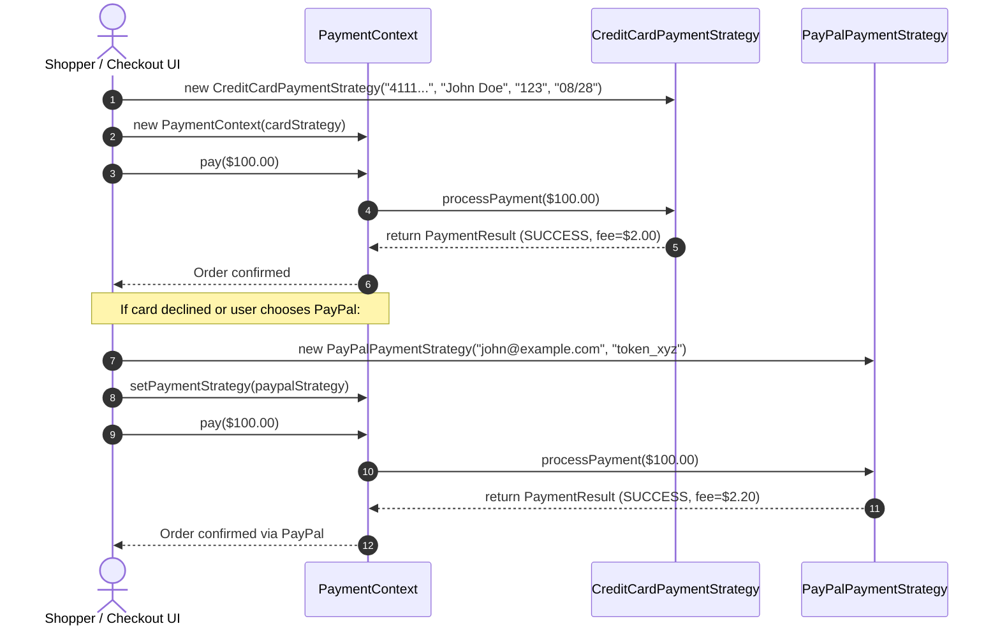

# Example 03: Payment Processing (E-Commerce Gateway)

## 1. The Problem

An online retail system must support diverse checkout payment methods:
- **Credit / Debit Cards:** Card number, CVV, expiry date, 3D Secure verification, processing interchange fee.
- **PayPal:** Account email, OAuth authorization token, flat + percentage fee structure.
- **UPI (Unified Payments Interface):** Virtual Payment Address (VPA), MPIN credential verification, zero consumer surcharge.
- **Cryptocurrency:** Blockchain wallet address, network gas fee estimation, broadcast confirmation.

In a naive implementation, payment processing is placed inside a central `PaymentService` class that accepts an untyped dictionary/map of credentials and executes a monolithic switch statement.

---

## 2. Bad Design Analysis

In `bad/PaymentService.java`, all payment methods are handled in one switch block:

```java
public PaymentResult processPayment(PaymentType type, BigDecimal amount, Map<String, String> credentials) {
    switch (type) {
        case CREDIT_CARD:
            // extract cardNumber, cvv, expiry
            ...
        case PAYPAL:
            // extract email, authToken
            ...
        case UPI:
            // extract upiId, pin
            ...
        case CRYPTO:
            // extract walletAddress, network
            ...
    }
}
```

### Why This Design Fails
1. **Violation of Open/Closed Principle (OCP):** Supporting a new payment gateway (e.g., Apple Pay, Klarna, or Stripe ACH) requires editing `PaymentService.java` and `PaymentType.java`. Existing, sensitive financial code is reopened and modified.
2. **Violation of Single Responsibility Principle (SRP):** `PaymentService` must know how to validate credit card Luhn algorithms, inspect PayPal OAuth headers, parse UPI VPAs, and handle crypto gas limits.
3. **Security Vulnerability (Untyped Map of Secrets):** The calling code passes an unstructured `Map<String, String>` containing card numbers, passwords, CVVs, and private keys. There is no type safety, and sensitive details can easily leak into logs or exception traces.
4. **Poor Testability:** Testing card validation requires calling the monolithic service with string map keys, making it impossible to unit-test each gateway in isolation.

---

## 3. Improved Design (Strategy Pattern)

The improved design in `good/` isolates each payment method into its own concrete strategy class. Each strategy encapsulates its own private, strongly-typed credentials:

```
[ PaymentContext (Checkout Engine) ] ──> delegates to ──> [ PaymentStrategy (Interface) ]
                                                                 ▲
            ┌──────────────────────┬─────────────────────────────┴───────────────────────┬────────────────────────┐
            │                      │                                                     │                        │
[ CreditCardPaymentStrategy ] [ PayPalPaymentStrategy ]                        [ UpiPaymentStrategy ] [ CryptoPaymentStrategy ]
```

### Participants
- **Strategy Interface (`PaymentStrategy`):** Declares `PaymentResult processPayment(BigDecimal amount)`.
- **Concrete Strategies:**
  - `CreditCardPaymentStrategy`: Privately stores `cardNumber`, `cvv`, `expiryDate`; calculates interchange fee.
  - `PayPalPaymentStrategy`: Privately stores `accountEmail`, `authToken`; validates email format.
  - `UpiPaymentStrategy`: Privately stores `upiId`, `mpin`; verifies VPA pattern.
  - `CryptoPaymentStrategy`: Privately stores `walletAddress`, `networkName`, `estimatedGasFee`.
- **Context (`PaymentContext`):** High-level checkout engine. It does **not** know card numbers, PINs, or gateway tokens. It simply calls `paymentStrategy.processPayment(amount)`.
- **Dynamic Swapping:** If a customer's credit card fails, the UI simply calls `context.setPaymentStrategy(new PayPalPaymentStrategy(...))` and retries.

---

## 4. Execution Flow: Encapsulated Payment Processing



### Explanation of Sequence
1. The shopper selects Credit Card at checkout. The card credentials are typed and sealed inside `CreditCardPaymentStrategy`.
2. The `PaymentContext` only receives the generic `PaymentStrategy` interface.
3. If the card declines or the customer wishes to switch to PayPal, `context.setPaymentStrategy()` allows changing the payment rail with zero changes to the underlying checkout flow.

---

## 5. Relationship to SOLID Principles

- **Open/Closed Principle (OCP):** Introducing a new gateway (e.g., `ApplePayStrategy`) requires adding one new class. Neither `PaymentContext` nor existing strategies are altered.
- **Single Responsibility Principle (SRP):** Each strategy manages its own validation, communication protocol, and fee rules. `PaymentContext` focuses solely on transaction orchestration.
- **Dependency Inversion Principle (DIP):** The checkout workflow depends on the `PaymentStrategy` abstraction rather than low-level banking SDKs.
- **Interface Segregation Principle (ISP):** The strategy interface is minimal and focused: one clean method `processPayment(BigDecimal amount)`.
