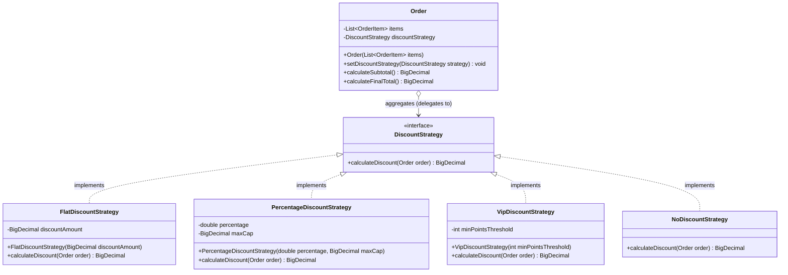
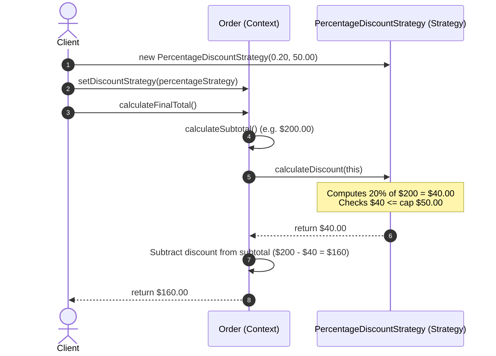

# Strategy Design Pattern

The **Strategy Pattern** is a behavioral design pattern from the Gang of Four (GoF). It defines a family of algorithms, encapsulates each one in a separate class, and makes them interchangeable at runtime. 

In simple terms: **Strategy lets the algorithm vary independently from the clients that use it.**

---

## 1. What is Strategy and Why Do We Need It?

### The Core Idea
In software development, there are often multiple ways to accomplish the same high-level task. For instance:
- **Sorting data:** QuickSort, MergeSort, or TimSort.
- **Calculating discounts:** Flat dollar discount, percentage discount, or loyalty tier discount.
- **Routing a trip:** Fastest driving route, scenic bicycling route, or public transit.
- **Processing payments:** Credit card, PayPal, or UPI.

Without a design pattern, developers typically put all these algorithms into a single class using conditional statements (`if-else` or `switch`). 

While this seems simple initially, it quickly leads to **fragile, bloated, and hard-to-maintain code**. Every time business requirements change (e.g., adding a holiday sale discount or updating credit card processing), you must open and modify the same monolithic class.

### Why Do We Need the Strategy Pattern?
The Strategy pattern solves this problem by separating **what needs to be done** from **how it is done**:

1. A **Context class** represents the overall business workflow (e.g., `ShoppingCart` or `Navigator`).
2. A **Strategy interface** declares a generic contract for the algorithm (e.g., `DiscountStrategy` or `RouteStrategy`).
3. Each algorithm variation is extracted into its own class called a **Concrete Strategy** (e.g., `PercentageDiscount` or `DrivingRoute`).
4. The Context holds a reference to a Strategy interface and delegates the algorithm execution to it.
5. The client can swap strategies dynamically at runtime without altering the Context.

---

## 2. Real-Life Analogy: Commuting to the Airport

Imagine you need to travel from your apartment to the international airport:

```
+----------------------------------------------------------------+
|                        Traveler (Context)                      |
|  - Goal: Reach the airport on time                             |
|  - Action: Execute selected travel strategy                    |
+----------------------------------------------------------------+
                               │
               ┌───────────────┼───────────────┐
               ▼               ▼               ▼
      +----------------+ +---------------+ +----------------+
      | Driving (Car)  | | Public Transit| | Bicycling      |
      | - Fastest      | | - Predictable | | - Zero emissions |
      | - Highway toll | | - Low cost    | | - Weather dep. |
      +----------------+ +---------------+ +----------------+
```

1. **The Goal (Context):** You need to reach the airport. That high-level objective never changes.
2. **The Strategies (Algorithms):**
   - **Driving personal car:** Fast, requires parking fee, prone to traffic jams.
   - **Taking the subway/train:** Fixed schedule, cost-effective, immune to road gridlock.
   - **Calling a ride-share (Uber/Taxi):** Convenient, variable surge pricing.
   - **Bicycling:** Zero fuel, active exercise, viable only if traveling light.
3. **Interchangeability at Runtime:** If you wake up and discover heavy snowfall, you switch your strategy from driving to the subway. You do not change who you are (the Traveler); you simply swap your commuting strategy.

In software terms:
- **Traveler:** The **Context**.
- **CommuteMethod:** The **Strategy Interface**.
- **Driving, Subway, RideShare:** The **Concrete Strategies**.

---

## 3. The Problem Without the Pattern

Let us examine what code looks like when we do not use the Strategy pattern. 

Suppose an e-commerce platform calculates final order totals with various discounts:

```java
public class OrderService {

    public double calculateTotal(Order order, String discountType) {
        double subtotal = order.getSubtotal();
        double discount = 0.0;

        // Monolithic conditional branching
        if (discountType.equalsIgnoreCase("FLAT_10")) {
            discount = 10.0;
        } else if (discountType.equalsIgnoreCase("PERCENTAGE_20")) {
            discount = subtotal * 0.20;
            if (discount > 50.0) { // Max discount cap
                discount = 50.0;
            }
        } else if (discountType.equalsIgnoreCase("VIP_TIER")) {
            if (order.getCustomer().getLoyaltyPoints() > 500) {
                discount = subtotal * 0.15 + 25.0;
            } else {
                discount = subtotal * 0.05;
            }
        } else if (discountType.equalsIgnoreCase("SEASONAL_CLEARANCE")) {
            discount = subtotal * 0.40;
        } else if (discountType.equalsIgnoreCase("NONE")) {
            discount = 0.0;
        } else {
            throw new IllegalArgumentException("Unknown discount type: " + discountType);
        }

        // Apply discount and return net total
        double total = subtotal - discount;
        return total > 0 ? total : 0.0;
    }
}
```

### Why This Design Fails
1. **Violation of the Open/Closed Principle (OCP):** When marketing introduces a new "Flash Sale" discount, you must open `OrderService.java` and add another `else-if` branch. Modifying existing, production-tested code risks introducing regressions.
2. **Violation of the Single Responsibility Principle (SRP):** `OrderService` is responsible for order orchestration *and* the intimate mathematical calculations for flat discounts, percentage caps, and VIP loyalty formulas.
3. **Difficult Testing:** Testing one specific discount rule requires creating dummy `Order` objects and exercising the entire `OrderService` method. You cannot isolate algorithms in dedicated test suites.
4. **No Runtime Flexibility:** The calling code has to pass magic strings (`"VIP_TIER"`, `"PERCENTAGE_20"`). If the strategy needs to change mid-session based on a newly applied coupon code, you have to re-evaluate the entire conditional ladder.

---

## 4. How Strategy Solves the Problem Step by Step

The Strategy pattern replaces conditional branching with **polymorphism and composition**:

```
Step 1: Extract the Strategy Interface
        [ DiscountStrategy ]  <-- Contract: BigDecimal calculateDiscount(Order order)

Step 2: Create Concrete Strategies for Each Algorithm
        [ FlatDiscountStrategy ]
        [ PercentageDiscountStrategy ]
        [ VipDiscountStrategy ]
        [ NoDiscountStrategy ]

Step 3: Introduce the Context Class
        [ Order ] or [ CheckoutCart ]
        - holds reference to DiscountStrategy
        - delegates calculation: discountStrategy.calculateDiscount(this)
        - allows strategy switching: setDiscountStrategy(newStrategy)

Step 4: Client Injects the Strategy
        Order order = new Order(items);
        order.setDiscountStrategy(new PercentageDiscountStrategy(0.20, 50.0));
        BigDecimal finalTotal = order.calculateFinalTotal();
```

### Step-by-Step Breakdown

1. **Step 1: Declare the Strategy Interface (`DiscountStrategy`)**
   Define a uniform method signature that all algorithms must implement. In our case: `BigDecimal calculateDiscount(Order order)`.
2. **Step 2: Implement Concrete Strategies**
   Extract each calculation formula into its own dedicated class implementing `DiscountStrategy`.
3. **Step 3: Compose Strategy into the Context (`Order`)**
   The Context stores a private reference to `DiscountStrategy`. Instead of computing the discount itself, it calls `strategy.calculateDiscount(this)`.
4. **Step 4: Provide Runtime Strategy Swapping**
   Expose a setter (`setDiscountStrategy`) or constructor parameter allowing clients to configure or replace the strategy at any time.

---

## 5. Class Diagram and Sequence Diagram

### Class Diagram



#### Explanation of Class Diagram
- **`DiscountStrategy`:** The common interface declaring `calculateDiscount()`.
- **`FlatDiscountStrategy`, `PercentageDiscountStrategy`, etc.:** Concrete implementations with their own encapsulated parameters (e.g., maximum cap, percentage).
- **`Order` (Context):** Has a `1` association to `DiscountStrategy`. It delegates the discount calculation to whichever strategy instance is currently assigned.
- **Loose Coupling:** `Order` knows nothing about concrete classes like `FlatDiscountStrategy`; it depends strictly on the abstraction.

---

### Sequence Diagram: Runtime Delegation



#### Explanation of Sequence Diagram
1. The **Client** creates a `PercentageDiscountStrategy` configured with 20% off and a $50 cap.
2. The Client injects this strategy into the `Order` (Context).
3. The Client asks `Order` for the final total via `calculateFinalTotal()`.
4. The `Order` computes the raw item subtotal, then delegates the discount calculation to the active `DiscountStrategy`.
5. The strategy executes its proprietary algorithm and returns the discount amount.
6. The `Order` subtracts the discount from the subtotal and delivers the final price to the client.

---

## 6. Participant Responsibilities

| Participant | Role | Primary Responsibility | Example in Our Code |
| :--- | :--- | :--- | :--- |
| **Strategy Interface** | Abstraction | Declares the common method signature shared by all algorithmic variations. | `DiscountStrategy` |
| **Concrete Strategy** | Implementation | Encapsulates a single specific algorithm and any data required to execute it. | `PercentageDiscountStrategy`, `FlatDiscountStrategy` |
| **Context** | Orchestrator | Maintains a reference to a Strategy object; delegates calculation to it; may allow swapping strategies. | `Order`, `Navigator`, `PaymentContext` |
| **Client** | Assembler | Chooses the appropriate concrete strategy and passes it to the Context. | Application controller, service layer |

---

## 7. Relationships Between Classes and Why They Exist

### Composition Over Inheritance
A common mistake beginners make is subclassing the Context to vary behavior:
- `FlatDiscountOrder extends Order`
- `PercentageDiscountOrder extends Order`

This approach fails quickly:
- **Combinatorial explosion:** What if an order can be an `ExpressShippingOrder` AND a `PercentageDiscountOrder`? Multiple inheritance is not allowed in Java.
- **Static binding:** Subclasses are hardcoded at compile time. You cannot change an order's discount after instantiating it.

The Strategy pattern uses **Composition** (`Order has-a DiscountStrategy`). This allows:
1. Dynamic runtime swapping: An order can switch strategies when the user enters or removes a promo code.
2. Independent testing: Each strategy can be tested in complete isolation with mock order data.
3. Reusability: The same `PercentageDiscountStrategy` can be reused by an `InvoiceService` or a `QuoteEngine`.

---

## 8. Side-by-Side Comparison: Bad vs Good Design

| Dimension | Bad Design (Monolithic Conditionals) | Good Design (Strategy Pattern) |
| :--- | :--- | :--- |
| **Algorithm Location** | Hardcoded directly inside context methods (`if/else` or `switch`). | Encapsulated inside isolated Strategy classes. |
| **Adding New Algorithms** | Must modify existing code in Context (violates OCP). | Add a new class implementing the interface (satisfies OCP). |
| **Modifying an Algorithm** | Risk breaking unrelated algorithms sharing the same file. | Modify only the relevant strategy class without side-effects. |
| **Runtime Swapping** | Requires complicated conditional state flags. | Trivial: call `context.setStrategy(newStrategy)`. |
| **Unit Testing** | Complex: must exercise the entire Context class. | Simple: unit test each strategy class in total isolation. |
| **Code Length per Class** | One massive class that grows indefinitely. | Small, focused classes adhering to SRP. |

### Code Comparison

#### Bad Design (Conditionals inside Context)
```java
public double calculateFee(String vehicleType, double distance) {
    if (vehicleType.equals("CAR")) {
        return distance * 1.5 + 5.0;
    } else if (vehicleType.equals("BIKE")) {
        return distance * 0.5;
    } else {
        throw new IllegalArgumentException();
    }
}
```

#### Good Design (Strategy Pattern)
```java
// Common Abstraction
public interface FeeStrategy {
    double calculateFee(double distance);
}

// Concrete Implementations
public class CarFeeStrategy implements FeeStrategy {
    public double calculateFee(double distance) { return distance * 1.5 + 5.0; }
}

public class BikeFeeStrategy implements FeeStrategy {
    public double calculateFee(double distance) { return distance * 0.5; }
}

// Context delegates to strategy
public class Ride {
    private FeeStrategy feeStrategy;
    public double getCost(double distance) {
        return feeStrategy.calculateFee(distance);
    }
}
```

---

## 9. SOLID Principles Genuinely Demonstrated

The Strategy Pattern is a textbook implementation of multiple SOLID principles:

### 1. Open/Closed Principle (OCP)
- **Open for Extension:** Adding a new algorithm (e.g., `CryptoPaymentStrategy` or `HolidayDiscountStrategy`) is done by adding a new class.
- **Closed for Modification:** The `Order` or `PaymentProcessor` context class is **never modified**.

### 2. Single Responsibility Principle (SRP)
- The Context is responsible only for orchestrating the business entity.
- Each Strategy class is responsible solely for executing its specific algorithm.

### 3. Dependency Inversion Principle (DIP)
- High-level modules (`Order`) do not depend on low-level modules (`PercentageDiscountStrategy`).
- Both depend on the abstraction (`DiscountStrategy`).

### 4. Liskov Substitution Principle (LSP)
- Any concrete strategy can replace any other concrete strategy without breaking the Context's assumptions or runtime correctness.

---

## 10. When to Use It and When NOT to Use It

### When to Use Strategy
- **Multiple algorithm variants:** You have several variations of an algorithm (e.g., different compression algorithms, encryption formats, or sorting techniques).
- **Runtime algorithm switching:** You need to switch algorithms dynamically based on user input, system load, or configuration.
- **Eliminating conditional branches:** You find yourself writing large `switch` or nested `if-else` blocks that check an enum or string type to select behavior.
- **Isolating business formulas:** You want to isolate complex mathematical calculations or third-party SDK calls from core domain entities.

### When NOT to Use Strategy
- **Only 1 or 2 static algorithms:** If an algorithm will never change and has only one implementation, adding interfaces and multiple classes is over-engineering.
- **Algorithms rarely vary:** If a simple conditional statement (`if (isTaxExempt) ...`) suffices and will not grow, keep it simple.
- **Functional alternatives in modern Java:** If the algorithm has no state and is a single method, passing a lambda expression (e.g., `Function<Order, BigDecimal>`) is often cleaner than declaring full classes.

---

## 11. Benefits, Limitations, and Trade-offs

### Benefits
1. **Clean Code:** Eliminates messy conditional statements (`switch`, `if-else`).
2. **Independent Testability:** Strategies can be tested with 100% unit test coverage in complete isolation.
3. **Pluggability:** New strategies can be loaded dynamically, even via configuration files or dependency injection.
4. **Encapsulation:** Algorithms and their internal helper methods are tucked away inside private strategy packages.

### Limitations & Trade-offs
1. **Increased Number of Classes:** Every new strategy requires a new `.java` file, increasing project surface area.
2. **Client Awareness Required:** Clients must know the differences between strategies to select the right one (mitigated by combining with Factory patterns).
3. **Communication Overhead:** The Strategy interface must pass enough context data (e.g., the `Order` or individual parameters) so all concrete strategies have what they need.

---

## 12. How to Recognize Incorrect Use of Strategy

### Anti-Pattern 1: Leaking Strategy Type into the Context
```java
// WRONG: Context switches on strategy type
public void process(PaymentStrategy strategy) {
    if (strategy instanceof CreditCardStrategy) {
        // do specific credit card setup
    }
}
```
*Why it fails:* Defeats polymorphism. The Context should call interface methods blindly.

### Anti-Pattern 2: Stateful / Non-Thread-Safe Strategies Shared Across Threads
```java
// DANGEROUS: Strategy keeps mutable request state in instance fields
public class OrderDiscountStrategy implements DiscountStrategy {
    private double lastDiscountApplied; // Shared mutable state bug!
}
```
*Why it fails:* Strategies should either be stateless (preferred) or instantiated per context to prevent race conditions in multi-threaded servers.

### Anti-Pattern 3: Massive Over-Engineering for Simple Lambdas
Creating 5 classes for simple one-line mathematical operations when a standard `java.util.function.UnaryOperator<Double>` would suffice.

---

## 13. Strategy vs Similar Patterns

| Dimension | Strategy | State | Command | Template Method |
| :--- | :--- | :--- | :--- | :--- |
| **Intent** | Swap interchangeable algorithms. | Change behavior based on internal state transitions. | Encapsulate an operation/request as an object (with undo/redo/queueing). | Define algorithm skeleton in base class, defer steps to subclasses. |
| **Coupling** | Strategies are usually unaware of each other. | States frequently know about and trigger transitions to next states. | Commands can be queued, logged, or undone. | Uses inheritance; steps are overridden in subclasses. |
| **Mechanism** | Object Composition. | Object Composition. | Object Composition. | Class Inheritance (`extends`). |
| **Awareness** | Context passes data to strategy. | State often updates context's current state pointer. | Invoker executes command without knowing receiver details. | Base class calls abstract methods implemented by subclass. |

---

## 14. Real-World Interview Questions & Clear Answers

### Q1: How does the Strategy pattern achieve the Open/Closed Principle?
**Answer:** It achieves OCP by defining an abstract strategy interface. When new algorithm variants are needed, you write new classes that implement that interface. The Context class and existing strategy classes remain completely untouched.

### Q2: What is the difference between Strategy and State patterns?
**Answer:** While both use composition and share similar class diagrams, their **intent** differs:
- In **Strategy**, the client actively chooses or configures the strategy to vary *how* a task is performed. Strategies are independent and do not transition into one another.
- In **State**, the Context's behavior changes automatically as its internal state changes (e.g., from `Draft` $\rightarrow$ `Published`). Concrete states often trigger state transitions themselves.

### Q3: How do modern Java lambdas influence the Strategy pattern?
**Answer:** Because strategy interfaces typically have a single abstract method (SAM), they qualify as `@FunctionalInterface`. In Java 8+, clients can pass lambda expressions (e.g., `order.setDiscountStrategy(o -> o.getSubtotal().multiply(new BigDecimal("0.10")))`) or method references without creating dedicated concrete classes for simple cases.

### Q4: Can a Strategy access private fields of the Context?
**Answer:** No. Strategies should interact with the Context solely through its public API (getters). If a strategy requires extensive internal data, you can pass specific parameters into the strategy method instead of passing the entire Context object.

---

## 15. Final Revision Checklist

Use this checklist during system design interviews and code reviews:

- [ ] **Interface Defined:** Is there a clean Strategy interface declaring the algorithmic method?
- [ ] **Composition Used:** Does the Context hold a reference to the Strategy interface rather than using inheritance?
- [ ] **No `switch` or `instanceof`:** Is the Context completely free of conditional checks that branch on strategy types?
- [ ] **Runtime Swappable:** Can the Strategy be replaced via constructor injection or a setter method?
- [ ] **Stateless Strategies:** Are strategies thread-safe and stateless unless explicitly tied to a single context instance?
- [ ] **OCP Verified:** Can a developer add a new strategy by creating a new file without editing any existing classes?
- [ ] **Unit Tests Isolated:** Are concrete strategies tested independently with focused test cases and edge cases?
