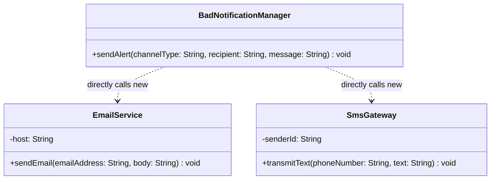
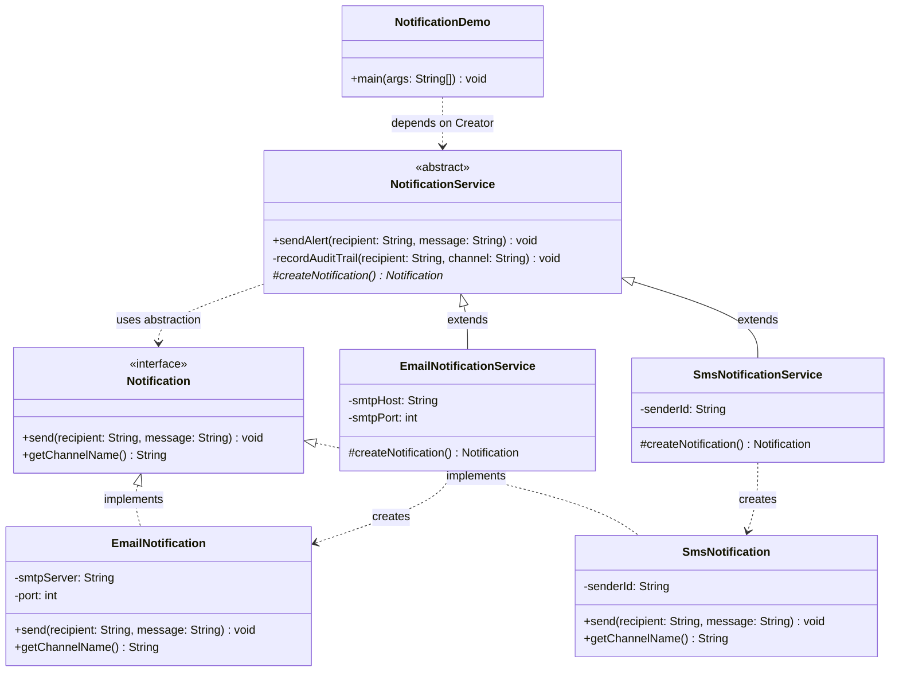

# Example 01: Notification Creation (Email and SMS)

## 1. The Problem in Simple Words

Modern software applications constantly send messages to users—security codes, payment confirmations, and system alerts. Initially, an app might only send **Emails**. Later, the team adds **SMS**. Soon, they will want **Slack**, **Push notifications**, or **WhatsApp**.

If the notification dispatch logic is written with a monolithic class full of `if-else` or `switch` statements, the code quickly turns into a fragile mess. Every time a new communication channel is introduced, developers must edit existing, tested code, increasing the risk of regressions across all channels.

---

## 2. The Bad Approach and Its Limitations

In `bad/BadNotificationManager.java`, the system tries to manage both **business workflows** (validation, auditing) and **direct instantiation** (connecting to SMTP servers or SMS gateways):

```java
switch (channelType.toUpperCase()) {
    case "EMAIL" -> {
        EmailService emailService = new EmailService("smtp.internal.corp");
        emailService.sendEmail(recipient, message);
    }
    case "SMS" -> {
        SmsGateway smsGateway = new SmsGateway("CORP-ALERT");
        smsGateway.transmitText(recipient, message);
    }
    default -> throw new IllegalArgumentException("Unsupported channel: " + channelType);
}
```

### Class Diagram of the Bad Approach



*Explanation of the bad diagram:*
`BadNotificationManager` depends directly on concrete low-level transport classes `EmailService` and `SmsGateway`. There is no abstraction layer.

### Limitations of the Bad Approach
1. **Violation of Open/Closed Principle (OCP):** Supporting a new channel (e.g., WhatsApp) requires opening `BadNotificationManager` and adding another `case` branch.
2. **Violation of Single Responsibility Principle (SRP):** The manager is responsible for notification business rules *and* low-level carrier/server configuration.
3. **No Common Interface:** `EmailService.sendEmail(...)` and `SmsGateway.transmitText(...)` have different method signatures and connection mechanics.
4. **Lack of Type Safety:** Relying on magic strings (`"EMAIL"`, `"SMS"`) leads to typos and runtime exceptions.

---

## 3. The Improved Design (Factory Method Step by Step)

The improved implementation in `good/` resolves these issues using the GoF Factory Method pattern:

```
Step 1: Extract the Product Abstraction (Notification interface)
Step 2: Implement Concrete Products (EmailNotification, SmsNotification)
Step 3: Define the Abstract Creator (NotificationService with sendAlert workflow)
Step 4: Implement Concrete Creators (EmailNotificationService, SmsNotificationService)
```

### Class Diagram of the Good Implementation



*Explanation of the good diagram:*
- `Notification` is the product interface.
- `EmailNotification` and `SmsNotification` implement this interface.
- `NotificationService` handles validation and auditing in `sendAlert()`, delegating object creation to `#createNotification()`.
- `EmailNotificationService` and `SmsNotificationService` subclass `NotificationService` and override `#createNotification()` to return their specific notification objects.

---

## 4. Explanation of Every Class and Relationship

| Class | Role | Description |
| :--- | :--- | :--- |
| **`Notification`** | Product Interface | Declares common operations (`send()`, `getChannelName()`). The creator workflow only speaks to this interface. |
| **`EmailNotification`** | Concrete Product | Handles SMTP server connections, port configurations, and email delivery. |
| **`SmsNotification`** | Concrete Product | Handles telecom sender IDs, mobile routing, and text delivery. |
| **`NotificationService`** | Creator (Abstract) | Holds the general notification workflow (`sendAlert()`), which validates inputs, creates the product via `createNotification()`, sends the message, and writes audit logs. |
| **`EmailNotificationService`** | Concrete Creator | Subclasses `NotificationService` and provides the concrete instantiation of `EmailNotification`. |
| **`SmsNotificationService`** | Concrete Creator | Subclasses `NotificationService` and provides the concrete instantiation of `SmsNotification`. |
| **`NotificationDemo`** | Client | Entry point demonstrating how client code works exclusively through the `NotificationService` base abstraction. |

---

## 5. Why Factory Method Fits This Situation

1. **Shared Workflow with Differing Instantiation:** The alert workflow (validating recipient, checking message length, auditing dispatch) is uniform across all channels. Only the object being created changes.
2. **True Decoupling:** `NotificationService` does not have a single import or reference to `EmailNotification` or `SmsNotification`.
3. **Effortless Extensibility (OCP):** To add a `SlackNotificationService`, we simply write two new classes (`SlackNotification` and `SlackNotificationService`). We do not touch existing classes.

---

## 6. Trade-Offs and When This Pattern Would Be Unnecessary

### Trade-Offs
- **More Classes:** Introducing the pattern creates separate classes for the product, creator, and their subclasses.
- **Inheritance Rigidity:** Creators must inherit from `NotificationService`. If a service class already extends another base class, Java's single inheritance constraint requires composition or interfaces.

### When This Pattern Is Unnecessary
- If the application **only ever sends emails** and there is no roadmap or likelihood of adding SMS or other channels.
- If the notification object requires no channel-specific lifecycle or setup parameters.
- If a functional approach using `Supplier<Notification>` is sufficient:
  ```java
  public class NotificationService {
      private final Supplier<Notification> factory;
      public NotificationService(Supplier<Notification> factory) {
          this.factory = factory;
      }
      // ...
  }
  ```
