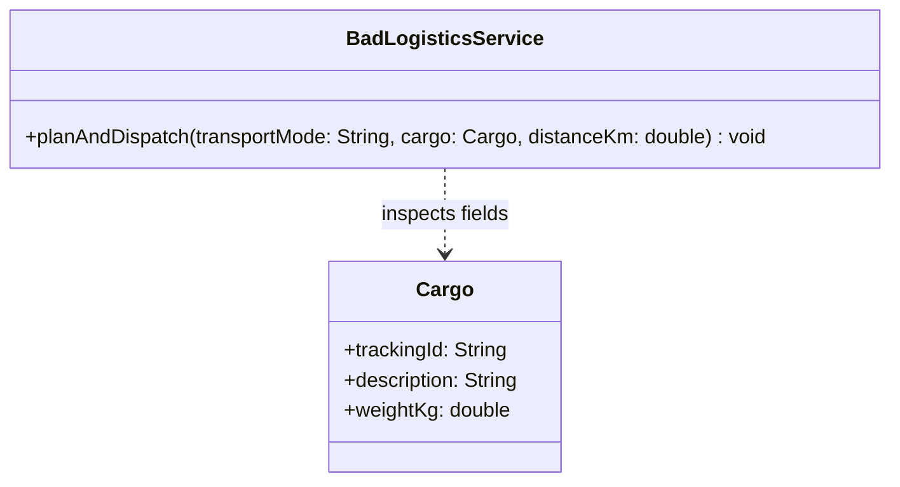
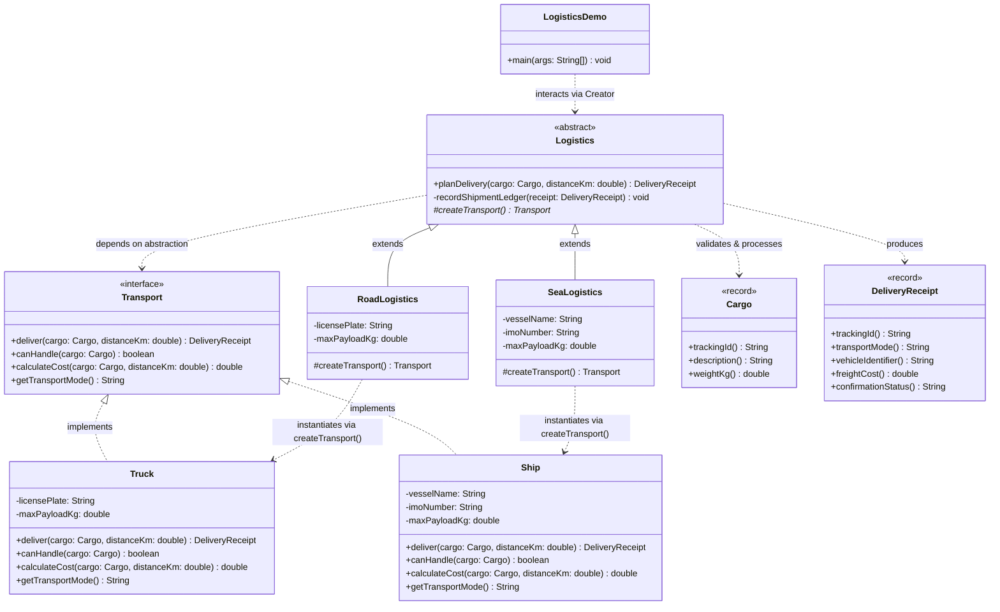

# Example 02: Logistics (Road Transport and Sea Transport)

## 1. The Problem in Simple Words

A global supply chain company manages freight shipments. Initially, the company operated only **Road Logistics**, delivering cargo across cities using **Trucks**. As business expanded overseas, they integrated **Sea Logistics** using cargo **Ships**. In the future, they plan to support **Air Cargo** and **Freight Trains**.

Every shipment requires a standard business workflow:
1. Validate cargo weight and dimensions.
2. Check if the transport vehicle has adequate capacity.
3. Compute pricing estimates (tolls, fuel, harbor fees).
4. Dispatch the carrier and generate a verified tracking receipt.
5. Log the dispatch event into the central corporate ledger.

If the system hardcodes `Truck` and `Ship` instantiation using conditional branches (`if (mode == "ROAD")`), the logistics service becomes bloated, brittle, and difficult to test.

---

## 2. The Bad Approach and Its Limitations

In `bad/BadLogisticsService.java`, a single monolithic class attempts to orchestrate both the shipping workflow and the creation/configuration of specific transport carriers:

```java
if (transportMode.equalsIgnoreCase("ROAD")) {
    if (cargo.weightKg() > 25000) { /* error */ }
    double totalCost = (distanceKm * 1.85) + 45.00;
    // Dispatches truck directly
} else if (transportMode.equalsIgnoreCase("SEA")) {
    if (cargo.weightKg() > 500000) { /* error */ }
    double totalCost = (distanceKm * 0.45) + 1200.00;
    // Dispatches ship directly
}
```

### Class Diagram of the Bad Approach



*Explanation of the bad diagram:*
`BadLogisticsService` concentrates all vehicle types, capacity rules, toll rates, and dispatch logic inside a single monolithic class. There are no transport abstractions or polymorphic creators.

### Limitations of the Bad Approach
1. **Violation of Open/Closed Principle (OCP):** Adding `AirLogistics` or `RailLogistics` requires modifying `BadLogisticsService.java` and adding more branches.
2. **Violation of Single Responsibility Principle (SRP):** The service simultaneously manages dispatch workflows, vehicle licensing, highway toll math, and maritime port fees.
3. **Rigid Configuration:** Different transport types need different configuration parameters (e.g., license plates vs IMO vessel numbers). Inlining them prevents clean dependency injection or fleet-specific configuration.
4. **Untestable Business Rules:** You cannot unit test the general planning algorithm without triggering concrete highway or maritime calculations.

---

## 3. The Improved Design (Factory Method Step by Step)

The improved implementation in `good/` applies the GoF Factory Method pattern:

```
Step 1: Extract the Product Interface (Transport)
Step 2: Implement Concrete Products (Truck, Ship)
Step 3: Define the Abstract Creator (Logistics with planDelivery workflow)
Step 4: Implement Concrete Creators (RoadLogistics, SeaLogistics)
```

### Class Diagram of the Good Implementation



*Explanation of the good diagram:*
- `Transport` defines the interface for all delivery carriers.
- `Truck` and `Ship` encapsulate road and ocean transit logic independently.
- `Logistics` contains the shared 5-step delivery planning workflow and delegates carrier instantiation to `#createTransport()`.
- `RoadLogistics` and `SeaLogistics` configure and return their respective vehicles.
- `LogisticsDemo` coordinates shipments via the base `Logistics` class without caring whether wheels or propellers move the goods.

---

## 4. Explanation of Every Class and Relationship

| Class / Record | Role | Description |
| :--- | :--- | :--- |
| **`Transport`** | Product Interface | Declares carrier operations (`deliver()`, `canHandle()`, `calculateCost()`, `getTransportMode()`). |
| **`Truck`** | Concrete Product | Implements road highway transport, highway toll calculations, and road weight restrictions (e.g., 25,000 kg). |
| **`Ship`** | Concrete Product | Implements oceanic container shipping, harbor dues calculations, and bulk hold restrictions (e.g., 750,000 kg). |
| **`Logistics`** | Creator (Abstract) | Orchestrates the universal shipment planning workflow (`planDelivery()`), validating capacity, estimating cost, calling `createTransport()`, and logging results. |
| **`RoadLogistics`** | Concrete Creator | Subclasses `Logistics` and overrides `createTransport()` to instantiate a configured `Truck`. |
| **`SeaLogistics`** | Concrete Creator | Subclasses `Logistics` and overrides `createTransport()` to instantiate a configured `Ship`. |
| **`Cargo`** | Domain Record | Immutable carrier data transfer object encapsulating tracking ID, description, and cargo weight in kilograms. |
| **`DeliveryReceipt`** | Domain Record | Immutable confirmation token issued after a carrier dispatches. |
| **`LogisticsDemo`** | Client | Entry point demonstrating polymorphic shipment dispatching and graceful capacity rejection. |

---

## 5. Why Factory Method Fits This Situation

1. **Standardized Lifecycle Workflow:** The shipment preparation lifecycle (validation $\rightarrow$ capacity check $\rightarrow$ cost estimation $\rightarrow$ dispatch $\rightarrow$ ledger recording) is identical across all logistics branches.
2. **Distinct Instantiation & Validation:** Creating a `Truck` involves vehicle licenses and highway permits, while creating a `Ship` involves IMO numbers and maritime container slots. Factory Method cleanly separates these creation concerns into `RoadLogistics` and `SeaLogistics`.
3. **Decoupled Business Rules:** The `Logistics` base class does not depend on road or maritime libraries. It remains clean, focused, and universally reusable.

---

## 6. Trade-Offs and When This Pattern Would Be Unnecessary

### Trade-Offs
- **Subclass Count:** Adding support for Air, Rail, and Pipeline transport requires creating both a `Transport` product class and a `Logistics` creator subclass for each.
- **Static Configuration Binding:** Each creator subclass is usually tailored to one product type. If a single logistics office must dynamically dispatch both trucks and ships based on a routing algorithm, an **Abstract Factory** or strategy-based dispatch engine might be more appropriate.

### When This Pattern Is Unnecessary
- If the transport carrier has no specific behavior, cost formula, or capacity limits, and is merely a string field on a database record.
- If there is only one mode of transport in the company and no plans to add others.
