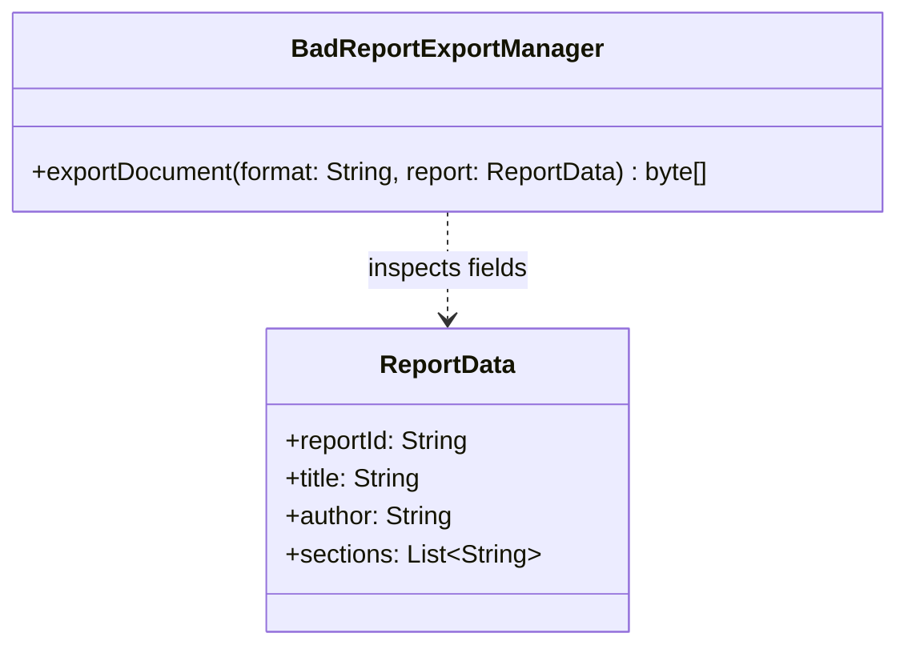
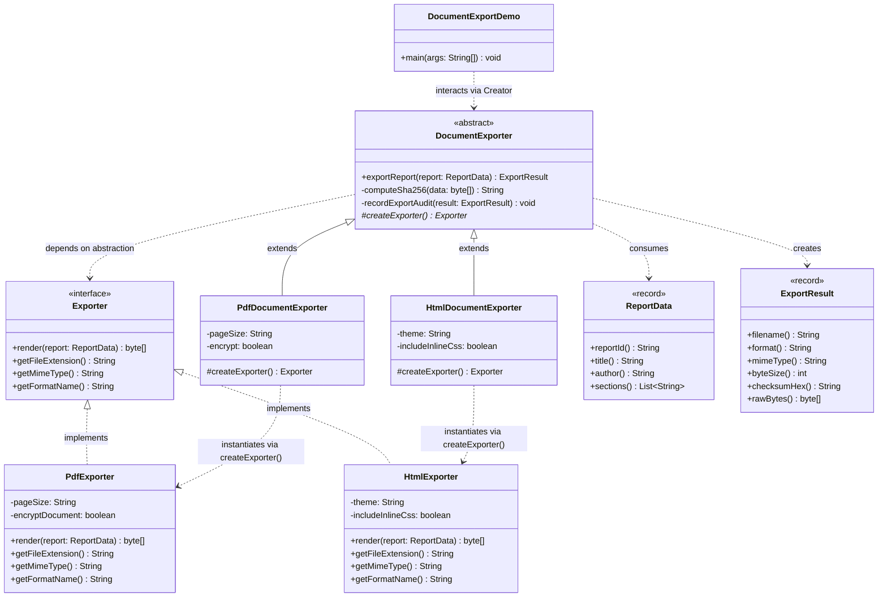

# Example 03: Document Export (PDF and HTML Exporters)

## 1. The Problem in Simple Words

An enterprise analytics and business intelligence platform generates operational and financial reports. Business users want to export these reports into different formats:
- **PDF format:** For board presentations, customer invoices, and formal archived documents.
- **HTML format:** For real-time web portal dashboards, internal intranets, and mobile web views.
- **Future formats:** CSV, Excel spreadsheets, or Markdown for engineering documentation.

Regardless of the target format, the **publishing workflow** always requires the same steps:
1. Validate the report contents (title, author, content blocks).
2. Prepare the format-specific engine with desired formatting parameters.
3. Render the report into raw output bytes.
4. Calculate an SHA-256 cryptographic checksum for data integrity.
5. Generate a standard filename and record the output metadata into an audit ledger.

If a developer writes this with a single monolithic export manager containing `if (format == "PDF")`, the binary rendering logic of PDF and the string markup of HTML become tangled together.

---

## 2. The Bad Approach and Its Limitations

In `bad/BadReportExportManager.java`, the system places all formatting rules, byte conversions, and conditional logic inside a single method:

```java
if (format.equalsIgnoreCase("PDF")) {
    StringBuilder pdf = new StringBuilder();
    pdf.append("%PDF-1.7\n");
    // Hardcoded PDF binary stream logic...
    outputBytes = pdf.toString().getBytes(StandardCharsets.ISO_8859_1);
} else if (format.equalsIgnoreCase("HTML")) {
    StringBuilder html = new StringBuilder();
    html.append("<!DOCTYPE html>\n<html>...<body>");
    // Hardcoded HTML markup strings...
    outputBytes = html.toString().getBytes(StandardCharsets.UTF_8);
}
```

### Class Diagram of the Bad Approach



*Explanation of the bad diagram:*
`BadReportExportManager` directly handles PDF binary construction and HTML generation in a single place. There are no format abstractions or modular creators.

### Limitations of the Bad Approach
1. **Violation of Open/Closed Principle (OCP):** Introducing a new format (e.g., CSV or Markdown) forces edits to `BadReportExportManager.java`, re-testing PDF and HTML logic.
2. **Violation of Single Responsibility Principle (SRP):** The manager mixes document security, checksum calculation, and file storage with format-specific rendering quirks.
3. **Inability to Configure Format Options:** PDF needs page size (A4 vs Letter) and encryption flags; HTML needs themes and CSS style links. Inlining prevents independent configuration.
4. **Fragile and Hard to Test:** You cannot test PDF generation without loading the entire class, and mistakes in string escaping can corrupt binary PDF bytes.

---

## 3. The Improved Design (Factory Method Step by Step)

The improved implementation in `good/` resolves this cleanly using the GoF Factory Method pattern:

```
Step 1: Extract the Product Interface (Exporter)
Step 2: Implement Concrete Products (PdfExporter, HtmlExporter)
Step 3: Define the Abstract Creator (DocumentExporter with exportReport workflow)
Step 4: Implement Concrete Creators (PdfDocumentExporter, HtmlDocumentExporter)
```

### Class Diagram of the Good Implementation



*Explanation of the good diagram:*
- `Exporter` provides the contract for all rendering engines (`render()`, `getFileExtension()`, `getMimeType()`).
- `PdfExporter` and `HtmlExporter` encapsulate format-specific rendering logic and configuration.
- `DocumentExporter` orchestrates the universal 5-step publishing pipeline, calling `#createExporter()` to obtain the formatter.
- `PdfDocumentExporter` and `HtmlDocumentExporter` configure and instantiate their respective format engines.
- `DocumentExportDemo` triggers exports polymorphically through the base `DocumentExporter` class.

---

## 4. Explanation of Every Class and Relationship

| Class / Record | Role | Description |
| :--- | :--- | :--- |
| **`Exporter`** | Product Interface | Declares format conversion operations (`render()`, `getFileExtension()`, `getMimeType()`, `getFormatName()`). |
| **`PdfExporter`** | Concrete Product | Renders binary PDF byte streams, sets page boxes (A4/Letter), and handles optional encryption headers. |
| **`HtmlExporter`** | Concrete Product | Generates HTML5 semantic markup, escapes special characters (`<`, `>`, `&`), and injects responsive CSS themes. |
| **`DocumentExporter`** | Creator (Abstract) | Contains the enterprise export pipeline (`exportReport()`), validating reports, computing SHA-256 integrity checksums, and generating filenames. |
| **`PdfDocumentExporter`** | Concrete Creator | Subclasses `DocumentExporter` and overrides `createExporter()` to supply a configured `PdfExporter`. |
| **`HtmlDocumentExporter`** | Concrete Creator | Subclasses `DocumentExporter` and overrides `createExporter()` to supply a configured `HtmlExporter`. |
| **`ReportData`** | Domain Record | Immutable report container holding report ID, title, author, and section paragraphs. |
| **`ExportResult`** | Domain Record | Immutable result bundle returning filename, MIME type, payload size, SHA-256 checksum, and byte stream. |
| **`DocumentExportDemo`** | Client | Entry point demonstrating export execution across both formats with SHA-256 integrity reporting. |

---

## 5. Why Factory Method Fits This Situation

1. **Shared Document Pipeline:** Document publishing involves common pre-processing (sanitization, title validation) and post-processing (hashing, size telemetry, archiving). Putting this workflow in the `DocumentExporter` base class eliminates duplication.
2. **Encapsulated Format Nuances:** PDF rendering involves binary byte operations and encryption dictionaries; HTML involves UTF-8 encoding and CSS stylesheets. Factory Method lets each format live in its own clean class.
3. **Pluggable Architecture:** A client can pass a `DocumentExporter` to any reporting job. If marketing needs a `MarkdownDocumentExporter`, engineers can add it without touching the existing PDF or HTML exporters.

---

## 6. Trade-Offs and When This Pattern Would Be Unnecessary

### Trade-Offs
- **Class Count:** For $N$ file formats, you need $N$ `Exporter` implementations and $N$ `DocumentExporter` subclasses.
- **Creator Subclass Overhead:** If format configuration rarely varies and the creator contains very little business logic, a simple map or registry of `Supplier<Exporter>` can be more lightweight.

### When This Pattern Is Unnecessary
- If the application only exports a single format (e.g. only CSV) and never plans to support others.
- If third-party libraries (e.g., Spring MVC `HttpMessageConverter` or JasperReports) already handle format negotiation behind framework annotations.
