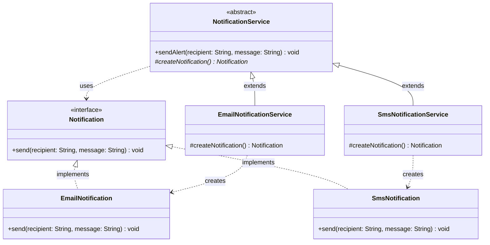
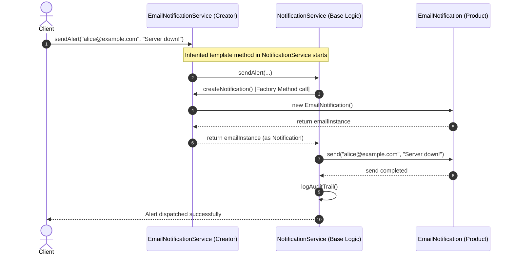

# Factory Method Design Pattern

The **Factory Method Pattern** is a creational design pattern from the Gang of Four (GoF). It defines an interface or abstract method for creating an object, but allows subclasses to decide which class to instantiate. 

In simple terms: **Factory Method lets a class defer object creation to its subclasses.**

---

## 1. What is Factory Method and Why Do We Need It?

### The Core Idea
When writing software, we often need to create objects. The most common way in Java is using the `new` keyword:

```java
EmailNotification notification = new EmailNotification();
```

While `new` works fine for tiny scripts, direct instantiation creates **tight coupling** in larger systems. Your business logic becomes tied to concrete class names. 

If you want to introduce a new type (for example, `SmsNotification` or `SlackNotification`), you must find every place where `new EmailNotification()` was written and modify that code.

### Why Do We Need Factory Method?
Factory Method solves this problem by separating **object creation** from **object usage**:

1. A high-level class contains the **workflow** (e.g., how to prepare, log, and send a message).
2. The high-level class does not know which exact object it will work with.
3. Instead of calling `new`, it calls an abstract **factory method** (`createNotification()`).
4. Dedicated subclasses override that method to return the specific object.

This keeps your high-level business logic clean, stable, and completely decoupled from concrete classes.

---

## 2. Real-Life Analogy: The Restaurant Franchise

Imagine a national restaurant brand called **WarmBites**:

```
+-------------------------------------------------------------+
|                     WarmBites Restaurant                    |
|  - Customer orders food                                     |
|  - Chef cooks food: makeFood()  <-- Subclass decides what!  |
|  - Staff packages & serves food                             |
|  - Cashier issues the receipt                               |
+-------------------------------------------------------------+
               ▲                               ▲
               │                               │
    +----------------------+       +----------------------+
    |    Italian Branch    |       |    Burger Branch     |
    | makeFood() -> Pizza  |       | makeFood() -> Burger |
    +----------------------+       +----------------------+
```

1. **Every WarmBites branch follows the same customer service workflow:**
   - Welcome customer $\rightarrow$ Take order $\rightarrow$ **Prepare food** $\rightarrow$ Package meal $\rightarrow$ Hand receipt.
2. But the **exact food prepared** depends on the branch:
   - An **Italian WarmBites** prepares a **Pizza**.
   - A **Burger WarmBites** prepares a **Gourmet Burger**.

The central WarmBites operating manual does not need to know recipes for every food item in existence. It defines the operational workflow and delegates the creation of the specific dish to the individual franchise branch.

That is the **Factory Method Pattern**:
- **Creator (`WarmBites`):** Defines the standard business workflow.
- **Factory Method (`makeFood()`):** Overridden by subclasses.
- **Concrete Creators (`ItalianWarmBites`, `BurgerWarmBites`):** Decide what to instantiate.
- **Product (`Meal`):** The item being created and served.

---

## 3. The Problem Without the Pattern

Let us look at what code looks like when we do not use the Factory Method pattern.

Suppose an application sends alerts across different communication channels:

```java
public class NotificationManager {
    public void sendAlert(String channelType, String recipient, String message) {
        // Step 1: Object Creation tied to conditional logic
        if (channelType.equalsIgnoreCase("EMAIL")) {
            EmailNotification email = new EmailNotification();
            email.connectSmtp();
            email.send(recipient, message);
        } else if (channelType.equalsIgnoreCase("SMS")) {
            SmsNotification sms = new SmsNotification();
            sms.connectTwilioGateway();
            sms.send(recipient, message);
        } else if (channelType.equalsIgnoreCase("SLACK")) {
            SlackNotification slack = new SlackNotification();
            slack.authenticateWebhook();
            slack.send(recipient, message);
        } else {
            throw new IllegalArgumentException("Unknown channel: " + channelType);
        }

        // Common audit logging
        System.out.println("Alert recorded in database for: " + recipient);
    }
}
```

### Why This Design Fails
1. **Violation of the Open/Closed Principle (OCP):** Every time the company adopts a new channel (e.g., `WhatsAppNotification`), you must open `NotificationManager` and add another `else-if` branch. Existing, tested code is modified.
2. **Violation of the Single Responsibility Principle (SRP):** `NotificationManager` handles business alert workflows *and* knows the setup details of SMTP, Twilio, Slack webhooks, and every future channel.
3. **Tight Coupling:** The manager is tightly bound to `EmailNotification`, `SmsNotification`, and `SlackNotification`. You cannot test the alert workflow in isolation without pulling in all transport dependencies.
4. **Fragile and Error-Prone:** Missing a case or making a typo in `"EMAIL"` leads to runtime failures.

---

## 4. How Factory Method Solves the Problem, Step by Step

Factory Method fixes these flaws by applying **polymorphism** to object creation:

```
Step 1: Define the Product Interface
        [ Notification ]  <-- Common contract: send(recipient, message)

Step 2: Create Concrete Products
        [ EmailNotification ]  and  [ SmsNotification ]

Step 3: Define the Abstract Creator Class
        [ NotificationService ]
        - sendAlert(recipient, message) {  <-- Business Workflow
              Notification n = createNotification();  <-- Call Factory Method!
              n.send(recipient, message);
          }
        - protected abstract Notification createNotification();  <-- Factory Method

Step 4: Create Concrete Creators
        [ EmailNotificationService ] -> returns EmailNotification
        [ SmsNotificationService ]   -> returns SmsNotification
```

### Step-by-Step Breakdown

1. **Step 1: Extract the Product Interface (`Notification`)**
   Declare a common interface for all items that will be created. High-level code will talk only to this interface.

2. **Step 2: Build Concrete Products (`EmailNotification`, `SmsNotification`)**
   Implement the specific behaviors for each transport channel.

3. **Step 3: Declare the Creator Class (`NotificationService`)**
   Create an abstract class (or interface with default methods) that hosts the **business workflow** (`sendAlert`). Inside this workflow, whenever an object is needed, call the abstract method `createNotification()`.

4. **Step 4: Implement Concrete Creators (`EmailNotificationService`, `SmsNotificationService`)**
   Each subclass overrides `createNotification()` to return an instance of its corresponding product.

5. **Step 5: Client Chooses the Creator Once**
   The client instantiates the desired creator once (or gets it injected). From then on, the client runs high-level workflows without caring about the concrete product underneath.

---

## 5. Class Diagram: Structure and Relationships



### Plain English Explanation of the Class Diagram
- **`Notification` (Product):** The interface common to all notification types.
- **`EmailNotification` & `SmsNotification` (Concrete Products):** Implementations that do the actual work of sending emails or text messages.
- **`NotificationService` (Creator):** An abstract class. It contains `sendAlert()`, which carries the shared alert logic. It defines `createNotification()` as an abstract method (the **Factory Method**).
- **`EmailNotificationService` & `SmsNotificationService` (Concrete Creators):** Subclasses that override `createNotification()`. Each one returns its specific product (`EmailNotification` or `SmsNotification`).
- **Dependencies:** The base `NotificationService` relies solely on the `Notification` interface, never touching concrete classes.

---

## 6. Sequence Diagram: Object Creation and Execution Flow

The sequence diagram below shows what happens at runtime when a client triggers an alert through an `EmailNotificationService`:



### Plain English Explanation of the Sequence Diagram
1. The **Client** calls `sendAlert()` on `EmailNotificationService`.
2. The base method in `NotificationService` takes control of the general alert workflow.
3. When the base method needs a notification object, it calls `createNotification()`.
4. Because the runtime object is `EmailNotificationService`, its overridden `createNotification()` runs and instantiates `EmailNotification`.
5. The freshly created `EmailNotification` is returned to the base method as a generic `Notification`.
6. The base method calls `send()` on the notification and performs post-processing like audit logging.
7. Control returns to the client. The base workflow remained clean and generic throughout.

---

## 7. Side-by-Side Comparison: Bad vs Good Design

| Dimension | Bad Design (Monolithic Switch / `new`) | Good Design (Factory Method) |
| :--- | :--- | :--- |
| **Object Instantiation** | Direct calls to `new` inside business logic (`new EmailNotification()`). | Delegated to subclass via abstract `createProduct()`. |
| **Adding a New Product** | Must edit existing switch/if-else blocks in the core service. | Add a new `ConcreteProduct` and a new `ConcreteCreator`. Existing code is untouched. |
| **Coupling** | High: Business logic depends on all concrete product classes. | Low: High-level logic depends only on the `Product` interface. |
| **Testability** | Hard: Cannot easily mock product creation without refactoring. | Easy: Create a `TestCreator` returning a mock product. |
| **Adherence to OCP** | **Violated**: Every new type forces edits to existing code. | **Respected**: Open for extension, closed for modification. |
| **Adherence to SRP** | **Violated**: Service handles business rules AND object construction. | **Respected**: Creator handles workflow; subclass handles instantiation. |

### Code Comparison

#### Bad Design (Conditionals Everywhere)
```java
public void process(String type) {
    Product p;
    if (type.equals("A")) {
        p = new ConcreteProductA();
    } else {
        p = new ConcreteProductB();
    }
    p.execute();
}
```

#### Good Design (Factory Method)
```java
// Base Creator
public abstract class AppService {
    public void process() {
        Product p = createProduct(); // Factory method
        p.execute();
    }
    protected abstract Product createProduct();
}

// Subclass A
public class ServiceA extends AppService {
    @Override
    protected Product createProduct() {
        return new ConcreteProductA();
    }
}
```

---

## 8. Roles and Responsibilities of Participants

| Participant | Type | Primary Responsibility | Example in Our Alert System |
| :--- | :--- | :--- | :--- |
| **`Product`** | Interface / Abstract Class | Defines the public interface for the objects that the factory method creates. | `Notification` |
| **`Concrete Product`** | Class | Implements the `Product` interface. Provides the actual channel-specific behavior. | `EmailNotification`, `SmsNotification` |
| **`Creator`** | Abstract Class | Declares the abstract factory method (`createProduct()`). Contains the core business logic that operates on the `Product`. | `NotificationService` |
| **`Concrete Creator`** | Class | Extends `Creator` and overrides `createProduct()` to return an instance of a specific `Concrete Product`. | `EmailNotificationService`, `SmsNotificationService` |

> **Key Takeaway:** The Creator is **not** just a factory. Its primary value is usually the **business logic** it provides (`sendAlert()`), which relies on products produced by its factory method.

---

## 9. When to Use It and When NOT to Use It

### When to Use Factory Method
- **Unknown Dependencies in Advance:** When you don't know beforehand the exact types and dependencies of the objects your code should work with.
- **Extensible Frameworks and Libraries:** When you are building a library or framework and want users to extend its internal components with their own classes.
- **Separating Creation from Core Workflows:** When you want to localize object creation to one place, allowing core workflows to remain pristine and testable.
- **Reusing Existing Objects:** When object creation involves caching, pools, or recycling rather than creating raw instances every time.

### When NOT to Use Factory Method
- **Simple, Stable Objects:** If you only have one concrete product that will never change (e.g., standard `ArrayList` or a plain data transfer object `UserDTO`), writing creators and products adds unnecessary boilerplate.
- **No Polymorphic Workflow:** If you only need a helper to instantiate an object without any enclosing creator workflow, a simple constructor or a static factory method idiom (`Optional.of(...)`) is cleaner.
- **Exploding Class Hierarchies:** If for every new product you have to introduce a creator subclass and you don't actually have differentiated creator logic, consider using dependency injection or passing a functional supplier (`Supplier<Product>`).

---

## 10. Benefits, Drawbacks, and Trade-Offs

### Benefits
1. **Eliminates Tight Coupling:** The high-level creator does not depend on concrete products.
2. **Single Responsibility Principle (SRP):** Object creation code is moved to a single dedicated place in subclasses.
3. **Open/Closed Principle (OCP):** You can introduce new product variants into the program without breaking existing client code.
4. **Enhanced Testability:** Unit testing the creator's business logic is trivial because you can subclass the creator and supply a mock product.

### Drawbacks
1. **Class Proliferation:** You must introduce new subclasses for every new product type. If you have 10 products, you may end up with 10 creator subclasses.
2. **Refactoring Overhead:** If the product constructor signature changes significantly, all creator subclasses might need adjustments.

### Architectural Trade-Off
| Prioritize | Consequence |
| :--- | :--- |
| **Flexibility & OCP** | Choose Factory Method. You gain decoupled architecture at the cost of more classes. |
| **Simplicity & Brevity** | Choose direct `new` or Simple Factory if your product set is small and fixed. |

---

## 11. SOLID Principles and Factory Method

Factory Method is one of the best demonstrations of **OCP** and **DIP** in object-oriented design.

### Open/Closed Principle (OCP)
> *Software entities should be open for extension, but closed for modification.*

#### Concrete Code Demonstration
Imagine our alert system needs to support Discord:

```java
// 1. Create the new Concrete Product (Extension)
public class DiscordNotification implements Notification {
    @Override
    public void send(String recipient, String message) {
        System.out.println("Posting to Discord webhook [" + recipient + "]: " + message);
    }
}

// 2. Create the new Concrete Creator (Extension)
public class DiscordNotificationService extends NotificationService {
    @Override
    protected Notification createNotification() {
        return new DiscordNotification();
    }
}
```

Notice what happened:
- **`Notification` interface:** Untouched.
- **`NotificationService` base class:** Untouched.
- **Existing Email/SMS services:** Untouched.
- **Total lines of existing code modified:** **0**.

### Dependency Inversion Principle (DIP)
> *High-level modules should not depend on low-level modules. Both should depend on abstractions.*

```
BAD (Violates DIP):
[ NotificationManager (High-Level) ] ─── depends directly on ───> [ EmailNotification (Low-Level) ]

GOOD (Satisfies DIP):
[ NotificationService (High-Level) ] ─── depends on ───> [ Notification (Abstraction) ]
                                                                   ▲
[ EmailNotification (Low-Level) ] ──────── implements ────────────┘
```

The high-level `NotificationService` orchestrates alerts, yet it has **zero references** to `EmailNotification` or `SmsNotification`. Both high-level workflows and low-level transports depend exclusively on the abstract `Notification` interface.

---

## 12. Factory Method vs Simple Factory vs Abstract Factory

One of the most frequent points of confusion in software design is distinguishing between these three patterns:

| Feature | Simple Factory | Factory Method (GoF) | Abstract Factory (GoF) |
| :--- | :--- | :--- | :--- |
| **Design Pattern Status** | Not an official GoF pattern; an OOP programming idiom. | **Official GoF Creational Pattern**. | **Official GoF Creational Pattern**. |
| **Mechanism** | A single class with a method (often `static`) containing a switch/if-else. | **Inheritance & Subclassing**: Subclasses override the creation method. | **Object Composition**: An interface declares methods to create families of related products. |
| **Open/Closed Principle** | **Violated**: Adding a new type requires modifying the switch statement. | **Respected**: Adding a new type requires adding a new creator subclass. | **Respected**: Adding a new family requires implementing the factory interface. |
| **Product Scope** | Creates a single product based on a parameter or type string. | Defer creation of **one product** to a subclass. | Creates **families of related/dependent products** (e.g., Mac Button + Mac Checkbox). |
| **Typical Signature** | `static Product create(String type)` | `protected abstract Product createProduct()` | `ProductA createProductA()`, `ProductB createProductB()` |

### Critical Clarification: Why `static create()` is NOT Factory Method

Many developers write:

```java
public class NotificationFactory {
    public static Notification createNotification(String type) {
        return switch (type) {
            case "EMAIL" -> new EmailNotification();
            case "SMS" -> new SmsNotification();
            default -> throw new IllegalArgumentException("Unknown type");
        };
    }
}
```

And claim: *"I have implemented the Factory Method pattern!"*

**This is incorrect.**
- This is a **Simple Factory** (or Static Factory).
- It relies on conditional logic (`switch`).
- It violates the Open/Closed Principle because adding a new channel modifies `NotificationFactory`.
- It cannot be extended through subclassing because the method is `static`.

In contrast, the **GoF Factory Method Pattern**:
1. Uses an abstract class or interface (`NotificationService`).
2. Does **not** pass a type code into a switch statement.
3. Lets dedicated subclasses (`EmailNotificationService`, `SmsNotificationService`) override an instance method to supply the product.

```
Simple Factory:   One class with a switch statement deciding which object to return.
Factory Method:   Subclasses override a method to decide which object to return.
Abstract Factory: An object that manufactures an entire suite of related products.
```

---

## 13. Common Mistakes and How to Avoid Them

### Mistake 1: Passing Type Codes to the Factory Method
```java
// INCORRECT: Bringing the switch statement into the creator
public abstract class NotificationService {
    public abstract Notification createNotification(String type); // Anti-pattern!
}
```
*Why it is wrong:* This reintroduces the switch statement inside every creator subclass.
*How to fix:* A concrete creator should know exactly what single product it creates (e.g., `EmailNotificationService` produces `EmailNotification`). Do not pass type codes.

### Mistake 2: Empty Creators (Useless Abstraction)
```java
// INCORRECT: An abstract creator with NO business logic at all
public abstract class AnimalFactory {
    public abstract Animal createAnimal();
}
public class DogFactory extends AnimalFactory {
    public Animal createAnimal() { return new Dog(); }
}
```
*Why it is wrong:* If the creator has no workflow methods and only exists to call `new Dog()`, you have added two classes for zero architectural benefit. A simple constructor call `new Dog()` or a lambda `Supplier<Animal> dogSupplier = Dog::new` is much better.
*How to fix:* Factory Method shines when the Creator owns a **business operation** (e.g., `feedAnimal()`, `trainAnimal()`) that needs the product to complete its job.

### Mistake 3: Returning Concrete Types from the Factory Method
```java
// INCORRECT: Exposing concrete products in creator signatures
public class EmailNotificationService extends NotificationService {
    @Override
    public EmailNotification createNotification() { // Breaks abstraction
        return new EmailNotification();
    }
}
```
*Why it is wrong:* While Java permits covariant return types, the creator's base workflow should interact with the product via the generic interface (`Notification`). Returning concrete types tightly couples downstream callers to the concrete implementation.
*How to fix:* Return the `Product` interface.

---

## 14. Real-World Interview Questions & Clear Answers

### Q1: What is the primary intent of the Factory Method pattern?
**Answer:** The primary intent is to define an interface for creating an object while deferring the decision of which class to instantiate to subclasses. This decouples high-level business workflows from concrete product classes.

### Q2: What is the difference between Simple Factory and Factory Method?
**Answer:** Simple Factory uses a single class with conditional logic (like `switch` or `if-else`) to create objects, which violates OCP when new types are added. Factory Method is a GoF design pattern that uses inheritance: the creator class declares an abstract creation method, and subclasses override it to instantiate specific products without touching existing code.

### Q3: Does the Creator class in Factory Method always have to be abstract?
**Answer:** No. While it is usually abstract, the GoF specification allows the Creator to provide a default implementation of the factory method returning a standard default product. Subclasses only override it when they need a specialized product.

### Q4: How does Factory Method relate to the Template Method pattern?
**Answer:** Factory Method is frequently used inside a **Template Method**. In many implementations, the Creator's main business method (e.g., `sendAlert()`) acts as a template method that defines an algorithm, and the factory method (e.g., `createNotification()`) is a step in that template that subclasses customize.

### Q5: When would you choose Java 8+ functional interfaces (`Supplier<T>`) over Factory Method?
**Answer:** If you only need parameterized object creation without subclass hierarchies or domain-specific creator behaviors, passing a `Supplier<Product>` (e.g., `EmailNotification::new`) directly to the consumer achieves loose coupling without creating separate `Creator` subclasses.

---

## 15. Final Revision Checklist

Use this checklist during system design interviews and code reviews:

- [ ] **Product Abstraction:** Is there a clean interface or abstract class for the products?
- [ ] **Polymorphic Creation:** Does the Creator declare an overridable method for object creation rather than directly invoking `new`?
- [ ] **Business Logic in Creator:** Does the Creator contain a meaningful workflow that actually uses the product?
- [ ] **No Hidden Switches:** Did you avoid passing string flags or enums to the factory method?
- [ ] **OCP Verified:** Can you add a new concrete product and creator subclass without modifying a single line of existing code?
- [ ] **DIP Verified:** Does the high-level Creator depend strictly on the Product interface?
- [ ] **Right Pattern for the Job:** Is the complexity justified, or would a simple constructor or `Supplier<T>` be cleaner?
