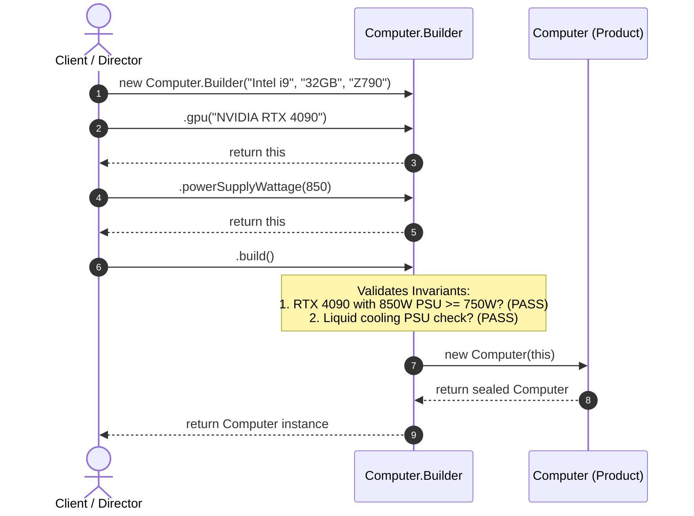

# Example 01: Computer Configuration System

## 1. The Problem

A custom PC manufacturing business allows customers to configure custom computer towers. A computer system consists of:
- **Mandatory components:** CPU, RAM, and Motherboard. Without these, the machine cannot boot.
- **Optional components & peripherals:** Dedicated GPU, high-speed NVMe storage drives, liquid cooling loops, Bluetooth modules, RGB lighting, and custom power supplies (PSU).
- **Interdependent hardware safety rules (Invariants):**
  - High-end graphics cards (e.g., RTX 4080/4090) draw heavy wattage and require at least a 750W PSU.
  - Custom liquid cooling loops require at least a 650W PSU to power cooling pumps safely.

When modeled using traditional constructors or JavaBeans setters, the system suffers from severe usability and safety flaws.

---

## 2. Bad Design Analysis

In `bad/Computer.java`, two flawed approaches are used:
1. **Telescoping Constructors:**
   ```java
   public Computer(String cpu, String ram, String motherboard, String storage, 
                   String gpu, boolean hasLiquidCooling, boolean hasBluetooth, 
                   boolean hasRgbLighting, int powerSupplyWattage) { ... }
   ```
   Calling this requires passing a long list of confusing boolean literals:
   ```java
   Computer pc = new Computer("i9", "32GB", "Z790", "1TB", "RTX 4090", true, false, true, 850);
   ```
   Accidentally swapping `true` (liquid cooling) with `false` (Bluetooth) is undetectable by the compiler and creates silent runtime defects.

2. **JavaBeans Pattern (No-arg constructor + setters):**
   ```java
   Computer pc = new Computer();
   pc.setCpu("i9");
   // PC is currently missing RAM and Motherboard, yet accessible to other threads!
   ```
   This exposes half-initialized objects and permanently leaves the computer mutable. Anyone can call `pc.setPowerSupplyWattage(200)` post-assembly, violating hardware safety invariants.

---

## 3. Improved Design (Builder Pattern)

The improved design in `good/` uses the **Fluent Builder Pattern**:

```
[ Client / ComputerDirector ]
             │
             ├── 1. new Computer.Builder("i9", "32GB", "Z790")  (Mandatory)
             ├── 2. .gpu("RTX 4090")                            (Optional)
             ├── 3. .withLiquidCooling(true)                    (Optional)
             ├── 4. .powerSupplyWattage(1000)                   (Optional)
             └── 5. .build()                                    (Validates invariants)
                         │
                         ▼
             [ Immutable Computer Object ]
```

### Participants
- **Product (`Computer`):** Declares all fields as `final`. Has a private constructor accepting `Builder`. Provides read-only getters and no public mutators.
- **Builder (`Computer.Builder`):**
  - Enforces mandatory fields in its public constructor.
  - Provides chainable fluent methods (`gpu()`, `withLiquidCooling()`, `powerSupplyWattage()`).
  - Contains centralized invariant verification inside `build()`.
- **Director (`ComputerDirector`):** Provides pre-configured recipes (`constructHighEndGamingRig()`, `constructBudgetOfficeWorkstation()`).

---

## 4. Execution Flow: Safe Atomic Construction



### Explanation of Sequence
1. The client begins assembly with mandatory fields (`CPU`, `RAM`, `Motherboard`).
2. Optional peripherals are chained smoothly in any order.
3. When `.build()` is executed, the builder validates cross-field constraints.
4. If valid, the private constructor freezes the state into immutable fields and hands back a safe `Computer` instance.

---

## 5. Relationship to SOLID Principles

- **Single Responsibility Principle (SRP):** `Computer` encapsulates domain hardware representation. `Computer.Builder` encapsulates assembly, fluent input handling, and invariant validation.
- **Open/Closed Principle (OCP):** New assembly presets can be added to `ComputerDirector` without touching `Computer` or `Computer.Builder`.
- **Liskov Substitution Principle (LSP):** No inheritance hierarchy is abused; object composition ensures clean separation.
