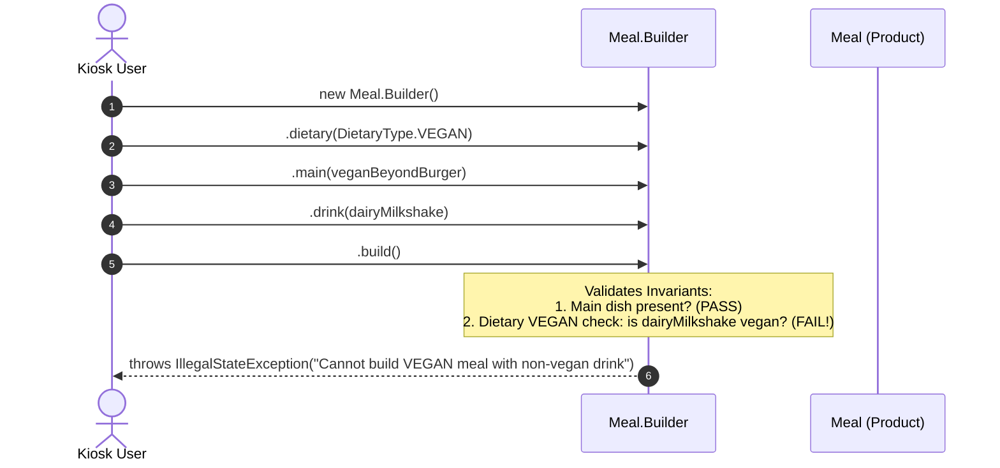

# Example 02: Meal Order Construction (Restaurant Point of Sale)

## 1. The Problem

A fast-casual restaurant ordering kiosk allows customers to assemble custom meal combos:
- **Main dish:** Burgers, wraps, salads (mandatory).
- **Optional additions:** Sides (French Fries, Onion Rings), Drinks (Sodas, Juices, Shakes), Desserts (Cookies, Fruit cups), Takeout packaging, and Toy inclusions for kids' meals.
- **Dietary safety invariants:**
  - An order marked `VEGAN` must never contain animal meat, dairy shakes, or gelatin desserts.
  - An order marked `GLUTEN_FREE` must never contain wheat buns or breaded items.
- **Pricing rules:** An automatic 10% combo discount applies if the customer orders Main + Side + Drink together.

Without the Builder pattern, order assembly suffers from parameter confusion, unvalidated dietary hazards, and accidental post-order mutations.

---

## 2. Bad Design Analysis

In `bad/Meal.java`, meals are assembled via a telescoping constructor or JavaBeans setters:

```java
public Meal(String mainItem, String sideItem, String drinkItem, String dessertItem,
            String dietaryTag, boolean isTakeout, boolean includeToy, double totalPrice) { ... }
```

### Why This Design Fails
1. **Dietary Hazard & Zero Validation:**
   Nothing prevents a customer or cashier from doing:
   ```java
   new Meal("Angus Beef Burger", "Fries", "Dairy Shake", "Pie", "VEGAN", false, false, 15.00);
   ```
   The meal is labeled `VEGAN` in the kitchen, but contains beef and dairy. In real-world food service, this creates legal liabilities and severe allergic emergencies.
2. **Post-Order Mutation:**
   If setters are provided, any component can modify `meal.setMainItem(...)` while the ticket is being printed or in transit to the kitchen.
3. **Missing Minimum Dish Requirements:**
   A caller can instantiate an empty `new Meal()` with no items at all.

---

## 3. Improved Design (Builder Pattern)

The improved design in `good/` uses a **Fluent Builder with Domain Invariant Validation**:

```
[ MealDirector / Customer Kiosk ]
                │
                ├── 1. .dietary(DietaryType.VEGAN)
                ├── 2. .main(plantBasedBurger)
                ├── 3. .side(gardenSalad)
                ├── 4. .drink(sparklingWater)
                └── 5. .build()  <-- Validates dietary consistency!
                            │
                            ▼
                [ Immutable Meal Object ]
```

### Participants
- **Product (`Meal`):** Immutable record of the ordered items and finalized price.
- **Builder (`Meal.Builder`):** Fluent methods (`main()`, `side()`, `drink()`, `dessert()`, `dietary()`). Evaluates dietary compatibility and computes combo discounts inside `.build()`.
- **Director (`MealDirector`):** Provides pre-assembled combo recipes (`constructClassicBurgerCombo()`, `constructKidsHappyMeal()`, `constructVeganDelightMeal()`).

---

## 4. Execution Flow: Validating Dietary Invariants



### Explanation of Sequence
1. The customer selects the `VEGAN` dietary option on the kiosk.
2. If the user accidentally selects a dairy-based milkshake, the builder intercepts this conflict during `.build()`.
3. The invalid state is rejected immediately before any incorrect meal object can be handed to the kitchen.

---

## 5. Relationship to SOLID Principles

- **Single Responsibility Principle (SRP):** `Meal` only encapsulates the completed meal state. `Meal.Builder` handles assembling items, computing combo discounts, and validating dietary constraints.
- **Open/Closed Principle (OCP):** New meal combo recipes can be added to `MealDirector` without altering `Meal` or `Meal.Builder`.
