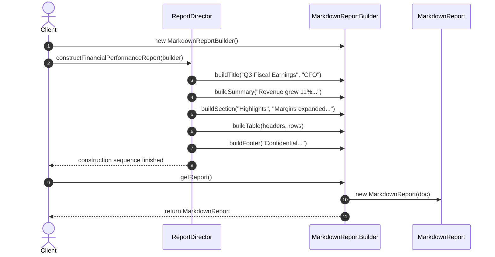

# Example 03: Complex Report Creation (Classic GoF Builder)

## 1. The Problem

An enterprise analytics platform generates complex executive reports (such as Financial Earnings, System Performance Audits, and Operational SLAs). A report contains multiple distinct structural elements:
- Title, Header, and Author metadata.
- Executive Summary highlight callouts.
- Arbitrary narrative content sections (headings and paragraphs).
- Tabular data grids (headers, rows, and alignment).
- Legal disclaimers, signatures, and footers.

The company needs to export the **exact same logical report** into completely different technical output representations:
- **HTML:** Semantic `<header>`, `<section>`, `<table>`, and embedded CSS styling.
- **Markdown:** `# Headings`, `> Blockquotes`, and `| Tables |` for developer documentation.
- **JSON:** Key-value telemetry payload for ingestion by downstream microservices.

If modeled using a single monolithic exporter class, the code becomes entangled with formatting syntax and impossible to extend.

---

## 2. Bad Design Analysis

In `bad/ReportGenerator.java`, all formats are handled inside a single class using string concatenation and `if-else` branching:

```java
public String generateReport(ReportData data, String format) {
    if (format.equalsIgnoreCase("HTML")) {
        // String concatenation with <html>, <header>, <table>, <td>...
    } else if (format.equalsIgnoreCase("MARKDOWN")) {
        // String concatenation with #, >, | ...
    } else if (format.equalsIgnoreCase("JSON")) {
        // String concatenation with {, }, "title": ...
    }
}
```

### Why This Design Fails
1. **Violation of the Open/Closed Principle (OCP):** Adding a new representation (e.g., PDF or CSV) requires modifying `ReportGenerator.java`. Existing, working HTML and Markdown code is reopened and risked.
2. **Violation of the Single Responsibility Principle (SRP):** This single class is responsible for the overall report section sequence *and* the syntax quirks of HTML tags, Markdown pipe tables, and JSON quote escaping.
3. **Rigid Coupling:** The caller must assemble a clumsy `ReportData` bundle with parallel lists (`sectionHeadings`, `sectionContents`) that must stay synchronized.

---

## 3. Improved Design (Classic GoF Builder Pattern)

The improved design in `good/` implements the **Classic Gang of Four (GoF) Builder Pattern**:

```
[ ReportDirector ] ──> directs construction using ──> [ ReportBuilder (Interface) ]
                                                                ▲
              ┌─────────────────────────┼───────────────────────┴────────────────────────┐
              │                         │                                                │
    [ HtmlReportBuilder ]     [ MarkdownReportBuilder ]                        [ JsonReportBuilder ]
              │                         │                                                │
              ▼                         ▼                                                ▼
       (HtmlReport)              (MarkdownReport)                                 (JsonReport)
```

### Participants
- **Builder Interface (`ReportBuilder`):** Declares abstract construction steps:
  - `buildTitle(String title, String author)`
  - `buildSummary(String summary)`
  - `buildSection(String heading, String content)`
  - `buildTable(List<String> headers, List<List<String>> rows)`
  - `buildFooter(String footerText)`
- **Concrete Builders:**
  - `HtmlReportBuilder`: Builds an `HtmlReport` with HTML5 markup.
  - `MarkdownReportBuilder`: Builds a `MarkdownReport` with GitHub-flavored markdown.
  - `JsonReportBuilder`: Builds a `JsonReport` with structured JSON.
- **Director (`ReportDirector`):** Coordinates the construction algorithm (e.g., `constructFinancialPerformanceReport(ReportBuilder builder)`). The director has **zero knowledge** of whether the output is HTML, Markdown, or JSON.

---

## 4. Execution Flow: Polymorphic Construction



### Explanation of Sequence
1. The client instantiates a concrete builder (e.g., `MarkdownReportBuilder`).
2. The client hands the builder to `ReportDirector.constructFinancialPerformanceReport()`.
3. The Director drives the builder through the standardized report recipe.
4. The client asks the builder for the finished `MarkdownReport` via `getReport()`.
5. To produce HTML instead, the client passes `HtmlReportBuilder` to the Director. **Zero Director code is modified.**

---

## 5. Relationship to SOLID Principles

- **Open/Closed Principle (OCP):** Supporting a new document format (e.g., `PdfReportBuilder`) requires writing a new class implementing `ReportBuilder`. Neither `ReportDirector` nor existing builders are modified.
- **Single Responsibility Principle (SRP):** The Director owns the structure and ordering of the report. Each concrete builder owns format-specific rendering syntax.
- **Dependency Inversion Principle (DIP):** The Director depends strictly on the `ReportBuilder` abstraction, never on concrete HTML or Markdown builders.
