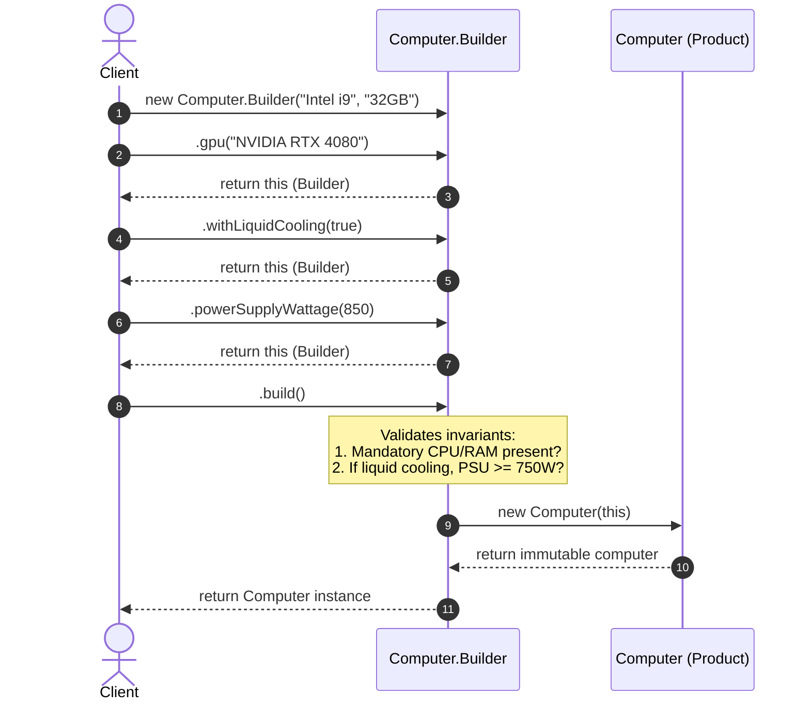

# Builder Design Pattern

The **Builder Pattern** is a creational design pattern from the Gang of Four (GoF). It separates the construction of a complex object from its representation, allowing the same construction process to create different representations. In modern Java, it is also widely used as a **Fluent Builder** to solve the *Telescoping Constructor* problem and create immutable objects cleanly.

In simple terms: **Builder lets you construct complex objects step by step without polluting constructors with dozens of confusing parameters.**

---

## 1. What is Builder and Why Do We Need It?

### The Core Idea
When creating complex domain objects (such as a gaming PC, an HTTP request, a meal combo, or an analytics report), objects often have:
- A few **mandatory** fields (e.g., CPU, RAM, Motherboard).
- Many **optional** fields (e.g., dedicated GPU, liquid cooling, Bluetooth card, RGB lighting, secondary NVMe drive).
- Strict validation rules that must be verified *before* the object is instantiated.
- Immutable state to prevent race conditions in concurrent applications.

### The Problem with Traditional Approaches
Developers without the Builder pattern typically resort to one of two flawed approaches:

1. **Telescoping Constructors:**
   Overloading constructors with 1, 2, 3, 4... 10 parameters.
   ```java
   public Computer(String cpu, String ram) { ... }
   public Computer(String cpu, String ram, String storage) { ... }
   public Computer(String cpu, String ram, String storage, String gpu) { ... }
   public Computer(String cpu, String ram, String storage, String gpu, boolean bluetooth, boolean liquidCooling) { ... }
   ```
   Calling this constructor becomes a game of parameter guessing:
   ```java
   // Which boolean is Bluetooth and which is liquid cooling?
   Computer pc = new Computer("Intel i9", "32GB", "1TB SSD", "RTX 4090", true, false);
   ```

2. **JavaBeans Pattern (No-arg constructor + Setters):**
   ```java
   Computer pc = new Computer();
   pc.setCpu("Intel i9");
   pc.setRam("32GB");
   // Object is partially constructed here! Inconsistent state!
   pc.setGpu("RTX 4090");
   ```
   This pattern causes two severe bugs:
   - **Inconsistent State:** The object is exposed to other threads in a half-configured state before all setters are called.
   - **Mutability:** Exposing public setters makes the object permanently mutable, destroying thread-safety.

### Why Do We Need the Builder Pattern?
Builder resolves both issues:
1. It gathers parameters step by step using readable, chainable methods (`.setGpu(...)`, `.withLiquidCooling(true)`).
2. It validates the configuration holistically.
3. It freezes the object by invoking `.build()`, returning a fully initialized, completely immutable instance.

---

## 2. Real-Life Analogy: Customizing a Fast-Food Burger Combo

Think about placing an order at a custom burger restaurant:

```
+-----------------------------------------------------------------------+
|                         Customer / Director                           |
|  - "I'd like a custom burger combo"                                   |
+-----------------------------------------------------------------------+
                                   │
                                   ▼
+-----------------------------------------------------------------------+
|                             MealBuilder                               |
|  - .chooseBun("Brioche")                                              |
|  - .addPatty("Angus Beef", 2)                                         |
|  - .addCheese("Aged Cheddar")                                         |
|  - .addCondiments(List.of("Truffle Mayo", "Caramelized Onions"))      |
|  - .withSide("Sweet Potato Fries")                                    |
|  - .withDrink("Vanilla Shake")                                        |
|  - .build()                                                           |
+-----------------------------------------------------------------------+
                                   │
                                   ▼
+-----------------------------------------------------------------------+
|                             Meal (Product)                            |
|  - Read-only, delicious, fully assembled combo!                       |
+-----------------------------------------------------------------------+
```

1. **The Product (`Meal`):** The final meal served on your tray. Once delivered, you cannot swap the bun or un-melt the cheese; it is immutable.
2. **The Builder (`MealBuilder`):** The order slip on which ingredients are selected one by one.
3. **The Director (Optional):** Pre-set menu combos. For example, the cashier can press the button for `"Super Delux Combo"`, which directs the builder through standard predefined steps.
4. **Validation:** If you ask for a burger with zero patties or select conflicting buns, the builder rejects the order *before* handing it to the kitchen.

---

## 3. The Problem Without the Pattern

Look at a computer configuration class built without the Builder pattern:

```java
public class Computer {
    private String cpu;
    private String ram;
    private String storage;
    private String gpu;
    private boolean hasLiquidCooling;
    private boolean hasBluetooth;
    private boolean hasRgbLighting;
    private int powerSupplyWattage;

    // Telescoping constructor hell
    public Computer(String cpu, String ram, String storage, String gpu, 
                    boolean hasLiquidCooling, boolean hasBluetooth, 
                    boolean hasRgbLighting, int powerSupplyWattage) {
        this.cpu = cpu;
        this.ram = ram;
        this.storage = storage;
        this.gpu = gpu;
        this.hasLiquidCooling = hasLiquidCooling;
        this.hasBluetooth = hasBluetooth;
        this.hasRgbLighting = hasRgbLighting;
        this.powerSupplyWattage = powerSupplyWattage;
    }
}
```

### Why This Design Fails
1. **Unreadable Client Code:**
   ```java
   Computer pc = new Computer("Ryzen 9", "64GB", "2TB NVMe", "RTX 4080", false, true, true, 850);
   ```
   What does `false, true, true` mean without opening the constructor source code? Swapping two booleans introduces silent runtime bugs that the compiler cannot detect.
2. **Combinatorial Constructor Explosion:** If some computers don't need a dedicated GPU, or don't need RGB, you must create 15 different overloaded constructors with overlapping signatures.
3. **Impossibility of Invariant Validation:** You cannot easily validate interdependent fields (e.g., *"If liquid cooling is selected, power supply must be at least 750W"*) without repeating validation code across every constructor.

---

## 4. How Builder Solves the Problem Step by Step

```
Step 1: Make Product Constructors Private
        Ensure the product (Computer) can only be instantiated through its Builder.

Step 2: Create a Nested Static Builder Class
        Declare public static class Builder with fields mirroring the product.

Step 3: Provide Chainable Fluent Setter Methods
        Each setter returns `this` to allow method chaining:
        builder.cpu("Intel i7").ram("32GB").gpu("RTX 4070")

Step 4: Perform Cross-Field Invariant Validation in `build()`
        Verify mandatory fields and cross-field rules before creating the object.

Step 5: Instantiate and Return the Immutable Product
        `return new Computer(this);`
```

### Step-by-Step Breakdown

1. **Step 1: Seal the Product**
   Mark product fields as `final` and its constructor as `private`. This guarantees immutability.
2. **Step 2: Define Fluent Setters**
   In the nested `Builder`, create methods that set a field and return `this`:
   ```java
   public Builder cpu(String cpu) {
       this.cpu = cpu;
       return this;
   }
   ```
3. **Step 3: Enforce Invariants in `build()`**
   Inside `.build()`, verify all business rules:
   ```java
   if (cpu == null || ram == null) {
       throw new IllegalStateException("CPU and RAM are mandatory");
   }
   if (hasLiquidCooling && powerSupplyWattage < 750) {
       throw new IllegalStateException("Liquid cooling requires at least 750W PSU");
   }
   ```
4. **Step 4: Deliver the Product**
   Pass the validated builder into the private constructor of `Computer`.

---

## 5. Class Diagram and Sequence Diagram

### Class Diagram: Fluent Builder Pattern

```mermaid
classDiagram
    direction TB

    class Computer {
        -String cpu
        -String ram
        -String storage
        -String gpu
        -boolean hasLiquidCooling
        -boolean hasBluetooth
        -int powerSupplyWattage
        -Computer(Builder builder)
        +getCpu() String
        +getRam() String
        +getGpu() String
        +hasLiquidCooling() boolean
    }

    class Builder {
        -String cpu
        -String ram
        -String storage
        -String gpu
        -boolean hasLiquidCooling
        -boolean hasBluetooth
        -int powerSupplyWattage
        +Builder(String cpu, String ram)
        +storage(String storage) Builder
        +gpu(String gpu) Builder
        +withLiquidCooling(boolean enabled) Builder
        +withBluetooth(boolean enabled) Builder
        +powerSupplyWattage(int wattage) Builder
        +build() Computer
    }

    class Director {
        +createHighEndGamingPC(Builder builder) Computer
        +createBudgetOfficePC(Builder builder) Computer
    }

    Computer +-- Builder : static inner class
    Computer <.. Builder : instantiates
    Director ..> Builder : directs
    Director ..> Computer : produces
```

#### Explanation of Class Diagram
- **`Computer` (Product):** The immutable object being constructed. Its constructor is `private`, accepting only a `Builder`.
- **`Builder` (Static Inner Class):** Contains identical fields and provides chainable fluent methods returning `Builder`. Its `build()` method produces the `Computer`.
- **`Director` (Optional Coordinator):** Knows standard recipes (e.g., standard gaming PC vs office workstation) and drives the builder through standard construction steps.

---

### Sequence Diagram: Fluent Construction Flow



#### Explanation of Sequence Diagram
1. The **Client** instantiates the builder, passing mandatory fields (`CPU`, `RAM`).
2. The Client chains optional configurations (`.gpu()`, `.withLiquidCooling()`, `.powerSupplyWattage()`).
3. Each method returns the builder itself (`this`), enabling fluent chaining.
4. When `.build()` is called, the builder verifies all invariants.
5. Upon successful validation, the private `Computer` constructor is invoked, copying values into immutable `final` fields.

---

## 6. Participant Responsibilities

| Participant | Role | Primary Responsibility | Example in Our Code |
| :--- | :--- | :--- | :--- |
| **Product** | Domain Entity | The complex object being created. Has private constructor and read-only getters. | `Computer`, `MealCombo`, `Report` |
| **Builder** | Object Assembler | Accumulates parameters through chainable methods; validates invariants; instantiates Product. | `Computer.Builder`, `MealBuilder` |
| **Director** *(Optional)* | Recipe Manager | Defines standard configurations using the builder's interface so clients don't repeat common recipes. | `ComputerDirector`, `MealDirector` |
| **Client** | Caller | Configures the builder directly or asks a Director to construct a standard preset. | Application controllers, unit tests |

---

## 7. Classic GoF Builder vs Modern Fluent (Effective Java) Builder

| Dimension | Classic GoF Builder | Modern Fluent Builder (Joshua Bloch) |
| :--- | :--- | :--- |
| **Primary Intent** | Build different representations of an object using the same step-by-step process (e.g., HTML vs PDF report). | Solve the telescoping constructor problem and safely construct immutable domain objects. |
| **Builder Hierarchy** | Abstract `Builder` interface with multiple concrete builders (`HtmlReportBuilder`, `PdfReportBuilder`). | Typically a single `static inner class Builder` inside the product. |
| **Director Role** | Essential: Director guides the abstract builder through fixed steps. | Optional: Clients usually configure the builder directly using method chaining. |
| **Method Chaining** | Rarely returns `this`; methods are `void buildPartA()`. | Returns `this` (`return this;`) for fluent chaining. |
| **Product Interface** | Products can be completely unrelated classes without a common interface. | Single target domain class. |

Both variations are valid and demonstrated in our examples.

---

## 8. Side-by-Side Comparison: Bad vs Good Design

| Dimension | Bad Design (Telescoping / Setters) | Good Design (Builder Pattern) |
| :--- | :--- | :--- |
| **Readability** | `new Computer("i9", "32G", null, null, true, false, true, 800)` $\rightarrow$ Unreadable. | `.cpu("i9").ram("32G").withLiquidCooling(true)` $\rightarrow$ Self-documenting. |
| **Immutability** | If using setters, the object is permanently mutable and thread-unsafe. | Product fields are `final`; object is strictly immutable once built. |
| **Consistency** | Object exists in an incomplete state between successive setter calls. | Object cannot be observed until `.build()` finishes successfully. |
| **Validation** | Invariant validation scattered across setters or constructors. | Centralized atomic validation inside `.build()`. |
| **Parameter Order** | Strict, brittle order where swapping two same-typed arguments causes silent bugs. | Order-independent: methods can be chained in any sequence. |

---

## 9. SOLID Principles Genuinely Demonstrated

### 1. Single Responsibility Principle (SRP)
- The **Product** is responsible solely for domain business behavior.
- The **Builder** is responsible solely for gathering configuration, validating invariants, and assembling the object.

### 2. Open/Closed Principle (OCP)
- In the GoF Director-Builder variant, new product representations (e.g., `CsvReportBuilder`, `JsonReportBuilder`) are added by creating a new builder class without modifying existing Director or Product code.

### 3. Dependency Inversion Principle (DIP)
- When using abstract builders, the Director depends on the `Builder` abstraction, not concrete builder implementations.

---

## 10. When to Use It and When NOT to Use It

### When to Use Builder
- **More than 4-5 constructor parameters**, especially when several have the same type (`String`, `boolean`, `int`).
- **Many optional fields:** Some instances need 2 fields, others need 8 fields.
- **Object immutability is required:** You want the benefits of thread-safe immutable fields without huge constructors.
- **Cross-field invariant validation:** You need to check multiple fields together before the object is allowed to exist.
- **Different representations:** You want the same construction workflow to build different formats (e.g., HTML, Markdown, PDF).

### When NOT to Use Builder
- **Simple objects with 1-3 mandatory fields:** A regular constructor or static factory method (e.g., `Point.of(x, y)`) is cleaner and has far less boilerplate.
- **Plain Data Transfer Objects (DTOs) with no business invariants:** If an object is just a temporary holder or an entity managed by an ORM (like Hibernate), standard Java 21 `record` or basic beans are more appropriate.
- **Performance-critical hot loops:** Instantiating a temporary `Builder` object on every single iteration in a low-latency loop allocating millions of objects adds minor GC overhead.

---

## 11. Benefits, Limitations, and Trade-offs

### Benefits
1. **Self-Documenting Code:** Client code reads like natural English.
2. **Atomic Validation:** Invariants are evaluated before the object ever exists in memory.
3. **Thread Safety:** Guarantees fully initialized immutable objects.
4. **Order Independent:** Methods can be chained in any order.

### Limitations & Trade-offs
1. **Boilerplate Code:** Requires writing a builder class with duplicate field declarations.
2. **Object Overhead:** Constructing an object requires creating the builder instance first.

---

## 12. How to Recognize Incorrect Use of Builder

### Anti-Pattern 1: Builder with Public Mutators on the Product
```java
// WRONG: Building an object and then mutating it with setters!
Computer pc = new Computer.Builder("i9", "32GB").build();
pc.setCpu("Ryzen 9"); // Defeats the entire purpose of the pattern!
```

### Anti-Pattern 2: Validation Inside the Product Constructor Instead of `build()`
If validation throws inside the product constructor after allocating half the internal state, resources may leak. Validate inside the builder's `build()` method before creating the product.

### Anti-Pattern 3: Builder for 2-Field Records
Creating a 40-line builder for a class with just `firstName` and `lastName`. A Java 21 `record User(String firstName, String lastName)` is already concise, immutable, and readable.

---

## 13. Builder vs Similar Patterns

| Dimension | Builder | Abstract Factory | Factory Method | Prototype |
| :--- | :--- | :--- | :--- | :--- |
| **Intent** | Construct complex objects step by step. | Create families of related products. | Defer single object creation to subclasses. | Clone an existing instance. |
| **Focus** | How a single complex object is assembled. | Which related family of products to instantiate. | Subclassing decides the concrete product. | Copying state from an archetype. |
| **Output** | Usually returns a single complex product at the end of `.build()`. | Returns products immediately from factory methods. | Returns product immediately from factory method. | Returns cloned copy immediately. |
| **Granularity** | Fine-grained, step-by-step configuration. | Coarse-grained product creation. | Coarse-grained product creation. | Coarse-grained replication. |

---

## 14. Real-World Interview Questions & Clear Answers

### Q1: Why should the Product constructor be private when using Builder?
**Answer:** Making the constructor private guarantees that clients cannot bypass the Builder. This ensures that every instantiated Product has passed the builder's validation checks and that no partially constructed objects can be created.

### Q2: How do you handle mandatory vs optional fields in a Builder?
**Answer:** There are two common approaches:
1. **Constructor on Builder:** Require mandatory fields in the Builder's constructor (`new Computer.Builder(cpu, ram)`), while optional fields are chained via fluent methods (`.gpu(...)`).
2. **Validation in `build()`:** Allow all fields to be set via fluent methods, but assert inside `build()` that mandatory fields are not null.

### Q3: What is the "Step Builder" pattern?
**Answer:** A Step Builder uses separate interfaces for each mandatory step (e.g., `CpuStep`, `RamStep`, `BuildStep`) to guide the developer at compile time through an exact sequence of method calls, making it impossible to call `.build()` until all mandatory steps are completed.

### Q4: How does Builder compare to Java 21 `record`?
**Answer:** Java 21 records provide concise syntax, automatic canonical constructors, and immutability. However, if a record has 10+ components, calling its canonical constructor still suffers from the telescoping constructor problem. A Builder can wrap a record to provide fluent, named argument construction.

---

## 15. Final Revision Checklist

- [ ] **Private Product Constructor:** Is the product's constructor private to prevent direct instantiation?
- [ ] **Immutable Product:** Are all product fields marked `final` with no public setters?
- [ ] **Fluent Chaining:** Do builder methods return `this` to support clean method chaining?
- [ ] **Validation in `build()`:** Are mandatory fields and cross-field invariants validated inside `.build()` before instantiating the product?
- [ ] **Sensible Defaults:** Are optional fields initialized to safe, sensible default values?
- [ ] **No Incomplete State:** Is it impossible for outside callers to observe the product before construction finishes?
- [ ] **Justified Complexity:** Is the object genuinely complex enough to warrant a builder, or would a simple constructor/record suffice?
