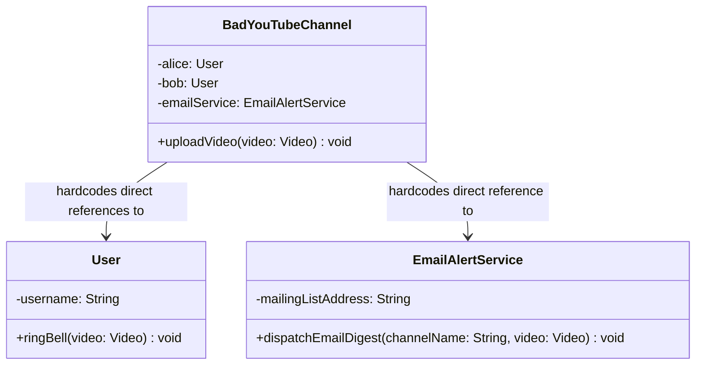
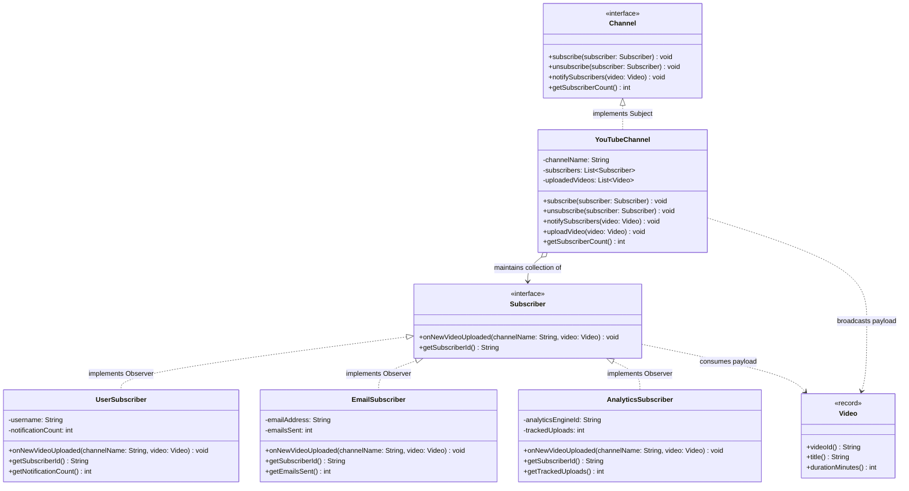

# Example 01: YouTube Channel Subscriptions and Notifications

## 1. The Problem and Requirements in Simple Words

A video platform allows content creators to publish videos to their channel. Whenever a creator uploads a new video, several parties want to know about it immediately:
- **Individual Viewers (Alice, Bob):** Want a bell notification badge in their browser or mobile app.
- **Email Digest Service:** Wants to dispatch a formatted newsletter email to registered inboxes.
- **Creator Studio Analytics Engine:** Wants to ingest the new video ID to begin tracking real-time views, audience retention, and revenue telemetry.
- **Future Listeners:** In the future, Discord webhooks, mobile push banners, and recommendation engines will also want to listen for uploads.

If the channel is written to directly call each viewer and service, adding or removing a subscriber requires editing the channel class every single time.

---

## 2. Bad Design Analysis

In `bad/BadYouTubeChannel.java`, the channel maintains hardcoded fields for specific users and services:

```java
public class BadYouTubeChannel {
    private final User alice = new User("Alice");
    private final User bob = new User("Bob");
    private final EmailAlertService emailService = new EmailAlertService("subscribers@techbites.com");

    public void uploadVideo(Video video) {
        alice.ringBell(video);
        bob.ringBell(video);
        emailService.dispatchEmailDigest(channelName, video);
    }
}
```

### Class Diagram of the Bad Design



*Explanation of the bad diagram:*
`BadYouTubeChannel` holds direct, concrete references to `User` and `EmailAlertService`. It calls different methods (`ringBell` vs `dispatchEmailDigest`) with different parameters. There is no common abstraction or dynamic list.

### Why This Design Fails
1. **Violation of Open/Closed Principle (OCP):** Adding Charlie or an Analytics listener forces developers to modify `BadYouTubeChannel.java` by adding new fields and lines to `uploadVideo()`.
2. **Violation of Dependency Inversion Principle (DIP):** The high-level channel depends directly on low-level concrete implementations.
3. **No Dynamic Subscription Lifecycle:** Viewers cannot click "Subscribe" or "Unsubscribe" at runtime. All listeners are baked into the class at compile time.
4. **Different Inconsistent Signatures:** Every listener invents its own method name and arguments.

---

## 3. Improved Design (Observer Pattern Step by Step)

The improved implementation in `good/` applies the GoF Observer pattern:

```
Step 1: Declare the Observer Abstraction (Subscriber interface)
Step 2: Implement Diverse Concrete Observers (UserSubscriber, EmailSubscriber, AnalyticsSubscriber)
Step 3: Declare the Subject Contract (Channel interface)
Step 4: Implement the Concrete Subject (YouTubeChannel with thread-safe list & fault isolation)
```

### Class Diagram of the Good Implementation



*Explanation of the good diagram:*
- `Channel` defines the contract for subjects to attach, detach, and broadcast to subscribers.
- `Subscriber` defines the uniform callback method `onNewVideoUploaded(channelName, video)`.
- `YouTubeChannel` maintains a dynamic list of subscribers and broadcasts upload events polymorphically.
- `UserSubscriber`, `EmailSubscriber`, and `AnalyticsSubscriber` react independently to the same broadcast.

---

## 4. Class Responsibilities

| Class / Interface | Role | Responsibility |
| :--- | :--- | :--- |
| **`Subscriber`** | Observer Interface | Defines the uniform update method `onNewVideoUploaded` and identity method `getSubscriberId`. |
| **`UserSubscriber`** | Concrete Observer | Simulates in-app notification bell alerts for individual users. Tracks notification count. |
| **`EmailSubscriber`** | Concrete Observer | Simulates email dispatch to newsletter subscriber inboxes. |
| **`AnalyticsSubscriber`** | Concrete Observer | Simulates Creator Studio telemetry ingestion and view-counter initialization. |
| **`Channel`** | Subject Interface | Defines subscriber management methods (`subscribe`, `unsubscribe`, `notifySubscribers`). |
| **`YouTubeChannel`** | Concrete Subject | Manages the dynamic list of subscribers, guards against duplicate subscriptions, and broadcasts upload events with fault isolation. |
| **`Video`** | Domain Record | Immutable event payload containing video ID, title, and duration in minutes. |
| **`YouTubeDemo`** | Client | Entry point demonstrating dynamic subscription, unsubscription, and multi-observer notifications. |
| **`YouTubeChannelTest`** | Test Suite | Automated verification of registration, unsubscription, fault isolation, and concurrency safety. |

---

## 5. How the Subject Manages Observers

### 1. Registering Observers (Subscription)
```java
public void subscribe(Subscriber subscriber) {
    if (subscriber == null) throw new IllegalArgumentException("Cannot subscribe null.");
    if (!subscribers.contains(subscriber)) {
        subscribers.add(subscriber); // Prevents duplicate notifications
    }
}
```

### 2. Notifying Observers (Broadcasting with Fault Isolation)
```java
public void notifySubscribers(Video video) {
    for (Subscriber subscriber : subscribers) {
        try {
            subscriber.onNewVideoUploaded(channelName, video);
        } catch (Exception ex) {
            // Fault isolation: one broken observer cannot halt notification to others!
            System.err.println("Failed to notify " + subscriber.getSubscriberId() + ": " + ex.getMessage());
        }
    }
}
```

### 3. Removing Observers (Safe Unsubscription)
Using a `CopyOnWriteArrayList` ensures that if a subscriber calls `channel.unsubscribe(this)` during an active notification loop, no `ConcurrentModificationException` occurs.

---

## 6. Why the Observer Pattern Fits This Situation

1. **One-to-Many Dynamic Dependency:** A YouTube channel has zero, one, or thousands of subscribers whose identities change dynamically at runtime.
2. **Autonomous Reaction:** Viewers watch videos, email services format digests, and analytics systems log numbers. The channel should not care what subscribers do with the event.
3. **Open for Extension (OCP):** You can add mobile push notifications, Slack bots, or automated subtitling workers without touching `YouTubeChannel.java`.

---

## 7. SOLID Principles Genuinely Demonstrated

- **Open/Closed Principle (OCP):** Adding `PushNotificationSubscriber` requires zero modifications to `YouTubeChannel`.
- **Dependency Inversion Principle (DIP):** `YouTubeChannel` depends exclusively on the `Subscriber` interface, never on `UserSubscriber` or `EmailSubscriber`.
- **Single Responsibility Principle (SRP):** `YouTubeChannel` manages video publication and subscriber lists; each subscriber handles its own notification channel mechanics.

---

## 8. Trade-Offs and When Observer is Unnecessary

### Trade-Offs
- **Synchronous Notification Latency:** If 1,000 subscribers are notified in a synchronous loop on the same thread, `uploadVideo()` takes longer to return. In high-scale production systems, notifications are dispatched asynchronously to an event queue.
- **Memory Retention (Lapsed Listener):** Subscribers must be unsubscribed when discarded to prevent memory retention.

### When Observer is Unnecessary
- If only one specific class will ever care about video uploads (use direct dependency injection).
- If notification order matters strictly (e.g. encode video $\rightarrow$ generate thumbnails $\rightarrow$ publish; use Chain of Responsibility or a Pipeline pattern instead).
