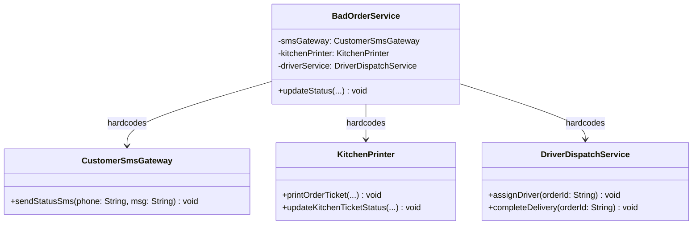
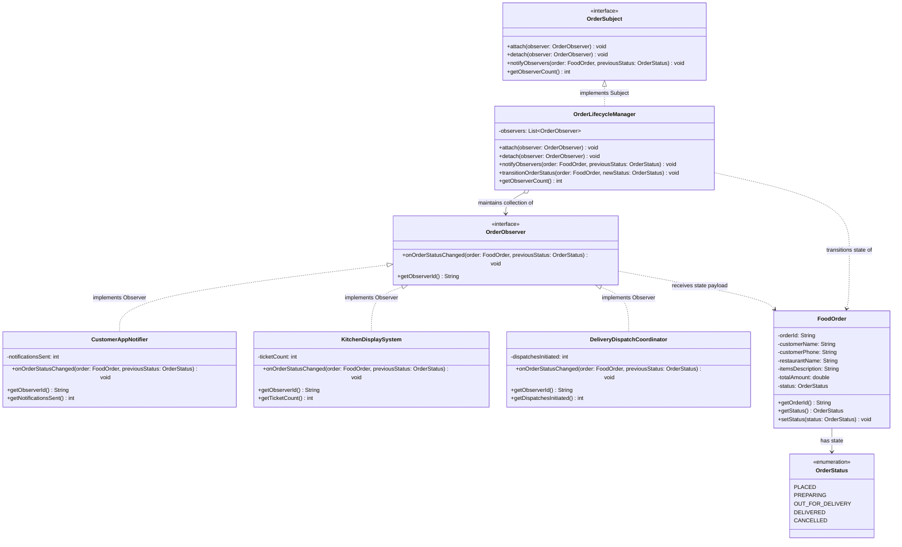

# Example 02: Food Delivery Order Status Updates

## 1. The Problem and Requirements in Simple Words

A food delivery application (such as DoorDash or UberEats) tracks an order as it moves through its operational lifecycle:
```
PLACED ──> PREPARING ──> OUT_FOR_DELIVERY ──> DELIVERED (or CANCELLED)
```

At every state transition, multiple distinct systems must be notified simultaneously:
- **The Customer:** Wants live progress in their mobile app and SMS alerts.
- **The Restaurant Kitchen:** Needs order tickets printed on thermal hardware and shown on kitchen display screens.
- **The Delivery Driver Fleet:** Needs to assign an available driver during preparation, send GPS coordinates during transit, and release the driver upon delivery.
- **Future Listeners:** Corporate accounting (for merchant billing), analytics pipelines, and fraud monitoring systems will also need order lifecycle events.

If the order service directly calls each external system with hardcoded method invocations, a failure in one service (like an SMS timeout) halts the entire transition, leaving the kitchen without a ticket.

---

## 2. Bad Design Analysis

In `bad/BadOrderService.java`, the order service manages state transitions using a monolithic `switch` block with hardcoded references to concrete services:

```java
switch (newStatus) {
    case PLACED -> {
        smsGateway.sendStatusSms(customerPhone, "Your order #" + orderId + " has been placed!");
        kitchenPrinter.printOrderTicket(orderId, restaurant, items);
    }
    case PREPARING -> {
        smsGateway.sendStatusSms(customerPhone, "Chef is now preparing your food!");
        kitchenPrinter.updateKitchenTicketStatus(orderId, "COOKING");
        driverService.assignDriver(orderId);
    }
    // ...
}
```

### Class Diagram of the Bad Design



*Explanation of the bad diagram:*
`BadOrderService` is directly coupled to `CustomerSmsGateway`, `KitchenPrinter`, and `DriverDispatchService`. It must know the distinct method names and arguments for every single system.

### Limitations of the Bad Approach
1. **Cascade Failures (No Fault Isolation):** If `smsGateway.sendStatusSms()` throws a network exception, the method immediately aborts. `kitchenPrinter.printOrderTicket()` is never called, so the restaurant never starts cooking!
2. **Violation of Open/Closed Principle (OCP):** Adding an accounting service or push notification service requires editing `BadOrderService` and modifying every single status branch.
3. **Tight Coupling:** The order domain model cannot be tested without instantiating telecom, printer, and driver services.
4. **No Dynamic Participation:** A customer cannot mute SMS notifications, and test environments cannot easily disable the kitchen printer.

---

## 3. Improved Design (Observer Pattern Step by Step)

The improved implementation in `good/` uses the GoF Observer pattern:

```
Step 1: Declare the Observer Abstraction (OrderObserver)
Step 2: Implement Diverse Observers (CustomerAppNotifier, KitchenDisplaySystem, DeliveryDispatchCoordinator)
Step 3: Declare the Subject Contract (OrderSubject)
Step 4: Implement Concrete Subject (OrderLifecycleManager with fault isolation and state transitions)
```

### Class Diagram of the Good Implementation



*Explanation of the good diagram:*
- `OrderSubject` declares methods to attach, detach, and broadcast updates to `OrderObserver`.
- `OrderLifecycleManager` encapsulates order state transitions and broadcasts events to its registered observers.
- `CustomerAppNotifier`, `KitchenDisplaySystem`, and `DeliveryDispatchCoordinator` each implement `OrderObserver` to handle notifications independently.
- `FoodOrder` is the domain entity passed as the event payload.

---

## 4. Class Responsibilities

| Class / Interface | Role | Responsibility |
| :--- | :--- | :--- |
| **`OrderObserver`** | Observer Interface | Defines the contract `onOrderStatusChanged(FoodOrder order, OrderStatus previousStatus)` and identifier `getObserverId()`. |
| **`CustomerAppNotifier`** | Concrete Observer | Delivers customer-facing push notifications and SMS updates for each lifecycle step. |
| **`KitchenDisplaySystem`** | Concrete Observer | Rings the kitchen chime, prints new order tickets, and updates the chef's active orders display. |
| **`DeliveryDispatchCoordinator`** | Concrete Observer | Coordinates courier dispatching, vehicle assignment, and delivery completion. |
| **`OrderSubject`** | Subject Interface | Defines subscriber management methods (`attach`, `detach`, `notifyObservers`). |
| **`OrderLifecycleManager`** | Concrete Subject | Manages order transitions, prevents duplicate attachments, and ensures fault-isolated broadcast. |
| **`FoodOrder`** | Domain Entity | Encapsulates order metadata (customer, restaurant, items, price, status). |
| **`OrderStatus`** | Domain Enum | Strongly-typed lifecycle stages (`PLACED`, `PREPARING`, `OUT_FOR_DELIVERY`, `DELIVERED`, `CANCELLED`). |
| **`FoodDeliveryDemo`** | Client | Entry point demonstrating order progression through its full lifecycle. |
| **`OrderLifecycleTest`** | Test Suite | Automated verification of multi-observer dispatch, detachment, duplicate prevention, and exception isolation. |

---

## 5. How the Subject Manages Observers and State Transitions

### Transitioning State and Broadcasting
```java
public void transitionOrderStatus(FoodOrder order, OrderStatus newStatus) {
    OrderStatus previous = order.getStatus();
    order.setStatus(newStatus);
    notifyObservers(order, previous);
}
```

### Fault-Isolated Notification Loop
```java
for (OrderObserver observer : observers) {
    try {
        observer.onOrderStatusChanged(order, previousStatus);
    } catch (Exception ex) {
        // A failure in one observer (e.g. SMS provider timeout) does NOT prevent
        // other observers (e.g. Kitchen Display) from receiving their critical update!
        System.err.println("Observer " + observer.getObserverId() + " failed: " + ex.getMessage());
    }
}
```

---

## 6. Why the Observer Pattern Fits This Situation

1. **Decoupled Lifecycle Events:** Order state changes are business-critical events that happen once, but affect many autonomous subsystems.
2. **Resilience & Fault Isolation:** If an SMS gateway or customer push service crashes, the kitchen printer and delivery dispatch systems must continue running uninterrupted.
3. **Pluggability:** New listeners (e.g., `FinancialLedgerObserver`, `LoyaltyPointsObserver`) can be attached to the ordering pipeline with zero changes to `OrderLifecycleManager`.

---

## 7. SOLID Principles Genuinely Demonstrated

- **Open/Closed Principle (OCP):** Adding an accounting observer or auditing service requires writing a new `OrderObserver` class. `OrderLifecycleManager.java` is never modified.
- **Dependency Inversion Principle (DIP):** `OrderLifecycleManager` depends strictly on the `OrderObserver` interface, having no knowledge of `CustomerAppNotifier` or `KitchenDisplaySystem`.
- **Single Responsibility Principle (SRP):** `OrderLifecycleManager` only manages order transitions and observer lists; each observer handles its own specific domain logic.

---

## 8. Trade-Offs and When Observer is Unnecessary

### Trade-Offs
- **Synchronous Execution:** All observer methods run sequentially on the calling thread. If an observer does a slow blocking network I/O call without asynchronous offloading, it slows down the order transition method.
- **State Mutation Risk:** If an observer inadvertently modifies the `FoodOrder` object inside `onOrderStatusChanged`, it can pollute subsequent observers. Passing immutable records or defensive copies mitigates this.

### When Observer is Unnecessary
- In simple CRUD applications where an order only saves to a database and no external notifications or UI updates exist.
- When an order transition is strictly linear and must halt if a specific downstream step fails (e.g., credit card payment must succeed before placing order—use Chain of Responsibility or a Saga orchestrator).
