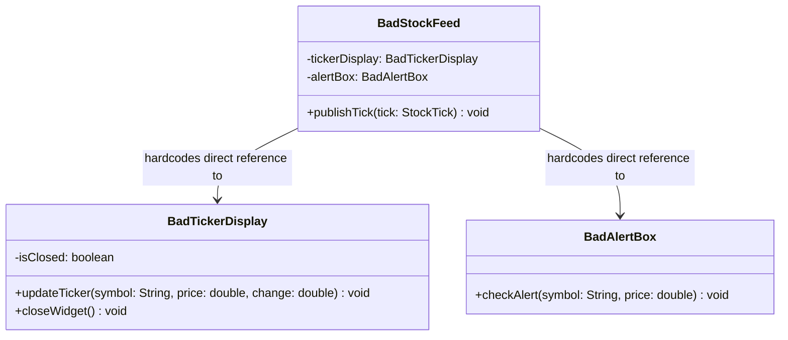
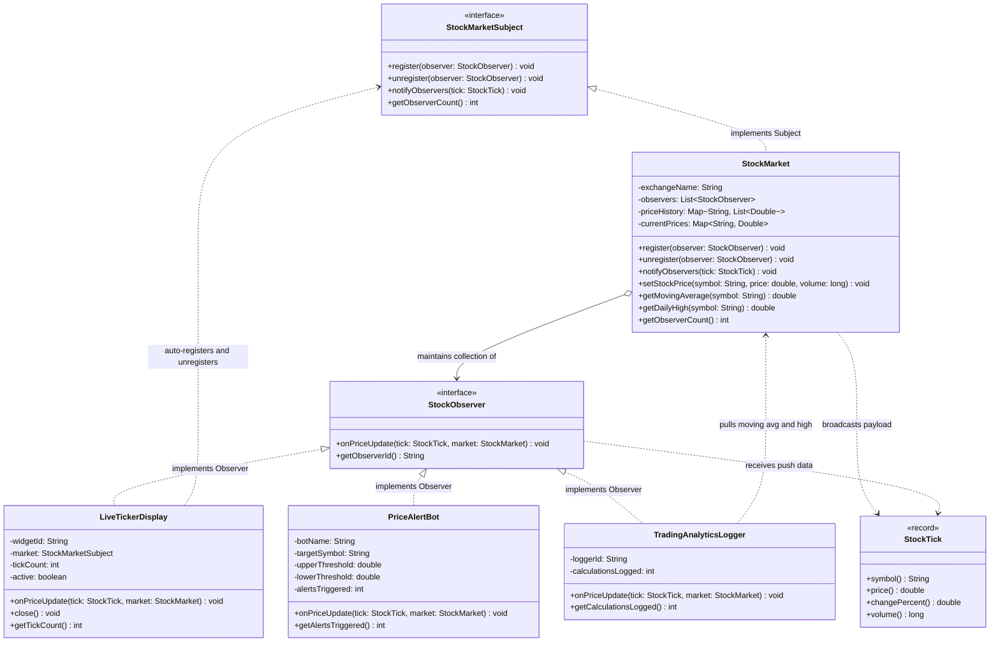

# Example 03: Stock Price Updates and Multiple Dashboard Displays

## 1. The Problem and Requirements in Simple Words

A financial market data platform broadcasts high-frequency real-time stock price changes (e.g., NASDAQ or NYSE ticks). Multiple diverse subscribers want to consume these price events:
- **Live Ticker Display Widget:** Renders the latest price, percentage change, and volume badge in a desktop trading terminal window.
- **Price Alert Bot:** Watches for specific price boundary triggers (e.g., alert when Apple crosses $190 or falls below $170) and ignores ordinary fluctuations.
- **Trading Analytics Logger:** Computes and records heavy statistical metrics (e.g., rolling 5-tick simple moving average, session high/low spread).
- **Dynamic Window Lifecycle:** Traders frequently open and close chart windows. When a window is closed, it must be detached so the system does not leak memory or waste CPU cycles pushing data to dead widgets.

---

## 2. Bad Design Analysis: The Lapsed Listener Problem

In `bad/BadStockFeed.java`, the market feed directly maintains hardcoded references to concrete GUI widgets:

```java
public class BadStockFeed {
    private final BadTickerDisplay tickerDisplay = new BadTickerDisplay();
    private final BadAlertBox alertBox = new BadAlertBox();

    public void publishTick(StockTick tick) {
        tickerDisplay.updateTicker(tick.symbol(), tick.price(), tick.changePercent());
        alertBox.checkAlert(tick.symbol(), tick.price());
    }
}
```

### Class Diagram of the Bad Design



*Explanation of the bad diagram:*
`BadStockFeed` holds hardcoded references to specific widgets. Even after a user closes a widget (`tickerDisplay.closeWidget()`), `BadStockFeed` retains a strong reference, preventing Java garbage collection and continuing to invoke methods on inactive UI components.

### Limitations of the Bad Approach
1. **Lapsed Listener Memory Leak:** When a user closes a display widget, the feed retains a strong reference to it. The garbage collector cannot reclaim it, creating a severe memory leak in long-running trading systems.
2. **Violation of Open/Closed Principle (OCP):** Adding a quantitative volatility logger or mobile webhook requires modifying `BadStockFeed.java` and editing the broadcast loop.
3. **No Support for the Pull Model:** If an analytics tool needs 24-hour moving averages or order book depth, pushing that heavy payload to all lightweight ticker displays wastes bandwidth and CPU.
4. **No Threshold Filtering:** Ticker displays, alert bots, and loggers are forced into the same rigid push invocation.

---

## 3. Improved Design (Observer Pattern with Push/Pull Support)

The improved implementation in `good/` resolves these challenges using the GoF Observer pattern:

```
Step 1: Declare the Observer Abstraction (StockObserver)
Step 2: Implement Diverse Concrete Observers (LiveTickerDisplay, PriceAlertBot, TradingAnalyticsLogger)
Step 3: Support Push & Pull: Pass lightweight tick AND Subject reference
Step 4: Implement AutoCloseable on Widgets to Eliminate Lapsed Listener Leaks
```

### Class Diagram of the Good Implementation



*Explanation of the good diagram:*
- `StockMarketSubject` defines the subscription contract.
- `StockObserver` accepts both a pushed `StockTick` and a `StockMarket` reference.
- `LiveTickerDisplay` implements `AutoCloseable` to safely unregister itself when closed, eliminating memory leaks.
- `PriceAlertBot` filters updates against upper and lower price thresholds.
- `TradingAnalyticsLogger` queries `market.getMovingAverage()` and `market.getDailyHigh()` using the pull model.

---

## 4. Class Responsibilities

| Class / Interface | Role | Responsibility |
| :--- | :--- | :--- |
| **`StockObserver`** | Observer Interface | Defines `onPriceUpdate(StockTick tick, StockMarket market)` supporting push and pull interactions. |
| **`LiveTickerDisplay`** | Concrete Observer | Renders live tick data and implements `AutoCloseable` to guarantee unregistration upon window closure. |
| **`PriceAlertBot`** | Concrete Observer | Selectively fires notifications only when a specific stock breaches defined upper or lower price boundaries. |
| **`TradingAnalyticsLogger`** | Concrete Observer | Demonstrates the **Pull Model** by pulling moving average and session high calculations from the subject. |
| **`StockMarketSubject`** | Subject Interface | Declares registry operations (`register`, `unregister`, `notifyObservers`). |
| **`StockMarket`** | Concrete Subject | Broadcasts price ticks, maintains price history, provides pull query endpoints, and isolates observer exceptions. |
| **`StockTick`** | Domain Record | Immutable push payload carrying symbol, price, percentage change, and volume. |
| **`StockMarketDemo`** | Client | Entry point demonstrating real-time market updates, alert triggers, pull queries, and clean widget closure. |
| **`StockMarketTest`** | Test Suite | Automated verification of push/pull, threshold filtering, lapsed listener prevention, and fault isolation. |

---

## 5. Push vs. Pull Model in This Implementation

This design demonstrates the hybrid push-pull technique recommended in professional software engineering:

### 1. The Pushed Payload
The Subject pushes the essential, lightweight facts that every observer needs:
```java
public record StockTick(String symbol, double price, double changePercent, long volume) {}
```
This avoids making any query for basic ticker rendering.

### 2. The Pulled Data
For observers that need heavy, optional, or specialized calculations, the Subject passes a reference to itself:
```java
// Inside TradingAnalyticsLogger:
@Override
public void onPriceUpdate(StockTick tick, StockMarket market) {
    // Selectively pulls only when this observer runs:
    double movingAverage = market.getMovingAverage(tick.symbol());
    double dailyHigh = market.getDailyHigh(tick.symbol());
}
```
This prevents bloating the `StockTick` record with fields that 90% of observers do not care about.

---

## 6. Eliminating the Lapsed Listener Memory Leak

The `LiveTickerDisplay` implements `AutoCloseable`:
```java
public class LiveTickerDisplay implements StockObserver, AutoCloseable {
    private final StockMarketSubject market;

    public LiveTickerDisplay(String widgetId, StockMarketSubject market) {
        this.market = market;
        this.market.register(this);
    }

    @Override
    public void close() {
        market.unregister(this); // Clean removal from Subject's observer list
    }
}
```

When used within a try-with-resources block or bound to a UI window close event:
```java
try (LiveTickerDisplay display = new LiveTickerDisplay("Window-1", market)) {
    // Window active: receives price updates
} // Exiting block calls display.close() automatically!
```
The subject no longer holds a reference, allowing the garbage collector to reclaim the object immediately.

---

## 7. SOLID Principles Genuinely Demonstrated

- **Open/Closed Principle (OCP):** Introducing an algorithmic automated trading observer (`AlgorithmicBuyBot`) requires writing a new class implementing `StockObserver`. The exchange engine (`StockMarket.java`) remains completely untouched.
- **Dependency Inversion Principle (DIP):** `StockMarket` relies only on the `StockObserver` interface, having no knowledge of GUI displays, bots, or logging systems.
- **Single Responsibility Principle (SRP):** `StockMarket` calculates price movements and manages subscriber lists; `LiveTickerDisplay` only renders UI elements; `PriceAlertBot` only monitors risk thresholds.

---

## 8. Trade-Offs and When Observer is Unnecessary

### Trade-Offs
- **Synchronous Notification Bottleneck:** In ultra-low-latency high-frequency trading (HFT), synchronous iteration over an observer list adds nanoseconds of latency. HFT engines use lock-free ring buffers (such as the LMAX Disruptor) rather than classic object-oriented Observer lists.
- **Pull Overhead:** If 500 observers all pull moving averages at the exact same moment on the same thread, the subject must compute or look up 500 averages synchronously.

### When Observer is Unnecessary
- When price updates are requested only on-demand by a user clicking a "Refresh" button (standard client-server request-response).
- When data stream consumers are distributed across different machines (use a distributed event streaming broker like Kafka instead).
