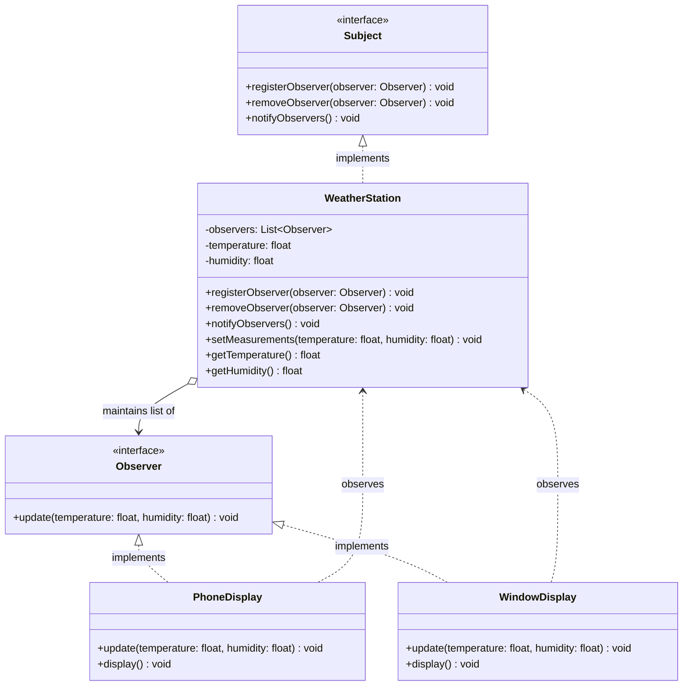
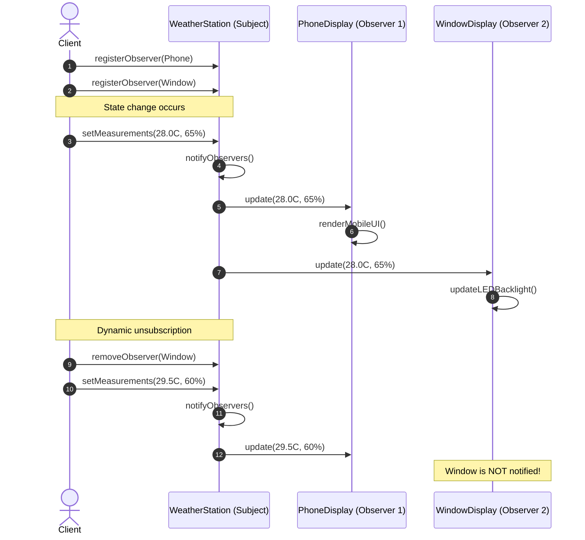

# Observer Design Pattern

The **Observer Pattern** is a behavioral design pattern from the Gang of Four (GoF). It defines a **one-to-many dependency** between objects so that when one object (the **Subject** or **Publisher**) changes its state, all its dependents (the **Observers** or **Subscribers**) are notified and updated automatically.

In simple terms: **"Don't call us, we'll notify you."**

---

## 1. What is the Observer Pattern and Why is it Needed?

### The Core Problem: How to Stay Informed
In software, objects often need to know when something happens in another object:
- A user interface needs to update when data changes.
- A mobile app needs to display an alert when a food order is out for delivery.
- A trading screen needs to refresh when a stock price changes.

Without a structured pattern, there are two naive ways to achieve this:

1. **Continuous Polling (Busy Waiting):** The client repeatedly asks the target object: *"Did you change yet? Did you change yet?"* This wastes CPU cycles, drains battery, floods networks, and adds latency.
2. **Hardcoded Direct Calls:** The target object directly holds references to every interested class and calls them one by one. This creates **tight coupling**—the target must know about every single listener and changes whenever listeners are added or removed.

### The Observer Solution
The Observer pattern flips the relationship:
- The target object becomes a **Subject** (Publisher). It maintains a list of interested parties.
- Interested parties implement a common **Observer** (Subscriber) interface.
- When an event occurs, the Subject loops through its list and calls a single method (e.g., `update()`).
- The Subject does not know who the observers are, what they do, or how many there are.

---

## 2. Real-Life Analogy: YouTube Channel Subscriptions

Think about how YouTube works in everyday life:

```
+-----------------------------------------------------------------------------+
|                          YouTube Channel: "TechBites"                       |
|   Subscribers List: [ Alice, Bob, Charlie, MobileAppNotifier ]              |
|                                                                             |
|   Action: Creator uploads "Design Patterns in 10 Minutes"                   |
+-----------------------------------------------------------------------------+
                                      │
               ┌──────────────────────┼──────────────────────┐
               ▼                      ▼                      ▼
      +-----------------+    +-----------------+    +-----------------+
      |  Alice (User)   |    |   Bob (User)    |    |  Push Notifier  |
      | Sees notification|   | Receives email  |    | Sends mobile UI |
      | in browser bell |    | alert in inbox  |    | push banner     |
      +-----------------+    +-----------------+    +-----------------+
```

1. **The Creator does not chase viewers:** The YouTuber does not call Alice, Bob, and Charlie individually to tell them a video is ready.
2. **Viewers subscribe:** If Alice wants updates, she clicks **"Subscribe"** (registration).
3. **Viewers can unsubscribe:** If Bob loses interest, he clicks **"Unsubscribe"** (deregistration). TechBites removes Bob from the list.
4. **Broadcast notification:** When a video goes live, YouTube automatically pushes a notification to everyone currently on the subscriber list.

- **Subject:** The YouTube Channel.
- **Observers:** The Subscribers.
- **State Change:** A new video upload.
- **Notification:** The subscription update ping.

---

## 3. The Problem Without Observer

Let us see what happens when code tries to manage notifications without the Observer pattern:

```java
public class WeatherStation {
    private float temperature;
    
    // Direct, hardcoded dependencies on concrete display classes
    private PhoneDisplay phoneDisplay = new PhoneDisplay();
    private WindowDisplay windowDisplay = new WindowDisplay();
    private BillboardDisplay billboardDisplay = new BillboardDisplay();

    public void setTemperature(float temperature) {
        this.temperature = temperature;
        
        // Hardcoded, tightly coupled notifications
        phoneDisplay.updatePhone(this.temperature);
        windowDisplay.refreshWindow(this.temperature);
        billboardDisplay.showOnBillboard(this.temperature);
    }
}
```

### Why This Design Fails
1. **Violation of the Open/Closed Principle (OCP):** If you want to add a `SmartWatchDisplay`, you must modify `WeatherStation` by adding a new field and changing `setTemperature()`.
2. **Violation of the Dependency Inversion Principle (DIP):** `WeatherStation` (high-level domain model) directly depends on low-level UI displays.
3. **No Dynamic Subscription:** You cannot add or remove displays at runtime. If a user turns off their phone screen, the station still calls it.
4. **Fragile and Error-Prone:** If `billboardDisplay` throws an error or requires different parameters, the entire station crashes.

---

## 4. How Observer Works, Step by Step

```
Step 1: Declare the Observer Interface
        [ Observer ]  <-- Contract: void update(Event event)

Step 2: Declare the Subject (Publisher) Interface
        [ Subject ]   <-- Contract: registerObserver(o), removeObserver(o), notifyObservers()

Step 3: Concrete Subject Implements the List
        - Holds List<Observer> observers = new ArrayList<>();
        - On state change: notifyObservers() { for (Observer o : observers) o.update(...); }

Step 4: Concrete Observers Implement the Interface
        [ PhoneDisplay implements Observer ]
        [ WindowDisplay implements Observer ]

Step 5: Runtime Subscription
        station.registerObserver(phoneDisplay);
        station.registerObserver(windowDisplay);
        station.setTemperature(24.5f); // Both get notified automatically!
```

---

## 5. Class Diagram: Structure and Participants



### Plain English Explanation of the Class Diagram
- **`Subject` (Interface):** Defines methods to attach (`registerObserver`), detach (`removeObserver`), and notify observers.
- **`Observer` (Interface):** Defines the update contract that the Subject uses to notify subscribers.
- **`WeatherStation` (Concrete Subject):** Stores state (`temperature`, `humidity`) and maintains a collection of `Observer` instances. It notifies them whenever measurements change.
- **`PhoneDisplay` & `WindowDisplay` (Concrete Observers):** Implement `Observer` and react to incoming updates in their own unique way without the Subject needing to know their concrete classes.

---

## 6. Sequence Diagram: Event Notification Flow



### Plain English Explanation of the Sequence Diagram
1. The **Client** attaches both `Phone` and `Window` observers to `WeatherStation`.
2. When `setMeasurements()` is invoked, `WeatherStation` executes `notifyObservers()`.
3. The subject iterates through its observer list and calls `update()` on `Phone` and then `Window`.
4. The client unregisters `Window`.
5. On the next measurement change, only `Phone` receives the notification. `Window` is safely skipped.

---

## 7. How Observers Subscribe and Unsubscribe

A robust Subject must manage its subscribers cleanly:

```java
public class ConcreteSubject implements Subject {
    // Thread-safe copy or synchronized list
    private final List<Observer> observers = new CopyOnWriteArrayList<>();

    @Override
    public void registerObserver(Observer o) {
        if (o == null) {
            throw new IllegalArgumentException("Observer cannot be null.");
        }
        if (!observers.contains(o)) { // Prevent duplicate registrations
            observers.add(o);
        }
    }

    @Override
    public void removeObserver(Observer o) {
        observers.remove(o); // Safe removal
    }

    @Override
    public void notifyObservers() {
        for (Observer o : observers) {
            o.update(this.state);
        }
    }
}
```

### Key Lifecycle Principles
1. **Idempotent Registration:** Registering the same observer twice should not result in duplicate notifications.
2. **Safe Detachment:** Calling `removeObserver()` during an active notification iteration must not throw `ConcurrentModificationException`. (Using `CopyOnWriteArrayList` or iterating over a snapshot array prevents this).
3. **No Memory Leaks (The Lapsed Listener Problem):** Observers must unsubscribe when they are no longer needed; otherwise, the Subject's strong reference keeps the Observer alive in garbage collection.

---

## 8. Push vs. Pull Notification Models

When an event fires, how should data travel from Subject to Observer?

| Feature | Push Model | Pull Model |
| :--- | :--- | :--- |
| **How it Works** | The Subject pushes all event details as arguments in `update(...)`. | The Subject only sends a minimal ping or a reference to itself: `update(Subject s)`. The Observer queries only the data it needs. |
| **Method Signature** | `void update(float temp, float humidity, float pressure);` | `void update(WeatherStation station);` or `void update();` |
| **Coupling** | Low coupling: Observer does not depend on the Subject class at all. | Moderate coupling: Observer must know the Subject's getter methods (`station.getTemperature()`). |
| **Data Efficiency** | May send unnecessary data to observers that only care about one metric. | Observers pull strictly what they need. Highly scalable when event state is large. |
| **Best Used When** | Event payload is small, fixed, and universally needed by all observers. | State is complex, changes frequently, or different observers need different subsets of data. |

### Push Example
```java
// Subject pushes everything
public void notifyObservers() {
    for (Observer o : observers) {
        o.update(this.temperature, this.humidity);
    }
}
```

### Pull Example
```java
// Subject passes reference to itself; observer pulls what it wants
public void notifyObservers() {
    for (Observer o : observers) {
        o.update(this); // Observer calls this.getTemperature() if needed
    }
}
```

---

## 9. Observer vs. Direct Method Calls vs. Event Listeners

| Aspect | Direct Method Calls | Observer Pattern (GoF) | GUI / Framework Event Listeners |
| :--- | :--- | :--- | :--- |
| **Coupling** | **Tight:** Caller directly references target classes. | **Loose:** Subject references only the `Observer` interface. | **Loose:** Components emit event objects consumed by handler callbacks. |
| **Cardinality** | 1-to-1 (hardcoded). | 1-to-Many (dynamic list). | 1-to-Many with typed events (e.g., `MouseEvent`, `KeyEvent`). |
| **Extensibility** | Poor: modifying listeners changes caller. | Excellent: new observers implement the interface without touching the Subject. | Excellent: listeners subscribe with lambdas or dedicated adapter classes. |
| **Primary Scope** | Local synchronous procedures. | Object-oriented domain logic. | UI frameworks (Swing, Android) and event-driven architectures. |

---

## 10. Observer vs. Mediator

Both patterns handle communication between objects, but with fundamentally different topologies:

```
Observer Pattern (1-to-Many Broadcast):
    [ Subject ] ─────── notifies ───────> [ Observer A ]
           │
           ├─────────── notifies ───────> [ Observer B ]
           │
           └─────────── notifies ───────> [ Observer C ]

Mediator Pattern (Many-to-Many Centralized Coordinator):
    [ Colleague A ] <───┐             ┌───> [ Colleague B ]
                        ▼             ▼
                     [    Mediator Hub    ]
                        ▲             ▲
    [ Colleague C ] <───┘             └───> [ Colleague D ]
```

| Dimension | Observer Pattern | Mediator Pattern |
| :--- | :--- | :--- |
| **Communication Flow** | One-way broadcast: One Subject notifies multiple Observers. | Two-way coordination: Colleagues talk to each other *through* the Mediator. |
| **Knowledge** | Subject doesn't know who observers are. Observers react independently. | Colleagues know only the Mediator; Mediator knows all colleagues and coordinates complex interactions. |
| **Goal** | Distribute state changes to interested parties. | Reduce spaghetti many-to-many connections between UI or domain components. |

---

## 11. SOLID Principles in the Observer Pattern

### Open/Closed Principle (OCP)
The Subject is **closed for modification** but **open for extension**:
- You can add 10 new types of observers (`EmailAlert`, `DiscordWebhook`, `AuditLogger`).
- **Zero lines** of code inside `WeatherStation` or `Subject` are touched!

```java
// Adding a brand new observer requires NO changes to existing Subject:
public class DiscordAlertObserver implements Observer {
    @Override
    public void update(float temp, float humidity) {
        System.out.println("Posting to Discord channel: Temp is " + temp);
    }
}
```

### Dependency Inversion Principle (DIP)
High-level modules and low-level modules both depend on abstractions:
- `WeatherStation` (High-Level) depends on `Observer` (Abstraction), not `PhoneDisplay` (Low-Level).
- `PhoneDisplay` (Low-Level) depends on `Observer` (Abstraction).

---

## 12. Advantages, Disadvantages, and Trade-Offs

### Advantages
1. **Loose Coupling:** Subject and Observers can be modified, tested, and reused independently.
2. **Dynamic Subscriptions:** Observers can be registered and removed at any time during program execution.
3. **Broadcast Communication:** The Subject does not need to specify individual recipients; notifications are broadcast automatically.
4. **Supports Clean Separation of Concerns (SoC):** Business logic resides in the Subject; presentation or alert mechanisms reside in Observers.

### Disadvantages & Trade-Offs
1. **Lapsed Listener Problem (Memory Leaks):** If an observer forgets to unsubscribe, the Subject retains a reference, preventing garbage collection.
2. **Unpredictable Notification Order:** Observers should never depend on the order in which they are notified.
3. **Cascading Updates:** If Observer A modifies Subject B, which notifies Observer C, which modifies Subject A, you can create infinite update loops.
4. **Performance Overhead:** If there are thousands of observers and state changes happen thousands of times per second, notifying all of them synchronously can stall the subject thread.

---

## 13. When to Use It and When NOT to Use It

### When to Use
- When a change to one object requires changing other objects, and you don't know how many objects need to change in advance.
- When an object should notify others without knowing who they are (e.g., UI widgets, order tracking, sensor telemetry).
- When an abstraction has two aspects, one dependent on the other (e.g., business entity vs. dashboard view).

### When NOT to Use
- **Simple 1-to-1 relationships:** If only one specific class will ever care about an event, a direct method call or a simple callback is much simpler.
- **Strictly sequential workflows:** If step B must always complete before step C, a pipeline or Chain of Responsibility is a better fit.
- **High-throughput micro-benchmarks:** When microsecond latency is critical and synchronous list iteration overhead is unacceptable.

---

## 14. Common Mistakes and How to Avoid Them

### 1. The Lapsed Listener Problem (Memory Leak)
```java
// MISTAKE: Adding observer and never removing it when destroyed
station.registerObserver(tempWidget); 
// tempWidget is closed by user, but station still holds strong reference!
```
*Solution:* Ensure observers unsubscribe in `dispose()`, `close()`, or use `WeakReference<Observer>` inside the Subject.

### 2. Modifying the Observer List During Notification
```java
// MISTAKE: Throws ConcurrentModificationException
for (Observer o : observers) {
    o.update(); // If o calls station.removeObserver(this), loop crashes!
}
```
*Solution:* Iterate over a defensive copy: `for (Observer o : new ArrayList<>(observers))` or use `CopyOnWriteArrayList`.

### 3. One Failing Observer Breaks the Whole Pipeline
```java
// MISTAKE: If observer 2 throws an exception, observer 3 never gets notified!
for (Observer o : observers) {
    o.update(data); // Unhandled RuntimeException here halts iteration!
}
```
*Solution:* Wrap individual observer notifications in `try-catch` blocks to provide fault isolation:
```java
for (Observer o : observers) {
    try {
        o.update(data);
    } catch (Exception ex) {
        System.err.println("Failed to notify observer: " + ex.getMessage());
    }
}
```

### 4. Relying on Notification Order
*Mistake:* Assuming `ObserverA` always runs before `ObserverB`. Observers must be self-contained and order-independent.

---

## 15. How to Identify a Genuine Observer Implementation

To confirm an implementation genuinely follows the GoF Observer pattern, verify:

1. **Observer Abstraction Exists:** There is a common interface or abstract class for observers (e.g., `Observer`, `Subscriber`, `Listener`).
2. **Subject Maintains a Collection:** The subject stores observers in a collection (`List`, `Set`), not individual hardcoded fields.
3. **Dynamic Subscription Methods:** The subject provides explicit `register/subscribe` and `unregister/unsubscribe` methods.
4. **Polymorphic Notification:** The subject broadcasts updates by looping over the observer collection and calling the interface method.
5. **No Direct Concrete Coupling:** The subject does not import or instantiate concrete observer classes.

> **Note on Message Brokers:** Tools like Apache Kafka or RabbitMQ are distributed publish-subscribe infrastructure, not the GoF Observer pattern. Observer is an in-memory, object-oriented design pattern running within a single process.

---

## 16. Real-World Interview Questions & Answers

### Q1: What is the main difference between Observer and Pub-Sub?
**Answer:** In the GoF Observer pattern, the Subject knows its list of observers (though only as interface types) and notifies them directly in the same memory space. In a Publish-Subscribe pattern, publishers and subscribers are completely decoupled through a third-party message broker or event bus (e.g., Kafka, Redis, EventBus); publishers do not hold references to subscribers.

### Q2: What is the "Lapsed Listener Problem" and how do you fix it?
**Answer:** It is a memory leak occurring when an observer registers with a subject but forgets to unsubscribe when it is discarded. Because the subject holds a strong reference to the observer, the garbage collector cannot reclaim it. It is fixed by ensuring explicit unsubscription (e.g., `AutoCloseable`), or by using `WeakReference` in the subject.

### Q3: When would you use Push vs. Pull models?
**Answer:** Use **Push** when the event payload is small, simple, and needed by all observers. Use **Pull** when the subject holds a large or complex state and different observers only need small, varying subsets of that state.

### Q4: How do you handle exceptions in observers?
**Answer:** A well-designed Subject wraps each observer invocation in a `try-catch` block. This prevents a misbehaving or slow observer from breaking the notification chain for subsequent observers.

---

## 17. Final Revision Checklist

- [ ] **Observer Interface:** Is there an `Observer` interface with an `update()` method?
- [ ] **Subject Interface / Abstraction:** Does the Subject provide `registerObserver()`, `removeObserver()`, and `notifyObservers()`?
- [ ] **No Hardcoded Dependencies:** Does the Subject avoid references to concrete observer classes?
- [ ] **Thread-Safe Iteration:** Is the observer collection safe against concurrent modification during unsubscription?
- [ ] **Fault Isolation:** Does an unhandled exception in one observer stop notifications to other observers?
- [ ] **No Duplicate Subscriptions:** Does the registration logic guard against duplicate entries?
- [ ] **Memory Leak Prevention:** Do observers have a clear lifecycle or unsubscription mechanism?
