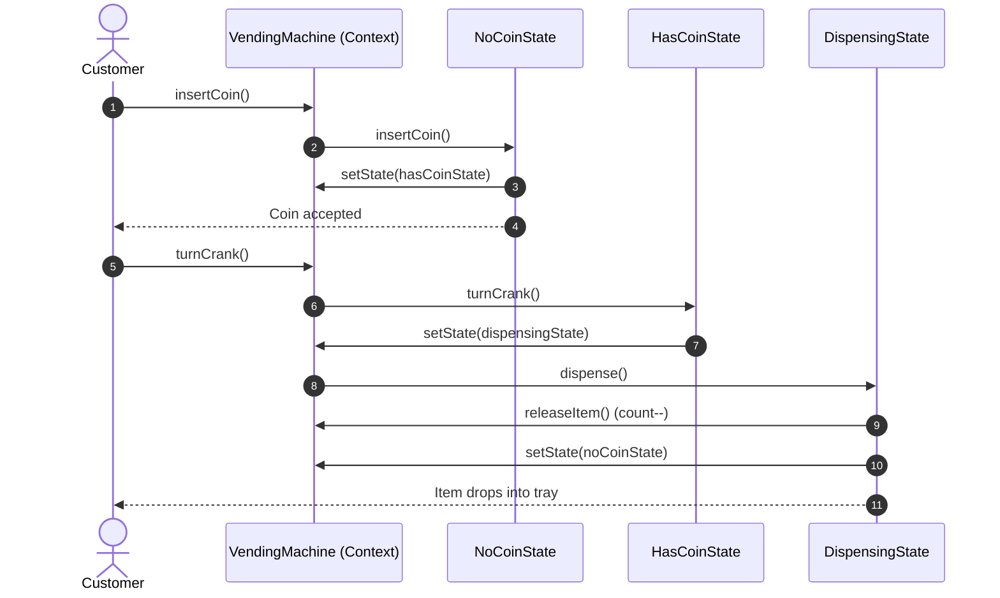

# Example 01: Vending Machine Controller

## 1. The Problem

An automated snack vending machine must respond correctly to user inputs and physical hardware events across its lifecycle:
- **`NO_COIN`:** The machine is idle. Ejecting coins does nothing; turning the crank prompts for payment; dispensing is locked.
- **`HAS_COIN`:** A coin has been verified. Inserting a second coin rejects it; ejecting the coin returns it and resets state to `NO_COIN`; turning the crank transitions to `DISPENSING`.
- **`DISPENSING`:** The motorized coil is actively rotating. Inserting coins or turning the crank is blocked. When the item drops, inventory decrements. If items remain, it returns to `NO_COIN`; if inventory reaches 0, it transitions to `SOLD_OUT`.
- **`SOLD_OUT`:** The machine is empty. Inserting coins immediately rejects them; turning the crank reports out-of-stock. Refilling items restores the machine to `NO_COIN`.

When implemented with primitive conditional flags (`switch (state)`), the controller becomes fragile, error-prone, and resistant to new business requirements.

---

## 2. Bad Design Analysis

In `bad/VendingMachine.java`, every action is implemented with a monolithic `switch (state)`:

```java
public void insertCoin() {
    switch (state) {
        case NO_COIN -> state = State.HAS_COIN;
        case HAS_COIN -> System.out.println("Coin already inserted!");
        case DISPENSING -> System.out.println("Wait, dispensing!");
        case SOLD_OUT -> System.out.println("Sold out!");
    }
}
```

### Why This Design Fails
1. **Violation of the Open/Closed Principle (OCP):** Adding a new state (e.g., `MAINTENANCE` or `WINNER_FREE_ITEM`) requires editing `insertCoin()`, `ejectCoin()`, `turnCrank()`, and `dispense()`. Every method in the system is modified.
2. **Violation of the Single Responsibility Principle (SRP):** `VendingMachine` handles physical inventory tracking *and* the tangled transition logic for 4+ states across 4 actions ($4 \times 4 = 16$ branches).
3. **Fragile State Invariants:** Omitting a state assignment in any branch can leave the machine permanently stuck in `DISPENSING` or accepting money when sold out.

---

## 3. Improved Design (State Pattern)

The improved design in `good/` models each lifecycle phase as an independent class implementing `VendingState`:

```
[ VendingMachine (Context) ] ──> delegates to ──> [ VendingState (Interface) ]
                                                         ▲
         ┌───────────────────┬───────────────────────────┴────────────────────────┬─────────────────────┐
         │                   │                                                    │                     │
  [ NoCoinState ]     [ HasCoinState ]                                    [ DispensingState ]    [ SoldOutState ]
```

### Participants
- **State Interface (`VendingState`):** Declares `insertCoin()`, `ejectCoin()`, `turnCrank()`, and `dispense()`.
- **Concrete States:**
  - `NoCoinState`: Accepts coins, transitioning machine to `HasCoinState`.
  - `HasCoinState`: Returns coins on eject; triggers item dispensing on crank turn.
  - `DispensingState`: Drops item, decrements count, and transitions to `NoCoinState` or `SoldOutState`.
  - `SoldOutState`: Rejects coins and crank turns; handles machine refill.
- **Context (`VendingMachine`):** Maintains pre-allocated instances of all states and delegates actions to `currentState`.

---

## 4. Execution Flow: The Purchase Cycle



### Explanation of Sequence
1. Customer inserts a coin. `VendingMachine` delegates to `NoCoinState`.
2. `NoCoinState` validates and transitions `VendingMachine` to `HasCoinState`.
3. Customer turns the crank. `HasCoinState` moves the machine to `DispensingState`.
4. `DispensingState` activates hardware release (`releaseItem()`), decrements stock, and resets to `NoCoinState`.

---

## 5. Relationship to SOLID Principles

- **Open/Closed Principle (OCP):** Introducing a new state (e.g., `WinnerState`) requires writing one new class `WinnerState implements VendingState`. The core `VendingMachine` class remains untouched.
- **Single Responsibility Principle (SRP):** Each state class encapsulates all logic and transitions relevant exclusively to that lifecycle phase.
- **Dependency Inversion Principle (DIP):** `VendingMachine` depends on the `VendingState` abstraction.
