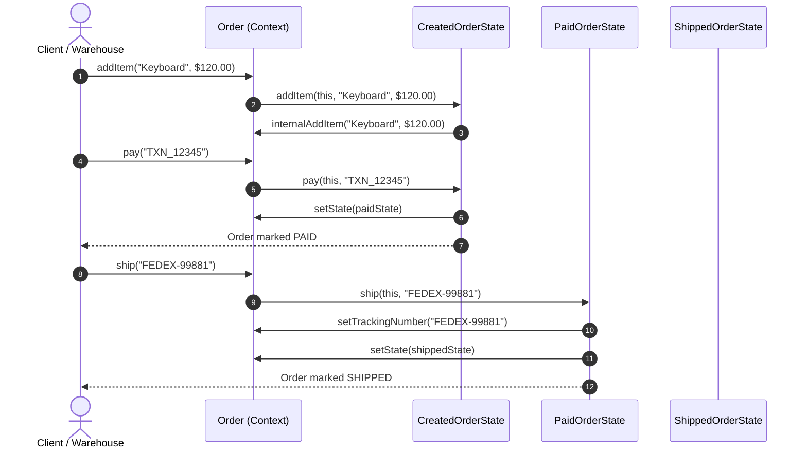

# Example 02: Order Lifecycle Management (E-Commerce)

## 1. The Problem

An online retail order moves through several distinct business states:
- **`CREATED`:** Draft phase where items can be added or removed. The customer can cancel at will or proceed to payment. Shipping and refunds are strictly prohibited.
- **`PAID`:** Funds captured. Cart is frozen (no adding items). Can be shipped with a tracking number, or cancelled with an automatic refund.
- **`SHIPPED`:** Order is in transit with a carrier. Cannot be modified or cancelled directly (the customer must wait for delivery to return). Can be marked delivered.
- **`DELIVERED`:** Item received. Can be refunded upon return verification. Cannot be paid, shipped, or cancelled.
- **`CANCELLED`:** Terminal state. All further mutations and actions are rejected.

Using primitive status flags with `switch` statements across every order method creates rigid code, invalid transition holes, and messy error handling.

---

## 2. Bad Design Analysis

In `bad/Order.java`, methods like `pay()`, `ship()`, and `cancel()` check `OrderStatus` using `if-else` cascades:

```java
public void ship(String trackingNumber) {
    if (status == OrderStatus.PAID) {
        this.status = OrderStatus.SHIPPED;
    } else if (status == OrderStatus.CREATED) {
        System.out.println("ERROR: Cannot ship unpaid order.");
    } else if (status == OrderStatus.SHIPPED) { ... }
}
```

### Why This Design Fails
1. **Violation of the Open/Closed Principle (OCP):** Adding a state (e.g., `OUT_FOR_DELIVERY` or `DISPUTED`) forces edits across every single method in `Order.java`.
2. **Violation of the Single Responsibility Principle (SRP):** `Order` manages cart calculation, courier tracking numbers, and the entire combinatorial transition matrix.
3. **Silent Failures:** Instead of throwing clear domain exceptions (`IllegalStateException`), bad designs print console messages and fail silently.

---

## 3. Improved Design (State Pattern)

The improved design in `good/` encapsulates each lifecycle phase into a dedicated class implementing `OrderState`:

```
[ Order (Context) ] ──> delegates to ──> [ OrderState (Interface) ]
                                                ▲
         ┌───────────────────┬──────────────────┴───────────────┬─────────────────────┬─────────────────────┐
         │                   │                                  │                     │                     │
[ CreatedOrderState ] [ PaidOrderState ]              [ ShippedOrderState ] [ DeliveredOrderState ] [ CancelledOrderState ]
```

### Participants
- **State Interface (`OrderState`):** Declares `addItem()`, `pay()`, `ship()`, `deliver()`, `cancel()`, `refund()`.
- **Concrete States:** Each class permits only valid operations for that state and throws `IllegalStateException` for illegal operations.
- **Context (`Order`):** Aggregates items, total, and metadata. Delegates actions to `currentState`.

---

## 4. Execution Flow: Order Progression



### Explanation of Sequence
1. Customer adds items while in `CreatedOrderState`.
2. Customer pays. `CreatedOrderState` transitions the order to `PaidOrderState`.
3. Warehouse attaches tracking number. `PaidOrderState` moves the order to `ShippedOrderState`.
4. Any attempt to modify cart items during `PaidOrderState` throws an `IllegalStateException`.

---

## 5. Relationship to SOLID Principles

- **Open/Closed Principle (OCP):** Introducing a new state (e.g., `ReturnRequestedOrderState`) requires adding a new class. Core order management logic is never modified.
- **Single Responsibility Principle (SRP):** Each state class isolates the transition rules and behaviors for a single phase.
- **Dependency Inversion Principle (DIP):** `Order` depends on the abstract `OrderState` interface.
