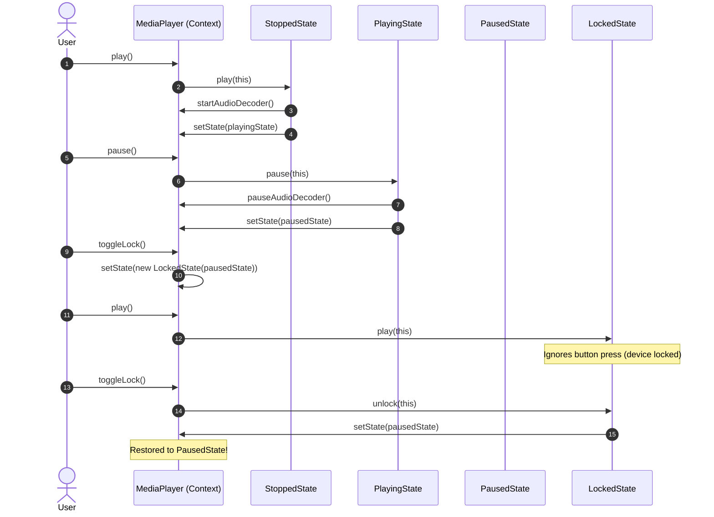

# Example 03: Media Player Control Engine

## 1. The Problem

An audio/video player application manages media streaming across distinct interactive states:
- **`STOPPED`:** Idle state. Pressing Play starts playback from 00:00; Pause does nothing; Stop does nothing; Next/Previous advance track while remaining stopped.
- **`PLAYING`:** Actively decoding audio. Pressing Play toggles pause; Pause records the current offset and transitions to `PAUSED`; Stop halts the decoder, rewinds to 00:00, and transitions to `STOPPED`; Next/Previous skips track and keeps playing.
- **`PAUSED`:** Audio suspended. Pressing Play resumes from the exact second offset; Stop rewinds to 00:00 and transitions to `STOPPED`.
- **`LOCKED`:** Physical keypad lock activated. All playback controls (Play, Pause, Stop, Skip) are ignored to prevent accidental pocket presses. Toggling the lock button restores whichever state was active immediately before locking!

When implemented with primitive flags, handling lock/unlock history and multiple button behaviors results in nested conditionals and state-leakage bugs.

---

## 2. Bad Design Analysis

In `bad/MediaPlayer.java`, all operations are stuffed into switch statements that check `PlayerStatus`:

```java
public void play() {
    switch (status) {
        case STOPPED -> { status = PlayerStatus.PLAYING; startPlayback(); }
        case PAUSED -> { status = PlayerStatus.PLAYING; resumePlayback(); }
        case PLAYING -> { status = PlayerStatus.PAUSED; pausePlayback(); }
        case LOCKED -> System.out.println("WARNING: Locked!");
    }
}
```

### Why This Design Fails
1. **Violation of the Open/Closed Principle (OCP):** Adding states like `FAST_FORWARDING` or `BUFFERING` requires modifying every control method (`play`, `pause`, `stop`, `next`, `previous`, `toggleLock`).
2. **Fragile Historical State Tracking:** Remembering what state to restore when unlocking requires tracking `statusBeforeLock` through ad-hoc variables that easily fall out of sync.
3. **Bloated Class:** Audio decoder commands, playlist cursor indices, and state transition matrices are all crammed into a single class.

---

## 3. Improved Design (State Pattern)

The improved design in `good/` uses the **State Pattern**:

```
[ MediaPlayer (Context) ] ──> delegates to ──> [ PlayerState (Interface) ]
                                                      ▲
         ┌───────────────────┬────────────────────────┼───────────────────────┐
         │                   │                        │                       │
  [ StoppedState ]    [ PlayingState ]         [ PausedState ]         [ LockedState ]
                                                                              │
                                                                       (remembers previousState)
```

### Participants
- **State Interface (`PlayerState`):** Declares `play()`, `pause()`, `stop()`, `next()`, `previous()`.
- **Concrete States:**
  - `StoppedState`: Starts playback from start on `play()`.
  - `PlayingState`: Toggles to pause on `play()`; stops and rewinds on `stop()`.
  - `PausedState`: Resumes from saved offset on `play()`.
  - `LockedState`: Blocks all controls. Encapsulates a reference to `previousState` and cleanly restores it on `unlock()`.
- **Context (`MediaPlayer`):** Manages playlist navigation and hardware decoder commands, delegating user inputs to `currentState`.

---

## 4. Execution Flow: Playing, Pausing, and Locking



### Explanation of Sequence
1. User presses Play. `StoppedState` starts audio and transitions to `PlayingState`.
2. User presses Pause. `PlayingState` pauses audio and transitions to `PausedState`.
3. User locks device. A new `LockedState(pausedState)` is created, storing the paused state reference.
4. User tries to play while locked: `LockedState` safely blocks execution.
5. User unlocks device: `LockedState` seamlessly restores the player back to `PausedState`.

---

## 5. Relationship to SOLID Principles

- **Single Responsibility Principle (SRP):** Each state class isolates the playback logic for a specific operational phase.
- **Open/Closed Principle (OCP):** Adding new states (e.g. `BufferingState`) requires creating a single new class implementing `PlayerState`. Zero lines of existing state code are altered.
- **Dependency Inversion Principle (DIP):** `MediaPlayer` depends on the `PlayerState` abstraction.
