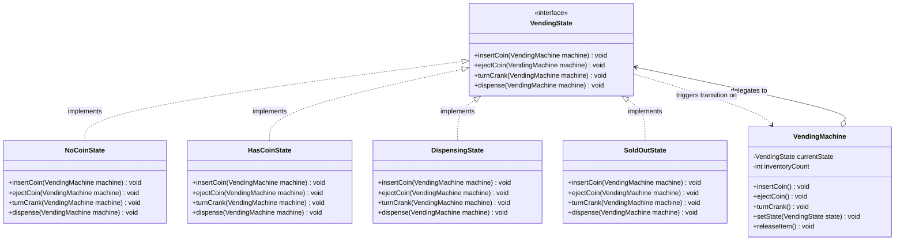
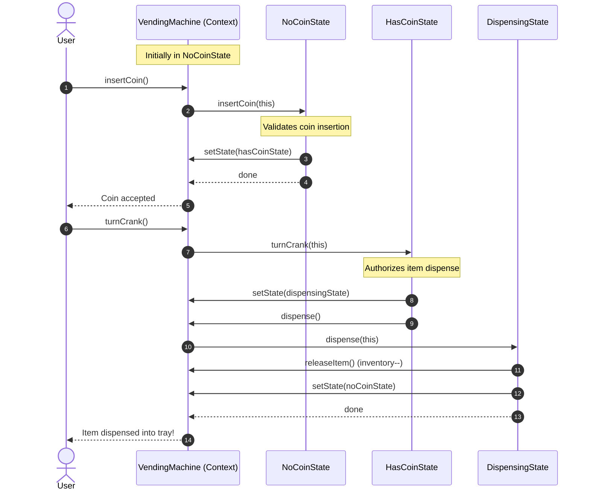

# State Design Pattern

The **State Pattern** is a behavioral design pattern from the Gang of Four (GoF). It allows an object to alter its behavior when its internal state changes. To outside observers, it appears as though the object changed its class.

In simple terms: **State encapsulates state-specific behaviors into separate classes, eliminating massive, error-prone `switch` or `if-else` state machines.**

---

## 1. What is the State Pattern and Why Do We Need It?

### The Core Idea
Many entities in software move through defined lifecycles:
- **A Vending Machine:** `NoMoneyState` $\rightarrow$ `HasMoneyState` $\rightarrow$ `DispensingState` $\rightarrow$ `SoldOutState`.
- **An E-Commerce Order:** `Created` $\rightarrow$ `Paid` $\rightarrow$ `Shipped` $\rightarrow$ `Delivered` $\rightarrow$ `Cancelled`.
- **A Media Player:** `Stopped` $\rightarrow$ `Playing` $\rightarrow$ `Paused`.
- **A Document:** `Draft` $\rightarrow$ `UnderReview` $\rightarrow$ `Published`.

In each state, the entity responds differently to identical events:
- Pressing the **Play button** while *Stopped* starts playback from the beginning.
- Pressing the **Play button** while *Playing* pauses playback.
- Pressing the **Play button** while *Locked* does nothing or beeps a warning.

### The Problem with Primitive State Flags
Without the State pattern, developers represent states using primitive enum flags and scatter conditional checks across every single method:

```java
public void pressPlay() {
    if (state == State.STOPPED) {
        startPlayback();
        state = State.PLAYING;
    } else if (state == State.PLAYING) {
        pausePlayback();
        state = State.PAUSED;
    } else if (state == State.LOCKED) {
        beepWarning();
    }
}

public void pressStop() {
    if (state == State.PLAYING) {
        haltPlayback();
        state = State.STOPPED;
    } else if (state == State.PAUSED) {
        rewindAndHalt();
        state = State.STOPPED;
    } else if (state == State.STOPPED) {
        // already stopped
    }
}
```

As the number of states and actions grows, this creates a **combinatorial nightmare**. If you have 6 states and 8 actions, you end up with 48 conditional branches scattered across one giant class. Adding a single new state (`BufferingState`) requires hunting down and modifying every single method, creating enormous regression risks.

### Why Do We Need the State Pattern?
The State pattern solves this by:
1. Defining a **State interface** declaring all possible actions (`insertMoney()`, `selectItem()`, `dispense()`).
2. Creating a dedicated class for every distinct state (`NoMoneyState`, `HasMoneyState`).
3. Letting the **Context** maintain a reference to its current state object and delegating actions to it.
4. Letting states trigger transitions to the next state by updating the Context's current state pointer.

---

## 2. Real-Life Analogy: The Smartphone Operating State

Consider your smartphone and how the physical **Power Button** behaves depending on the phone's internal state:

```
+-------------------------------------------------------------------------+
|                           Smartphone (Context)                          |
|  - Holds reference to: currentState                                     |
|  - Receives hardware event: pressPowerButton()                          |
+-------------------------------------------------------------------------+
                                     │
           ┌─────────────────────────┼─────────────────────────┐
           ▼                         ▼                         ▼
  +-----------------+       +-----------------+       +-----------------+
  |   ScreenOff     |       |    LockScreen   |       |  ActiveDesktop  |
  | - Power Button: |       | - Power Button: |       | - Power Button: |
  |   Turn on lock  |       |   Turn screen   |       |   Lock device & |
  |   screen backlight|     |   back off      |       |   turn off      |
  | - Next State:   |       | - Next State:   |       | - Next State:   |
  |   LockScreen    |       |   ScreenOff     |       |   ScreenOff     |
  +-----------------+       +-----------------+       +-----------------+
```

1. **When in `ScreenOffState`:** Pressing the power button turns on the display and transitions the phone to `LockScreenState`.
2. **When in `LockScreenState`:** Pressing the power button immediately turns the screen off, transitioning back to `ScreenOffState`. Swiping with a valid fingerprint transitions to `ActiveDesktopState`.
3. **When in `ActiveDesktopState`:** Pressing the power button locks the device, puts apps to sleep, and transitions to `ScreenOffState`. Long-pressing prompts for shutdown.

The phone's physical shell (the Context) does not rewrite its internal wiring; it simply **delegates handling of the event to its current state object**.

---

## 3. The Problem Without the Pattern

Look at a Vending Machine implemented with primitive enum conditionals:

```java
public class VendingMachine {
    public enum State { NO_COIN, HAS_COIN, DISPENSING, SOLD_OUT }
    private State state = State.NO_COIN;
    private int itemCount = 5;

    public void insertCoin() {
        if (state == State.NO_COIN) {
            System.out.println("Coin accepted.");
            state = State.HAS_COIN;
        } else if (state == State.HAS_COIN) {
            System.out.println("Coin already inserted! Ejecting coin.");
        } else if (state == State.DISPENSING) {
            System.out.println("Please wait, dispensing item.");
        } else if (state == State.SOLD_OUT) {
            System.out.println("Machine is sold out. Coin returned.");
        }
    }

    public void ejectCoin() {
        if (state == State.HAS_COIN) {
            System.out.println("Coin returned.");
            state = State.NO_COIN;
        } else if (state == State.NO_COIN) {
            System.out.println("No coin to return.");
        } else if (state == State.DISPENSING) {
            System.out.println("Cannot return coin while dispensing.");
        } else if (state == State.SOLD_OUT) {
            System.out.println("No coin inserted.");
        }
    }

    public void turnCrank() {
        if (state == State.HAS_COIN) {
            System.out.println("Crank turned.");
            state = State.DISPENSING;
            dispense();
        } else if (state == State.NO_COIN) {
            System.out.println("Please insert a coin first.");
        } else if (state == State.DISPENSING) {
            System.out.println("Already dispensing.");
        } else if (state == State.SOLD_OUT) {
            System.out.println("Machine is sold out.");
        }
    }

    private void dispense() {
        if (state == State.DISPENSING) {
            itemCount--;
            System.out.println("Item dispensed!");
            if (itemCount > 0) {
                state = State.NO_COIN;
            } else {
                state = State.SOLD_OUT;
            }
        }
    }
}
```

### Why This Design Fails
1. **Violation of the Open/Closed Principle (OCP):** If marketing wants a new `WinnerState` (where 1 in 10 customers wins a free bonus item), you must open `VendingMachine.java` and add a new `else-if` branch to *every single action method* (`insertCoin`, `ejectCoin`, `turnCrank`, `dispense`).
2. **Violation of the Single Responsibility Principle (SRP):** `VendingMachine` is responsible for hardware inventory *and* the nuanced transition logic for every single state.
3. **Fragile State Invariants:** It is very easy to forget to set `state = State.NO_COIN` in one branch, leaving the machine stuck in `DISPENSING` forever.
4. **Duplicate Transition Rules:** State logic is scattered across dozens of methods rather than co-located within a single cohesive state class.

---

## 4. How the State Pattern Solves the Problem Step by Step

```
Step 1: Declare the State Interface
        [ VendingState ]
        - insertCoin()
        - ejectCoin()
        - turnCrank()
        - dispense()

Step 2: Create Concrete State Classes
        [ NoCoinState ]    [ HasCoinState ]
        [ DispensingState ] [ SoldOutState ]

Step 3: Define the Context Class
        [ VendingMachine ]
        - maintains current VendingState reference
        - delegates actions: currentState.turnCrank()
        - provides package-private transition helper: setState(VendingState)

Step 4: Execute State Transitions Dynamically
        Inside HasCoinState.turnCrank():
        machine.setState(machine.getDispensingState());
```

### Step-by-Step Breakdown

1. **Step 1: Define Common State Interface (`VendingState`)**
   Declare methods for every action that changes behavior across states.
2. **Step 2: Extract State-Specific Logic into Classes**
   Each class (`NoCoinState`, `HasCoinState`) implements what should happen for each action *when in that specific state*. Invalid actions throw descriptive domain exceptions or log clear warning messages.
3. **Step 3: Wire Context to Current State**
   `VendingMachine` stores `private VendingState currentState`. When `insertCoin()` is called on the machine, it simply delegates: `currentState.insertCoin()`.
4. **Step 4: Transition to Next States**
   Either the State object calls `machine.setState(new NextState())`, or the Context evaluates state return values to perform transitions.

---

## 5. Class Diagram and Sequence Diagram

### Class Diagram: Vending Machine State Pattern



#### Explanation of Class Diagram
- **`VendingState`:** The common interface declaring all user actions.
- **`NoCoinState`, `HasCoinState`, `DispensingState`, `SoldOutState`:** Encapsulate behavior and transition rules for each specific state.
- **`VendingMachine` (Context):** Maintains inventory count and delegates user interactions to its `currentState`.
- **Bidirectional Relationship:** The Context delegates user calls to the State; the State calls back `machine.setState(...)` to drive transitions.

---

### Sequence Diagram: State Transition Flow



#### Explanation of Sequence Diagram
1. User inserts a coin. The `VendingMachine` delegates to `NoCoinState`.
2. `NoCoinState` verifies the coin and transitions `VendingMachine` to `HasCoinState`.
3. User turns the crank. `VendingMachine` delegates to `HasCoinState`.
4. `HasCoinState` initiates dispensing, transitions to `DispensingState`, and triggers `dispense()`.
5. `DispensingState` decrements inventory and resets the machine back to `NoCoinState`.

---

## 6. Participant Responsibilities

| Participant | Role | Primary Responsibility | Example in Our Code |
| :--- | :--- | :--- | :--- |
| **Context** | Lifecycle Host | Maintains the primary domain state (e.g. inventory, order items); holds a reference to `currentState`; delegates client requests to the state. | `VendingMachine`, `Order`, `MediaPlayer` |
| **State Interface** | Contract | Declares all actions that can be triggered on the Context across its lifecycle. | `VendingState`, `OrderState`, `PlayerState` |
| **Concrete State** | State Handler | Encapsulates behavior and transition rules for one specific lifecycle phase; rejects invalid actions gracefully. | `NoCoinState`, `PaidOrderState`, `PlayingState` |
| **Client** | Caller | Interacts exclusively with the Context API, unaware of internal state transitions. | End user, controller |

---

## 7. State vs Strategy: Key Differences

While both patterns rely on composition and have identical UML class diagrams, their **intent and dynamics** are fundamentally different:

| Dimension | State Pattern | Strategy Pattern |
| :--- | :--- | :--- |
| **Primary Intent** | Change an object's behavior as its **internal lifecycle state changes**. | Swap interchangeable **algorithms or mechanisms** independently. |
| **State Transitions** | **Dynamic and frequent:** Concrete states know about each other and actively trigger transitions to the next state. | **Static / Client-driven:** Strategies are typically unaware of other strategies and rarely trigger transitions. |
| **Client Awareness** | The client interacts with the Context and usually does **not** know what state the object is in. | The client **actively selects and injects** the specific strategy (e.g., CreditCard vs PayPal). |
| **Lifecycle** | Models temporal phases (`Draft` $\rightarrow$ `Reviewed` $\rightarrow$ `Published`). | Models alternative tools (`ZipCompression` vs `TarCompression`). |
| **Context Reference** | State usually holds a reference back to the Context to mutate its state. | Strategy typically receives data as arguments without holding Context pointers. |

---

## 8. Side-by-Side Comparison: Bad vs Good Design

| Dimension | Bad Design (Monolithic Enum Switch) | Good Design (State Pattern) |
| :--- | :--- | :--- |
| **Adding a State** | Must edit 10+ methods in the central class (violates OCP). | Add 1 new class implementing the State interface (satisfies OCP). |
| **Code Organization** | State logic for a single state is scattered across 15 different switch blocks. | All behavior for a given state is co-located in a single `.java` file (satisfies SRP). |
| **Handling Invalid Actions** | Messy nested conditionals checking whether action is allowed. | Clean polymorphism: the state immediately rejects or ignores invalid actions. |
| **Unit Testing** | Must construct a complex context and hit exact conditional branches. | Each state can be unit-tested in complete isolation with a mock Context. |
| **Maintainability** | Degrades exponentially as states and actions multiply. | Scales linearly: adding a state adds one isolated class. |

---

## 9. SOLID Principles Genuinely Demonstrated

### 1. Open/Closed Principle (OCP)
- Adding a new state (e.g., `RefundingState` or `WinnerState`) requires adding a new class. The core `VendingMachine` or `Order` context class remains **untouched**.

### 2. Single Responsibility Principle (SRP)
- The Context is responsible solely for hosting domain data.
- Each concrete state class is responsible solely for the rules and actions valid within its specific phase.

### 3. Dependency Inversion Principle (DIP)
- The Context depends strictly on the `State` abstraction, never on concrete states.

---

## 10. When to Use It and When NOT to Use It

### When to Use State
- **Object behavior depends heavily on its state:** Methods contain massive conditional statements (`if (state == ...)` or `switch (state)`).
- **Complex lifecycle workflows:** Objects pass through 4+ lifecycle stages with strict rules on legal state transitions.
- **Eliminating duplicate transition code:** Multiple methods repeat identical state check logic.

### When NOT to Use State
- **Only 2 simple states:** If an object is simply `Active` or `Inactive` with a couple of boolean checks, writing 5 classes is unwarranted over-engineering.
- **Stateless workflows:** If the object's behavior does not change over time, look at the Strategy pattern instead.
- **State transitions are purely external:** If states are simple database flags set by an external admin panel without distinct object behaviors, a standard enum field suffices.

---

## 11. Benefits, Limitations, and Trade-offs

### Benefits
1. **Co-located State Logic:** All behavior for a specific lifecycle phase is located in one clean file.
2. **Explicit State Transitions:** Transitions are first-class code operations rather than side-effects of flag assignments.
3. **Eliminates Giant Conditionals:** Eradicates error-prone `switch` ladders.
4. **Protects Domain Invariants:** Invalid transitions are rejected at compile time or cleanly via descriptive exceptions.

### Limitations & Trade-offs
1. **Class Proliferation:** A machine with 8 states requires at least 8 new classes.
2. **Coupling Between States:** Concrete states often need to know which state comes next, introducing coupling between state classes.

---

## 12. How to Recognize Incorrect Use of State

### Anti-Pattern 1: Context Still Checking States with `instanceof`
```java
// WRONG: Context checks current state type
if (currentState instanceof PaidState) {
    // do paid logic
}
```
*Why it fails:* Defeats polymorphism. The Context must call interface methods blindly.

### Anti-Pattern 2: State Holding Mutable Client Data
States should ideally be stateless and reusable, or dedicated to a single context instance. Never store global shared mutable state in state objects.

---

## 13. State vs Similar Patterns

| Dimension | State | Strategy | Command | Memento |
| :--- | :--- | :--- | :--- | :--- |
| **Intent** | Alter behavior when internal state changes. | Interchangeable algorithm variants. | Encapsulate an action/request as an object. | Snapshot internal state for undo/restore. |
| **Who initiates change?** | Internal lifecycle transitions. | Client explicitly configures strategy. | Invoker executes command. | Caretaker requests snapshot. |
| **Knowledge of others** | States know about succeeding states. | Strategies are completely independent. | Commands know Receiver. | Memento is opaque to outside. |

---

## 14. Real-World Interview Questions & Clear Answers

### Q1: Who should control state transitions: the Context or the Concrete States?
**Answer:** Both approaches are valid GoF variants:
- **States control transitions:** Best when transitions are dynamic and depend on the current state's internal logic. Concrete states call `context.setState(nextState)`.
- **Context controls transitions:** Best when transitions follow a fixed sequence (e.g. A $\rightarrow$ B $\rightarrow$ C) and you want to prevent concrete states from depending on each other.

### Q2: Can State objects be shared across multiple Contexts?
**Answer:** Yes, **if and only if** the State objects are completely **stateless** (they store no instance fields and receive all context data via method parameters). In such designs, state instances can be stored in static flyweights or singletons to reduce memory allocations.

### Q3: How do you handle invalid actions in a given state?
**Answer:** Two patterns:
1. **No-op / Silent ignore:** Used when an action is harmless (e.g., clicking Pause when already paused).
2. **Domain Exception:** Throw an `IllegalStateException` with a descriptive message (e.g., `"Cannot ship an order that has not been paid"`). This is preferred in transactional systems.

---

## 15. Final Revision Checklist

- [ ] **State Interface Defined:** Is there an interface declaring all actions that vary across lifecycle phases?
- [ ] **Context Delegation:** Does the Context delegate action calls to `currentState.action()`?
- [ ] **No `switch` on State Enums:** Are all monolithic state-checking switches removed?
- [ ] **Controlled Transitions:** Are state transitions explicitly defined and protected against illegal jumps?
- [ ] **Invalid Action Protection:** Does each state explicitly reject or ignore invalid operations?
- [ ] **Single Responsibility:** Is each state's logic co-located within its own class?
- [ ] **Unit Tests for Every State:** Are valid and invalid actions tested for every concrete state?
