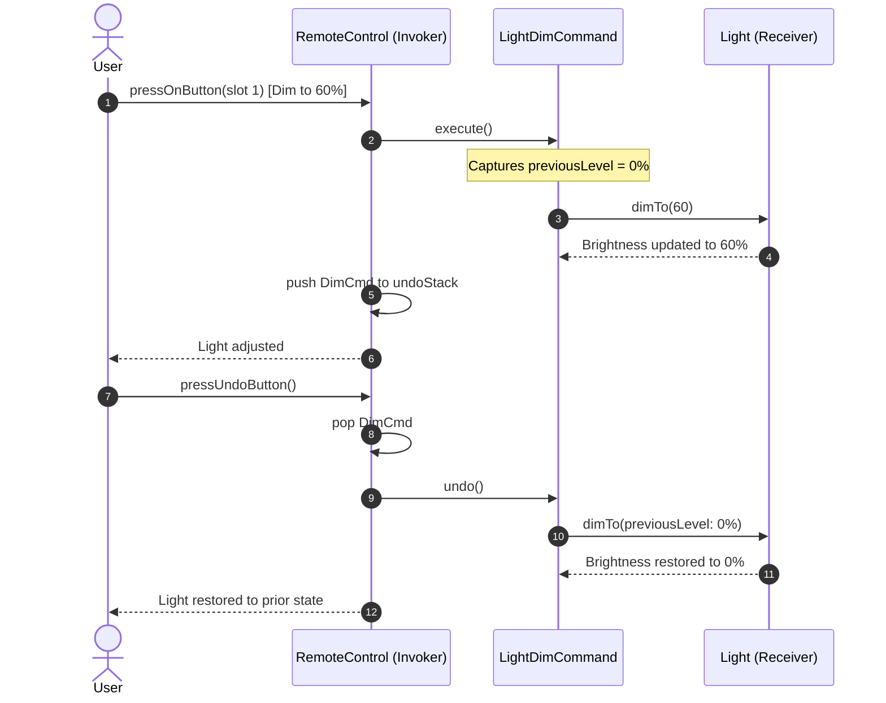

# Example 01: Universal Smart Home Remote Control

## 1. The Problem

A smart home automation vendor manufactures programmable multi-slot remote controls. The remote must control diverse household electronics:
- **Living room and kitchen lights:** Turning on, turning off, and dimming to custom brightness levels.
- **Stereo systems:** Powering on/off, adjusting volume.
- **Ceiling fans:** Cycling through speeds (`HIGH`, `MEDIUM`, `LOW`, `OFF`).
- **Macro actions:** A `"Party Mode"` or `"Good Night"` button that controls all devices simultaneously.
- **Undo capability:** Pressing the universal **Undo** button reverses the immediate prior action (restoring previous brightness or fan speed).

If the remote is hardwired directly to specific hardware classes using `if-else` branching on slot IDs, introducing a new device (e.g., motorized blinds) forces rewriting the remote controller.

---

## 2. Bad Design Analysis

In `bad/HardwiredRemote.java`, device instances are hardcoded as fields and operated through switch statements:

```java
public void pressButton(int slot, boolean on) {
    if (slot == 0) {
        if (on) livingRoomLight.turnOn();
        else livingRoomLight.turnOff();
    } else if (slot == 2) {
        if (on) { stereo.powerOn(); stereo.setVolume(11); }
        else stereo.powerOff();
    }
}
```

### Why This Design Fails
1. **Violation of the Open/Closed Principle (OCP):** Supporting a new device (e.g., smart fireplace) requires opening `HardwiredRemote.java` and adding another branch.
2. **Tight Coupling:** The remote has intimate, direct dependencies on `Light` and `Stereo`.
3. **No Undo/Redo:** Reverting fan speed or brightness requires complex, brittle state-tracking variables.
4. **No Macro Capabilities:** Combining multiple actions into one button press is impossible without writing custom monolithic methods.

---

## 3. Improved Design (Command Pattern)

The improved design in `good/` isolates actions into standalone `Command` objects:

```
[ RemoteControl (Invoker) ] ──> delegates to ──> [ Command (Interface) ]
                                                        ▲
         ┌───────────────────┬──────────────────────────┼─────────────────────────┬─────────────────────┐
         │                   │                          │                         │                     │
[ LightOnCommand ]   [ LightDimCommand ]     [ StereoOnCommand ]        [ CeilingFanHighCommand ] [ MacroCommand ]
         │                   │                          │                         │                     │
         ▼                   ▼                          ▼                         ▼                     ▼
      (Light)             (Light)                    (Stereo)                (CeilingFan)       (List<Command>)
```

### Participants
- **Command Interface (`Command`):** Declares `execute()` and `undo()`.
- **Concrete Commands:**
  - `LightOnCommand` / `LightOffCommand`
  - `LightDimCommand`: Saves `previousLevel` before dimming to support clean `undo()`.
  - `StereoOnWithCdCommand` / `StereoOffCommand`
  - `CeilingFanHighCommand` / `CeilingFanOffCommand`: Saves `previousSpeed` for undo.
  - `MacroCommand`: Holds a `List<Command>`; executes forward, undos in reverse!
  - `NoCommand`: Null object pattern to avoid null checks on unassigned slots.
- **Invoker (`RemoteControl`):** Holds array slots for On/Off commands and maintains an `undoStack`.

---

## 4. Execution Flow: Dimming and Undo



### Explanation of Sequence
1. User presses the Dim button. `RemoteControl` calls `execute()` on `LightDimCommand`.
2. The command captures the previous brightness before applying the new level.
3. The command is stored on the remote's `undoStack`.
4. When `pressUndoButton()` is invoked, the command restores the saved brightness level.

---

## 5. Relationship to SOLID Principles

- **Single Responsibility Principle (SRP):** `RemoteControl` is responsible solely for triggering actions and tracking history. Receivers perform hardware execution. Commands bind actions to receivers.
- **Open/Closed Principle (OCP):** New devices and commands (e.g. `SmartCurtainOpenCommand`) can be added without modifying the `RemoteControl`.
- **Dependency Inversion Principle (DIP):** The remote depends strictly on the `Command` abstraction.
