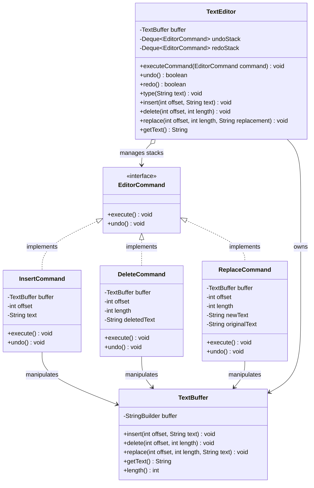

# Example 02: Text Editor with Reversible Undo / Redo

## 1. Problem Statement
Text editors and IDEs require multi-level undo and redo. Every keystroke, deletion, or format replacement modifies a document buffer. 

In a naive implementation:
- The editor snapshots the entire document string into a `List<String>` on every modification.
- If a document is 5 MB in size, performing 200 edits creates 200 full 5 MB copies (1 GB of RAM usage).
- Implementing "Redo" becomes complicated and memory-prohibitive.
- Buffer manipulation logic is tightly coupled to history tracking.

## 2. Bad Design vs Good Design

### Bad Design (Full String Snapshot)
```java
public class BadTextEditor {
    private String text = "";
    private List<String> history = new ArrayList<>();

    public void type(String newText) {
        history.add(text); // Full memory snapshot copy!
        text = text + newText;
    }
    public void undo() {
        if (!history.isEmpty()) text = history.remove(history.size() - 1);
    }
}
```
**Weaknesses:**
1. **O(N * M) Memory Complexity:** Copies entire buffer on every action.
2. **No Redo Support:** Redo requires managing a second full-snapshot list.
3. **Violates Single Responsibility Principle:** Buffer editing and history management are intertwined.

### Good Design (Command Pattern with Delta Inverses)
```java
public interface EditorCommand {
    void execute();
    void undo();
}

public class DeleteCommand implements EditorCommand {
    private final TextBuffer buffer;
    private final int offset;
    private final int length;
    private String deletedText; // Only saves the delta needed to reverse

    public void execute() {
        deletedText = buffer.getText().substring(offset, offset + length);
        buffer.delete(offset, length);
    }

    public void undo() {
        buffer.insert(offset, deletedText);
    }
}
```
**Benefits:**
1. **O(Delta) Memory:** Only the characters modified/inserted/deleted are held in the command object.
2. **Dual-Stack History:** `undoStack` and `redoStack` maintain command objects that seamlessly alternate states.
3. **Open for Extension:** Adding a `FormatBoldCommand` or `TransposeCommand` requires zero modifications to `TextEditor`.

## 3. Class Diagram


## 4. Execution Flow
```text
[User] -> TextEditor.type("Hello")
       -> new InsertCommand(buffer, 0, "Hello")
       -> InsertCommand.execute() -> buffer.insert(0, "Hello")
       -> undoStack.push(InsertCommand)
       -> redoStack.clear()

[User] -> TextEditor.undo()
       -> command = undoStack.pop()
       -> command.undo() -> buffer.delete(0, 5)
       -> redoStack.push(command)

[User] -> TextEditor.redo()
       -> command = redoStack.pop()
       -> command.execute() -> buffer.insert(0, "Hello")
       -> undoStack.push(command)
```

## 5. SOLID Principles Genuine Demonstration
- **Single Responsibility Principle (SRP):** `TextBuffer` manages low-level character storage; each `EditorCommand` is responsible for applying and inverting a specific mutation; `TextEditor` handles history orchestration.
- **Open/Closed Principle (OCP):** New operations (e.g. `UppercaseCommand`, `RegexReplaceCommand`) can be added without changing `TextEditor` or existing commands.
- **Liskov Substitution Principle (LSP):** Any `EditorCommand` implementation can be pushed and popped interchangeably on the undo/redo stacks.
