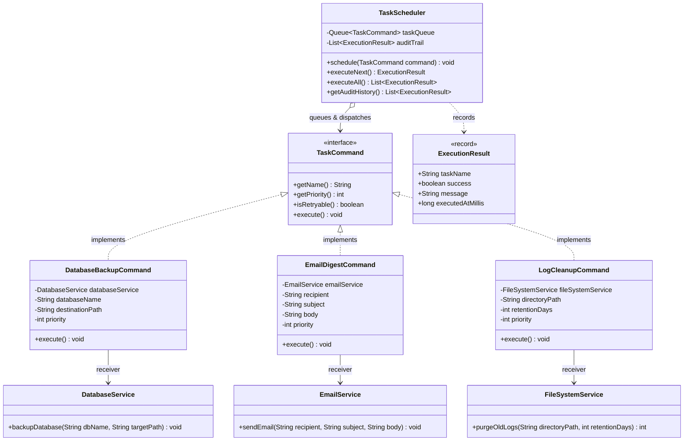

# Example 03: Task Scheduling and Priority Job Execution

## 1. Problem Statement
Backend distributed platforms must schedule periodic and event-driven background tasks:
- Database backups
- Daily email digests
- Automated log file cleanups
- Cache warming and metric aggregation

In naive implementations, a monolithic scheduler implements a giant `switch` statement over task enums. Parameters are packed into unstructured `Map<String, Object>` blobs, leading to runtime `ClassCastException` failures. Adding a new task type requires modifying the core scheduler engine, violating the Open/Closed Principle. Uniform features like priority queues, audit logging, and retry policies are painful to maintain.

## 2. Bad Design vs Good Design

### Bad Design (Monolithic Enum Switch)
```java
public class MonolithicTaskScheduler {
    public void runTask(TaskType type, Map<String, Object> params) {
        switch (type) {
            case DATABASE_BACKUP -> {
                String db = (String) params.get("dbName");
                // Direct implementation of backup logic...
            }
            case EMAIL_DIGEST -> {
                String email = (String) params.get("recipient");
                // Direct implementation of SMTP logic...
            }
        }
    }
}
```
**Weaknesses:**
1. **Tight Coupling:** The scheduler directly imports database, email, and filesystem dependencies.
2. **Untyped Parameter Passing:** `Map<String, Object>` forfeits compile-time type safety.
3. **No Prioritization or Queueing:** Hard to sort jobs by business importance or schedule them asynchronously.

### Good Design (Command Pattern)
```java
public interface TaskCommand extends Comparable<TaskCommand> {
    String getName();
    int getPriority();
    boolean isRetryable();
    void execute() throws Exception;
}

public class DatabaseBackupCommand implements TaskCommand {
    private final DatabaseService databaseService; // Receiver
    private final String databaseName;
    private final String destinationPath;
    private final int priority;

    public void execute() {
        databaseService.backupDatabase(databaseName, destinationPath);
    }
}
```
**Benefits:**
1. **Total Decoupling:** `TaskScheduler` acts strictly as an Invoker. It knows nothing about databases, files, or SMTP servers.
2. **Priority-Driven Scheduling:** `TaskScheduler` uses a `PriorityQueue<TaskCommand>` to execute high-value tasks first.
3. **Audit Logging & Retries:** Uniform status tracking (`ExecutionResult`) and transparent failure retry handling.

## 3. Class Diagram


## 4. Execution Flow
```text
[Client] ---> DatabaseBackupCommand (Priority: 10) ---> TaskScheduler.schedule(...)
[Client] ---> LogCleanupCommand (Priority: 2)     ---> TaskScheduler.schedule(...)
[Client] ---> EmailDigestCommand (Priority: 5)    ---> TaskScheduler.schedule(...)

PriorityQueue Order: [DatabaseBackup (10), EmailDigest (5), LogCleanup (2)]

TaskScheduler.executeAll()
  1. Polls DatabaseBackupCommand -> calls databaseService.backupDatabase(...) -> records ExecutionResult
  2. Polls EmailDigestCommand    -> calls emailService.sendEmail(...)       -> records ExecutionResult
  3. Polls LogCleanupCommand     -> calls fileSystemService.purgeOldLogs(...) -> records ExecutionResult
```

## 5. SOLID Principles Genuine Demonstration
- **Single Responsibility Principle (SRP):**
  - Receivers (`DatabaseService`, `EmailService`) handle domain work.
  - Concrete commands (`DatabaseBackupCommand`, `EmailDigestCommand`) encapsulate request parameters and binding.
  - `TaskScheduler` only manages queueing, ordering, dispatching, and audit recording.
- **Open/Closed Principle (OCP):**
  - Adding a new scheduled job (e.g. `CacheWarmingCommand`) requires zero changes to `TaskScheduler`.
- **Dependency Inversion Principle (DIP):**
  - `TaskScheduler` depends upon the high-level `TaskCommand` interface, never on low-level database or filesystem concrete classes.
