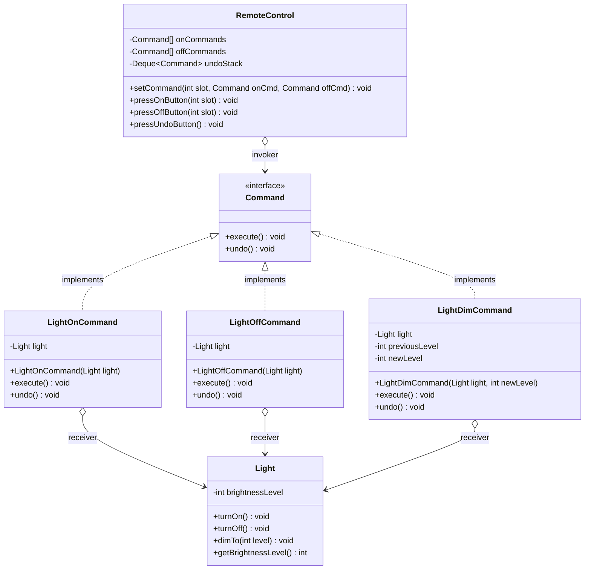
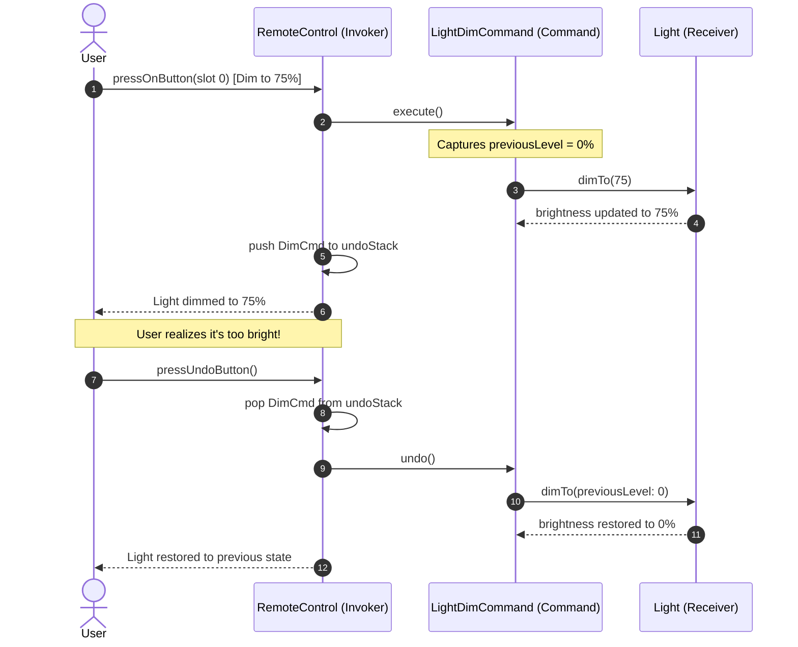

# Command Design Pattern

The **Command Pattern** is a behavioral design pattern from the Gang of Four (GoF). It encapsulates a request or action as an object, thereby letting you parameterize clients with different requests, queue or log requests, and support reversible (undo/redo) operations.

In simple terms: **Command turns an action into a standalone object with an `execute()` method and an optional `undo()` method.**

---

## 1. What is the Command Pattern and Why Do We Need It?

### The Core Idea
In standard procedural programming, when a user clicks a button or triggers an action, the UI element directly calls the business logic:
```java
// Tight coupling: Button knows about Light
class Button {
    private Light light = new Light();
    public void click() {
        light.turnOn();
    }
}
```
This direct connection causes severe architectural problems:
1. **Tight Coupling:** The UI component (`Button`, `MenuItem`, `ShortcutKey`) is hardwired to a specific receiver (`Light`, `Document`, `AudioTrack`).
2. **Cannot Reuse UI Elements:** You cannot use the same `Button` class for saving a file, sending an email, and turning on a light without adding messy conditional checks.
3. **No Support for Advanced Operations:** How do you implement **Undo/Redo**, **Macro recording**, **Task queuing**, or **Audit logging** if requests are executed immediately upon invocation?

### Why Do We Need the Command Pattern?
The Command pattern decouples the **Invoker** (the sender of a request, like a Remote Control or Button) from the **Receiver** (the object that knows how to perform the actual work, like a Light, Stereo, or Database):

1. The Invoker only knows the generic `Command` interface with an `execute()` method.
2. Concrete commands encapsulate the target Receiver and the parameters needed to run the operation.
3. The Invoker triggers `command.execute()` blindly, oblivious to the Receiver's concrete class.
4. Commands can retain previous state to implement `undo()`.

---

## 2. Real-Life Analogy: The Restaurant Waiter and Kitchen Order

Think about ordering food at a full-service restaurant:

```
+-------------------------------------------------------------------------------+
|                                Customer (Client)                              |
|  - Decides what to eat                                                        |
|  - Creates an order: "Steak Medium-Rare" + "Caesar Salad"                    |
+-------------------------------------------------------------------------------+
                                        │
                                        ▼ hands order to
+-------------------------------------------------------------------------------+
|                                Waiter (Invoker)                               |
|  - Takes the order slip (OrderCommand)                                        |
|  - Does NOT cook the steak                                                    |
|  - Places the order into the kitchen order carousel queue                     |
+-------------------------------------------------------------------------------+
                                        │
                                        ▼ carousel queue triggers
+-------------------------------------------------------------------------------+
|                            Order Slip (Command Object)                        |
|  - Encapsulates: Receiver (Chef), Action (cookSteak), Parameters (Medium-Rare)|
|  - Method: execute() -> calls chef.prepareSteak(Medium-Rare)                  |
+-------------------------------------------------------------------------------+
                                        │
                                        ▼ executes on
+-------------------------------------------------------------------------------+
|                               Chef (Receiver)                                 |
|  - Actually fires up the grill, seasons the steak, and prepares the meal      |
+-------------------------------------------------------------------------------+
```

1. **The Customer (Client):** Specifies what dishes should be prepared.
2. **The Waiter (Invoker):** Accepts the order slip and pins it to the kitchen order carousel. The waiter does not need to know recipes or how to operate the stove.
3. **The Order Slip (Command):** An encapsulated object that captures all the details needed to prepare the meal. It can be queued, delayed, transferred to another chef, or cancelled before cooking begins.
4. **The Chef (Receiver):** Possesses the actual cooking skills to prepare the food.

---

## 3. The Problem Without the Pattern

Look at a Smart Home remote control implemented without the Command pattern:

```java
public class HardwiredRemoteControl {
    private LivingRoomLight livingRoomLight;
    private KitchenLight kitchenLight;
    private Stereo stereo;
    private GarageDoor garageDoor;

    public void pressButton(int slot, String action) {
        if (slot == 1) {
            if (action.equals("ON")) livingRoomLight.turnOn();
            else livingRoomLight.turnOff();
        } else if (slot == 2) {
            if (action.equals("ON")) kitchenLight.dimTo(50);
            else kitchenLight.turnOff();
        } else if (slot == 3) {
            if (action.equals("ON")) {
                stereo.powerOn();
                stereo.setVolume(15);
                stereo.setCdTrack(1);
            } else {
                stereo.powerOff();
            }
        } else if (slot == 4) {
            if (action.equals("UP")) garageDoor.openDoor();
            else garageDoor.closeDoor();
        }
    }
}
```

### Why This Design Fails
1. **Violation of the Open/Closed Principle (OCP):** Adding a smart Air Conditioner requires modifying `HardwiredRemoteControl` and adding more slot conditionals.
2. **Violation of the Single Responsibility Principle (SRP):** The remote control is burdened with the intimate API knowledge of lights, volume knobs, CD tracks, and garage motors.
3. **No Undo/Redo Support:** Reversing the last button press requires maintaining complex historical records of every device's previous state.
4. **Zero Macro Capability:** You cannot create a `"Good Night"` button that turns off all lights, locks doors, and powers down the stereo in sequence.

---

## 4. How the Command Pattern Solves the Problem Step by Step

```
Step 1: Declare the Command Interface
        [ Command ]
        - void execute()
        - void undo()

Step 2: Create Concrete Commands Wrapping Receivers
        [ LightOnCommand ]   ──> calls ──> light.turnOn()
        [ LightOffCommand ]  ──> calls ──> light.turnOff()
        [ StereoOnCommand ]  ──> calls ──> stereo.powerOn(); stereo.setVolume(12)

Step 3: Define the Invoker Class
        [ RemoteControl ]
        - stores Command references per button slot: setCommand(int slot, Command onCmd, Command offCmd)
        - stores history stack for undo: Stack<Command> history
        - invokes: onCommands[slot].execute(); history.push(onCommands[slot]);

Step 4: Support Macro Commands
        [ MacroCommand ]
        - holds List<Command>
        - execute() calls command.execute() on all children
```

### Step-by-Step Breakdown

1. **Step 1: Define the Contract (`Command`)**
   Declare `void execute()` and `void undo()`.
2. **Step 2: Create Concrete Commands**
   Each command takes the target Receiver (e.g., `Light`) in its constructor. Inside `execute()`, it calls the receiver's specific methods. Inside `undo()`, it reverses the action.
3. **Step 3: Program the Invoker (`RemoteControl`)**
   The remote stores generic `Command` slots. Pressing button `slot` simply triggers `command.execute()`.
4. **Step 4: Maintain History for Undo**
   Whenever a command executes, the invoker pushes it onto an undo stack. Pressing the "Undo" button pops the last command and calls its `undo()`.

---

## 5. Class Diagram and Sequence Diagram

### Class Diagram: Remote Control Command Architecture



#### Explanation of Class Diagram
- **`Command`:** Common interface declaring `execute()` and `undo()`.
- **`LightOnCommand`, `LightOffCommand`, `LightDimCommand`:** Concrete command classes holding references to the `Light` receiver.
- **`Light` (Receiver):** The actual hardware device containing the physics/logic of illumination.
- **`RemoteControl` (Invoker):** Holds arrays of `Command` objects and an undo stack. It has zero dependencies on `Light`.

---

### Sequence Diagram: Execution and Undo Flow



#### Explanation of Sequence Diagram
1. User presses button 0 on the remote.
2. The `RemoteControl` calls `execute()` on `LightDimCommand`.
3. `LightDimCommand` saves the current brightness (0%) before calling `light.dimTo(75)`.
4. The remote stores `LightDimCommand` on its undo stack.
5. User presses "Undo". The remote pops `LightDimCommand` and invokes its `undo()` method.
6. The command restores the light to 0% using the saved previous state.

---

## 6. Participant Responsibilities

| Participant | Role | Primary Responsibility | Example in Our Code |
| :--- | :--- | :--- | :--- |
| **Command Interface** | Abstraction | Declares execution and undo contracts. | `Command` |
| **Concrete Command** | Encapsulated Request | Binds a Receiver to an action; passes parameters; stores state for `undo()`. | `LightOnCommand`, `InsertTextCommand` |
| **Receiver** | Worker | Knows how to perform the actual business/hardware work. | `Light`, `DocumentBuffer`, `ScheduledTask` |
| **Invoker** | Trigger | Holds commands; triggers `execute()`; tracks undo/redo history; manages queues. | `RemoteControl`, `TextEditor`, `TaskScheduler` |
| **Client** | Assembler | Instantiates the Receiver, creates the Command, and registers it with the Invoker. | Main application, UI controller |

---

## 7. Command vs Strategy: Key Differences

Developers often confuse Command and Strategy because both use composition with a single abstract method:

| Dimension | Command Pattern | Strategy Pattern |
| :--- | :--- | :--- |
| **Primary Intent** | Encapsulate **what action to perform** (a request/operation) as a standalone object. | Encapsulate **how an algorithm is executed** (interchangeable algorithm implementations). |
| **Who Owns the Data?** | The command encapsulates its own receiver and arguments. | The context passes data into the strategy method. |
| **Reversibility** | Frequently supports `undo()` and `redo()`. | Rarely supports undo; simply returns a calculation or result. |
| **Lifecycle** | Can be saved, scheduled, queued, serialized, or replayed. | Usually executed immediately when invoked by the context. |
| **Analogy** | A restaurant order slip submitted to the kitchen. | Choosing between taking the train vs driving a car. |

---

## 8. Side-by-Side Comparison: Bad vs Good Design

| Dimension | Bad Design (Direct Method Calls) | Good Design (Command Pattern) |
| :--- | :--- | :--- |
| **Coupling** | High: Invoker directly references concrete receiver classes. | Low: Invoker depends exclusively on `Command` interface. |
| **Extensibility** | Adding new actions requires modifying the invoker code. | Add a new `Command` class without touching the invoker. |
| **Undo/Redo** | Nearly impossible without messy state snapshots in the UI. | Natural: each command captures before-state and implements `undo()`. |
| **Reusability** | A button can only trigger one hardcoded action. | The same Button or Shortcut class can hold any command. |
| **Batching & Queuing** | Cannot easily queue or schedule operations for later execution. | Trivial: store commands in a `Queue<Command>` and execute sequentially. |

---

## 9. SOLID Principles Genuinely Demonstrated

### 1. Single Responsibility Principle (SRP)
- The **Invoker** is responsible solely for triggering actions and tracking history.
- The **Receiver** is responsible solely for domain logic.
- Each **Command** is responsible solely for linking an action to its receiver and storing undo state.

### 2. Open/Closed Principle (OCP)
- Introducing a new action (e.g., `CeilingFanLowSpeedCommand`) requires writing one new class. Neither the remote control nor existing commands are modified.

### 3. Dependency Inversion Principle (DIP)
- The Invoker depends strictly on the `Command` abstraction, never on concrete devices like `LivingRoomLight` or `SmartGarage`.

---

## 10. When to Use It and When NOT to Use It

### When to Use Command
- **Parameterize UI components with actions:** You want buttons, menu items, or keyboard shortcuts to trigger arbitrary business operations.
- **Support Undo and Redo:** You are building an editor, canvas, or transactional system requiring multi-level undo/redo stacks.
- **Task Scheduling and Queuing:** You need to queue operations, run tasks asynchronously on background worker threads, or retry failed operations.
- **Macro Commands / Batch Operations:** You need to bundle multiple actions into a composite sequence (e.g., `"Movie Night"` macro).

### When NOT to Use Command
- **Simple direct operations with no undo or queuing:** If a button simply opens a modal or navigates to a URL with zero undo requirement, a direct lambda or method call is cleaner.
- **Overkill for CRUD service calls:** If your service layer directly performs synchronous database updates without needing undo or queuing, wrapping every method call in a Command class adds needless boilerplate.

---

## 11. Benefits, Limitations, and Trade-offs

### Benefits
1. **Decoupled Architecture:** Completely separates the sender of a request from the receiver.
2. **First-Class Undo/Redo:** Natural fit for reversible applications.
3. **Queueing and Serialization:** Commands can be persisted to disk, sent over network sockets, and replayed.
4. **Composite Macros:** Easily combine multiple commands using the Composite pattern.

### Limitations & Trade-offs
1. **Proliferation of Classes:** Every action requires a new Command class (`CopyCommand`, `PasteCommand`, `DeleteCommand`).
2. **Memory Footprint:** Long undo history stacks retaining deep object states can consume significant memory if not capped.

---

## 12. How to Recognize Incorrect Use of Command

### Anti-Pattern 1: Fat Commands Containing Business Logic
```java
// WRONG: Command implements complex business calculations
public class TransferMoneyCommand implements Command {
    public void execute() {
        // 200 lines of tax calculations, fraud checks, and SQL updates!
    }
}
```
*Why it fails:* Commands should only **delegate** to Receivers (e.g., `accountService.transfer(...)`). They should not become god-objects containing business rules.

### Anti-Pattern 2: Irreversible Commands in an Undo Stack
Pushing commands onto an undo stack when their `undo()` method simply throws `UnsupportedOperationException`. If an action cannot be undone, the undo stack must either be cleared or the command excluded from the stack.

---

## 13. Command vs Similar Patterns

| Dimension | Command | Strategy | Memento | Chain of Responsibility |
| :--- | :--- | :--- | :--- | :--- |
| **Intent** | Encapsulate an operation/request. | Interchangeable algorithm variants. | Snapshot internal state for restore. | Pass request along a chain of handlers. |
| **Undo Support** | Natural through `undo()` method. | Rarely supports undo. | Core mechanism for undo. | Does not support undo. |
| **Receiver** | Explicitly calls receiver methods. | Context passes arguments to strategy. | Caretaker stores memento opaquely. | Handler either processes or forwards. |

---

## 14. Real-World Interview Questions & Clear Answers

### Q1: How do you implement multi-level Undo and Redo?
**Answer:** Maintain two stacks inside the invoker:
- **`undoStack`:** Every time a command is executed, push it onto `undoStack`, and clear `redoStack`.
- When the user presses **Undo**: pop the command from `undoStack`, call `command.undo()`, and push it onto `redoStack`.
- When the user presses **Redo**: pop the command from `redoStack`, call `command.execute()`, and push it back onto `undoStack`.

### Q2: What is the "Null Object" pattern's role in the Command pattern?
**Answer:** A `NoCommand` (Null Object) class implementing `Command` with empty `execute()` and `undo()` methods is used to initialize all unassigned remote control slots. This eliminates tedious `if (command != null)` checks across the entire Invoker.

### Q3: How do modern Java lambdas influence the Command pattern?
**Answer:** Because `Command` is a `@FunctionalInterface` (when undo is not required), simple one-way commands can be passed as lambdas (e.g., `remote.setCommand(0, light::turnOn)`) without creating dedicated `.java` files for every tiny action.

---

## 15. Final Revision Checklist

- [ ] **Command Interface Defined:** Does the interface declare `execute()` and optional `undo()`?
- [ ] **Receiver Decoupled:** Does the Invoker have zero direct references to Receiver concrete classes?
- [ ] **Minimal Command Logic:** Do commands delegate actual work to Receivers rather than implementing business logic?
- [ ] **Undo State Captured:** Does the command capture before-state (parameters, previous values) *before* mutating the receiver?
- [ ] **Null Object Protection:** Are unassigned command slots initialized to a `NoCommand` null object?
- [ ] **Undo Stack Management:** Is the undo history capped to a reasonable size to prevent memory leaks?
- [ ] **Macro Support:** Can composite commands bundle multiple operations cleanly?
